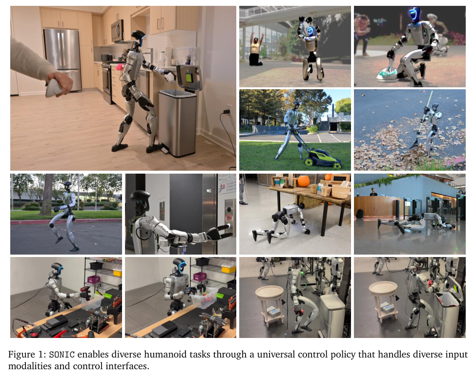
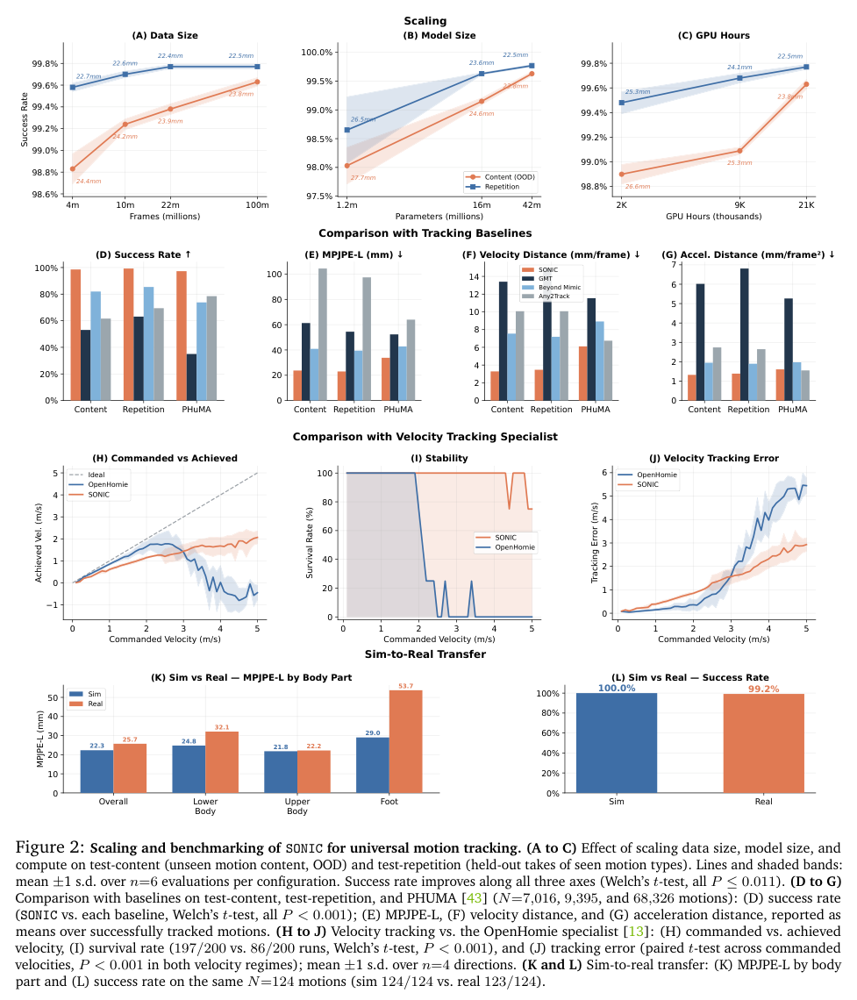

# 专访罗正宜：关于SONIC全身控制框架的访谈

2026-04-16 · NVIDIA GEAR Lab · SONIC (Science Robotics) · 有来源缺口

[本地原件归档](../../../raw/78635547d80283dd65b7330031ae1e0473bddd3885101ebf5b26a24cb5bc858e) · 固定材料版本 `digest-material-78635547d80283dd65b7330031ae1e0473bddd3885101ebf5b26a24cb5bc858e@1` · [一手原站](https://arxiv.org/abs/2511.07820)

## 深度拆解与复核

- ==核心结论==：工作台已在 [Zhengyi Luo (罗正宜) — 2025–2026 研究人物档案](Zhengyi%20Luo%20%28%E7%BD%97%E6%AD%A3%E5%AE%9C%29%20%E2%80%94%202025%E2%80%932026%20Humanoid%20%26%20Embodied%20AI%20Research%20Profile.md) 收录了 [罗正宜](../entities/people/%E7%BD%97%E6%AD%A3%E5%AE%9C.md) 的多论文完整谱系；本篇 2026 年 4 月 16 日一手专访（围绕 [NVIDIA GEAR Lab](../entities/labs/NVIDIA%20GEAR%20Lab.md) 发表在 Science Robotics 的 SONIC：arXiv:2511.07820）的核心增量在于揭开了三个论文正文未明言的工程决策：700 小时核心动捕底座直接复用了英伟达早期数字人与游戏资产（后开源部分子集 288 小时 BONES-SEED）；SONIC 放弃在线神经网络 Retargeting、改为“离线高精度数据重定向 + 潜空间端到端 RL 映射”，根因是线上跨系统延迟冲突与滑窗抖动无法消除；以及通用基础模型（SONIC）与特化极限跑酷（Perceptive Humanoid Parkour）在多模态接入接口上正面临根本性的架构互斥。

#### 一、业务切口与核心机制

[罗正宜](../entities/people/%E7%BD%97%E6%AD%A3%E5%AE%9C.md) 在卡耐基梅隆大学（CMU，导师 Kris Kitani；亦与 Jason Peng、Kostas Daniilidis 及宾大团队有长期脉络交集）完成 PHC（仅约 40 小时学术 AMASS 数据底座）后，与 [Jim Fan](../entities/people/Jim%20Fan.md)、[Yuke Zhu](../entities/people/Yuke%20Zhu.md) 等人主导了基于 700 小时工业级动捕、42M 参数量及最高 128 GPU × 7 天（约 21k GPU 小时）训练的 SONIC 通用全身控制模型，本次访谈（对应 Human Data 系列 EP02 之后的一线研究者深谈）揭示了架构取舍的底层逻辑：

1. 为什么 40 小时不够、而数字人 700 小时恰好破局（Data Retargeting vs Neural Retargeting）：访谈确认，SONIC 并未从零花数百万自建动作棚，而是整合了英伟达内部积累多年用于游戏/数字人的高精度光学 MoCap 库（约 700 小时，后通过合作方 Bones Studio 开源了 BONES-SEED 288 小时、142,220 条动作、522 名演员子集）。将其经 GMR 与 PyRoki 离线重定向至 29 自由度 Unitree G1 并清洗筛选留存 611 小时（317,189 个片段、超 1 亿帧 @ 50 Hz，覆盖 33 个大类、8,447 个子类）后，关键转向在于淘汰实时神经网络在线重定向：神经网络在推理时的历史窗口边界效应与“离线平滑延迟 vs 在线实时响应”矛盾会直接放大机器人关节的物理噪声。因此 SONIC 架构内设三路编码器（机器人自身、人体 SMPL 与稀疏 3 点 VR 接口），经由 FSQ 离散量化器（FSQ-32-32，2 个 token 构成 64 维通用运动语汇）映射到同一个 Control Decoder，靠跨模态一致性损失将跨编码器潜空间 L2 误差压降近 8 倍（4.23 降至 0.57），实现 5 分钟佩戴 PICO VR 即可实时驱动真机，同时避开 CGI 动画可容忍但实机金属框架会发声震颤的微观高频抖动。

2. VLA-Controller 解耦与端侧多线程工程：上层语义层（如 GR00T N1.5）不再直接吃力预测底层关节角或不稳定 SMPL，而是输出 SONIC 的紧凑 FSQ 潜空间运动指令与 3 点轨迹（Table 1 显示直接预测 SMPL 5 任务平均仅 27%，改预测 FSQ token 跃升至 68%，整合多视角后 5 任务均值达 75%，其中易拉罐扔垃圾桶一项由 0% 飙升至 60%）。实机部署将 Jetson Orin 上策略推理压在 1–2 ms，运动学规划器约 12 ms（笔记本 <5 ms），拆成 500 Hz 指令写入、100 Hz 状态输入、50 Hz 策略控制与 10 Hz 规划器（160 ms 渐变混合 cross-fade）四条独立并发环路。

3. 未来演进路线：从文本/音乐/视频驱动的 GEM 管线到 Interactive World（交互式世界模型，如同期 ReSpark、ReLoo 工作脉络），团队正试图用生成式人体动作扩展居家搬运、俯身捡物、折叠布料与单腿踩踏脚踏式垃圾桶等过去数字人资产中缺失的“枯燥日常动作”，同时明确认为不同构型（轮式双臂 vs 双足人形）可在上肢操作上共享如 EgoScale 类的 2 万小时数据，但强行训练跨本体单一策略会因网络容量稀释导致性能明显劣于单本体专训模型。

#### 二、核心数据核查、口径纠偏与工程边界

场景与利益披露：受访者系论文第一作者及 NVIDIA GEAR Lab 核心成员；访谈发生于 2026-04-16（即 4 月开源推理/部署代码包前后），涉及开源范围划分（放部署推理+PICO VR 栈、保留核心训练脚本与内部全量 700 小时资产）带有清晰的商业科研护城河考量。

| 核查维度 | 访谈要点与研究定位 | 论文实证拆解（arXiv:2511.07820v4 / Science Robotics） | 本工作台核查判定 |
| --- | --- | --- | --- |
| 规模缩放（40h 到 700h，1.2M 到 42M） | 数据规模跨越量级后产生泛化涌现，小模型装不下复杂先验 | 模型扩至 42M（OOD 测试集准确率 98.0%→99.6%，MPJPE-L 27.7 mm→23.8 mm；复现集 99.8% / 22.5 mm）；MuJoCo 对比测试集/复现集/PHUMA（68,326 条动作）追踪成功率达 98.5% / 99.2% / 97.2%，MPJPE-L 23.7 mm 较 BeyondMimic（40.9 mm，成功率 82.0%/85.4%/73.8%）降低 42%，远超 Any2Track（61.6%/69.4%/78.5%） | ✅ 多基准横向可比实证充分（FSQ 亦以 26.6 mm 显著胜出 VQ-VAE 的 35.3 mm 误差 8.7 mm；24.4 mm→22.4 mm 消融单调性一致） |
| 速度专精与真机抗扰表 | 真机极少跌倒，能流畅跑跳并与 VLA 联调 | 速度追踪测试 SONIC 生存率 98.5%（197/200）碾压 OpenHomie 43.0%（86/200，后者扩至 32 GPU 甚至由 95.0% 退化至 91.2%）；Unitree G1 真机 124 条高难度动作实测通过率 99.2%（123/124，仿真 100.0%），整体 MPJPE-L 25.7 mm（仿真 22.3 mm），上肢 22.2 mm vs 21.8 mm，足部误差放宽至 53.7 mm vs 29.0 mm；可硬抗高空坠落 11 kg 重物冲击与 8 Nm 等效扰动；VLA 五任务苹果入盘 90%、刮擦 95%、切菜 75%、脚踩开盖 70%、投罐 60% | ✅ 真机统计维度严谨（且足部 53.7 mm vs 仿真 29.0 mm 暴露了真机足底接触漂移的诚实衰减） |
| 能力盲区：楼梯、滑板与跑酷 | 访谈坦承 SONIC 无法直接上楼梯、玩滑板或跑酷 | 论文系统与访谈均确认：700h 底座缺纯平地以外三维地形交互数据，SONIC 纯依赖本体感知且接口面向语言/VR 速度指令；一旦如 Perceptive Humanoid Parkour 引入深度/点云视觉以适应复杂攀爬，该视觉条件会与通用自然动作追踪（VLA-Controller）的极简输入范式产生接口冲突 | ✅ 诚实披露架构撕裂（通用平地稳控模型与环境感知特化跑酷模型尚未合流） |
| 开源真实完整性 | 已开放 SONIC 完整框架与 PICO VR 接入体验 | 2026-04 公开 GitHub 仓库（NVlabs/GR00T-WholeBodyControl）实际只含推理引擎、1–2 ms TensorRT 部署与 PICO VR 遥操栈，训练源码与全量 700h 闭源；后由合作伙伴借 BONES-SEED 放出 288h 子集（且官方于 2026 年在 Science Robotics Vol.11 Issue 117 正式刊出，DOI 10.1126/scirobotics.aed4592） | ⚠️ 开源属于“部署开源 + 训练基础设施闭源”，复现完整预训练底座仍依赖企业算力与商业动捕 |

#### 三、赛道横向对比与定位

在人形全身控制赛道的“工业轻量化稳态派”与“重参数异构大底座派”之间，SONIC（与同为 2025–2026 主线的 GAE、GMT、Figure/Tesla/Booster 等路线）构成了最清晰的工程参数对照组：

| 控制底座 | 数据底座与参数体量 | 编码器与部署架构 | 实机实测与延迟指标 | 相对竞争优劣势 |
| --- | --- | --- | --- | --- |
| [专访罗正宜：关于SONIC全身控制框架的访谈](%E4%B8%93%E8%AE%BF%E7%BD%97%E6%AD%A3%E5%AE%9C%EF%BC%9A%E5%85%B3%E4%BA%8ESONIC%E5%85%A8%E8%BA%AB%E6%8E%A7%E5%88%B6%E6%A1%86%E6%9E%B6%E7%9A%84%E8%AE%BF%E8%B0%88.md) | 700h 数字人光学动捕清洗为 611h；42M 参数 MLP（21k GPUh） | 3 编码器对齐 FSQ-32-32（64 维）+ 50 Hz 控制 / 10 Hz 规划 | 真机 124 片段 99.2% 成功率；Jetson 策略 1–2 ms / 规划 12 ms | 极致的端侧计算效率与多端 VLA/VR 兼容性；缺盲区外置地形感知与日常精细杂活数据 |
| [Human Data EP06—Mocap+Video：GAE](Human%20Data%20EP06%E2%80%94Mocap%2BVideo%EF%BC%9AGAE.md) | 宣称 >10,000h 混合动捕/视频；852M 参数 MoE Transformer | 两阶段 Generator–Executor + RoPE 最高 100 ms 前瞻 | 仿真 Hard 集 93.9%（对比 SONIC 开源权重的 77.7%，但评价阈值更宽） | 在超长延迟容错和高难连续翻爬追踪表现突出；参数大 20 倍且未公开机载端测速 |
| [Human Data EP04—Video：VideoMimic](Human%20Data%20EP04%E2%80%94Video%EF%BC%9AVideoMimic.md) | 123 段自拍 RGB 视频 + 10 段 LaFAN | MonST3R + 4 阶段 PPO + 11×11 高度图 | 依托 Fast-lio2 实现上下楼梯与坐站迁移，无百次定量成功率表 | 具备 SONIC 所欠缺的三维地形上下文感知，但真机步态高频抖动严重 |
| [Weave](Weave_%20Learning%20Whole-Body%20Dexterous%20Loco-Manipulation%20from%20Human-Object%20Interactions%20%28arXiv_2609.16683%29.md) | 人机物体交互（HOI）专项数据 | 全身移动抓取 + 灵巧操作一体化策略 | 强化近身交互力控与物体协同 | 补齐了纯数字人动捕库中缺乏真实重物推拉、弯腰搬运接触反馈的盲区 |

### 观点与可反驳条件

- ==观点==：SONIC 用 42M 参数 MLP 证明了在人形全身下肢稳态与常用上半身协调空间内，瓶颈并不在网络规模，而在高清洁度动捕清洗（611 小时）、离线数据重定向与 FSQ 紧凑潜空间对 VLA 动作空间的离散压缩与接口解耦；但“仅靠平地动作资产即可一统通用移动操作”的窗口正在关闭，下一代基础模型必须解决外置视觉地形（如爬梯、绕障、地面滑移材质）与通用 VLA 语言/VR 控制接口之间的兼容矛盾。
- ==推翻条件==：
  1. ① 若 NVIDIA GEAR Lab 或同行在不放弃既有 1–2 ms 机载速度与 FSQ 接口的前提下，于同一套单一 42M–100M 级控制器内接入深度/激光局部感知后，在真机复杂楼梯+杂物地面上同时维持 >= 98% 平地运动追踪率与 >= 95% 的 VLA 桌面抓取均值（苹果/罐子等操作任务不跌反升），则“通用稳定器与感知跑酷特化框架存在接口互斥”的判断被推翻。
  2. ② 若更大规模纯单目视频+可微物理微调（类似 [SuperMimic](SuperMimic%EF%BC%88BAIR%20_%20CoRL%202026%20%E6%9C%80%E4%BD%B3%E8%AE%BA%E6%96%87%EF%BC%89%EF%BC%9A%E5%8D%95%E4%B8%AA%E5%8F%AF%E5%BE%AE%E4%B8%96%E7%95%8C%E6%A8%A1%E5%9E%8B%E5%B0%86%E4%BA%BA%E5%BD%A2%E5%85%A8%E8%BA%AB%E6%8E%A7%E5%88%B6%E7%AE%97%E5%8A%9B%E9%99%8D%E4%BD%8E%E8%B6%85%201%2C000%20%E5%80%8D.md) 路线）能在 1 年内不借助数字人商业光学动捕库（0 小时内部 700h 商业资产）、在 Unitree G1 等量产机上实现同等 25 mm 级真机跟踪精度和 99%+ 完成率，则高成本光学动捕资产作为底层基石的议价权将大幅缩水。

---

## 原文摘录与一手信源存证

> 人形机器人通用控制器系列，我们在专访Xue Bin(Jason) Peng：探索人形机器人全身运控的通用控制器，专访罗正宜：解密PHC——人形机器人通用控制器，以及2025年的Human Data系列总结篇：Human Data— The “Key” to Robot Data的一系列采访都有涉及。这期文章，我再次邀请到了罗正宜博士，来聊一聊在人形机器人全身运控领域家喻户晓的工作SONIC。
> — 原文摘录，PDF p.1；证据 `digest-material-78635547d80283dd65b7330031ae1e0473bddd3885101ebf5b26a24cb5bc858e-excerpt-1@1`

> 罗正宜（Zhengyi Luo）是英伟达GEAR实验室的一名研究科学家，博士毕业于CMU，他的导师是 Kris Kitani 教授。在此之前，他于2019年在宾夕法尼亚大学获得了本科学位，并曾在 Kostas Daniilidis 教授的指导下开展研究工作。罗正宜博士的的研究兴趣主要集中在视觉、学习与机器人技术的交叉领域。主要研究方向包括人体姿态估计、人-物交互建模、人类运动建模等。
> — 原文摘录，PDF p.1；证据 `digest-material-78635547d80283dd65b7330031ae1e0473bddd3885101ebf5b26a24cb5bc858e-excerpt-2@1`

> 这期节目的博客可以点击下方链接进入小宇宙，或者苹果podcast搜索“ReSpark”栏目来收听。
> — 原文摘录，PDF p.1；证据 `digest-material-78635547d80283dd65b7330031ae1e0473bddd3885101ebf5b26a24cb5bc858e-excerpt-3@1`

一手材料：

- SONIC: Supersizing Motion Tracking for Natural Humanoid Whole-Body Control · Zhengyi Luo et al. / Science Robotics · [原站](https://arxiv.org/abs/2511.07820) · [主体档案：NVIDIA GEAR Lab](../entities/labs/NVIDIA%20GEAR%20Lab.md) / [主体档案：罗正宜](../entities/people/%E7%BD%97%E6%AD%A3%E5%AE%9C.md) · [NotebookLM](https://notebook.google.com/notebook/33f0076b-fc09-42cc-9cd9-fecfb847ce1c) · [Drive](https://drive.google.com/file/d/1lh1mp-C2npU2dCE7foHM62SXcgfw0R-T/view?usp=drivesdk)
  材料版本 `digest-material-6580f9223b504c6420eb409bca849bdd968cec17af5c2e7e3c395bb9e1df4267@1`；获取方式 `http_pdf`。
  > Despite the rise of billion-parameter foundation models trained across thousands of graphical processing units (GPUs), similar scaling gains have not been shown for humanoid control. — PDF p.1
  > Over the past decade, artificial intelligence has scaled rapidly: the generative pretrained transformer (GPT) \[1\] family of models is trained on 25,000+ graphical processing units (GPUs) with trillions of tokens; video and image-generation models \[2–6\] leverage thousands of GPUs processing billions of images. — PDF p.1

归属与范围：完成专访（2026-04-16）与Science Robotics正刊论文（arXiv:2511.07820v4，官网验证Vol.11 Issue 117及BONES-SEED 288h子集渊源）的实证比对，并与工作台已有罗正宜人物档案建立清晰增量区隔：突出访谈独有的数字人历史资产来源、放弃在线神经Retargeting及通用vs跑酷接口冲突三大工程决策；全项核验99.2%真机124片段、1–2 ms Jetson端测与VLA 75%均分，保留训练代码闭源及三维地形能力缺失缺口。

来源缺口：

- `not_disclosed`：2026-04随访谈开源的NVlabs/GR00T-WholeBodyControl仅涵盖推理部署与PICO VR遥操栈，训练代码与内部全量700小时动捕资产未开放（后续仅由合作伙伴通过BONES-SEED释放288小时子集）。
- `pending_verification`：访谈与论文均确认SONIC缺乏深度/点云地形感知输入，无法上楼梯或跑酷（与Perceptive Humanoid Parkour存在接口耦合冲突），多模态地形泛化与日常居家精细杂活数据补全仍有待下一代工作验证。

[返回赛道总览](../赛道总览.md#digest-78635547d80283dd) · [返回导读索引](README.md) · [主体档案库](../entities/README.md)
