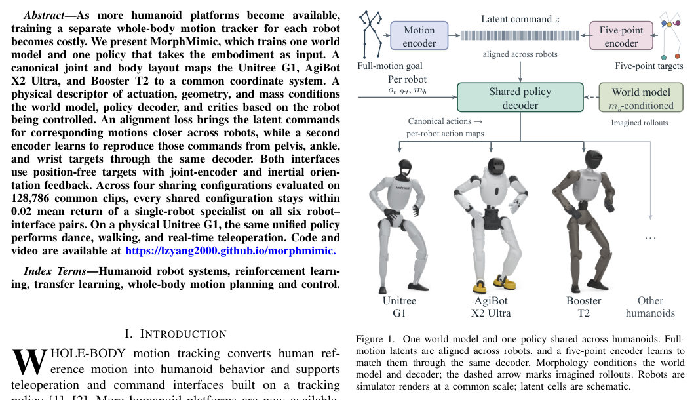
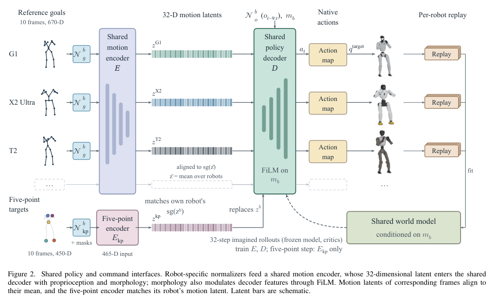

# 两天跟进SuperMimic：MorphMimic让三种人形机器人共用一个世界模型、一套策略

2026-10-25 · Caltech & Georgia Tech · MorphMimic · 有来源缺口

[本地原件归档](../../../raw/99cf9ef36e1e68da7d8c5b49db3399d0f4dfdbdd41a9d7953e035bf810f20d0e) · 固定材料版本 `digest-material-99cf9ef36e1e68da7d8c5b49db3399d0f4dfdbdd41a9d7953e035bf810f20d0e@1` · [一手原站](https://lzyang2000.github.io/morphmimic/)

## 深度拆解与复核

- ==核心结论==：加州理工学院（Caltech：Lizhi Yang、Fengze Xie、Yuyang Wang、Yisong Yue、Aaron D. Ames）与佐治亚理工学院（Georgia Tech：Lu Gan）在 SuperMimic 公开两天后推出 MorphMimic（v0.1 2026-10-29），基于对 SuperMimic 的独立复现，首次让 [宇树科技 (Unitree Robotics)](../entities/companies/%E5%AE%87%E6%A0%91%E7%A7%91%E6%8A%80%20%28Unitree%20Robotics%29.md) Unitree G1（33.3 kg）、智元 AgiBot X2 Ultra（43.5 kg）与加速进化 Booster T2（42.0 kg）三种异构人形机器人共用同一个可微世界模型、同一套策略编码/解码器权重及五点稀疏接口。在 BONES-SEED 与 NVIDIA SOMA Retargeter（提交 cbdb2b4）构建的 128,786 段共同动作集上，统一策略在全部 6 组「机型 × 指令接口」的均值归一化回报与单机专用策略之差均严格收敛在预设 0.02 容差内（最大差距 0.0181），三机型全动作存活率均超 99.7%（99.747%–99.891%），并在真实 Unitree G1 上完成舞蹈、行走与 PICO 遥操作零样本部署；但跨三机联合训练消耗 16.3 GPU-h，反高于三套独立专用模型的合计 13.9 GPU-h（多约 17%），且尚未对未参与联合训练的第四种人形本体验证零样本泛化。

#### 一、业务切口与核心机制

1. 规范化三层身体表征与 125 维形态条件
   - 关节与刚体语义对齐：三种机型均暴露 29 个策略关节（X2 Ultra 与 T2 额外包含 2 个未受控头部关节），按运动学功能重排并乘以符号及零偏对齐到统一关节顺序与 14 个被追踪刚体（骨盆与躯干分别位于槽位 0 与 7）。为让统一动作输出具备一致的执行器物理含义，每台机器人的缩放系数按 alpha = 0.25 × tau_max / k_p 设定（折扣因子 gamma=0.99），即单位动作对应相同比例的关节力矩上限变化。
   - 传感器不强行拉齐、统计量留在本机：每帧 93 维本体感知（历史 10 帧，50 Hz，执行延迟随机化 0–40 ms，90% 软关节限位）中的角速度与投影重力仍保留在各自原生 IMU 刚体坐标系中（G1 与 X2 在骨盆，而 Booster T2 安装在躯干），归一化统计、RMS 残差尺度、默认姿态与回放缓冲均按机器人独立保存。
   - 125 维静态物理描述符与 FiLM 调制：将 4 组各 29 维对数化驱动参数（动作缩放、比例增益、微分增益、力矩上限）与 9 维几何/质量指标（大腿/小腿/上臂/前臂长度、髋宽、躯干高度、总质量与肢体子树质量）线性缩放到 [-1, 1]，连同 33 维上下文向量（摩擦、编码器零偏、质心偏移）输入共享世界模型（472 维输入，8 步拟合）；而在策略解码器中除直接拼接外，还通过零初始化的 FiLM 层按形态向量对隐层特征做逐通道缩放平移。

2. 跨本体潜空间对齐与双指令接口（全动作 vs 五点）
   - 670 维无位置全动作接口（10 帧 × 67 维）经共享编码器压至 32 维潜变量，并在每次策略更新抽取 1,024 对共同重定向片段-帧（权重 0.05），用停止梯度的跨机器人潜变量均值监督各本体发出一致的运动语义指令，再由形态条件解码器执行落地。
   - 465 维五点稀疏接口（骨盆、双脚踝、双手腕 10 帧位姿 450 维 + 5 位点掩码 + 10 位帧掩码）只更新五点编码器（冻结解码器、世界模型与 critic，但梯度穿透回传），在 4,096 个想象起点上（32 步想象视域，采样占比 0.5，潜匹配权重 0.1）同时优化想象回报与本机全动作潜变量对齐，并在想象阶段注入水平 ±0.05 m、竖直 ±0.01 m、滚转/俯仰 ±0.1 rad、偏航 ±0.2 rad 抖动以提升遥操作容错。

#### 二、核心数据核查、口径纠偏与工程边界

- 场景与利益披露：本文由 Caltech 与 Georgia Tech 学术团队（获陶氏化学项目 #227027AW 资助）以技术报告与网页项目页发布，旨在论证「一世界一策略」跨形态分享可行性；Trigger 来源为微信公众号 SourceMind 二手编译稿（2026-10-25），本工作台直接穿透原论文表 I、表 II、表 III 与附录 A/B 全量核验。

| 指令接口与配置 | Unitree G1 存活率 / 回报 | AgiBot X2 Ultra 存活率 / 回报 | Booster T2 存活率 / 回报 | 复核结论与口径说明 |
| :--- | :--- | :--- | :--- | :--- |
| 全动作 · 单机专用模型 (Specialist) | 99.797% / 0.9306 | 99.818% / 0.9253 | 99.860% / 0.9448 | 每机 40,000 次迭代（4,096 环境），三机合计 13.9 GPU-h |
| 全动作 · 三机统一模型 (Unified) | 99.747% / 0.9358 | 99.891% / 0.9304 | 99.886% / 0.9398 | 3×H100 NVL 训练 5 小时 26 分（16.3 GPU-h），全动作指标持平或微超 |
| 全动作 · 仅 G1 策略迁移（目标/G1 参数） | — | 7.7% (.213) / 87.7% (.724) | 1.9% (.048) / 1.6% (.042) | ❌ 未共同训练时跨至 T2 近乎全溃 |
| 五点 · 单机专用模型 (Specialist) | 99.849% / 0.8807 | 99.841% / 0.8689 | 99.857% / 0.9014 | 稀疏接口比全动作在每台机型上降低平均回报 0.04–0.07 |
| 五点 · 三机统一模型 (Unified) | 99.729% / 0.8626 | 99.880% / 0.8774 | 99.852% / 0.8890 | 最大差值 0.0181 仍在 0.02 容差内；五点对齐保留了完整可用性 |
| 五点 · 仅 G1 策略迁移（目标/G1 参数） | — | 17.2% (.264) / 76.8% (.401) | 2.6% (.047) / 2.1% (.027) | ⚠️ 纠正编译稿「T2 均低于 2.1%」笔误：目标参数五点实为 2.6% |

- ✅ T2 迁移溃败物理根因的定量诊断（本工作台核查）：仅用 G1 训练的策略在 T2 上存活率仅 1.6%–2.6%（而 X2 在保留 G1 缩放参数时全动作可达 87.7%、五点 76.8%）。附录 A.A 的控制变量实验精确定位了主因：把仿真中 T2 的 IMU 位置从躯干虚拟移回与 G1/X2 同构的腰部 yaw 连杆后，沿用 G1 参数的 G1 专用模型 / 共享世界模型（WM）演员存活率立即从不足 3% 跳升至全动作 83.4% / 81.5%、五点 75.4% / 74.2%（改用 T2 目标动作参数下亦达到 64.0% / 79.8% 与 67.6% / 66.4%）。这证实了多机共训不仅在学质量与连杆长度差，更是在让策略识别原生传感安装坐标系。
- ⚠️ 「共享 ≠ 更省本次训练算力」与真机实证单腿（本工作台核查）：统一模型在 3 张 H100 NVL 耗时 5 小时 26 分、累计 16.3 GPU-h，相对三套专用模型总计 13.9 GPU-h 反多出约 17%（主因同时同步处理三流数据与跨体对齐开销），其核心价值是产出一套服务三机的共享权重与对齐接口，而非本次算力折让。此外，实体硬件仅在 Unitree G1 导出 ONNX 运行舞蹈、行走与 PICO 遥操作（且微信文指出博客将三段实机视频标为全动作接口，而论文 §IV-E 将 PICO 遥操作写为五点接口并配 K−1 预览缓冲）；AgiBot X2 Ultra 与 Booster T2 实机实验仍处于待完成状态，网页视频演示使用的第 76,000 次迭代权重也与论文表 I 的第 40,000 次迭代主表口径不同。
- ⚠️ 未见本体与消融缺口（本工作台推断）：虽然论文声称新人形机器人可通过映射表、描述符和重定向动作接入，但全篇未测试“仅训练 G1+X2 后零样本测试 T2”的留出泛化，且未提供分别去掉 FiLM 调制或去掉跨体对齐损失的单模块消融表，亦未报告五点接口任意节点遮挡（Mask 设为 0）时的退化曲线（评测时 5 点与 10 帧全部可见）。

#### 三、赛道横向对比与定位

| 跨本体人形控路线 | 代表研究 | 策略与解码器共享粒度 | 跨形态核心表征 | 已验证边界与局限 |
| :--- | :--- | :--- | :--- | :--- |
| 全权重共享 + 可微世界模型（本文） | MorphMimic（Caltech / Georgia Tech） | 共享世界模型、全动作/五点编码器、解码器与 critic；仅统计量/动作映射留本机 | 29 关节语义槽 + 125 维物理描述符（FiLM）+ 32 维跨机对齐潜指令 | 128,786 共同动作回报差 <=0.02，G1 真机已跑通；未测第 4 种未见机型零样本 |
| 单机可微世界模型底座 | SuperMimic（BAIR，CoRL 2026 最佳论文） | 单机 Unitree G1 专用可微世界模型与共享解码器 | 无形态描述符，专攻单机高动态平地模仿与速度编码器 | 1 卡 H100 3h 超过 SONIC，2 卡 9.8h 零失败覆盖 129,514 片段，G1 跑通 360° 空翻 |
| 模块化专口 + 共享时序主干 | X-WBC（arXiv:2609.15213，CoRL 2026） | 共享时序主干，保留机器人专属指令编码器、本体编码器与动作解码器 | 机器人专属编解码适配器桥接共享潜令牌 | 添加全新机型仍需维护并训练独立的输入输出头部权重 |
| 预训练追踪器局部微调 | Any2Any（arXiv:2605.23733） | 运动学对齐后仅微调对动力学敏感的策略局部模块 | 冻结大部分基础追踪网络参数 | 面向单源向目标迁移适配，并非单一权重同步控制多机 |

### 观点与可反驳条件

- ==观点==：==MorphMimic 的真正贡献不在单次训练省算力（16.3 GPU-h 反较三套独立专模多耗 17%），而在于实证「只要用规范关节槽 + 125 维驱动几何描述符 + 共同重定向帧潜对齐，3 个不同重量与 IMU 位置的人形平台就能共用 99.9% 存活率的同一个可微世界模型与同一套策略权重」==；但未做未见第四机型的留出测试、且缺乏 X2 Ultra 与 Booster T2 的真机实跑，使其目前仍是「多机共训共享」而非「免重训即插即用通用人形控制器」。
- ==推翻条件==：
  1. ① 第 4 种未见机型零样本迁移失败：若独立复现将 MorphMimic 权重在 G1/X2/T2 上训练完成后，仅填入第四款未见人形机器人（如 Fourier GR-2 或宇树 H1）的关节映射与 125 维描述符而不微调世界模型与解码器，真机或仿真全动作存活率低于 50%（与单机 G1 跨 T2 同样崩塌），且重训微调耗时超过从零单机训练（~5 GPU-h）的 60%，则「新本体低成本直接复用共享权重」的价值主张将被推翻。
  2. ② X2 Ultra 与 Booster T2 真机 Sim-to-Real 鸿沟放大：若在后续补齐的 AgiBot X2 Ultra 与 Booster T2 真机测试中，统一策略在实体电机饱和或躯干 IMU 高频振动下的站立/舞蹈跟踪成功率大幅落后于各机型专用控制器 15 个百分点以上，则说明共享世界模型在跨实体非理想机械间隙上存在隐性折损。

---

## 原文摘录与一手信源存证

> 加州理工学院与佐治亚理工学院团队提出 MorphMimic，让宇树 G1、智元 X2 Ultra 和Booster T2 共用一个世界模型和一套全身动作追踪策略。这套策略已在三种机器人的仿真中运行，并在真实 G1 上展示了行走、舞蹈与遥操作。
> — 原文摘录，PDF p.1；证据 `digest-material-99cf9ef36e1e68da7d8c5b49db3399d0f4dfdbdd41a9d7953e035bf810f20d0e-excerpt-1@1`

> 为什么重要： 第一作者 Lizhi Yang 用“One world, one policy”概括这项工作：三种机器人共享形态条件世界模型和策略，从仿真中跳同一段舞，走到浏览器实时演示和 G1 真机。他也特别感谢 SuperMimic 团队带来的启发。
> — 原文摘录，PDF p.1；证据 `digest-material-99cf9ef36e1e68da7d8c5b49db3399d0f4dfdbdd41a9d7953e035bf810f20d0e-excerpt-2@1`

> SuperMimic 第一作者 Qiayuan Liao 则感叹：“仅仅两天，就有了 SuperMimic 的第一篇后续论文！”
> — 原文摘录，PDF p.1；证据 `digest-material-99cf9ef36e1e68da7d8c5b49db3399d0f4dfdbdd41a9d7953e035bf810f20d0e-excerpt-3@1`

一手材料：

- MorphMimic: One World, One Policy · MorphMimic authors · [原站](https://lzyang2000.github.io/morphmimic/) · [主体档案：Lizhi Yang](../entities/people/Lizhi%20Yang.md) / [主体档案：Lizhi Yang (arXiv)](../entities/people/Lizhi%20Yang%20%28arXiv%29.md) · [NotebookLM](https://notebook.google.com/notebook/cac99041-d3b9-449e-a192-12bb4b1ad391) · [Drive](https://drive.google.com/file/d/1Fj0uV_IhyWbBR0lsG14cr7bd5dLLyCK6/view?usp=drivesdk)
  材料版本 `digest-material-b4259b6c9f569a477a65775b9fc264351ec3eb45212d13ec9eb391274f790467@2`；获取方式 `http_pdf`。
  > Abstract—As more humanoid platforms become available, training a separate whole-body motion tracker for each robot becomes costly. — PDF p.1
  > Index Terms—Humanoid robot systems, reinforcement learn- ing, transfer learning, whole-body motion planning and control. — PDF p.1

归属与范围：已复用已归档的 MorphMimic 官方 9 页技术报告 PDF（43,720 字符）及项目页（lzyang2000.github.io/morphmimic/），穿透核查 29 关节规范映射、125 维物理形态描述符、FiLM 调制、跨机器人均值潜变量对齐及五点接口扰动训练细节；纠偏单机零样本迁移在 Booster T2 躯干 IMU 坐标系下骤降至 1.6%–2.6% 的物理根因与重映射后恢复至 64.0%–83.4% 的诊断表，明晰 Unified 模型 16.3 GPU 小时反高于三套 Specialist 合计 13.9 GPU 小时（+17%）及仅 Unitree G1 上真机的实证边界。

来源缺口：

- `pending_verification`：MorphMimic 仅在真实 Unitree G1 上导出 ONNX 跑通舞蹈、行走与遥操作（且博客标注与论文 §IV-E 对 PICO 遥操作使用全动作还是五点接口存在表述差异），AgiBot X2 Ultra 与 Booster T2 真机部署显式标记为待完成（hardware pending）；同时 128,786 片段评测全为共同训练集，未对未见第 4 种人形机器人做留出零样本测试，亦缺少单独剔除 FiLM 或对齐损失的模块消融。 [线索](https://lzyang2000.github.io/morphmimic/)

[返回赛道总览](../赛道总览.md#digest-99cf9ef36e1e68da) · [返回导读索引](README.md) · [主体档案库](../entities/README.md)
