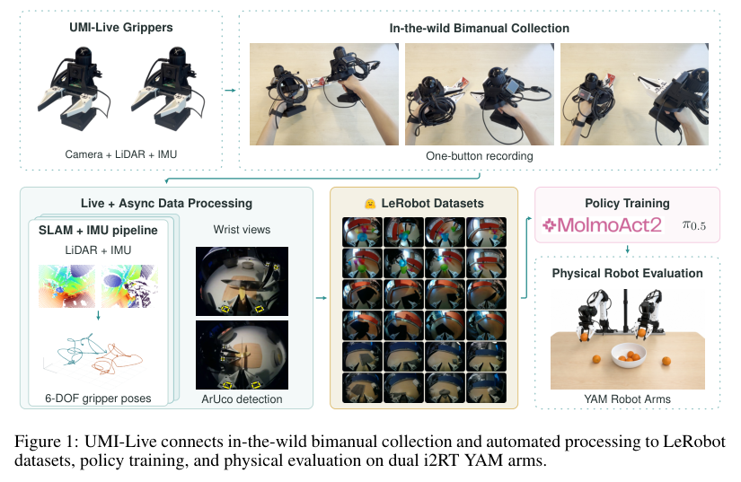
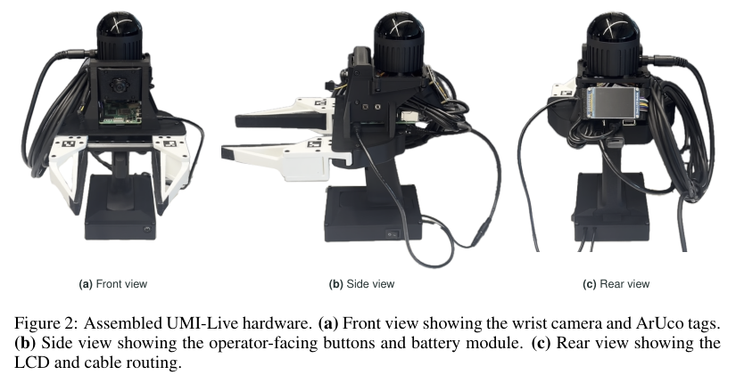

# 从零件组装、数据采集到模型训练，UMI-Live全流程开源｜可加装触觉

2026-10-31 · UMI-Live 项目组 (AfterQuery Research / Yale / CMU / UPenn / Harvard) · 有来源缺口

[本地原件归档](../../../raw/9862a1bdf3e9ca8056234dc1b871ff47b704fd3411192b93cae3c655bf5ef97f) · 固定材料版本 `digest-material-9862a1bdf3e9ca8056234dc1b871ff47b704fd3411192b93cae3c655bf5ef97f@1` · [一手原站](https://arxiv.org/abs/2610.39385)

## 深度拆解与复核

- ==核心结论==：UMI-Live 将传统需离线手工配准与基站标定的手持 UMI 数采器改造成“端侧 LiDAR-惯性 SLAM + 异步并行管线自动推流 Hugging Face”的交钥匙工具链（单只 1.42 kg、续航 1.5 小时、一对硬件 BOM 约 1,930 美元），其工程集成度显著降低开源门槛；但核查论文（arXiv:2610.39385）、GitHub 源码仓库与 Hugging Face 数据卡后可见三项关键限制：已公布的真机策略消融仅有“6 颗橙子入碗”单任务 10 次试验且缺乏纯 UMI 对照，数据集虽有 3,255 段（39.705 小时）但逾 90% 集中于两类日常基准任务，而微信摘要高调提及的 FlexiTac V2 触觉加装方案并不在 v1 论文与硬件工程定版中、仍属作者后续探索预览。

#### 一、业务切口与核心机制

由共同第一作者 Govind Velamoor（Yale）、Adrian Lin（CMU）联合 Sam Jung、Spencer Mateega（AfterQuery 团队赞助）与 Brandon Yifan Yang（Brandon Y. Yang，UPenn）、Amish Sethi（Harvard）推出的 UMI-Live，核心瞄准 UMI 范式长期存在的“采得出但用得慢”与“依赖 GoPro/VIVE 外置追踪易漂移或受限室内”两大痛点：
1. 由内向外（Inside-Out）无基站硬件栈：每只手持夹爪独立搭载 SVPRO AR0234 全局快门腕部相机（800×600 @ 30 Hz）、RoboSense Airy 激光雷达（10 Hz）、200 Hz IMU、树莓派 5（Raspberry Pi 5，Ubuntu 24.04）、MicroSD 缓存与可更换电池，无需任何外置基站或场景标定。双手间通过主臂（Leader，umi1，USB Wi-Fi 建私钥热区 10.42.0.1）与从臂（Follower，umi2，10.42.0.2）在按下录制键前校验 5 帧内均可见 ArUco 夹爪标定码（左 02/03，右 00/01）后才启动同步采集，跨设备同步阈值卡在 5 ms 以内。
2. 采传分离的异步入库管线：录制完成一段后，采集端即可继续下一轮录制，后台服务器通过 SSH 隧道并发执行最多 5 路任务（pair -> decode -> GLIM 激光惯性 SLAM -> ArUco 宽度解码 -> dataset），自动将 6-DoF 位姿（[x, y, z, rx, ry, rz]）与归一化 [0, 1] 夹爪开合组成 14 维 observation.state，打包为 LeRobot v3 格式直接推流 Hugging Face。
3. UMI-Teleop 与 VLA 微调接口：把手持外壳的 LiDAR 换为 VIVE 追踪器即变成低延迟遥操作控制器 UMI-Teleop（用于采少样本机上示范甚至演示划燃火柴），并依托 220 mm 固定法兰至 TCP 外参偏移将手持人类示范映射至双 YAM 机械臂（6-DoF + 夹爪）。微调 π0.5（全参数，12,000 updates）与 MolmoAct2（LoRA + 动作专家）时仅输入双腕相机影像与指令（故意屏蔽当前位姿以防过拟合），预测未来 24 步（H=24 @ 30 Hz）绝对或查询相对位姿。

#### 二、核心数据核查、口径纠偏与工程边界

场景与利益披露：项目获创业/研究机构 AfterQuery（AfterQuery-Research）赞助并在 CoRL 2026 UMI Arena Workshop 发布，定位为全流程开源基础设施（Apache-2.0 数据集、公开 STL/STEP、BOM 清单与 GitHub 仓库 `AfterQuery-Research/umi-live`），核心诉求是通过简化数据端摩擦扩大开源社区采用与工具链影响力。

本工作台将微信推文（SourceMind 编译自 Amish Sethi 发布帖）与 arXiv 论文（2610.39385v1）、GitHub README 及 Hugging Face 数据卡逐行交叉核对，暴露出多处决定落地判断的边界：

| 维度 | 传播摘要常见印象 | 一手论文/仓库/HF 数据卡核查实情 | 性质判定 |
| --- | --- | --- | --- |
| 开源数据体量与结构 | “约 40 小时、3,255 段示范涵盖放橙子、倒水与叠毛巾” | [✅] HF 数据卡证实共 3,255 段、4,288,182 成对帧、39.705 小时 @ 30 Hz、66.5 GB；[⚠️] 其中 `artem-fold-towel`（1,513 段）与 `artem-pour-water`（1,444 段）占 90.8%，实际橙子任务仅 298 段（183+115），旧版 33 段叠毛巾与 9 段叠衬衫已被替换/移除；原始 LiDAR 包未随合并版 HF 数据发布 | 比例偏斜+版本演化 |
| 策略微调成功率 | “π0.5 达到 10/10，MolmoAct2 达到 8/10（基线 0/10）” | [⚠️] 论文第 6 节明确承认三项局限：① 真机评测仅覆盖单任务（6 颗橙子放碗里）；② 每组条件仅测 10 次 rollout 且只跑 1 个随机种子；③ 采用混训比例（π0.5 为 90% UMI-Live + 10% UMI-Teleop = 10/10、95%/5% = 9/10；MolmoAct2 为 75%/25% = 8/10），且完全缺乏纯 UMI-Live（100%/0%）与纯遥操作对照消融 | [⚠️] 缺乏单因素消融 |
| 硬件便携性与成本 | “单只 1.42 kg、1.5 小时续航、一对约 1,930 美元” | [✅] 论文、官网与硬件清单一致，较外置 VIVE/动捕房大幅降本；[⚠️] 1.42 kg 含电池、Pi 5、LiDAR 全套集成重量单手长时悬停握持仍有腕部负荷；硬件指南特意警告充电期间禁止开机/接线共用电池 | [✅] 实测权衡明确 |
| 数据格式 Schema 差异 | “直接整理好 14 维位姿动作用于训练” | [⚠️] GitHub README 写动作表示为 12-D 位姿增量，但 HF 数据卡特地注记：`action[t]` 在入库文件里是与 `observation.state[t]` 完全相同的同帧位姿副本（均先做片段起点零化归一化，且旧版两批双 LiDAR 橙子标定区间不同：UMI1 56–125 mm，UMI2 68–119 mm），训练加载器必须自行切片取未来帧并算增量 | [⚠️] 下游接管陷阱 |
| 触觉反馈加装 (FlexiTac) | “第 10 节重点突出可方便用胶带加装 FlexiTac V2 触觉” | [❌] 经全文检视 `arXiv:2610.39385` v1 PDF 与 `AfterQuery-Research/umi-live` 主页 README，均未收录 `FlexiTac` 模块接线、校准代码与力-视融合模型消融；原作者在 X 补充帖亦明示“仍在探索视觉、夹爪与触觉联合训练方案” | [⚠️] 后续预览非正文 |

本工作台推断，UMI-Live 真正的工程贡献在于把困扰学术实验室多时的“多设备时钟漂移、同步录制防呆（缺 5 帧 ArUco 拒录）与 SLAM 后台非阻塞流水线”工程化固化为一条可复制脚本，直接省去从零组装基础设施的数周时间；但它并未改变纯视觉手持示范向真机迁移的两条根本规律：其一，少量真机遥操混训（5%–25% UMI-Teleop）在消除人手与 YAM 末端动力学偏移中不可或缺；其二，不经统一长度标定与未来窗口切片直接吞下 HF 数据包必然报错或学偏。

#### 三、赛道横向对比与定位

| 采集体系 | 位姿追踪原理 | 单套估算成本/重量 | 核心优势 | 核心不足 |
| --- | --- | --- | --- | --- |
| UMI-Live (本文) | 端侧 RoboSense Airy LiDAR + IMU GLIM SLAM | 一对约 1,930 美元 / 单只 1.42 kg（续航 1.5 小时） | 无基站、采传异步并发推流 LeRobot、内置防漏标校验 | 1.42 kg 握持偏重；触觉仍未入主干代码；高动态甩动受限于 LiDAR 10 Hz 扫描率 |
| 原代 UMI (Stanford) | GoPro + 视觉 SLAM (ORB-SLAM3) + 固定背景/校准 | 低硬件门槛 | 轻量易持，早期验证生态广 | 单目视觉在纯白墙面/强遮挡/跨场地易跟丢且后期离线配准耗时长 |
| Pixel-UMI (前序档案对比) | 传感器化人体演示直接对齐环境感知 | 偏轻量传感器 | 环境感知更强 | 缺乏与 UMI-Live 等同体量的开箱异步入库工具链 |
| 真机遥操作 (ALOHA / UMI-Teleop) | VIVE 外部追踪 / 主从臂编码器直读 | 需部署成对实体臂或基站 | 无人类与机器人本体动力学差异 | 无法带出户外，数据采集场景与空间受限 |

### 观点与可反驳条件

- ==观点==：UMI-Live 是 2026 年极少数把“手持端侧采集 + 异步 SLAM 清洗 + LeRobot 标准入库”做成完整可复现全流程开源工具链的优质工程，对实验室与中小团队起步极具参考价值；但若因此把“90% 人类手持示范微调达成 10/10”直接理解为纯野生 UMI 无需机上遥操及多任务泛化已彻底打通，则属过度外推——现有论文数据只验证了窄分布高复现单任务（6 颗橙子），且缺乏 UMI-only 与 FlexiTac V2 触觉的定量实证。
- ==推翻条件==：
  1. ① 团队或第三方在 `AfterQuery-Research/umi-live` 仓库补充发布完整的 0% UMI-Teleop（100% 纯 UMI-Live 数据）对照实验与多种子多任务评测，且在包含形变体（如叠毛巾/倒水）的真机测试中仍保持 >= 80% 成功率。
  2. ② 作者正式发布将 FlexiTac V2 压阻阵列接入主干 `umi-live-core` 管线与 LeRobot schema 的完整代码、驱动及对比消融报告，证明加入触觉通道相比纯双腕视觉在接触敏感任务（如插拔、划火柴）上带来 >= 15 个百分点的稳健提升。

---

## 原文摘录与一手信源存证

> Amish Sethi 介绍了一套开源的双手示范采集系统 UMI-Live ：操作者手持两只夹爪，按下按钮即可同步录制动作；后台则在采集继续进行时，把已完成的示范转成可用于训练机器人的数据集。
> — 原文摘录，PDF p.1；证据 `digest-material-9862a1bdf3e9ca8056234dc1b871ff47b704fd3411192b93cae3c655bf5ef97f-excerpt-1@1`

> 为什么重要： 录下人的操作，只是机器人数据采集的第一步。视频还要与夹爪的位置、朝向和开合状态同步，才能成为训练素材。UMI-Live 把设备追踪、数据处理和格式转换接成一条流程，试图减少从“示范一次”到“拿去训练”之间的准备工作。
> — 原文摘录，PDF p.1；证据 `digest-material-9862a1bdf3e9ca8056234dc1b871ff47b704fd3411192b93cae3c655bf5ef97f-excerpt-2@1`

> 怎么做到的： 每只夹爪自带相机、激光雷达、计算单元和电池，无需外部追踪基站或场景标定。录制结束后，后台自动重建轨迹、校验数据，并整理为 LeRobot 格式上传至Hugging Face。一对设备成本约为 1,930 美元，单只重 1.42 千克，续航约 1.5 小时。
> — 原文摘录，PDF p.1；证据 `digest-material-9862a1bdf3e9ca8056234dc1b871ff47b704fd3411192b93cae3c655bf5ef97f-excerpt-3@1`

一手材料：

- UMI-Live for In-The-Wild Bimanual Robotics Data Collection · UMI-Live论文作者 · [原站](https://arxiv.org/abs/2610.39385) · [主体档案：Govind Velamoor](../entities/people/Govind%20Velamoor.md) · [NotebookLM](https://notebook.google.com/notebook/cac99041-d3b9-449e-a192-12bb4b1ad391) · [Drive](https://drive.google.com/file/d/1do8-4l3IFjwwoZ44XcMWvEhxsrnkDrAW/view?usp=drivesdk)
  材料版本 `digest-material-bc7c54e9b67ab2bdf1e01c36e5f4aa2c7323260c0e8a2c7ca44f17fffcc55ed4@1`；获取方式 `http_pdf`。
  > Abstract: Universal Manipulation Interface (UMI) devices allow human experts to demonstrate tasks for robot learning without teleoperating physical robots. — PDF p.1
  > Figure 1: UMI-Live connects in-the-wild bimanual collection and automated processing to LeRobot datasets, policy training, and physical evaluation on dual i2RT YAM arms. — PDF p.1
- UMI-Live for In-The-Wild Bimanual Robotics Data Collection (Project & Hardware Guide) · UMI-Live Project Team · [原站](https://umi-live.github.io/) · [主体档案：UMI-Live Project](../entities/companies/UMI-Live%20Project.md) · [本地原件](../../../raw/c6ba504258f2268094c0911094466ded099eb494fd5f201e3aec1d7a472fe8e0)
  材料版本 `digest-material-c6ba504258f2268094c0911094466ded099eb494fd5f201e3aec1d7a472fe8e0@1`；获取方式 `http_full_text`。
  > --- PROJECT PAGE --- UMI-Live for In-The-Wild Bimanual Robotics Data Collection UMI-Live for In-The-Wild Bimanual Robotics Data Collection CoRL 2026 UMI Arena Workshop. — 原文提取
  > --- HARDWARE GUIDE (https://umi-live.github.io/hardware.html) --- UMI-Live Hardware Skip to content UMI-Live ← Back to project UMI-Live Hardware Hardware reproduction guide, including part sourcing, printing, and assembly. — 原文提取
- GitHub - AfterQuery-Research/umi-live · AfterQuery-Research · [原站](https://github.com/AfterQuery-Research/umi-live) · [主体档案：AfterQuery-Research](../entities/companies/AfterQuery-Research.md) · [本地原件](../../../raw/203f0d27ff95eea2bf7e45a8e88e45465a795567d2908d7c662c066d422a940d)
  材料版本 `digest-material-203f0d27ff95eea2bf7e45a8e88e45465a795567d2908d7c662c066d422a940d@1`；获取方式 `http_full_text`。
  > The leader refuses to record unless the follower acknowledges the take. Both clients spool to their microSD cards and upload through SSH tunnels. — 原文提取
  > The machine running these commands can reach the server and both clients over SSH. — 原文提取
- brandonyang/umi-live-dataset · Datasets at Hugging Face · Brandon Y. Yang / UMI-Live Team · [原站](https://huggingface.co/datasets/brandonyang/umi-live-dataset) · [主体档案：Brandon Y. Yang (brandonyang)](../entities/people/Brandon%20Y.%20Yang%20%28brandonyang%29.md) · [本地原件](../../../raw/3a24fb16ca6e6d0109c85f30ad4328fbee324e9a9b76101b8fcb6738e5c9b6d3)
  材料版本 `digest-material-3a24fb16ca6e6d0109c85f30ad4328fbee324e9a9b76101b8fcb6738e5c9b6d3@1`；获取方式 `http_full_text`。
  > . Paired time is counted once, not once per wrist camera. All episodes from the four pinned sources are retained without filtering or deduplication. Original datasets are unchanged. — 原文提取
  > Each arm's initial position and rotation vector are exactly zero. Position is in meters; orientation is an SO(3) rotation vector in radians. — 原文提取

归属与范围：已完整核对arXiv:2610.39385v1正文并新抓保存项目官网+硬件组装指南(umi-live.github.io)、GitHub主仓库README(AfterQuery-Research/umi-live)与Hugging Face正式数据卡(brandonyang/umi-live-dataset)全文快照。揭示出HF合并版3,255段数据构成偏斜（折毛巾+倒水占90.8%，橙子仅298段）、action\[t\]==observation.state\[t\]接口惯例，以及微信新增第10节FlexiTac V2触觉加装目前尚未进入v1论文与GitHub主干代码的关键偏差。

来源缺口：

- `not_disclosed`：微信摘要第10节补充提到的FlexiTac V2压阻触觉阵列加装方案未包含在arXiv:2610.39385 v1正式论文与AfterQuery-Research/umi-live主仓库README中，尚无视觉-触觉策略融合消融或公开代码规范。
- `pending_verification`：arXiv原文第6节局限部分明示：真机VLA评测仅覆盖单一任务(把6个橙子放入碗中)、每条件仅10次试验且仅用1个随机种子；所有成功组均混合5%-25%的UMI-Teleop遥操作示范，完全缺乏纯UMI(100%/0%)与纯遥操作对照消融。

[返回赛道总览](../赛道总览.md#digest-9862a1bdf3e9ca80) · [返回导读索引](README.md) · [主体档案库](../entities/README.md)
