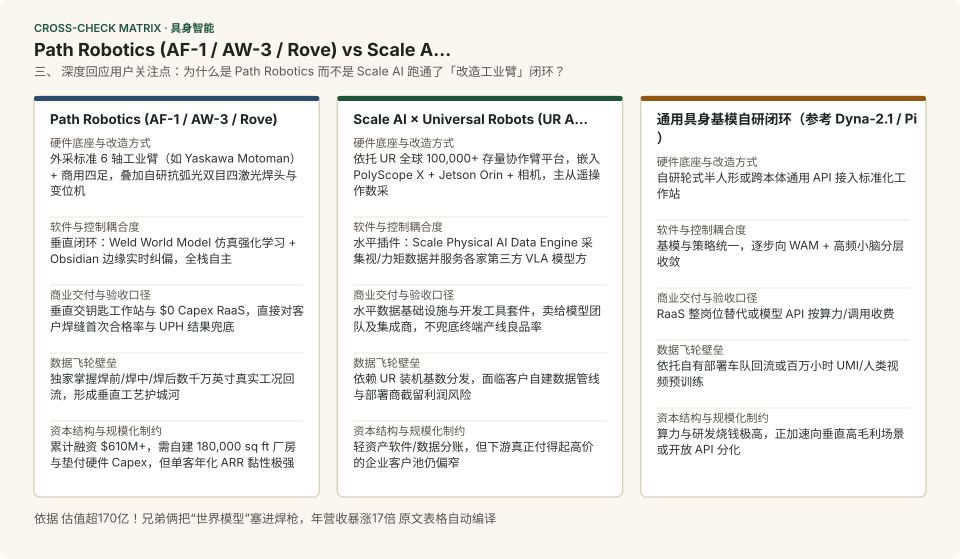

# 估值超170亿！兄弟俩把“世界模型”塞进焊枪，年营收暴涨17倍

2026-11-13 · Path Robotics · 有来源缺口

[本地原件归档](../../../raw/ef0484bf75e8ad6c86b6dfcae61b1a853cb3e0a2312d625a6f406bbf843bb2a5) · 固定材料版本 `digest-material-ef0484bf75e8ad6c86b6dfcae61b1a853cb3e0a2312d625a6f406bbf843bb2a5@1` · [一手原站](https://www.path-robotics.com/news/path-robotics-announces-300-million-series-e-led-by-georgian) · [触发线索（具身之家Robots）](https://mp.weixin.qq.com/s/e4tfSeHIEYNpDWleicl5RQ)

> [!IMPORTANT]
> 用户关注点（TG）：研究一下这家公司，我之前的思路也是：物理模型足够强的部署第一环，应该是改造现有的工业机械臂，比如ScaleAI的转型，终于找到案例了

## 针对性追查与回应

- ==核心结论==：本轮对 Path Robotics 2026-11-10 官方 Series E 通稿、领投方 Georgian 尽调备忘录、Path 官方技术文档（llms-full.txt 与 AW3/AF-1/Rove 规格）及 HII 官方军工造船协议的交叉穿透，==整体印证了用户直觉的前半句（Physical AI 工业商业化第一环是复用成熟工业运动学底座而非另造人形），但必须精细纠偏后半句的商业交付边界：Path Robotics 并非如 Scale AI 那样向存量工厂老机械臂卖水平软件/数采插件，而是受制于抗强弧光近场传感、高频控制器封闭性与无损探伤结果验收，选择了「外采成熟六轴工业臂 + 自研多激光视觉焊头 + Obsidian 闭环 + 交钥匙/RaaS 兜底」的垂直集成商路线==。
- ==场景与利益相关标注==：本稿件交叉核查对象包括卖方与投资方公开材料（Path Robotics 官方新闻稿、技术规格与 Georgian 投资备忘录，存在突出 17 倍 ARR 增速、4 倍产能及 97%+ 首次通过率等最优口径的商业路演激励）、买方军工采购公告（Huntington Ingalls Industries 官方新闻稿对 7 年最高 \$900M 绩效协议设置了严格的阶段验收闸门），以及对比案例方公告（Scale AI 与 Universal Robots GTC 2026 联合通稿）；微信公众号《具身之家Robots》二次编译文章将核心架构笼统简称为「把世界模型塞进焊枪」，并将 Sensor Stack v5 表述为「4 台激光传感器」，本工作台已在下文逐项还原纠偏。

### 一、 「把世界模型塞进焊枪」真架构与产品演进拆解

1. 离线物理世界模型训练端 vs. 端侧低延迟推理端（本工作台核查）
   - ==并非端侧自回归生成视频==：据 Path Robotics 官方技术文档（llms-full.txt 与 Obsidian 产品页），其物理 AI 由两层解耦模型构成。训练端为 ==Weld World Model==，是基于公司 8 年来部署车队与内部数据农场积累的数千万焊接英寸（tens of millions of welded inches）多模态焊接数据训练的神经网络焊接物理模拟器，用来拟合电弧熔池行为、热输入形变（heat distortion）、装夹公差（fit-up variation）及焊缝偏移，而非传统焊接仿真器使用的简化物理近似方程；研发团队在 Weld World Model 内运行大规模强化学习以训出端侧策略。
   - ==端侧执行层 Obsidian 与 Sensor Stack v5==：部署在产线机器端的是强化学习物理 AI 智能体 ==Obsidian==，而非在焊枪边端运行大模型视频预测。其感知硬件 Sensor Stack v5 采用 ==2 颗相机 + 4 束激光器==（✅ 纠偏微信原文「4 台激光传感器」的模糊表述），在焊枪周围形成 360° 亚毫米级点云观测，并通过神经网络实时过滤强弧光飞溅与金属反光导致的虚假反射（false reflections）。配合 JobBuilder 软件，系统在焊前扫描实际工件生成无示教器路径（将传统数周人工编程压缩至 1 小时内），焊中实时调整电流电压、走枪速度与姿态以补偿热变形及进行自适应多道填充（multi-pass adaptive fill），焊前/焊中/焊后数据全量回流反哺 Weld World Model 迭代。
2. 工业运动学底座复用与产品形态拓展（AW-2/AW-3 → AF-1 → Rove）
   - ==不造六轴手臂本体，专攻传感焊头与系统集成==：Yaskawa Motoman 官方战略合作伙伴目录与 CWRU 校刊明确确认，Path Robotics 并不自造工业机械臂本体，而是复用成熟工业六轴臂（如 Yaskawa Motoman 平台，工程体系亦覆盖 ABB、FANUC、KUKA）与 ALM 重型变位机。其中固定工作站 AW-3 面向高混杂重工大件，支持直径 8–72 英寸、长度达 65 英尺、最大承重 10,500 磅（另据大型发电机箱体 FAT 披露重型双臂单元可达 55,000 磅 / 60×15 英尺），支持 MIG/MAG 碳钢、不锈钢与铝合金单/多道焊；2023-09 发布的 ==AF-1==（Autonomous Fit-up）进一步在单元内接管原料抓取、对位装夹与焊接全工序，直接消除对专业装夹工（fitters）的依赖（首批客户包括 Hutchens Industries）。
   - ==2026-04 四足移动焊接系统 Rove==：为解决船体、重型工程机械等无法搬入固定焊房的超大工件，Path Robotics 于 2026-04-16 发布 Rove，将 Obsidian 焊头搭载于四足移动平台（媒体报道采用 Boston Dynamics Spot，2027 年计划首批交付 50 台）。自主造船厂 Saronic 作为首发试用伙伴，在路易斯安那州 Franklin 造船厂将其用于船体建造并服务 Port Alpha 下一代软件定义船厂布局。

### 二、 融资账本、军工协议与单位经济口径原位核查

- ✅ 融资与商业化规模核查（Path Robotics 官方通稿 & Georgian 备忘录）：2026-11-10 Path Robotics 宣布完成 ==\$300M E 轮融资，投后估值 \$2.45B==（较前轮接近翻 4 倍，对应中文报道超 170 亿元人民币），2018 年创立至今累计融资超 ==\$610M==。本轮由成长型 AI 基金 Georgian 领投（合伙人 Emily Walsh 入驻董事会），新引入 D. E. Shaw Ventures 与 NAVER Ventures，原有投资方 Addition、Drive Capital、IronArc Ventures、Tiger Global、Yamaha Motor Ventures 跟投。过去 18 个月 ARR 增长 ==17 倍==（2025 年订单 bookings 突破 \$100M），员工同比扩编 97% 达 300+ 人（2026 年底目标 400 人），在俄亥俄州哥伦布市运营 180,000 平方英尺制造厂房及 30,000+ 平方英尺仓储。核实核心客户覆盖 HII（Huntington Ingalls Industries）、Lockheed Martin、Saronic、LAD Services、Nello 以及 EK Machine、Millerbernd Manufacturing Company、TransAmerican Power Products、TYCROP 等制造骨干。
- ⚠️ HII HYPR 协议「\$900M / \$600M 订单」真实条款核查（本工作台核查）：2026-08-06 Huntington Ingalls Industries（HII）与 Path Robotics（负责自主焊接）及 GrayMatter Robotics（负责表面打磨、喷砂、涂装与检测）签署的 High-Yield Production Robotics（HYPR）协议，名义框架总额为 ==7 年最高 \$900M==（Georgian 与 Path 口径中归属 Path 的上限为 ==\$600M==）。对照 HII 官方原文，该协议分「海军级技术研发验证阶段」与「生产交付采购阶段」，实际拨款与订单释放严格取决于两家公司是否达成技术就绪度、制造就绪度及成本、交期、军工级无损检验标准，==并非无条件保底的确定性在手订单==（HII 同期披露 2026 年计划外包超 250 万造船工时，同比增长 30%）。
- ⚠️ 「97%+ 首次合格率 / 4 倍产能 / 17 倍焊接速度」口径核查（本工作台核查）：Path Robotics 宣称其系统相对高混杂人工焊（首次通过率约 70%–85%，全美人工焊工有效燃弧时间仅 10%–12%）可实现 97%+ 首次通过率、4 倍整体产能、最高 17 倍局部焊接速度及 30%–40% 单焊缝降本（Georgian 客户访谈亦提及某客户在复杂件上较资深焊工提升 10%+ 首次良率并实现约 40% 成本下降）。但上述指标基于公司内部测试与可适配工件统计，缺少大样本第三方超声波/射线无损探伤（NDT）长期统计分母；Rove 四足平台在船厂强弧光与非平整甲板下的结构刚度与焊缝一致性亦待 2027 年 50 台规模发货验证。
- ⚠️ RaaS 资本效率折损核查（本工作台推断）：Path Robotics 采用 \$0 Capex 的 Robots-as-a-Service 订阅交付模式（含 24/7 Mission Control 远程运维与软件持续升级），绕开了中小制造企业采购固定资产的漫长审批周期；但与纯软件公司不同，Path 需要垫付 180,000 平方英尺集成制造产能与工作站硬件资本开支，这也是其 ARR 暴涨 17 倍仍需累计融资超 \$610M 的根本原因。

### 三、 深度回应用户关注点：为什么是 Path Robotics 而不是 Scale AI 跑通了「改造工业臂」闭环？

- ✅ 印证核心判断：美国焊接学会（AWS）测算 2029 年美国面临 320,500–400,000 名焊工缺口，而重工焊接 80% 仍靠手工，卡点在于高混杂工件的来料公差与热形变，而非机械臂重复定位精度。因此工业场景物理 AI 的第一落点必然是「成熟工业臂运动学 + 物理 AI 闭环」，避开高故障率与高成本的双足人形路线（参见本工作台对 [Unitree Dex5-S 寿命约束](Unitree%20Dex5-S%201_1%20Human-Scale%20Five-Finger%20Dexterous%20Hand%20Release_%2022%20Active%20DoF%2C%20620g%20Weight%20%26%20RMB%2039%2C900%20%28%246.md) 与 [Dyna-2.1 轮式降维](Dyna-2.1_%20A%20Physical%20Agent%20for%20End-to-End%20Workflows.md) 的拆解）。
- ⚠️ 本工作台推断：必须区分「水平数据平台改造存量臂」与「垂直传感器+交钥匙改造工业臂」两条截然不同的商业物种——
  1. Scale AI 的真实定位是水平数采与模型训练基建，而非垂直部署交付商：在 GTC 2026（2026-03-16）发布的 ==Scale AI × Universal Robots（UR AI Trainer）== 合作中，Scale 将其 Physical AI Data Engine 嵌入 UR 基于 PolyScope X 与 AI Accelerator（内置 NVIDIA Jetson Orin AGX 64GB + Orbbec Gemini 335Lg 相机 + Direct Torque Control 力矩传感）的平台，利用 UR 全球 ==100,000+ 台==工业协作臂装机基数，通过 UR3e 带教 UR7e 的主从遥操作采集视触力数据，支撑外部模型公司（如展示手机包装任务的 Generalist AI）或企业开发者训练 VLA，逻辑延续其后续开源 533,913 条子任务标注数据集 FineART 的策略（见 [Scale AI FineART 导读](OpenAI%E8%AE%A1%E5%88%92%E7%94%A8%E6%9C%BA%E5%99%A8%E4%BA%BA%E5%BB%BA%E8%AE%BE%E6%95%B0%E6%8D%AE%E4%B8%AD%E5%BF%83%20_%20%E7%A0%B4%E5%A3%B3%E6%9C%BA%E5%99%A8%E4%BA%BA%E5%BC%80%E6%94%BERoboAPI%20_%20Scale%20AI%E5%8F%91%E5%B8%8353%E4%B8%87%E6%9D%A1%E5%AD%90%E4%BB%BB%E5%8A%A1%E6%A0%87%E6%B3%A8%E6%95%B0%E6%8D%AE%E9%9B%86.md)）。Scale AI 并不承担产线工艺工程、夹具改造与良率验收；正如本库已归档的 [Scale Venture Partners 部署层分析](具身基模之上，还有应用层｜Scale%20VP合伙人：部署公司将分走模型公司的蛋糕.md)（注：Scale VP 与 Scale AI 系独立机构）所指出的，价值捕获大头正在流向贴近产线的工作流部署公司，且纯第三方数采同样面临 [Eidon AI 停摆复盘](Robotics%20Data%20is%20a%20Broken%20Business%20%26%20Robot%20Training%20Data%20Guide_%20Eidon%20AI%20Post-Mortem%20and%201%2C270%2B%20Hours%20Open%20Ego.md) 揭示的“车队上量后大客户数据自闭环”天花板。
  2. Path Robotics 为何没有只做纯软件插件去升级客户存量老焊臂？本工作台推断背后有三道硬壁垒：其一，工厂存量老焊臂缺少抗强弧光近场 3D 光学标定（Sensor Stack v5），裸接普通相机在电弧紫外炫光下直接致盲；其二，传统封闭式工业示教器/PLC 缺乏像 UR PolyScope X 那样开放 ROS 2 与百赫兹外部实时纠偏的高速控制环；其三，制造与造船客户拒绝为「软件权重」付费，只愿按「无损探伤首次良率与 \$0 Capex 焊接产出」验收，逼迫 Path Robotics 必须把外采机械臂当作标准化执行器，向上游锁定传感器焊头与 Obsidian 模型、向下游包揽 AF-1/AW-3/Rove 交钥匙及 RaaS 运维。

| 对比维度 | Path Robotics (AF-1 / AW-3 / Rove) | Scale AI × Universal Robots (UR AI Trainer) | 通用具身基模自研闭环（参考 Dyna-2.1 / Pi） |
| :--- | :--- | :--- | :--- |
| 硬件底座与改造方式 | 外采标准 6 轴工业臂（如 Yaskawa Motoman）+ 商用四足，叠加自研抗弧光双目四激光焊头与变位机 | 依托 UR 全球 100,000+ 存量协作臂平台，嵌入 PolyScope X + Jetson Orin + 相机，主从遥操作数采 | 自研轮式半人形或跨本体通用 API 接入标准化工作站 |
| 软件与控制耦合度 | 垂直闭环：Weld World Model 仿真强化学习 + Obsidian 边缘实时纠偏，全栈自主 | 水平插件：Scale Physical AI Data Engine 采集视/力矩数据并服务各家第三方 VLA 模型方 | 基模与策略统一，逐步向 WAM + 高频小脑分层收敛 |
| 商业交付与验收口径 | 垂直交钥匙工作站与 \$0 Capex RaaS，直接对客户焊缝首次合格率与 UPH 结果兜底 | 水平数据基础设施与开发工具套件，卖给模型团队及集成商，不兜底终端产线良品率 | RaaS 整岗位替代或模型 API 按算力/调用收费 |
| 数据飞轮壁垒 | 独家掌握焊前/焊中/焊后数千万英寸真实工况回流，形成垂直工艺护城河 | 依赖 UR 装机基数分发，面临客户自建数据管线与部署商截留利润风险 | 依托自有部署车队回流或百万小时 UMI/人类视频预训练 |
| 资本结构与规模化制约 | 累计融资 \$610M+，需自建 180,000 sq ft 厂房与垫付硬件 Capex，但单客年化 ARR 黏性极强 | 轻资产软件/数据分账，但下游真正付得起高价的企业客户池仍偏窄 | 算力与研发烧钱极高，正加速向垂直高毛利场景或开放 API 分化 |

### 观点与可反驳条件

- ==观点==：物理 AI 在重工业落地的第一商业闭环不是「纯软件模型直接接管存量旧臂」，而是「成熟运动学本体商品化 + 专有抗极端工况近场传感头 + 垂直物理仿真强化学习（Weld World Model + Obsidian）+ 按产线结果兜底的交钥匙/RaaS」；因此 Path Robotics 估值跃升至 \$2.45B 的本质是工业部署层的垂直溢价，而 Scale AI 依托 UR 100,000+ 存量臂的水平数采工具链若无法延伸至终端工艺闭环，其单点商业捕获能力仍将逊于垂直交付系统商。
- ==推翻条件==：
  1. 若未来 18 个月内，基于 UR PolyScope X 等开放架构的纯软件/数据层平台（如 Scale AI × UR）无需自研专有近场传感头与整站 RaaS 兜底，即可让第三方集成商在重工焊接或复杂装配中直接驱动存量臂实现 90%+ 首次合格率并跑出独立亿元级 ARR，则「必须通过垂直整站与自研传感掌控闭环」的边界判断将被推翻；
  2. 若 Path Robotics 在 2027–2028 年 HII HYPR 海军级交付阶段因无损探伤（NDT）通过率不达标导致 \$600M 绩效协议实际兑现率低于 20%，或 RaaS 硬件折旧与现场 Mission Control 运维成本导致毛利率持续承压且无法复制至焊前装夹、焊后打磨等非焊接工序，则其 \$2.45B 平台化扩张估值将被证伪；
  3. 若 2027 年首批发运的 50 台 Rove 四足焊接系统在船厂复杂地面与高振动工况下的焊缝首次合格率低于 85%（显著低于固定 AW-3 工作站的 97%+），导致移动焊接退回固定桁架或轮式轨道，则「Obsidian 单一物理模型跨异构本体直接迁移」的技术外推将被大幅缩水。

---

## 原文摘录与一手信源存证

> 11月10日，位于美国俄亥俄州哥伦布市的机器人公司Path Robotics宣布完成3亿美元（22亿元人民币）E轮融资，本轮融资后公司估值达到24.5亿美元（超170亿元人民币）。
> — 原文摘录，文字段落 1；证据 `digest-material-ef0484bf75e8ad6c86b6dfcae61b1a853cb3e0a2312d625a6f406bbf843bb2a5-excerpt-1@2`

> 为此，Path Robotics开发了一套AI模型Obsidian，专门给搭载焊枪的工业机器人提供算法支持，用于解决焊接自动化难题。
> — 原文摘录，文字段落 2；证据 `digest-material-ef0484bf75e8ad6c86b6dfcae61b1a853cb3e0a2312d625a6f406bbf843bb2a5-excerpt-2@2`

一手材料：

- Path Robotics Announces \$300 Million Series E Financing at \$2.45 Billion Valuation to Scale Physical AI for Manufacturing · Path Robotics · [原站](https://www.path-robotics.com/news/path-robotics-announces-300-million-series-e-led-by-georgian) · [主体档案：Path Robotics](../entities/companies/Path%20Robotics.md) / [主体档案：Andy Lonsberry](../entities/people/Andy%20Lonsberry.md) / [主体档案：Alex Lonsberry](../entities/people/Alex%20Lonsberry.md) · [本地原件](../../../raw/4c42462176cc3d8c639796d6e94db7777d4147429e9402b1a327cebdae641278)
  材料版本 `digest-material-4c42462176cc3d8c639796d6e94db7777d4147429e9402b1a327cebdae641278@1`；获取方式 `http_full_text`。
  > COLUMBUS, Ohio – November 10, 2026 – Path Robotics, the global leader in physical AI for manufacturing, today announced \$300 million in Series E financing at a post-money valuation of \$2.45 billion, led by Georgian, an AI-focused growth equity firm. — 原文提取
  > The investment follows a period of rapid commercial expansion for Path Robotics, with annual recurring revenue (ARR) growing 17-fold over the past 18 months as the company scales deployments across major industrial customers in North America. — 原文提取
- Why Georgian Invested in Path Robotics · Georgian · [原站](https://georgian.io/posts/why-georgian-invested-in-path-robotics) · [主体档案：Georgian](../entities/funds/Georgian.md) · [本地原件](../../../raw/b0d15aae20d815da438859e2bdce9872dcb2ddeb309264c70ce4513c87a48d18)
  材料版本 `digest-material-b0d15aae20d815da438859e2bdce9872dcb2ddeb309264c70ce4513c87a48d18@1`；获取方式 `http_full_text`。
  > raise at a \$2.45B post-money valuation alongside existing investors, Addition, Drive Capital, IronArc Ventures, Tiger Global, Yamaha Motor Ventures, and additional investors D.E. — 原文提取
  > , the welding trade is personal. The brothers grew up learning to weld with their father in the family garage and building off-road vehicles at their father’s factory. — 原文提取
- Path Robotics Technical & Product Architecture (Weld World Model, Obsidian, Sensor Stack v5, Rove) · Path Robotics · [原站](https://www.path-robotics.com/llms-full.txt) · [主体档案库](../entities/README.md) · [本地原件](../../../raw/ca47f6d33f4e71d00ca5fdc5d719e64b72cf5e4a9bb0cd0fad4df159572e9c27)
  材料版本 `digest-material-ca47f6d33f4e71d00ca5fdc5d719e64b72cf5e4a9bb0cd0fad4df159572e9c27@1`；获取方式 `http_full_text`。
  > \> Path Robotics builds Physical AI for manufacturing. — 原文提取
  > Path Robotics, founded in 2018 by brothers Andy and Alex Lonsberry and headquartered in Columbus, Ohio, builds Physical AI for manufacturing. — 原文提取
- Path Robotics Launches Rove, Bringing Mobility to Welding Automation Powered by Physical AI · Path Robotics · [原站](https://www.path-robotics.com/news/path-robotics-launches-rove-bringing-mobility-to-welding-automation-powered-by-physical-ai) · [主体档案库](../entities/README.md) · [本地原件](../../../raw/9935c3678568940fcd9c1767911617ecefcf6eac2ba82d9e78278ee53f013f40)
  材料版本 `digest-material-9935c3678568940fcd9c1767911617ecefcf6eac2ba82d9e78278ee53f013f40@1`；获取方式 `http_full_text`。
  > \*\*COLUMBUS, Ohio – April 16, 2026\*\* — \[Path Robotics\](https://www.path-robotics.com/), the global leader in physical AI for manufacturing, today announced the launch of Rove™, a mobile robotic welding system that pairs the company's Obsidian™ physical AI model with a quadruped robot. — 原文提取
  > Shipbuilding, heavy construction, and large-scale fabrication face a shared constraint: massive assemblies, inconsistent fit-up, and workpieces that cannot be moved, let alone fixtured inside of a welding cell. — 原文提取
- HII Signs Performance-based Production Agreements with Path Robotics and GrayMatter Robotics · HII (Huntington Ingalls Industries) · [原站](https://www.hii.com/news/hii-signs-performance-based-production-agreements-with-path-robotics-and-graymatter-robotics) · [主体档案：HII (Huntington Ingalls Industries)](../entities/companies/HII%20%28Huntington%20Ingalls%20Industries%29.md) · [本地原件](../../../raw/83c1c2852e2c6ca0bbf8333bb4f16b73c9ccf88ad128bf2c5daff93625f7d00d)
  材料版本 `digest-material-83c1c2852e2c6ca0bbf8333bb4f16b73c9ccf88ad128bf2c5daff93625f7d00d@1`；获取方式 `http_full_text`。
  > The multi-year deal, which expands shipbuilding capacity, is worth up to \$900 million, and is a commitment by the three companies to transform how complex shipbuilding structures are fabricated, assembled, and outfitted. — 原文提取
  > (HYPR) team members GrayMatter Robotics and Path Robotics. The signed agreements are designed to accelerate the development and deployment of advanced physical AI automation across U.S. — 原文提取
- Path Robotics Product Overview (AW2 / AW3 Cell Envelope & WaaS Model) · Path Robotics · [原站](https://info.path-robotics.com/hubfs/Sales%20Enablement/Path%20Overview.pdf?hsLang=en) · [主体档案库](../entities/README.md) · [本地原件](../../../raw/e434c0439b88471e97bc1f04dd5ebda5dd8be241d1bd2224901801b676094b57)
  材料版本 `digest-material-e434c0439b88471e97bc1f04dd5ebda5dd8be241d1bd2224901801b676094b57@1`；获取方式 `http_pdf`。
  > Programming complex parts is one of the most difficult tasks in robotic welding. So we removed it. — PDF p.1
  > Our proprietary AI system enables robots to autonomously see, understand, and weld your parts without the need for skilled welders or robot programmers. — PDF p.1
- Path Robotics announces their next chapter in delivering fully autonomous manufacturing systems with AF-1 · Path Robotics · [原站](https://www.prnewswire.com/news-releases/path-robotics-announces-their-next-chapter-in-delivering-fully-autonomous-manufacturing-systems-with-af-1-301922900.html) · [主体档案库](../entities/README.md) · [本地原件](../../../raw/2af9cffe0974b5655bfa7beef0b5aabd539d909250ce72e099c252308b1b60f1)
  材料版本 `digest-material-2af9cffe0974b5655bfa7beef0b5aabd539d909250ce72e099c252308b1b60f1@1`；获取方式 `http_full_text`。
  > /PRNewswire/ -- Path Robotics, the market leader of truly autonomous welding robotic systems, today announced their next chapter in delivering fully autonomous manufacturing systems with their new Autonomous Fit-up robotic system ("AF-1"), a ground-breaking robotic cell capable of performing both fit-up and welding of metal parts. — 原文提取
  > premier metal forming and fabrication tradeshow. — 原文提取
- Path Robotics | Yaskawa Motoman Strategic Partners · Yaskawa Electric Corporation · [原站](https://www.motoman.com/en-us/integration/partners/path-robotics) · [主体档案：Yaskawa Electric Corporation](../entities/companies/Yaskawa%20Electric%20Corporation.md) · [本地原件](../../../raw/7d37a9755c3aa1f52abd4addf5601bb7765bad2fd29f7d666250639723d4cb41)
  材料版本 `digest-material-7d37a9755c3aa1f52abd4addf5601bb7765bad2fd29f7d666250639723d4cb41@1`；获取方式 `http_full_text`。
  > Path Robotics is an Artificial Intelligence company focusing on the manufacturing industry. — 原文提取
  > Path Robotics created the first autonomous welding cell. Path technology helps manufacturers get quality welds with zero programming required. — 原文提取
- Robot Wizards | Think magazine | Case Western Reserve University · Case Western Reserve University · [原站](https://case.edu/think/fall2021/robot-wizards.html) · [主体档案：Case Western Reserve University](../entities/labs/Case%20Western%20Reserve%20University.md) · [本地原件](../../../raw/f848c560961f7346d8c724e6317978533e2ce6cb504043fcb5d275adf122ce4e)
  材料版本 `digest-material-f848c560961f7346d8c724e6317978533e2ce6cb504043fcb5d275adf122ce4e@1`；获取方式 `http_full_text`。
  > Alex Lonsberry, left, and his brother, Andrew, standing in the area where Path Robotics tests autonomous robotic welding technology. — 原文提取
  > think\[box\] innovation center on campus, designing and testing their ideas for smarter manufacturing robots. — 原文提取
- Scale AI + Universal Robots: Enabling Physical AI for Real-World Deployment · Scale AI · [原站](https://scale.com/blog/scale-ai-universal-robots-physical-ai) · [主体档案：Scale AI Labs](../entities/companies/Scale%20AI%20Labs.md) · [本地原件](../../../raw/eee9a5928573f920369e08d0393bfecedf72e6eacc9e81e142057b82746e8427)
  材料版本 `digest-material-eee9a5928573f920369e08d0393bfecedf72e6eacc9e81e142057b82746e8427@1`；获取方式 `http_full_text`。
  > , enabling physical AI applications to be deployed in challenging real-world environments. — 原文提取
  > Most of the data used to train robotics AI today is collected on research robots and not designed for production settings. — 原文提取
- Universal Robots and Scale AI launch imitation learning system to accelerate AI model training, bridging the 'lab-to-factory' gap · Universal Robots · [原站](https://www.universal-robots.com/news-and-media/news-center/universal-robots-scale-ai-launch-imitation-learning-system-accelerate-ai-training-lab-to-factory/) · [主体档案：Universal Robots](../entities/companies/Universal%20Robots.md) · [本地原件](../../../raw/abc765167d6237bd94a4783edeb959cf18da1e86994c5719e3c46ac5fdfb2ac0)
  材料版本 `digest-material-abc765167d6237bd94a4783edeb959cf18da1e86994c5719e3c46ac5fdfb2ac0@1`；获取方式 `http_full_text`。
  > , the AI Trainer marks a tectonic shift as robots move from pre-programmed applications to fully AI-driven tasks. These systems are powered by robust data generated in AI training cells where robots imitate humans. — 原文提取
  > “Our customers, ranging from large enterprises to AI research labs, are no longer just asking for AI features,” said Anders Beck, VP of AI Robotics Products at Universal Robots. — 原文提取

归属与范围：二手公众号《具身之家Robots》文章退居触发线索（trigger\_source）；已穿透并归档Path Robotics官方2026-11-10 E轮融资通稿、领投方Georgian投资备忘录、Path Robotics官方技术文档（llms-full.txt与Sales Overview PDF）、Rove发布通稿（2026-04-16）、AF-1发布通稿（2023-09-11）、HII HYPR协议官方新闻稿（2026-08-06）、Case Western Reserve大学创始人履历报道、Yaskawa Motoman战略合作页面，以及Scale AI与Universal Robots联合发布的UR AI Trainer官方原文；保留财务营收绝对值及HII阶段考核细则等未披露缺口。

来源缺口：

- `not_disclosed`：Path Robotics未公开E轮融资对应的当年绝对营收或ARR基准数字、97%+首次合格率的大样本第三方无损探伤（NDT）工件分布明细，以及HII \$600M绩效协议中阶段性技术与交付验收的定量门槛。
- `not_disclosed`：Scale AI与Universal Robots联合发布的UR AI Trainer尚未披露在UR 100,000+存量协作臂中的实际付费装机转化率、软件/数据分成比例及工业预训练数据集的具体发布规模。

[返回赛道总览](../赛道总览.md#digest-ef0484bf75e8ad6c) · [返回导读索引](README.md) · [主体档案库](../entities/README.md)
