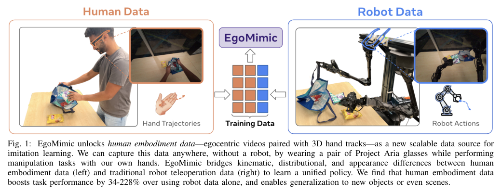
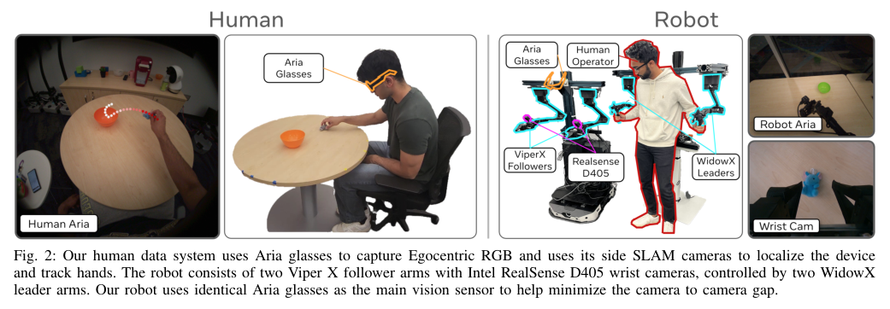

# 使用Pico 4 Ultra采集Egocentric Data：规格、对比与Workflow

2026-09-14 · Unidata · Production Workflow · 有来源缺口

[本地原件归档](../../../raw/11321de331892daf77b4a57c3b843e745f411f0f96235835315444d9de21061c) · 固定材料版本 `digest-material-11321de331892daf77b4a57c3b843e745f411f0f96235835315444d9de21061c@1` · [一手原站](https://unidata.pro/blog/pico-4-ultra-for-egocentric-data-collection/)

## 深度拆解与复核

- ==核心结论==：[Unidata](../entities/companies/Unidata.md) 依据其 4,050 小时第一视角商业数据集实采经验（2,321 小时仅头显方案 + 1,729 小时多摄像头方案，另含 1,000 小时 Robotic Household Activities Dataset），给出了 2026 年用消费级头显搭建工业化数采产线的完整工程解剖：之所以选定 `Pico 4 Ultra`（Snapdragon XR2 Gen 2、12 GB 内存较 Meta Quest 3 的 8 GB 多出 4 GB 余量、Wi-Fi 7），核心分水岭在于 SDK 是否允许后台并行运行自有录制服务（`PXR_CameraImage` 实测可达 1280×960 / 89 fps，而 Meta Quest 3 通过 `PassthroughCameraAccess` 限制在 60 Hz，Apple Vision Pro 被锁在 `Enterprise API` 之后，Project Aria 仅限研究用途），以及原厂 Motion Trackers 的 24 点全身追踪能力。本工作台核查确认：Unidata 为匹配机械臂末端（end-effector）几何关系在腕部加装 [Ouster (Stereolabs)](../entities/companies/Stereolabs.md) `ZED X One GS` 与 `ZED X Mini` 并挂载 `NVIDIA Jetson Orin`，却舍弃硬件 genlock 而改用每 500 ms 一次 WebSocket NTP 软件同步（典型偏差 2–3 ms、均值警告 6 ms、P95 报错 11 ms、起止漂移限 5 ms 内）；这种消费级头显 + 软件同步方案虽大幅压低了单台启动门槛，但在高速亚秒级抓握闭合瞬间仍存在时间与尺度折损，且 Unidata 明确不交付世界系相机位姿与标注，使其更适合作为高性价比“原始视听+骨骼流供应商”而非直接对标精密力控端真值。

#### 一、业务切口与双套生产级采集架构

1. 为什么单头显方案管不了精细操作？两套硬件拓扑拆解
   - 方案 A（headset-only setup，已采 2,321 小时）：`Pico 4 Ultra` + 5 枚 `Pico Motion Trackers`（双手各 1、腰部 1、双脚各 1；每次开机配对标定各约 5 秒，单次续航 90–110 分钟需备备用电池；全身模式 24 个骨骼点、20 ms 延迟、步态识别率 ≥ 98%、追踪器最高 200 Hz；手部原生 OpenXR 每手 26 个关键点；头手体姿态日志标称 ~90 Hz）。全部视频与姿态共享头显单时钟（亚帧对齐），适合 `TWIST2` / `EgoHumanoid` / `General Motion Retargeting`（GMR）等全身移动操作，但手掌被遮挡时头显手部骨骼失准，且录制前无外接监视预览屏幕。
   - 方案 B（multi-camera setup，已采 1,729 小时）：针对精细操作加装 4 颗 Stereolabs 相机（头显装 1 颗 ZED X Mini 立体相机 + 1 颗 ZED X One GS，双腕各装 1 颗 ZED X One GS），由机载 `NVIDIA Jetson Orin`（Orin Data 服务）通过 Wi-Fi 与头显（PICO Data 服务）协同录制。头显接入市电供电（录时仍缓降、靠每班 8 小时内间歇 15 分钟休息补电，每日目标有效采集 5–5.5 小时，理想 6 小时）。
2. 软件跨时钟同步、输出包封装与 4 级 QA 门控
   - 输出封装（自包含 Episode 文件夹）：头显产出立体 `MP4 H.264`（2160×810，~30 fps，禁用耗电且强光下不可靠的 `iToF` 深度通道，由双目下游推导深度）、~90 Hz 四元数姿态流（防万向锁）与帧 sidecar；ZED 产出 `SVO2 H.264`（SVGA 960×600，30 fps，需 `ZED SDK` 解码）及曝光/到达 Orin 双时间戳 sidecar。
   - 软件同步与完整性红线：无硬件 genlock，靠每 500 ms 一次 WebSocket NTP ping/pong 取最近 100 样本中位数（20 样本预热）并在全局共享标记前滚 2 秒缓冲起录。任一相机开启失败直接 `rejected`，掉线等待 15 秒即正常收尾（重采不修补）。导出前逐集执行 4 档 QA 判定（`PASS` / `PASS_WITH_WARNINGS` / `FAIL` / `INCOMPLETE`）：流重叠度 < 80% 警告、< 60% 失败；有效追踪占比 < 95% 警告、< 80% 失败；头显至 Orin 偏移均值 ≥ 6 ms 警告、P95 ≥ 11 ms 失败，整集起止漂移须 < 5 ms，迁移删源前执行 `MD5` 逐字节校验。

#### 二、核心数据核查、口径纠偏与工程边界

场景与利益披露：Unidata 为商用 AI 数据采集与标注外包商（文中 FAQ 直接挂载其 4,050 小时与 1,000 小时商用数据集获客入口，文末附客户背书及估算表单），撰写目的在于向具身客户推销“Pico 4 Ultra + ZED 多目采集服务与现货库”。核心工程参数与 4 级 QA 阈值公开度高且含罕见反推销实话（主动劝退逐帧边界框、背景分割与 `world-origin` 相机位姿）。

| 采集头显平台 | 传感器 RGB | 应用可访问数据流 | 深度与身体追踪 | 追踪频率 | SDK 开放度与适用判定 |
| :--- | :--- | :--- | :--- | :--- | :--- |
| Pico 4 Ultra | 2 × 32 MP | 1280×960 @ 89 fps (EgoKit 实测)；Unidata 生产写 2160×810 @ 30 fps | iToF；手部原生 26 点/手 + 扩展全身 24 骨骼点 | Motion Tracker ≤ 200 Hz（日志 ~90 Hz）；头显 IMU 未披露 | 高（12 GB RAM 并行余量，适合自建服务与全身/多目采集） |
| Meta Quest 3 | Meta 未公布 | 1280×960 或 Horizon OS v83 1280×1280 @ 60 Hz | Meta 未公布；仅原生手部追踪 | 未披露 | 中（8 GB RAM，社区工具多，但 60 Hz 帧率受限且无原生全身追踪） |
| Apple Vision Pro | 立体主摄 6.5 立体 MP | 锁在 Enterprise API 之后 | LiDAR；仅原生手部追踪 | 高（未披露） | 低（EgoKit 实测后判为不适合低成本规模化采集） |
| Meta Project Aria | 1 RGB + 2 单目 SLAM (Gen 1) | 仅限研究用途 | 无独立深度（立体重叠）；眼动 + 手部 | 双 IMU 1,000 / 800 Hz | 仅限研究（仅当目标机器人部署 Aria 传感器时匹配） |

1. ✅ 本工作台核查（软件 11 ms P95 同步与 30 fps 对精细动作的时序限制）：Unidata 将“头显-Orin 偏移典型 2–3 ms、P95 达 11 ms 才判错、全集漂移 < 5 ms”作为多目质检及格线，且生产视频帧率设为 30 fps（每帧跨度 33.3 ms）。对照同批 [Perceptron](../entities/companies/Perceptron.md) 对亚秒级（< 0.5 s）抓取闭合动作的强调、以及 [Maxinsights](../entities/companies/Maxinsights.md) / 觅蜂科技 / 清研精准全面采用硬触发曝光中点同步（≤ 1 ms，60 fps 全局快门），软件 NTP 同步在低速家务搬运中完全够用，但在高速插拔或瞬间触碰抓握闭合时，11 ms 尾部抖动叠加 33.3 ms 帧间隔可能引入 1 帧级视角错位，且无世界系 `world-origin` 位姿交付意味着下游买家仍需自担 SLAM 漂移与尺度解算成本。
2. ✅ 本工作台核查（500 小时 × 20 地点与算账逻辑）：Unidata 引述 [NVIDIA](../entities/companies/NVIDIA.md) `EgoScale`（20,854 小时人类视频的对数线性 Scaling Law）与清华 `Data Scaling Laws`（40,000+ 条示范揭示泛化随环境与物体数量呈幂律增长），并在此基础上提出“20 个地点各采 500 小时优于单点 2,000 小时”经验法则——按每班 5–5.5 小时算，20 地点 500 小时约合 95 个操作员日（每地点约 5 个班次），证明跨点位调度与后勤摩擦才是真正烧钱项。同时 Unidata 诚实标明“自动化 QA 只管帧率、丢帧、同步和追踪掉线，不管操作员疲劳或抓取犹豫，最终仍须人工审片；当前默认仅采成功示范，不含失败恢复”。
3. ⚠️ 本工作台核查（法规与生物特征合规边界）：手部 26 关键点与第一视角人脸/工位录影在欧盟 GDPR（Art. 4(14) 与 Recital 51）及美国伊利诺伊州 `BIPA`（明文列举手部几何特征）、德州 `CUBI`、华盛顿州 `RCW 19.375` 与加州 `CCPA` 下均紧贴生物识别红线。Unidata 采取了“书面知情同意覆盖训练与评估 + 禁止未同意第三方入镜 + API 与目录名加密替换设备序列号”的隔离方案，提示跨国采集团队在签单前必须前置法务审计。

#### 三、赛道横向对比与定位

| 数采路线与代表厂商 | 硬件形态与同步机制 | 交付输出物与开放态 | 核心优势与工程短板 |
| :--- | :--- | :--- | :--- |
| Unidata (Pico 4 Ultra + ZED) | 消费头显 + 4×ZED + Jetson Orin；500 ms WebSocket NTP (2–3 ms) | 2160×810 MP4 + 960×600 SVO2 + 90 Hz 24+26×2 姿态；未标注交付 | 硬件现货易采购、SDK 开放且全身+腕部兼备；缺硬同步、缺力觉及世界系 SLAM |
| 觅蜂科技 (MEgo View + MEgoVista) | 自研 3 鱼眼头显 + 2 腕摄；亚毫秒硬件同步 (60 fps) | 4.29 mm PA-MPJPE-p 与 0.65–2.83 mm 头部世界系 4D 轨迹 | 独立动捕验证米级绝对尺度与抗旁人干扰；需专用自研硬件且偏离线重算 |
| [Maxinsights](../entities/companies/Maxinsights.md) (MaxSLAM + MaxGlove) | 自研硬同步双目头显 + 触觉力手套；当日 MaxLoop 质检 | 4.24 mm 相机 ATE、99.90% 帧完整率，成品模型就绪交付 | 4 关串联良率 96%、商业现货规模最大（200万h+）；重资产直营壁垒高 |
| Generalist AI (Edge-Zero UMI) | 无源注塑 1-DoF UMI + SD 卡物理快递 | 云端 Airflow 4 离线 6-DoF 解算 + 10 PB AV1 | 端侧极简零同步摩擦、已跑通 100 万h；仅单自由度刚性夹爪，缺全身与触觉 |

### 观点与可反驳条件

- ==观点==：Unidata 的实践证明消费级 XR 头显（`Pico 4 Ultra` 凭借 12 GB RAM 与开放 `PXR_CameraImage`）配合外挂腕部 `ZED` 与 `Jetson Orin` 已足以支撑千小时级全身移动与中等精度操作采数，是中小研发团队免于从头流片硬件的最快过渡路径；但当具身基模采购标尺从“有视频+骨骼”转向“硬同步毫米级接触真值 + 力/触觉信号”时，纯软件 NTP（11 ms P95 容忍度）与不交付世界系相机轨迹的消费头显组合在精细灵巧操作上的天花板会迅速显现。
- ==推翻条件==：
  1. ① 若 2027 年底前开源生态（如 `EgoKit` 或 PICO/Quest 官方系统更新）通过内置芯片级时间同步将“头显 + 外接双腕相机”跨设备软件漂移稳定压缩至 < 1 ms 且支持 60–90 fps 同步输出，同时下游策略在仅凭 Unidata 30 fps 立体视频离线重建后于精密插接任务上追平专用硬件方案，则消费级头显与自研多目采集硬件间的精度代差将被拉平；
  2. ② 若欧美主流具身实验室因 `BIPA` / `GDPR` 生物识别诉讼风险大幅收紧对第三方面部/手部几何采集数据的合规准入，导致消费级穿戴外包交付周期与合规成本暴涨 2 倍以上，则依赖人类穿戴头显的大规模外包数采商将被迫加速萎缩。

---

## 原文摘录与一手信源存证

> 你可以在 Pico 4 Ultra上部署自己的录制服务，并直接从头显读取其摄像头、手部追踪和全身姿态数据。并非每款头显都允许你触达这些数据，正是这种访问权限让egocentric 数据采集在此变得切实可行。
> — 原文摘录，PDF p.1；证据 `digest-material-11321de331892daf77b4a57c3b843e745f411f0f96235835315444d9de21061c-excerpt-1@1`

> 不过，仅靠头显无法覆盖fine manipulation。这需要腕部摄像头，而随之而来的是需要对齐的第二个时钟，以及每个 episode 都要通过的一次检查。这就是我们运行的两套setup ，在采集项目中，选择其中一套是第一个真正的决策。
> — 原文摘录，PDF p.1；证据 `digest-material-11321de331892daf77b4a57c3b843e745f411f0f96235835315444d9de21061c-excerpt-2@1`

> 一个经过训练的 policy—— 即把机器人看到的内容转化为其运动方式的模型—— 能否迁移，取决于egocentric 与外部视角（exocentric ）数据之间的区别。俯视摄像头记录的是任务本身；头戴式或腕戴式摄像头记录的才是机器人将要看到的内容。对manipulation 最重要的信号只有从任务内部才能看到：手相对于物体的位置、grasp closure 的几何形态、接触发生的精确时刻。
> — 原文摘录，PDF p.2；证据 `digest-material-11321de331892daf77b4a57c3b843e745f411f0f96235835315444d9de21061c-excerpt-3@1`

一手材料：

- Pico 4 Ultra for Egocentric Data Collection: Specs and Production Workflow — Unidata · Unidata · [原站](https://unidata.pro/blog/pico-4-ultra-for-egocentric-data-collection/) · [主体档案：Unidata](../entities/companies/Unidata.md) · [NotebookLM](https://notebook.google.com/notebook/cac99041-d3b9-449e-a192-12bb4b1ad391) · [Drive](https://drive.google.com/file/d/16qN7xlt9NROFJg6E7OQBFHUJtfbEw6Sh/view?usp=drivesdk)
  材料版本 `digest-material-2f958e380bd7c8819eea008eb9a9caa2596a5c5a5ab2518e25abda3c55f92919@2`；获取方式 `http_full_text`。
  > You can put your own recording service on a Pico 4 Ultra and read its cameras, its hand tracking and full-body pose straight off the headset. — 原文提取
  > The headset alone will not cover fine manipulation, though. That takes wrist cameras, and with them come a second clock to reconcile and a per-episode check to pass. — 原文提取
- EgoMimic: Scaling Imitation Learning via Egocentric Video · 论文作者 · [原站](https://arxiv.org/abs/2410.24221) · [主体档案：Simar Kareer](../entities/people/Simar%20Kareer.md) · [NotebookLM](https://notebook.google.com/notebook/cac99041-d3b9-449e-a192-12bb4b1ad391) · [Drive](https://drive.google.com/file/d/13hhjhZ5rc8Ha4TwcYSEvrpySle0Rdzix/view?usp=drivesdk)
  材料版本 `digest-material-227fe304bd198d2c54242ec3aaf5c7eaa78579059820228f46005734a3784c85@1`；获取方式 `http_pdf`。
  > Fig. 1: EgoMimic unlocks human embodiment data—egocentric videos paired with 3D hand tracks—as a new scalable data source for imitation learning. — PDF p.1
  > Abstract— The scale and diversity of demonstration data required for imitation learning is a significant challenge. — PDF p.1
- EgoScale: Scaling Dexterous Manipulation with Diverse Egocentric Human Data · 论文作者 · [原站](https://arxiv.org/abs/2602.16710) · [主体档案：Danfei Xu](../entities/people/Danfei%20Xu.md) / [主体档案：NVIDIA GEAR Lab](../entities/labs/NVIDIA%20GEAR%20Lab.md) / [主体档案：Ruijie Zheng](../entities/people/Ruijie%20Zheng.md) · [NotebookLM](https://notebook.google.com/notebook/cac99041-d3b9-449e-a192-12bb4b1ad391) · [Drive](https://drive.google.com/file/d/1CUTnSUejWUAe8aHEIJZunMgoxTmzCkL1/view?usp=drivesdk)
  材料版本 `digest-material-39c691baf374a154e26ffc0098b97037875909495013d4017d97761716ff2735@1`；获取方式 `http_pdf`。
  > Human behavior is among the most scalable sources of data for learning physical intelligence, yet how to effectively leverage it for dexterous manipulation remains unclear. — PDF p.1
  > Human behavior is one of the most scalable sources of data for learning physical intelligence. — PDF p.1
- EgoKit: Towards Unified Low-Cost Egocentric Data Collection with Heterogeneous Devices · 论文作者 · [原站](https://arxiv.org/abs/2605.16797) · [主体档案：Liuchuan Yu](../entities/people/Liuchuan%20Yu.md) · [NotebookLM](https://notebook.google.com/notebook/cac99041-d3b9-449e-a192-12bb4b1ad391) · [Drive](https://drive.google.com/file/d/1VMmLsUHRpkg-5S9VRYjVyLLs48NxubEP/view?usp=drivesdk)
  材料版本 `digest-material-f48ae57d9f085844bfce681aec7c375e7712e4652ccf5710e552891631fc1738@1`；获取方式 `http_pdf`。
  > to any supported host without custom hardware fabrication. EgoKit is available at https://egokit.chuange.org/. — PDF p.1
  > Scaling data has become a central driver of progress in robot learning, but collecting demonstrations directly on robots through teleoperation is expensive, hardware-dependent, and difficult to scale beyond a single lab. — PDF p.1
- TWIST2: Scalable, Portable, and Holistic Humanoid Data Collection System · 论文作者 · [原站](https://arxiv.org/abs/2511.02832) · [主体档案：Yanjie Ze](../entities/people/Yanjie%20Ze.md) · [NotebookLM](https://notebook.google.com/notebook/cac99041-d3b9-449e-a192-12bb4b1ad391) · [Drive](https://drive.google.com/file/d/1IziIPgRcalKMCiu5ls2imcYWzroYlSl_/view?usp=drivesdk)
  材料版本 `digest-material-7c627455b7b8d4a86c321002c757150f36a6de5fccda7f4d3a017df18352dd11@1`；获取方式 `http_pdf`。
  > Fig. 1: We introduce TWIST2, a holistic humanoid data collection system designed with scalability and portability. — PDF p.1
  > Abstract— Large-scale data has driven breakthroughs in robotics, from language models to vision-language-action mod- els in bimanual manipulation. However, humanoid robotics lacks equally effective data collection frameworks. — PDF p.1
- EgoHumanoid: Unlocking In-the-Wild Loco-Manipulation with Robot-Free Egocentric Demonstration · 论文作者 · [原站](https://arxiv.org/abs/2602.10106) · [主体档案：Modi Shi](../entities/people/Modi%20Shi.md) · [NotebookLM](https://notebook.google.com/notebook/cac99041-d3b9-449e-a192-12bb4b1ad391) · [Drive](https://drive.google.com/file/d/1N4_hrRJ5hV40OgfCL8XwTBzpaoLQNBck/view?usp=drivesdk)
  材料版本 `digest-material-73ed9bfc11c60c12fd8eb2652f47a0b64d423d7f266b6d81f8023ca47fa0b5e2@1`；获取方式 `http_pdf`。
  > Fig. 1: Introducing EGOHUMANOID, the first investigation on human-to-humanoid transfer for whole-body loco-manipulation. — PDF p.1
  > alignment pipeline lies two key components. The view alignment reduces visual domain discrepancies caused by camera height and perspective variation. — PDF p.1
- Retargeting Matters: General Motion Retargeting for Humanoid Motion Tracking · 论文作者 · [原站](https://arxiv.org/abs/2510.02252) · [主体档案：Joao Pedro Araujo](../entities/people/Joao%20Pedro%20Araujo.md) · [NotebookLM](https://notebook.google.com/notebook/cac99041-d3b9-449e-a192-12bb4b1ad391) · [Drive](https://drive.google.com/file/d/1eivKlvu0CVc4zHTj8XVSOuIxzO6PXU_1/view?usp=drivesdk)
  材料版本 `digest-material-cc910a8606c2de1d87c5f34a9e1753165f3cdbefe2b1d61f1bf608dbd419f0a5@1`；获取方式 `http_pdf`。
  > Abstract— Humanoid motion tracking policies are central to building teleoperation pipelines and hierarchical controllers, yet they face a fundamental challenge: the embodiment gap between humans and humanoid robots. — PDF p.1
  > Developing humanoid policies that truly generalize to real-world environments requires learning from data that captures physical interaction with the world. — PDF p.1
- Data Scaling Laws in Imitation Learning for Robotic Manipulation · 论文作者 · [原站](https://arxiv.org/abs/2410.18647) · [主体档案：Fanqi Lin](../entities/people/Fanqi%20Lin.md) · [NotebookLM](https://notebook.google.com/notebook/cac99041-d3b9-449e-a192-12bb4b1ad391) · [Drive](https://drive.google.com/file/d/1GGJSlUeP_nHDFCezx-SWpZ1A8DjBKJCo/view?usp=drivesdk)
  材料版本 `digest-material-e3ee296bdf1b34dde4816d36207a0b2b496c66ab352299702e9efc8187e7ec07@1`；获取方式 `http_pdf`。
  > Data scaling has revolutionized fields like natural language processing and com- puter vision, providing models with remarkable generalization capabilities. — PDF p.1
  > Scaling has been a key driver behind the rapid advancements in deep learning (Brown et al., 2020; Radford et al., 2021). — PDF p.1

归属与范围：完成一手信源核验与分诊：复用 Unidata 官方工程博客(2026-08-21)及被引全部 7 篇 arXiv 一手论文(EgoMimic、EgoScale、EgoKit、TWIST2、EgoHumanoid、GMR、Data Scaling Laws)；核对 Pico 4 Ultra 生产参数(2,321h 仅头显 + 1,729h 多相机 = 4,050h)、软件同步阈值(2–3 ms 典型 / 11 ms P95)与 4-平台 SDK 差异，保留 Quest 3 跨设备实测成本与法规适用性待核查缺口。

来源缺口：

- `pending_verification`：Unidata 明确披露其仅规模化运营 Pico 4 Ultra 设备群，对 Meta Quest 3、Apple Vision Pro 与 Project Aria 的对照均基于官方开发文档与 EgoKit 论文而非同场实测；跨设备真实规模化单小时成本及“20 地点各 500 小时优于单一地点 2,000 小时”的经验法则尚缺对照消融实验。
- `not_disclosed`：Unidata 未公开其 4,050 小时 Egocentric Video Dataset 与 1,000 小时 Robotic Household Activities Dataset 的商业售价、每班次人工审核报废率（pass rate）以及经第三方策略训练验证的下游成功率收益。
- `unverified_claim`：实体关系入库跳过 (Unidata --produces--\> Egocentric Video Dataset (4,050h))：谓词 'produces' 不允许 to 实体类型 'company'（仅允许 \['product'\]）
- `unverified_claim`：实体关系入库跳过 (Unidata --uses\_artifact--\> ZED SDK)：谓词 'uses\_artifact' 不允许 to 实体类型 'company'（仅允许 \['product'\]）

[返回赛道总览](../赛道总览.md#digest-11321de331892daf) · [返回导读索引](README.md) · [主体档案库](../entities/README.md)
