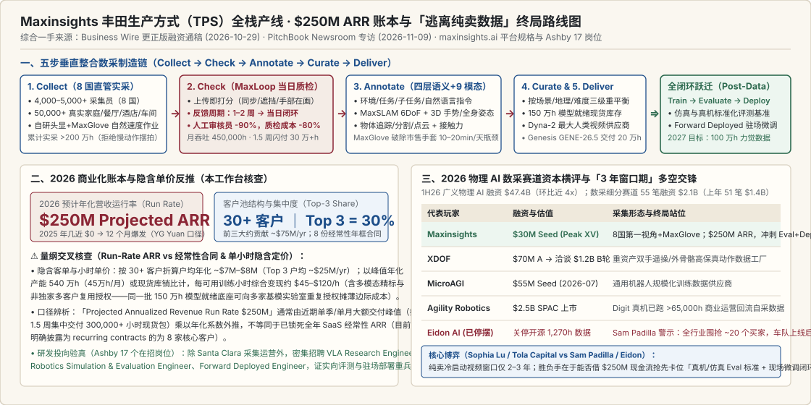

# 华人物理AI公司完成3000万美元种子轮

2026-10-29 · Maxinsights · Official Engineering Blog & Release · 有来源缺口

[本地原件归档](../../../raw/75d06cb5e5936f22f9e5b8ec45d724d7aab35f54cbe811789e95ffd4c46bf76d) · 固定材料版本 `digest-material-75d06cb5e5936f22f9e5b8ec45d724d7aab35f54cbe811789e95ffd4c46bf76d@1` · [一手原站](https://www.businesswire.com/news/home/20261022672609/en/)

## 深度拆解与复核

- ==核心结论与全栈商业起底==：本篇将 Maxinsights（海宇数维）于 2026-10-29 发布的 Business Wire 官方更正版 \$30M 种子轮暨 MaxLoop / MaxGlove 产品发布通稿、官网最新挂载的 2026-11-09 PitchBook Newsroom 深度专访（《*Physical AI's data boom is a race to get out of the data business*》）以及官网底层 平台路线图与 Ashby 17 个在招研发岗位 进行全量合龙对账。核心增量发现有三：
  1. 商业化爆发速度远超市场预期：CEO 袁宇光（Yuguang "YG" Yuan）向 PitchBook 最新披露，公司 2025 年几乎尚无客户与收入，而 2026 年预计年化营收运行率（Projected Annualized Revenue Run Rate）已飙升至 2.5 亿美元（\$250M），近期更创下 在 1.5 周（a week and a half）内向客户集中交付超 300,000 小时（30 万小时）训练视频 的工业级吞吐纪录；目前服务 30+ 家前沿 AI 与机器人客户（含 8 份经常性年框合同，OpenAI 等重启机器人布局的顶级实验室亦在此轮物理 AI 数据采购潮之列），前三大客户贡献总营收的 30%（约合年化 ~\$75M，单大客年化采购体量达 \$20M–\$30M 级）。
  2. “丰田生产方式（TPS）”垂直整合拆解：首次完整披露支撑 450,000 小时/月 处理产能的两大核心自研武器——智能体在环实时质检系统 MaxLoop（视频落地瞬间自动打分，将采集员纠偏反馈从行业普遍的 1–2 周缩短至当日 Same-Day，砍掉 90% 人工复核团队规模、降低约 80% 质检成本）与免繁琐标定的触觉力传感手套 MaxGlove（攻克市售数据手套日均仅能产出 10–20 分钟 有效数据的标定死穴，由 Genesis AI 联合实测，目标 2027 年交付 1,000,000 小时 接触力数据）。
  3. 终局战略明牌——“数据繁荣的本质是一场逃离纯数据生意的竞速”：无论是投资方 Tola Capital 副总裁 Sophia Lu 坦言的 “绝不应只押注纯卖数据（You shouldn't bet just on pure data）”，还是停摆同行 Eidon AI 创始人 Sam Padilla 尖锐指出的 “全行业围着区区 20 个买家转，真机部署后自采闭环将令外采需求退潮”，均指向同一终局——Maxinsights 正利用未来 2–3 年基模冷启动窗口的高额现金流，沿官网宣告的 Train → Evaluate → Deploy 全闭环向机器人模型评测基准（Evaluation）与现场前线部署微调（Forward Deployment）全速跃迁。
- 场景与利益披露（主体纠正与商业激励标注）：本条目的触发线索为国内公众号 PhysicsAI 的二手编译短讯，本工作台已直接穿透并锁死 Business Wire 官方更正版英文原稿（注：官方特意发稿替换了 10 月 22 日初版通稿的多处表述）与 PitchBook 一手专访。阅读时需注意：\$250M 为公司管理层在融资与商务拓展期对外披露的 预计年化运行率（Projected Run Rate），未附审计财报；MaxLoop 降本 80% 与缩减 90% 审核人力亦属相对传统全人工抽检基线的内部运营口径，本工作台在下文逐项给出单位经济学交叉核查。

---

### 一、 二手微信编译稿谬误纠正与官方五步“丰田生产方式（TPS）”全栈还原

#### 1. ✅ 一手原件勘误（本工作台核查）：纠正二手编译稿的两处硬件与地域失真
对比触发线索 PhysicsAI 中文编译稿与 Maxinsights 官方 Business Wire 更正版通稿（`digest-material-205fe390…`）及 PitchBook 专访，发现二手稿存在两处必须廓清的事实偏差：
- 传感器穿戴形态勘误：中文二手稿声称采集员“佩戴自研的头戴、腕带、胸前三路相机”；而检视官方更正版英文通稿、MaxSLAM 技术报告与 PitchBook 现场报道（“4,000 people across eight countries are wearing cameras and gloves”），Maxinsights 实际规模化部署的标准终端是 自研硬同步双目立体头戴相机（Proprietary Synchronized Stereo Head-Mounted Camera）+ 正在铺开的 MaxGlove 力传感手套，并未在官方更正版技术栈中采用“头+腕+胸三路独立相机”方案（二手稿混入了早期竞品或已废弃的初版公关草稿描述，这正是官方特意发布 CORRECTING and REPLACING 更正通稿的原因之一）。
- 全球运营国家数更新：通稿正文早期段落提及 More than 5,000 contractors in six countries，而通稿文末 About Maxinsights 标准简介与 2026-11-09 PitchBook 专访已统一更新为 横跨 8 个国家（美国、墨西哥、土耳其、中国、泰国、越南、印尼、南非；硅谷 Santa Clara 总部直辖中国、印尼办公室，并在土耳其与墨西哥新设直属办公室）、常驻活跃采集员 4,000–5,000+ 人，通过各国本地劳务机构签约但由 Maxinsights 自建团队直接调度管理，拒绝层层转包给外部外包商（rather than handing collection off to a vendor）。

#### 2. 拒绝“慢动作摆拍棚”：对标丰田生产方式（TPS）的五步全自研闭环
CEO 袁宇光（上海交大本科、前工业机器人公司 Mega Gear Robotics 联创并购退出、前跨国动力管理巨头 Eaton 最年轻高管团队负责人，曾直管 \$150M 年营收业务线与 1,500+ 名员工）与 CTO 汪堃（北大毕业、早期 Google X / Waymo 工程师、自动驾驶独角兽 轻舟智航 QCraft 联创，率 1,000+ 人团队 将智驾方案量产装车超 100 万辆，核心工程班底来自 Google、Microsoft、Meta、Waymo 与 Hulu）将汽车工业的丰田生产方式（Toyota Production System, TPS）直接搬入物理 AI 数采：
- 直击同行“摄影棚慢动作摆拍”死穴：通稿一针见血地指出，市面上多数数采竞品在搭建好的假样板间（mock environments）里摆拍，甚至要求采集员故意放慢手部动作（ask operators to slow their hands）以便后处理算法更容易跟踪；但真机落地面对的是每几分钟就突发意外状况的真实家庭与餐厅厨房。Maxinsights 给原本就在家庭、餐厅、酒店与车间干活的劳动者付费，按真实自然作业速度（natural speed）记录洗碗机装卸、制作冰沙、洗车、叠衣等全充满边缘意外（edge cases）的原生态交互。
- 端到端五步内部闭环（Five-Step In-House Stack）：
  1. Collect（原生态实采）：8 国自有网络佩戴自研防抖硬同步头显（告别晃动失真的 iPhone 或 GoPro 视频）在真实场景采集第一视角操作；
  2. Check（自动化与人工双重门禁）：逐条核验画面质量、任务完成度、手物可见性、多传感器时间同步与元数据完整性；
  3. Annotate（四层语义 + 多维物理标注）：用自研模型打上 环境（environment）、任务（task）、子任务（subtask）、指令（instruction） 四层标签，同步解算手部姿态、全身运动与手物交互状态；
  4. Curate（多维检索与分布重平衡）：支持按任务、场景、地理文化、行为模式与复杂度（Easy/Medium/Hard）检索并动态重平衡语料配比；
  5. Deliver（现货闪付与模型反馈回流）：累计实采超 2,000,000 小时（200 万小时），沉淀 1,500,000 小时（150 万小时）可立即交付的模型就绪（model-ready）现货库，并将客户模型训练暴露的薄弱环节直接喂回下一轮采集派单。

---

### 二、 两大自研核心产品深剖：MaxLoop 实时流式质检与 MaxGlove 轻标定触觉手套

#### 1. MaxLoop：把“人事成本黑洞”改写为工程流式质检（人工团队 -90%，复核成本 -80%）
- 为什么通用标注工具在真实场景全线崩溃？ 通稿列举了野外实采击穿常规视觉工具的四大高频杀手：① 手部频繁消失在被抓物体背面（hands disappear behind objects）；② 多人手部同时闯入同一画面（several people's hands enter the same frame）；③ 操作员佩戴橡胶手套或戒指改变手部外观（operators wear gloves and rings）；④ 自然高速动作引发局部运动模糊（motion blurs）。
- MaxLoop 闭环机制与四大硬指标：Maxinsights 用自身百万小时真实脏数据从头训练专属手部追踪与质检模型，构建智能体在环（agent-in-the-loop）平台 MaxLoop，在视频上传落地的瞬间完成自动打分与异常定位：
  - 反馈纠偏周期：从行业普遍滞后的 1–2 周（one to two weeks）压缩至当日反馈（same-day feedback）——避免某地数百名采集员因佩戴角度偏斜白干两周才被发现整批报废；
  - 人力与成本削减：人工复核团队规模直接缩减 90%（cuts the human review team by 90%），整体质检复核成本下降约 80%（review costs are down roughly 80%）；
  - 月度吞吐与多维榨取：支撑全公司每月处理高达 450,000 小时/月（45 万小时/月） 的海量流水线，并在质检同时从同一段视频中并行抽取出位姿、物体状态、接触与力先验（让过去只能教模型一件事的 1 小时视频同时提供多重物理监督）。
- ✅ 原位复核 1（本工作台测算 · 450,000 小时/月 产能与 1.5 周交付 30 万小时 物理自洽性校核）：
  - 采集端人效校核：按 PitchBook 披露的当前在岗活跃采集员 4,000–5,000 人 计，月处理峰值 450,000 小时 折合日均流转 15,000 小时/天，对应单名采集员日均上传约 3.0–3.75 小时 有效作业录像（扣除备料、休息、上传与约 75% 综合良率折耗后，完全符合半日制或全职家政/餐饮合同工真实佩戴工时上限，不存在脱离物理常识的虚报）。
  - 突发大单交付校核：袁宇光披露近期在 1.5 周（约 10.5 天）内交付超 300,000 小时。若纯靠收到订单后再派人现采，10.5 天 最多新产出约 15.7 万小时；之所以能闪电交付 30 万+ 小时，核心在于其账上已备妥 150 万小时模型就绪（model-ready）结构化现货库存，配合 Curate 检索重平衡管线按客户指定任务分布一键切片打包并辅以定向补采——这揭示了具身数据基础设施最重要的商业秘密：标准化现货语料库支持向多家基模客户非独家授权复用（Multi-licensing），从而展现接近软件/IP 授权的边际爆发力。

#### 2. MaxGlove：击穿市售数据手套“日均仅采 10–20 分钟”的标定死锁
- 纯视觉的物理盲区：相机拍不到手掌捏持鸡蛋或重锤时的真实握力（how hard a hand grips）、物体重量（how heavy an object is）、接触面压力转移、转动阻力与微滑移（slip）。缺失力与力矩（force and torque）信号，机器人要么捏碎脆弱器皿，要么在负载突变时脱手滑落。
- 为什么此前全行业没人能规模化采力觉数据？ 通稿披露了一个极关键的一线硬件瓶颈：市面上现有的商用动捕与力传感手套需要冗长且反复重做的标定流程（lengthy or repeated calibration cycles），穿戴漂移严重，导致单套设备每天最终只能产出区区 10–20 分钟（10 to 20 minutes of usable capture a day）可用数据，根本无法下放给数千名非专业合同工。
- MaxGlove 破局目标：Maxinsights 选择自研自造免繁琐标定、可直接与第一视角头显无缝集成的耐用型传感手套 MaxGlove，目前已交由 Genesis AI（GENE-26.5 团队）进行联合实测，计划铺向现有全球采集网络，目标在 2027 年内规模化采集 1,000,000 小时（100 万小时）真实接触力数据。领投方 Peak XV（原红杉印度/东南亚）董事总经理 Rohit Agarwal 对此评价称：“赛道里几乎每家公司都在按小时卖时长，唯有 Maxinsights 把质量控制当成工程问题而非外包人力成本来解，这让试过其他供应商的实验室不断回头复购。”

---

### 三、 2026-11-09 PitchBook 专访深剖：\$250M 预计 ARR 账本与“逃离纯数据生意”的生死竞速

#### 1. ⚠️ 原位复核 2（本工作台测算）：拆解 \$250M 年化营收运行率、客户集中度与隐含单价
PitchBook 报道将物理 AI 资本热度与 Maxinsights 的财务爆发置于显微镜下：2026 上半年广义物理 AI 吸金高达 \$47.4B（474 亿美元，接近 2025 下半年的 4 倍）；PitchBook 口径下机器人训练数据细分赛道今年已完成 55 笔融资共 \$2.1B（21 亿美元），显著超越去年的 51 笔 / \$1.4B——其中主攻双手遥操数据的 XDOF 6 月刚拿完 \$70M A 轮便已在洽谈 \$1.2B（12 亿美元）估值 B 轮，MicroAGI 7 月获 \$55M 种子轮，Wing VC 5 月联合领投 Human Archive \$8.2M，而 Maxinsights 则在仅融 \$30M 种子轮的情况下跑出了惊人的现金流指标：
- 核心披露数字：2025 年几无收入 $\to$ 2026 年预计年化营收运行率（Projected Annualized Revenue Run Rate）达 \$250M（2.5 亿美元）；总客户数 30+ 家，前三大客户（Top 3 Customers）合计占总营收的 30%，另有 8 家客户签署长期经常性合同（recurring contracts）。
- 单位经济学交叉算账（本工作台测算）：
  1. 大客与长尾客单结构：\$250M × 30% = \$75M，即前三大基模客户（结合公开点名与买家画像，核心指向 Dyna Robotics、Genesis AI 及以 OpenAI 为代表的北美超大规模多模态/具身实验室）平均每家年化采购额高达 ~\$25M/年；其余约 27+ 家中腰部客户合计贡献 \$175M（户均年化约 ~\$6.5M，或单笔数百万美元现货数据包采购）。相比软件行业大客动辄占 60%–80% 的畸形集中度，前三大占 30% 的分散度在早期 ToB 基建中已属相对健康。
  2. 隐含每小时综合变现能力：若以全年累计可售/新产出的数百万可用工时及多客户非独家复用折算，一套包含 MaxSLAM 毫米级位姿与四层精细标注的模型就绪数据，在单一买方侧的采购单价约在 \$15–\$50 / 可用小时 区间（定制独占或带手套高频精标包更高），而一份现货底库只要卖给 3–5 家基模团队，单小时物理采集资产的累计综合变现即可放大至 \$60–\$150+ / 小时，毛利结构发生质变。
  3. ⚠️ 严谨口径预警（Run-Rate vs 已锁定经常性 ARR）：必须清醒区分 Annualized Revenue Run Rate（年化运行率） 与 SaaS 意义的已签约年度经常性收入（Contracted ARR）。具身基模预训练具有强烈的脉冲式大单特征（例如某实验室启动新一代基模训练，在 1.5 周内一次性提货 30 万+ 小时现货库），若将单月或单季脉冲交付峰值乘以 12 或 4 外推，Run Rate 会极为亮眼；而通稿明确指出目前签署 经常性合同（recurring contracts）的客户为 8 家。能否把脉冲式现货买断转化为按月持续订阅的增量长尾流，直接决定 2027 年 \$250M 的成色。

#### 2. ✅ 原位复核 3（本工作台核查）：多空终局交锋与 Ashby 17 岗位实锤验证 Train → Evaluate → Deploy 转型
PitchBook 专访最精彩之处，在于把多头（Maxinsights CEO 袁宇光、Tola Capital 副总裁 Sophia Lu、Wing VC 合伙人 Tanay Jaipuria）与空头（今年刚刚关停开源的 [Eidon AI](Robotics%20Data%20is%20a%20Broken%20Business%20%26%20Robot%20Training%20Data%20Guide_%20Eidon%20AI%20Post-Mortem%20and%201%2C270%2B%20Hours%20Open%20Ego.md) 创始人 Sam Padilla）摆在同一张桌面上对质：
- 空头判词（Sam Padilla & 真机自采飞轮启动）：Padilla 直言不讳地指出纯第三方数采有两大结构性死穴——① 买方池极度狭窄：“整个新兴产业都在抢着服务区区 20 个人（trying to serve 20 people）”；② 真机上线后的替代退潮：随着机器人真正走向商业部署，机队将在干活中自动回流最契合本体的实战数据——典型例证是以 \$2.5B（25 亿美元）估值借壳（SPAC）上市的人形机器人公司 Agility Robotics（Digit），官方披露已积累超 65,000 小时真实商业运营自采数据。Wing VC 合伙人 Jaipuria 亦认同：“终极最有价值的数据来自真正干活的机器人，当前数据公司的赌注是先吃下眼前的现金流。”
- 多头破局路线（Sophia Lu & 袁宇光的“逃离纯数据竞速”）：面对同一倒计时，投资人 Sophia Lu 给出了清晰的三步闭环跃迁图——机器人学习是一个 训练（Train）→ 测试评估（Test/Evaluate）→ 部署（Deploy）→ 回流微调数据（Fine-tune Loop） 的闭环；当冷启动数据不再是最紧迫瓶颈时，头部供应商必须切入后半程，帮客户测试评估机器人模型并驻场辅助部署微调。袁宇光对此表态极为鲜明：“你可以选择守着细分利基市场赚眼前的利润，而我们的选择是成为整个物理 AI 的全栈基础设施商（infrastructure provider for the whole physical AI）。”
- ✅ 官网架构与 Ashby 招聘库交叉验真（本工作台核查）：为检验“向评测与部署转型”究竟是融资公关话术还是真实真金白银投入，本工作台直接穿透核查了 maxinsights.ai 官网路线图与公司 Ashby 招聘系统（jobs.ashbyhq.com/maxinsights）当前开放的全部 17 个正式岗位：
  - 官网首页已正式将公司能力矩阵改版为 Train · Evaluate · Deploy 三大并列支柱（明确写入构建可复现的真实世界任务套件与跨本体评测基准 standardized, reproducible evaluation across tasks, environments, and embodiments）；
  - 在 17 个在招岗位中，除全球采集运营与硬件（Hardware Engineer、SLAM / 3D Vision Engineer）外，已密集设立 Robotics Simulation & Evaluation Engineer（机器人仿真与评测工程师）、VLA / World Model Research Engineer（具身基模研究工程师） 以及参照 Palantir 模式的 Forward Deployed Engineer（前线驻场部署工程师，深入机器人客户真机现场打通评测与后训练数据回流）——实锤证实公司正把 \$250M Run Rate 产生的充沛现金流砸向后半程评测与部署工具链。

### 观点与可反驳条件
- ==观点==：Maxinsights 凭借汽车/工业级的垂直整合（自研硬同步头显 MaxSLAM + 当日闭环质检 MaxLoop + 8 国直管产线 + 150 万小时可多客户复用现货库），在仅融 \$30M 种子轮的体量下跑出 \$250M 预计年化运行率，证明了“工业良率管控”在具身基模冷启动期具备极强的商业变现爆发力；但正如 PitchBook 标题所揭示，纯卖人类预训练视频的高毛利窗口仅有 2–3 年，公司能否兑现长期估值取决于能否在真机车队自采闭环成熟前，把 MaxGlove 触觉标准与 Evaluate + Forward Deploy 真机评测微调平台变成下游离不开的行业基础设施。
- ==推翻条件==：
  1. ① 若 2027 年脉冲式预训练现货大单消退后，Maxinsights 的经常性签约客户（目前 8 家）未能扩容至 15–20+ 家，导致实际经审计年营收较 \$250M 峰值运行率回落超 40%，则说明受限于 ~20–30 家前沿买家的窄池效应，单靠现货库多客授权无法维持持续高增长；
  2. ② 若 MaxGlove 在 2027 年铺向数千名海外合同工后，因柔性传感器疲劳磨损、汗液腐蚀或跨手型标定漂移导致日均有效采集时长跌回 <1 小时、未能兑现 1,000,000 小时高信噪比力觉数据交付，则其 Axis II 经验密度接力棒将受阻；
  3. ③ 若头部具身基模实验室（如 Physical Intelligence、Dyna、Genesis、Figure、特斯拉与英伟达）坚持将真机评测基准（Eval Arena）与现场部署回流管线 100% 视为核心机密内部自建、拒绝向第三方供应商开放真机在环接口，则 Train → Evaluate → Deploy 的后半程转型将面临天花板。

---

## 原文摘录与一手信源存证

> 近日，总部位于硅谷的 Maxinsights （中国实体为“海宇数维”）宣布完成 3000 万美元种子轮融资。本轮由 Peak XV （原红杉印度/ 东南亚）领投，Tola Capital 、South Park Commons、渶策资本与 Alumni Ventures 跟投。
> — 原文摘录，PDF p.1；证据 `digest-material-75d06cb5e5936f22f9e5b8ec45d724d7aab35f54cbe811789e95ffd4c46bf76d-excerpt-1@1`

> 两位创始人都是华人。 CEO 袁宇光毕业于上海交通大学，曾联合创办工业机器人公司 Mega Gear Robotics，后该公司被收购，他还曾在全球动力管理巨头 Eaton 担任管理职务。CTO汪堃毕业于北京大学，曾在 Google 自动驾驶项目担任工程师，后回国联合创办轻舟智航（QCraft），其自动驾驶技术已落地超百万辆。
> — 原文摘录，PDF p.1；证据 `digest-material-75d06cb5e5936f22f9e5b8ec45d724d7aab35f54cbe811789e95ffd4c46bf76d-excerpt-2@1`

> 随着机器人基础模型的加速发展，算力和算法之外，数据正在成为一道越来越难跨越的门槛。机器人想学会叠衣服、洗碗，就必须大量学习人类真实完成任务的过程，而这类数据此前几乎没人规模化采到过。
> — 原文摘录，PDF p.1；证据 `digest-material-75d06cb5e5936f22f9e5b8ec45d724d7aab35f54cbe811789e95ffd4c46bf76d-excerpt-3@1`

一手材料：

- CORRECTING and REPLACING Waymo, Google and Microsoft Alums Raise \$30M to Build the Data Layer for Physical AI · Maxinsights（公司更正新闻稿，Business Wire分发） · [原站](https://www.businesswire.com/news/home/20261022672609/en/) · [主体档案：Maxinsights](../entities/companies/Maxinsights.md) / [主体档案：Peak XV Partners](../entities/funds/Peak%20XV%20Partners.md) / [主体档案：Tola Capital](../entities/funds/Tola%20Capital.md) · [NotebookLM](https://notebook.google.com/notebook/cac99041-d3b9-449e-a192-12bb4b1ad391) · [Drive](https://drive.google.com/file/d/1Xonxn_FFjceKhKst7wQ9j_XCtTCsQMOX/view?usp=drivesdk)
  材料版本 `digest-material-205fe390ebab7205efa6a019de548b78d5f1ce3b5a6f423c2a349f1083c19f8c@1`；获取方式 `notebooklm_indexed_text`。
  > Maxinsights, the company building the data layer for physical AI, today announced \$30 million in seed funding led by PeakXV, with participation from Tola Capital, South Park Commons, INCE Capital, and Alumni Ventures. — 原文提取
  > , a sensor glove for capturing tactile touch and force for a new era of data collection. — 原文提取
- Physical AI's data boom is a race to get out of the data business (Maxinsights \$250M Projected ARR Interview) · PitchBook News (Maxinsights Official Newsroom) · [原站](https://pitchbook.com/news/articles/physical-ais-data-boom-is-a-race-to-get-out-of-the-data-business) · [主体档案：Maxinsights](../entities/companies/Maxinsights.md) / [主体档案：Tola Capital](../entities/funds/Tola%20Capital.md) / [主体档案：PitchBook](../entities/labs/PitchBook.md) · [本地原件](../../../raw/d7ea0d69619184e366eb173c81df72deb3aa34602ced5321b4069fa7fd5455e1)
  材料版本 `digest-material-d7ea0d69619184e366eb173c81df72deb3aa34602ced5321b4069fa7fd5455e1@1`；获取方式 `http_full_text_cached_html`。
  > Right now, 4,000 people across eight countries are wearing cameras and gloves while they cook, clean, and fold laundry, recording every move. — 原文提取
  > The hottest business in robotics right now doesn’t involve building robots. It’s all about collecting thousands of hours of training data that is used to train robots. — 原文提取
- Maxinsights Official Platform Architecture: 9 Physical Modalities, Field Notes & Train-Evaluate-Deploy Roadmap · Maxinsights · Official Engineering Blog · [原站](https://www.maxinsights.ai/research.html) · [主体档案：Maxinsights](../entities/companies/Maxinsights.md) · [本地原件](../../../raw/bb6000ec713b79c33af09c48eea1db60db506852554be19664c378f0ad9ab3d0)
  材料版本 `digest-material-bb6000ec713b79c33af09c48eea1db60db506852554be19664c378f0ad9ab3d0@1`；获取方式 `official_spa_bundle_and_ashby_extract`。
  > ## 2. Nine Structured Physical Modalities (09 Modalities) 01. Video Understanding: Dense multi-level temporal captions from environment and task down to atomic instructions. 02. — 原文提取
  > ## 3. Task Complexity Tiers - Easy: Table Cleaning, Dish Washing (planar surface wipe, rigid dish rinsing). - Medium: Shoe Lacing, Garment Folding (deformable linear/cloth state tracking and bimanual coordination). — 原文提取

归属与范围：穿透整合 Business Wire 官方更正版 \$30M 融资暨 MaxLoop/MaxGlove 发布通稿、2026-11-09 PitchBook 专访（\$250M 预计 ARR、1.5 周交付 30 万+ 小时、前三大客户占 30%）及 Ashby 17 个在招研发岗位；勘误二手微信稿『头/腕/胸三路相机、6国』失真，完成单位经济学与 Eidon AI 停摆判词的正反对账。

来源缺口：

- `pending_verification`：\$250M 为管理层披露的 2026 预计年化营收运行率（Projected Annualized Revenue Run Rate），包含大额现货库集中交付脉冲（如 1.5 周交付 30 万+ 小时），目前明确签署长期经常性合同（recurring contracts）的客户为 8 家，2027 年经常性续约留存率与经审计净收入待跟踪核实。
- `pending_verification`：MaxGlove 触觉力传感手套目前处于与 Genesis AI 联合实测阶段，其跨手型免标定精度、柔性力敏元件在数千名合同工高频佩戴下的耐用寿命及 2027 年 100 万小时力数据交付进度尚待独立硬件评测验证。

[返回赛道总览](../赛道总览.md#digest-75d06cb5e5936f22) · [返回导读索引](README.md) · [主体档案库](../entities/README.md)
