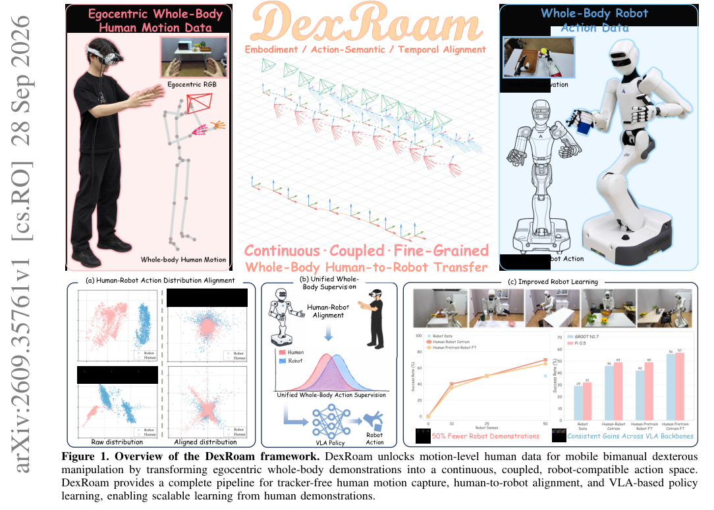
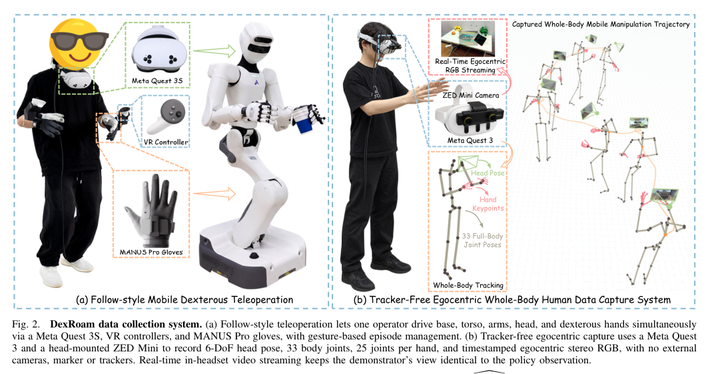

# 对话 DexRoam 作者周睿，谈人类示范如何变成机器人动作数据

2026-11-23 · arXiv:2609.35761 · HKUST & BAAI (CoRL 2026) · 有来源缺口

[本地原件归档](../../../raw/ab649be1995fda03fe15f85d7f196ffd9a7c7be73d49069559ebd58d87267ee7) · 固定材料版本 `digest-material-ab649be1995fda03fe15f85d7f196ffd9a7c7be73d49069559ebd58d87267ee7@1` · [一手原站](https://arxiv.org/abs/2609.35761) · [触发线索（42号电波）](https://mp.weixin.qq.com/s/-Um55XmJhqfjgKWNYG1diQ)

> [!IMPORTANT]
> 用户关注点（TG）：这个也有趣

## 针对性追查与回应

- 来源：[arXiv:2609.35761 · DexRoam (CoRL 2026)](https://arxiv.org/abs/2609.35761) · [官方项目主页](https://dexroam.github.io/) · [GitHub: DexRoam](https://github.com/zhourui9813/DexRoam) · [GitHub: Policy-Training](https://github.com/zhourui9813/DexRoam-Policy-Training)
- 口径与利益披露：论文系香港科技大学（HKUST）、北京智源人工智能研究院（BAAI）、北京大学（PKU HMI Lab）、北京航空航天大学（Beihang）与中国科学院自动化研究所（CASIA）联合发表于 CoRL 2026（Conference on Robot Learning）的研究成果（2026-09-28 提交 arXiv），一作周睿（Rui Zhou）为香港科技大学 2026 级 AI 博士生（师从韩斯睿 Sirui Han 与郭毅可 Yike Guo），此前任智源与北大施柏鑫/张尚杭（Shanghang Zhang）组科研实习生，曾主导或参与 MotionTrans（ICRA 2026）、TwinRL（ACM MM 2026）、STAG-VIO（IROS 2026）与 DexTeleGym；触发线索系《42号电波》对周睿的独家深度访谈，下文所有实验细节、误差分布与代码口径均已回溯 arXiv:2609.35761v1 HTML 全文及双代码仓核实。
- ==核心结论==：对「这个也有趣」的第一性原理回应——DexRoam 的真正工程价值不在于提出新 VLA 架构，而在于用低成本无追踪器消费级穿戴方案（Meta Quest 3 + ZED Mini 30 Hz 机内双目实时回传），把以往「静态桌面 UMI」难以覆盖的==移动底盘 + 躯干 + 双臂 + 头部 + 五指灵巧手（56 维全身连续动作空间）==耦合示范打通了「本体对齐—DeltaEF 语义对齐—归一化进度重采样」三段式转换链路，在 5 项真机移动灵巧任务上把 GR00T N1.7 成功率从 29% 拉至 56%、π0.5 从 32% 拉至 57%，并将所需真机遥操示范压缩 50%（25 条人机联训打平 50 条纯真机）。但该路线存在两条硬物理红线：一是零真机示范时成功率为 0%，人类示范只提供动作先验而不能取代真机本体落地；二是灵巧手纯位置控制缺少力触觉反馈，与本库已归档 OmniTacTune/MimicTouch、Pixel-UMI 及 Ego4WAM 形成鲜明边界对照。

---

### 一、 作者团队学术谱系与跨校硬件分工核查

| 作者与署名角色 | 当前单位与学历履历 | 核心导师与学术谱系 | 代表前作与 DexRoam 工程角色 |
| :--- | :--- | :--- | :--- |
| 周睿（Rui Zhou，共同一作*） | HKUST 计算机/AI 一年级博士生（2026-09 入学）；武汉大学电子信息工程学士（2022–2026，GPA 3.95/4.00 前 1.5%） | 博士导师韩斯睿（Sirui Han，HKUST 助理教授 / HKGAI LLM 主管）与郭毅可；曾任清华 IIIS EVAR Lab（高阳）与 PKU/BAAI（张尚杭）实习生 | MotionTrans（ICRA 2026）、STAG-VIO（IROS 2026）、TwinRL（ACM MM 2026）、DexTeleGym；主导 DexRoam 数据采集、三段对齐与双 VLA 训练管线 |
| 袁一博（Yibo Yuan，共同一作*） | 北京航空航天大学（Beihang）与 BAAI 联合培养研究员 | BAAI 具身智能与灵巧操作研发线 | 共同承担真机系统搭建与人机对齐实验 |
| 赵俊凯（Junkai Zhao，共同一作* / Project Leader†） | 北京智源人工智能研究院（BAAI）研究骨干 | 智源跨本体移动操作研究方向负责人 | 项目统筹与 Astribot–XHand 全身平台工程落地 |
| 张尚杭（Shanghang Zhang，通讯作者✉） / 韩斯睿（Sirui Han，通讯作者✉） | PKU 计算机学院多媒体信息处理国家重点实验室；HKUST 助理教授（兼 HKGAI 大模型负责人） | UC Berkeley BAIR 博士后渊源（张尚杭）；跨模态生成与具身智能双线指导 | 提供 BAAI/PKU 算力真机基座与 HKUST 跨模态对齐方法论支持 |

---

### 二、 系统架构与三段对齐机制（arXiv:2609.35761v1 全文还原）

#### 1. 双端硬件栈与视角一致性设计
- 真机执行端：采用星尘智能 Astribot 移动操作平台（全向移动底盘 + 可动躯干 + 双 7-DoF 机械臂 + 2-DoF 主动头部）配双 12-DoF XHand 灵巧手（目标状态 53 维、动作空间 56 维：左/右 XHand 各 12 维、左/右臂与躯干各 9 维即 3D 平移 + 6D 旋转、头部 2 维、底盘平面位移与偏航角 3 维）。遥操作采用 Meta Quest 3S + VR 手柄 + MANUS Pro 手套单人同控（机械臂/状态 250 Hz、MANUS 与 XHand 39 Hz，以头部 30 Hz 双目图像时间轴对齐；53 维状态刻意隐去底盘全局位姿以防止过拟合绝对站位）。
- 人类无追踪器采集端：仅用 Meta Quest 3（WebXR 实时采集 6-DoF 头部、33 个人体关节与每只手 25 个关节点）叠加头戴 ZED Mini 双目相机（1280×480 并排裁切为双路 640×480 RGB @ 30 Hz，经 Vuer 以约 20 Hz 实时回传头显内视窗），省去外部动捕相机、场地标定板与 PICO 绑腿追踪器，并以双手捏合手势完成开始/停止/丢弃/保存录制闭环。

#### 2. 人—机动作空间对齐三环节
1. 本体对齐（Embodiment Alignment）：以骨盆（pelvis）地面投影为原点且骨盆水平朝向定为前方构造局部坐标系，将胸部、头部与双腕变换至骨盆坐标系；底盘继承骨盆地面投影运动，头部保留俯仰与偏航 2-DoF，人手 25 关键点经 dex-retargeting 映射为 12-DoF XHand 关节角。
2. 动作语义对齐（Action-Semantic Alignment / DeltaEF）：为剥离示范者身高、臂长与站位绝对偏移，将双臂末端（EF）与躯干目标改写为相邻时刻局部相对位姿增量，底盘表达为本地平面增量（前后位移、横向位移与转角）。
3. 时间对齐（Temporal Alignment）：以目标任务真机示范平均步数为准，按归一化任务进度对人类轨迹等距插值重采样（每个插值点匹配最近原始双目图像），弥合人类动作快于机器人步长造成的动作分布错位。

---

### 三、 全量量化实验、消融边界与库内横向对照

| 实验维度与比较对象 | 核心指标与实测数据 | 本工作台原位核查（✅ / ⚠️ / ❌） |
| :--- | :--- | :--- |
| 1. 轨迹可回放精度（Table I & II，3 任务×5 条=15 条） | 15/15 全部通过无逆解（IK）失败；无追踪器平均误差：躯干 12.54 mm / 1.84°、左臂 4.01 mm / 0.55°、右臂 6.30 mm / 0.92°、头部 1.37°；对照组 PICO+5 追踪器为 13.16 / 4.12 / 5.63 mm | ✅ 精度复核（本工作台核查）：Quest 3 + ZED Mini 仅靠机内估计即在手臂端追平 PICO+5 追踪器（4.01 vs 4.12 mm），且附录 Table V 测得重定向人类动作频域平滑度 SPARC 为 -6.2196，反而优于遥操作真机 -7.0522，消除高频抖动对策略的干扰。 |
| 2. 动作分布距离对齐（56 维 MMD / Sliced Wasserstein） | 对齐后 5 任务平均 MMD 下降 41.7%、SWD 下降 31.1%；推椅子合电脑 MMD 由 0.553 降至 0.274（项目页均值由 0.598 降至 0.313，SWD 由 0.926 降至 0.563） | ✅ 口径核查（本工作台核查）：需留意两处统计基准，推椅子任务 0.553→0.274 对应单任务值，而项目页 0.598→0.313 为跨任务汇总基线；消融 Table III 证明改为绝对位姿时全部 6 组设置成功率直接归 0%，去掉时间重采样后 GR00T N1.7 六组均值从 68.3% 跌至 44.2%（拿薯片罐从 90% 崩至 20%）。 |
| 3. 五项真机任务与两类 VLA 基座（每设置评测 20 次） | 加入对齐人类示范后，GR00T N1.7 平均 SR 从 29% 升至 56%（TCS 0.56→0.77），π0.5 从 32% 升至 57%（TCS 0.52→0.73）；拿薯片罐达 90%，推椅子合电脑 GR00T 10%→25%、π0.5 20%→40%，倒水 25% / 30% | ⚠️ 绝对成功率分层核查（本工作台核查）：56% / 57% 均值存在显著任务分化，抓取类（拿薯片罐 90%）拉高均值，但多阶段移动协同与柔性/液态任务（倒水 25%–30%、推椅合电脑 25%–40%）仍处低可用区；真机示范为 0 时 3 项测试任务全部 0%，需 10 条激活、25 条追平 50 条纯真机基线。 |
| 4. OOD 分布偏移测试与库内路线对照 | 背景变化后拿薯片罐：纯真机 50%→20%，人机联训 90%→55%；OOD 验证仅在拿薯片罐单任务开展 | ❌ 泛化与接触盲区（本工作台推断）：对比本库 Ego4WAM（12,000h 多任务人类中训压低真机 15 倍但无触觉仅 14.35%）、OmniTacTune/MimicTouch（靠在线残差 RL+触觉把插拔从 10% 拉至 100%）与 Pixel-UMI（引入三维重建碰撞避障 EAR 与在线 DAgger），DexRoam 的 XHand 属纯位置控制且无环境碰撞感知，附录 C 坦承最主要失败模式为「看似抓住却未捏紧，抬手即掉落」。 |

### 观点与可反驳条件

- ==观点==：DexRoam 证明了在「同构移动双臂灵巧手 + 视角实时对齐（ZED Mini 回传 Quest 3）」的前提下，显式保持全身耦合（56 维 DeltaEF + 归一化时间重采样）的消费级人类示范确实能替代约 50% 的昂贵真机遥操并提升单任务泛化，是一条工程性价比极高的「预对齐动作先验」路径；但它仍严格受制于「零真机不工作（必须至少 10–25 条真机锚定本体）」和「纯位置控制灵巧手无力触觉闭环（富接触任务停留在 25%–40%）」两大天花板，且目前开源数据仅覆盖单一任务的 50 条真机子集（约 20.7 分钟 / 227.3 GiB），尚未验证跨任务跨人形本体的通用迁移。
- ==推翻条件==：
  1. 零真机直接泛化突破：若未来同类无追踪器头显采集管线在「0 条目标机器人真机示范」条件下，仅凭人类全身示范与零样本重定向训练，即可在推椅合电脑、倒水等 5 项移动灵巧任务上稳定取得 >= 50% 完整任务成功率（打破当前 0% 红线），则「人类示范必须依赖少量真机锚定本体」的判断将被推翻。
  2. 跨任务正迁移与触觉无感替代：若后续实验证明任务 A（如抓薯片罐）的 DexRoam 人类示范可令未见任务 B（如叠衣或插拔装配）的真机成功率提升 >= 20 个百分点，且在不增加指尖触觉/力反馈硬件的纯视觉位置控制下将倒水、推椅合电脑成功率推升至 >= 80%，则本文关于「缺乏跨任务迁移与接触力控瓶颈」的边界限定将被修正。

---

## 原文摘录与一手信源存证

> 在大会接收的论文中，香港科技大学、北京智源人工智能研究院、北京大学、北京航空航天大学和中国科学院自动化研究所联合公开了《DexRoam: Learning Mobile Bimanual Dexterous Manipulation from Egocentric Whole-Body Human Demonstrations》（《从第一视角人类全身示范中学习移动双臂灵巧操作》）。
> — 原文摘录，文字段落 1；证据 `digest-material-ab649be1995fda03fe15f85d7f196ffd9a7c7be73d49069559ebd58d87267ee7-excerpt-1@2`

> 在加入人类示范数据后，团队报告了两种视觉语言动作模型（Vision-Language-Action，VLA）的性能提升：GR00T N1.7 的平均任务成功率由 29% 提高至 56%，π0.5 则由 32% 提高至 57%。在另外一组专门比较真机数据用量的实验中，部分设置用一半的真机示范就达到了纯真机训练的水平。
> — 原文摘录，文字段落 2；证据 `digest-material-ab649be1995fda03fe15f85d7f196ffd9a7c7be73d49069559ebd58d87267ee7-excerpt-2@2`

一手材料：

- DexRoam: Learning Mobile Bimanual Dexterous Manipulation from Egocentric Whole-Body Human Demonstrations (arXiv:2609.35761) · HKUST, BAAI, Peking University, Beihang University & CASIA · [原站](https://arxiv.org/abs/2609.35761) · [主体档案：Rui Zhou](../entities/people/Rui%20Zhou.md) / [主体档案：zhourui9813](../entities/people/zhourui9813.md) / [主体档案：Rui Zhou (arXiv)](../entities/people/Rui%20Zhou%20%28arXiv%29.md) · [本地原件](../../../raw/48a0c15ce7242b9ddb9d6265144a498261dfba1c57c53a90fff3961a09ba39e0)
  材料版本 `digest-material-48a0c15ce7242b9ddb9d6265144a498261dfba1c57c53a90fff3961a09ba39e0@1`；获取方式 `http_full_text`。
  > Mobile bimanual dexterous manipulation requires continuous coordination of locomotion, whole-body motion, and finger-level dexterity within a single trajectory, creating a severe robot demonstration bottleneck. — 原文提取
  > DexRoam unlocks motion-level human data for mobile bimanual dexterous manipulation by transforming egocentric whole-body demonstrations into a continuous, coupled, robot-compatible action space. — 原文提取
- DexRoam Official Project Page · DexRoam Team (HKUST & BAAI) · [原站](https://dexroam.github.io/) · [主体档案：zhourui9813](../entities/people/zhourui9813.md) · [本地原件](../../../raw/658732fab1fe4410349eb4359992df4929bfb2f13ddbb03f28e9b37bc63580ba)
  材料版本 `digest-material-658732fab1fe4410349eb4359992df4929bfb2f13ddbb03f28e9b37bc63580ba@1`；获取方式 `http_full_text`。
  > DexRoam unlocks motion-level human data for mobile bimanual dexterous manipulation by transforming egocentric whole-body demonstrations into a continuous, coupled, robot-compatible action space. — 原文提取
  > Across five real-world tasks and two VLA backbones, aligned human demonstrations raise average success from 29% to 56% on GR00T N1.7 and from 32% to 57% on π0.5, while matching robot-only training with 50% fewer robot demonstrations. — 原文提取
- DexRoam: Human Motion Capture and Human-Robot Alignment Code · zhourui9813 (GitHub) · [原站](https://github.com/zhourui9813/DexRoam) · [主体档案：zhourui9813](../entities/people/zhourui9813.md) · [本地原件](../../../raw/b8b4bbdb2e2480c1b270e6e88b843d1a6777ec5e0e15b0f09bd7ab397f6cc75a)
  材料版本 `digest-material-b8b4bbdb2e2480c1b270e6e88b843d1a6777ec5e0e15b0f09bd7ab397f6cc75a@2`；获取方式 `http_full_text`。
  > DexRoam unlocks motion-level human data for mobile bimanual dexterous manipulation by transforming egocentric whole-body demonstrations into a continuous, coupled, robot-compatible action space. — 原文提取
  > This repository provides the motion-capture and human-to-robot alignment stages of DexRoam, covering synchronized egocentric stereo recording, whole-body and hand-motion capture, HDF5 inspection, Astribot whole-body alignment, XHand retargeting, and temporal resampling. — 原文提取
- DexRoam-Policy-Training: OpenPI π0.5 & GR00T N1.7 VLA Training Code · zhourui9813 (GitHub) · [原站](https://github.com/zhourui9813/DexRoam-Policy-Training) · [主体档案：zhourui9813](../entities/people/zhourui9813.md) · [本地原件](../../../raw/722581810ccfeb4ee36757b39a13a761b9f85a42d4cdcc83c513a716d62f5012)
  材料版本 `digest-material-722581810ccfeb4ee36757b39a13a761b9f85a42d4cdcc83c513a716d62f5012@1`；获取方式 `http_full_text`。
  > This repository contains the VLA training code for DexRoam: Learning Mobile Bimanual Dexterous Manipulation from Egocentric Whole-Body Human Demonstrations, built on the OpenPI π0.5 codebase from Physical Intelligence and the Isaac GR00T N1.7 codebase from NVIDIA. — 原文提取
  > For the human motion capture and human-to-robot alignment stages, please refer to the main DexRoam repository. — 原文提取
- DexRoam\_Realworld\_Data (Push Chair and Close Laptop 50-Episode Sample) · zhourui9813 (Hugging Face) · [原站](https://huggingface.co/datasets/zhourui9813/DexRoam_Realworld_Data) · [主体档案：zhourui9813](../entities/companies/zhourui9813.md) · [本地原件](../../../raw/0786b946076f1d440d236d9ec3617448fcc5e19128d9a58a26aebfffbe107580)
  材料版本 `digest-material-0786b946076f1d440d236d9ec3617448fcc5e19128d9a58a26aebfffbe107580@1`；获取方式 `http_full_text`。
  > This repository contains real-robot demonstrations of an Astribot robot pushing a chair and then closing a laptop. — 原文提取
  > This release is an integration example rather than a benchmark or a complete training corpus. Results trained only on this subset should not be interpreted as representative of the full DexRoam system. — 原文提取

归属与范围：已穿透至 CoRL 2026 录用论文全文（arXiv:2609.35761v1 HTML 全文，2026-09-28 提交）、官方项目主页（dexroam.github.io）、双开源代码仓（zhourui9813/DexRoam 与 DexRoam-Policy-Training）、HuggingFace 数据集（DexRoam\_Realworld\_Data）及一作周睿（Rui Zhou）与通讯作者韩斯睿（Sirui Han）个人学术主页；同时结合库内 Ego4WAM、OmniTacTune/MimicTouch 与 Pixel-UMI 完成边界横比。42 号电波访谈文章退居触发线索，未公开的其余 4 项任务完整训练集与触觉故障比例留作规范缺口。

来源缺口：

- `not_disclosed`：Hugging Face 仓 zhourui9813/DexRoam\_Realworld\_Data 当前仅作为格式样例公开「推椅子合电脑」单任务 50 条真机 HDF5（约 20.7 分钟 / 227.3 GiB），其余 4 项真机任务及全部人类无追踪器示范原始库尚未开放下载。 [线索](https://huggingface.co/datasets/zhourui9813/DexRoam_Realworld_Data)
- `not_disclosed`：论文附录 C 定性指出「因缺少力觉/触觉反馈导致未抓紧掉落」为首要真机失败原因，但未定量统计各失败模式在全部测试失败样本中的占比，亦未验证跨任务人类示范正迁移或人形机器人本体迁移。 [线索](https://arxiv.org/abs/2609.35761)

[返回赛道总览](../赛道总览.md#digest-ab649be1995fda03) · [返回导读索引](README.md) · [主体档案库](../entities/README.md)
