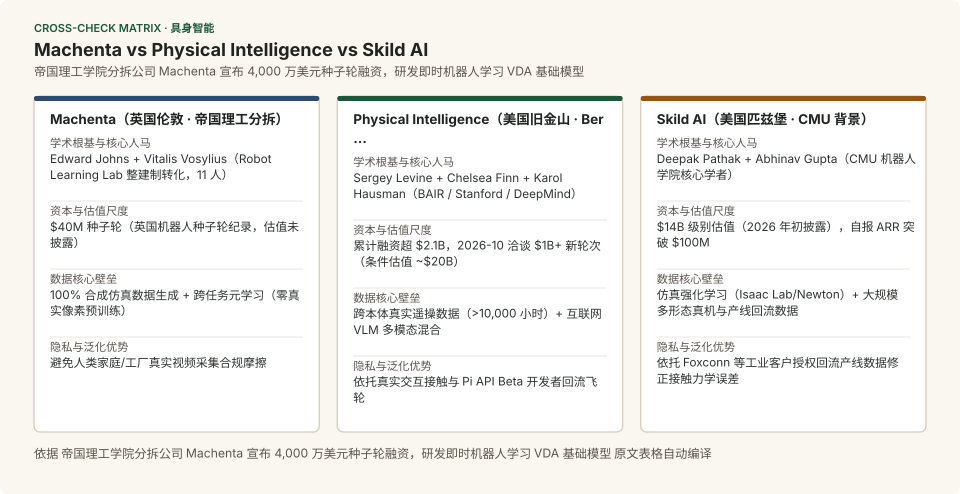

# 帝国理工学院分拆公司 Machenta 宣布 4,000 万美元种子轮融资，研发即时机器人学习 VDA 基础模型

2026-10-27 · Imperial College London · Machenta · 有来源缺口

[本地原件归档](../../../raw/cf5d66e2d5abedbaf6cb574917a0f47d86e5262f593698b3ada7f218ea9c2590) · 固定材料版本 `digest-material-cf5d66e2d5abedbaf6cb574917a0f47d86e5262f593698b3ada7f218ea9c2590@1` · [一手原站](https://www.imperial.ac.uk/news/articles/2026/imperial-ai-spinout-machenta-raises-40-million-to-make-robots-instant-learners/) · [触发线索（Imperial College London · Machenta）](https://www.imperial.ac.uk/news/263223/imperial-spinout-machenta-raises-40-million-make/)

## 深度拆解与复核

- ==核心结论==：帝国理工学院于 2026-10-27 官方背书分拆公司 Machenta 完成 $40M（4,000 万美元）种子轮融资，刷新英国机器人初创公司种子轮融资纪录；公司以伦敦 King's Cross 为基地、11 人研发团队为核心，将帝国理工 Robot Learning Lab 六年研究转化为 Vision-Demo-Action（VDA）全仿真即时学习底座，但高校科研分拆到工业生产之间仍存在「无真实物理接触数据、团队尚偏早期研究、未披露知识产权许可与估值条款」三项落地约束。

#### 一、业务切口与核心机制

本条目聚焦 Imperial College London 官方发布的高校成果转化视角，与站内侧重算法拆解的 [《Machenta发布即时机器人学习模型：只需一次示范，无需微调｜全仿真训练学习真实任务》](Machenta%E5%8F%91%E5%B8%83%E5%8D%B3%E6%97%B6%E6%9C%BA%E5%99%A8%E4%BA%BA%E5%AD%A6%E4%B9%A0%E6%A8%A1%E5%9E%8B%EF%BC%9A%E5%8F%AA%E9%9C%80%E4%B8%80%E6%AC%A1%E7%A4%BA%E8%8C%83%EF%BC%8C%E6%97%A0%E9%9C%80%E5%BE%AE%E8%B0%83%EF%BD%9C%E5%85%A8%E4%BB%BF%E7%9C%9F%E8%AE%AD%E7%BB%83%E5%AD%A6%E4%B9%A0%E7%9C%9F%E5%AE%9E%E4%BB%BB%E5%8A%A1.md) 及侧重 VC 视角的融资条目形成互补：

1. 学术转化链路：Machenta 由帝国理工学院（Imperial College London）计算系 Robot Learning Lab 教授 Edward Johns（CEO）与其高年级博士研究员 Vitalis Vosylius（CTO，曾获帝国理工机器人杰出博士奖）共同创立，将实验室自 2020 年起积累的六年单次示范学习研究整建制商业化。团队驻扎伦敦 King's Cross，目前保持 11 人精干研究团队规模。
2. 技术机制差异：常规机器人模型依赖在真实世界采集海量人类示范并按任务反复微调数天；Machenta 的 Vision-Demo-Action（VDA）模型在预训练阶段完全采用计算机生成的仿真数据，学习「如何从单次示范推断任务策略」，从而让终端用户（非算法工程师）通过一次现场示范即可驱动多类机器人（含机械臂与人形机器人）执行装箱、整理等新任务，同时规避大规模采集人类真实家庭/工厂视频引发的隐私与部署摩擦。

#### 二、核心数据核查、口径纠偏与工程边界

场景与利益披露：本条目主源为 Imperial College London 新闻部（记者 David Silverman）于 2026-10-27 发布的校方新闻稿，引用副教务长 Mary Ryan 教授、创始人 Edward Johns 与领投方 Creandum 合伙人 Kathi Wilhelm 发言。校方新闻稿具有显著的高校成果转化宣传与英国科技生态背书立场（强调「英国有望成为 AI 机器人全球领跑者」），对「打破英国种子轮纪录」及商业转化前景的表述须交叉核对具体条款缺口。

| 核查项目 | 巡检摘要与高校新闻稿表述 | 本工作台核查与补正 | 来源指针 |
| :--- | :--- | :--- | :--- |
| 官方页面 URL 有效性 | 巡检卡登记旧链 `/news/263223/...` | ❌ 旧链接已失效（HTTP 404，`newsarchive_article_263223`）；已定位并抓取帝国理工 2026 年有效官方新闻页全文 | [Imperial News 2026](https://www.imperial.ac.uk/news/articles/2026/imperial-ai-spinout-machenta-raises-40-million-to-make-robots-instant-learners/) |
| 融资额与领投机构 | $40M（4,000 万美元）种子轮，Creandum 与 Union Square Ventures 联合领投，创英国机器人种子轮纪录 | ✅ 核查确认：帝国理工官稿、Creandum 与 USV 三方披露金额、时间（2026-10-27）与联合领投方完全吻合 | [Imperial News](https://www.imperial.ac.uk/news/articles/2026/imperial-ai-spinout-machenta-raises-40-million-to-make-robots-instant-learners/) · [USV](https://www.usv.com/writing/physical-vibe-coding-our-investment-in-machenta) |
| 团队规模与成员构成 | 11 人研发团队，由帝国理工实验室分拆 | ✅ 交叉补充：`machenta.com/team` 核实实验室 5 篇核心论文全数作者加入，并吸收来自 DeepMind、Dyson、Huawei、Stability AI 的研究者 | [Machenta Team](https://machenta.com/team) |
| 校企股权与算力预算 | 资金全部投入合成仿真算力、团队扩张与 VDA 扩展 | ⚠️ 未披露边界：帝国理工在分拆实体中的 IP 授权股比、本轮估值及算力供应商（云集群 vs 自建）均未公开 | [Imperial News](https://www.imperial.ac.uk/news/articles/2026/imperial-ai-spinout-machenta-raises-40-million-to-make-robots-instant-learners/) |

- ✅ 团队工程履历核查：Edward Johns 不仅任帝国理工学院计算系教授，此前亦曾任 Dyson 机器人学习负责人，具备消费硬件企业机器人研发管理经验；CTO Vitalis Vosylius 主导了 CoRL 2023 `Implicit Graph Alignment` 与 ICLR 2025 `Instant Policy` 两篇全仿真上下文学习基石论文，使 Machenta 在英国高校分拆项目中拥有罕见的工程化延续性。
- ⚠️ 11 人纯研究团队的算力与工程杠杆边界（本工作台推断）：$40M 种子轮支撑 11 人团队驻守伦敦 King's Cross，平均人均资本密度极高（约 $3.6M/人），说明绝大部分资金将消耗在 GPU 算力、仿真资产管线与顶尖研究员招募上。本工作台推断，在没有制造工厂或垂直行业集成团队配合的情况下，Machenta 短期内只可能输出软件基础模型或开发者演示，难以独立承担 B 端整站交钥匙交付。

#### 三、赛道横向对比与定位

| 对比维度 | Machenta（英国伦敦 · 帝国理工分拆） | Physical Intelligence（美国旧金山 · Berkeley/Stanford） | Skild AI（美国匹兹堡 · CMU 背景） |
| :--- | :--- | :--- | :--- |
| 学术根基与核心人马 | Edward Johns + Vitalis Vosylius（Robot Learning Lab 整建制转化，11 人） | Sergey Levine + Chelsea Finn + Karol Hausman（BAIR / Stanford / DeepMind） | Deepak Pathak + Abhinav Gupta（CMU 机器人学院核心学者） |
| 资本与估值尺度 | $40M 种子轮（英国机器人种子轮纪录，估值未披露） | 累计融资超 $2.1B，2026-10 洽谈 $1B+ 新轮次（条件估值 ~$20B） | $14B 级别估值（2026 年初披露），自报 ARR 突破 $100M |
| 数据核心壁垒 | 100% 合成仿真数据生成 + 跨任务元学习（零真实像素预训练） | 跨本体真实遥操数据（>10,000 小时）+ 互联网 VLM 多模态混合 | 仿真强化学习（Isaac Lab/Newton）+ 大规模多形态真机与产线回流数据 |
| 隐私与泛化优势 | 避免人类家庭/工厂真实视频采集合规摩擦 | 依托真实交互接触与 Pi API Beta 开发者回流飞轮 | 依托 Foxconn 等工业客户授权回流产线数据修正接触力学误差 |

### 观点与可反驳条件

- ==观点==：帝国理工学院分拆案例说明，欧洲顶尖高校实验室在「纯仿真 + 元学习算法原始创新」上仍能通过极端精简团队（11 人）撬动跨大西洋顶级 VC（Creandum + USV）的 $40M 资本支持，以算力密度对冲真机数采的重资产劣势；但相比已切入 Pi API Beta 或 Foxconn 产线的美国头部玩家，Machenta 在算力体量（$40M vs 十亿美元级）与工业级客户数据回流上存在明显量级落差，能否在算力消耗殆尽前跑出明显高于主流 VLA 的真实场景胜率，将决定其下一轮融资上限或并购归宿。
- ==推翻条件==：
  1. ① 商业化与客户验证推翻条件：若 Machenta 在 2027 年底前披露至少 2 家工业或物流头部客户签单部署，且证明仅凭其纯仿真 VDA 模型（无需派驻工程团队重构仿真数字孪生）即可在产线换型工位实现 >=95% 连续作业自主率，则本文对其「缺乏真实产线数据回流而受限」的判断需向上修正。
  2. ② 资本效率证伪条件：若 Machenta 在 2027-Q4 前消耗大半 $40M 种子轮资金后，仍未能将单次示范能力从桌面刚体任务拓展至双臂动态协同、可形变物体与精密插接，且未获算力巨头战略注资或下一轮高溢价融资，则说明欧洲实验室型「轻资产仿真路线」难以抵抗美系重算力与真机飞轮的马太效应。

---

## 原文摘录与一手信源存证

> 【信源巡检核心摘要】 2026 年 10 月 27 日，由帝国理工学院机器人学习实验室主任 Edward Johns 教授（CEO）与博士研究员 Vitalis Vosylius（CTO）联合创立的 Machenta 走出隐身，宣布完成由 Creandum 与 Union Square Ventures 联合领投的 4,000 万美元（\$40M）种子轮融资，刷新英国机器人初创公司种子轮融资历史纪录。
> — 原文摘录，文字段落 1；证据 `digest-material-cf5d66e2d5abedbaf6cb574917a0f47d86e5262f593698b3ada7f218ea9c2590-excerpt-1@1`

一手材料：

- Imperial AI spinout Machenta raises \$40 million to make robots instant learners · Imperial College London · [原站](https://www.imperial.ac.uk/news/articles/2026/imperial-ai-spinout-machenta-raises-40-million-to-make-robots-instant-learners/) · [主体档案：Imperial College London](../entities/labs/Imperial%20College%20London.md) · [本地原件](../../../raw/4f16d300a76d804d8bbcace5d4c7c8c78072e8df2475ba289485ebbe6c2851b7)
  材料版本 `digest-material-4f16d300a76d804d8bbcace5d4c7c8c78072e8df2475ba289485ebbe6c2851b7@1`；获取方式 `http_full_text`。
  > A physical AI spinout from Imperial College London has secured record-breaking seed funding to develop a new kind of robot foundation model building on the founders’ research at Imperial. — 原文提取
  > Machenta has raised \$40 million in the largest ever seed raise by a UK robotics startup. — 原文提取
- Team | Machenta · Machenta · [原站](https://machenta.com/team) · [主体档案：Machenta](../entities/companies/Machenta.md) · [本地原件](../../../raw/0c647feec9b1136b8f9c66afffb5cc4449c30b823db7b585ef786e8e9e01abb3)
  材料版本 `digest-material-0c647feec9b1136b8f9c66afffb5cc4449c30b823db7b585ef786e8e9e01abb3@1`；获取方式 `http_full_text`。
  > Professor of Robot Learning at Imperial College London. In 2020, started building a research group focussing on one-shot robot learning, and developed many of the early methods in this space. — 原文提取
  > PhD from Imperial College London. Built the first generalist in-context learning models for robotics trained entirely in simulation, Implicit Graph Alignment (CoRL 2023) and Instant Policy (ICLR 2025). — 原文提取
- Introducing Instant Robot Learning | Machenta · Machenta · [原站](https://machenta.com/blog/instant-robot-learning) · [主体档案：Machenta](../entities/companies/Machenta.md) · [NotebookLM](https://notebook.google.com/notebook/cac99041-d3b9-449e-a192-12bb4b1ad391) · [Drive](https://drive.google.com/file/d/1b8Q5zc_YQQFAQDmF3FThj4mcv1ZOMWqZ/view?usp=drivesdk)
  材料版本 `digest-material-80508e12068285913bd81f99bd4cc99d50a141517eaf28cd88795c629747ea45@5`；获取方式 `notebooklm_indexed_text`。
  > without a single pixel of real-world training data. — 原文提取
  > Intelligence is not about what you can already do. It's about how quickly you can learn to do something new. — 原文提取

归属与范围：已修复原巡检卡 404 旧链接并抓取帝国理工学院 2026-10-27 官方分拆新闻稿、machenta.com/team 与官博全文；系统核查了高校整建制转化、\$40M 英国种子轮纪录与轻资产仿真路线的算力边界。

来源缺口：

- `unavailable`：原巡检卡片登记的旧链接 https://www.imperial.ac.uk/news/263223/imperial-spinout-machenta-raises-40-million-make/ 返回 HTTP 404（newsarchive\_article\_263223），已定位并抓取帝国理工学院 2026 年有效官方新闻页全文；校方新闻稿未公布 11 人研发团队名单全集，团队履历补充自 machenta.com/team。
- `not_disclosed`：帝国理工学院在 Machenta 的知识产权（IP）授权股权比例、\$40M 种子轮投后估值及算力采购合同详情均未公开披露。

[返回赛道总览](../赛道总览.md#digest-cf5d66e2d5abedba) · [返回导读索引](README.md) · [主体档案库](../entities/README.md)
