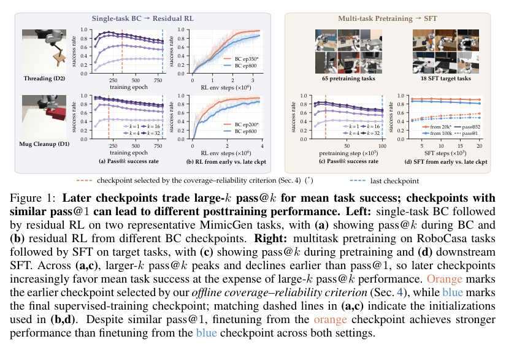
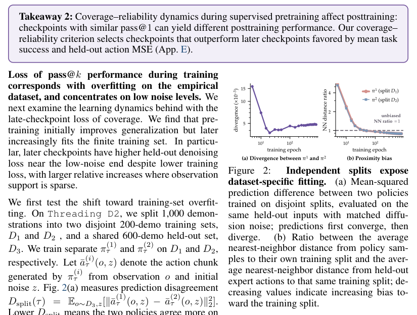

# 斯坦福宋舒然团队提出机器人预训练评估新指标：用动作误差分布选模型｜只看验证损失，可能错过更好的微调起点

2026-11-04 · Stanford REAL Lab · CMU (arXiv:2611.01565) · 有来源缺口

[本地原件归档](../../../raw/e3e9faee5c86f07939d2715d0e8f13c5cd54c0620274e4fc2c8784292f40c66c) · 固定材料版本 `digest-material-e3e9faee5c86f07939d2715d0e8f13c5cd54c0620274e4fc2c8784292f40c66c@1` · [一手原站](https://arxiv.org/abs/2611.01565)

## 深度拆解与复核

- ==核心结论==：斯坦福大学 [REALab](../entities/labs/Stanford%20University.md)（[Zhanyi Sun](../entities/people/Zhanyi%20Sun.md)、Shuran Song；致谢 Huy Ha 与负责真机采样的 Jack Joler）联合 [CMU](../entities/labs/Carnegie%20Mellon%20University%20%28CMU%29.md) Max Simchowitz 发布的 [arXiv:2611.01565](https://arxiv.org/abs/2611.01565) 实证指出，生成式机器人策略（Diffusion Policies 与 VLA）在监督预训练（Supervised Pretraining）后期会出现 Coverage（大 k 值 pass@k）与 Reliability（pass@1 平均成功率）的分化，单纯依据 Validation Loss 或最终轮次选检查点会损伤下游强化学习与监督微调上限；团队据此提出无需真机反复试跑的离线动作误差分位数准则与联合生成增强 JointAug，在真机 6-DoF Push-T 推动 T-block 任务上选出第 46 轮检查点（pass@1 为 62% vs 最终第 200 轮 52%，pass@5 为 95% vs 75%），但 JointAug 像素级联合生成器在 π0.5 等大型 VLA 上算力开销过高，RoboCasa 规模验证只能退回轻量动作扰动。

#### 一、业务切口与核心机制

1. 固定初态闭式评测 pass@k 与凹函数极化机理
   借鉴大语言模型（LLM）在可验证推理领域的发现（Springer 等 ICML 2025、Chen 等及 Kang 等 ICLR 2026 讨论 SFT-RL Post-Training 中高 SFT 分数对 RL 的误导），作者定义固定初始配置下的闭式评估指标 pass@k：对每个留出初始状态 c 重置仿真并独立执行 k 次策略采样，统计至少成功 1 次的概率。当 k = 1 时即常规平均成功率（Reliability）；当 k 较大时反映策略在困难边界仍保有可行解的概率（Coverage）。
   由于 k > 1 时映射函数 f_k(q) = 1 - (1 - q)^k 呈严格凹性，训练后期若把概率质量从困难初态抽向本就稳妥的简单初态，均值不变但覆盖率必然下挫。论文给出直觉算例：简单条件成功率从 80% 升至 90%、困难条件从 20% 降至 10%，pass@1 维持 50% 不变，而 pass@10 从约 95% 跌至约 83%。
2. 跨单任务扩散策略与多任务 VLA 的统一现象
   研究团队在两类主线设定上交叉验证：（1）单任务图像条件 Behavioral Cloning（BC）Baseline DP（ResNet-18 视觉编码器配 1D U-Net，84×84 双视角 + 9 维本体状态，预测 8 步动作块，10 步 DDIM 采样，目标函数 LDP），在 MimicGen 五项核心任务（Threading D2、Mug Cleanup D1、Hammer Cleanup D1、Square D2、3-Piece Assembly D1）各取 200 条示范（及 500 条对照与 Three-Piece Assembly D2）训练 800 轮；（2）多任务 VLA Pretraining，采用 OpenPI 版 π0.5（Kevin Black 等，arXiv:2504.16054）在 RoboCasa（RoboCasa365）65 个原子任务（每任务 100 条示范，共 100k 步，50 步动作块，3 视角 224×224）预训练后对 18 个目标任务做 SFT。两类实验均出现一致模式：k 越大，pass@k 峰值出现越早；即使 pass@1 仍在爬坡，pass@10 与 pass@32 已开始回落。
3. 有限数据过拟合定位于低噪声去噪步
   在 Threading D2 将 1,000 条示范切分为互不重叠的两份 200 条训练集 D1/D2 与 600 条留出集 D3 后，两个独立策略在相同留出观测与初始噪声下的预测散度 Divergence（Dsplit）先收敛再于后期发散，各自样本到自身训练集的最近邻距离比值（Proximity Ratio）跌破 1（各自贴合特定样本子集，重演 Gu 等 2023 与 Bonnaire 等 NeurIPS 2025 揭示的扩散模型隐式动态正则化与后期记忆化规律，亦呼应 Baptista、Bertrand、Favero 等扩散泛化—记忆相变文献）。
   按扩散噪声水平拆解误差发现，训练集去噪 MSE 在全噪声段持续下降，但留出集（Held-out）在低噪声端（最后两次 DDIM 采样调用 Q5）显著恶化，且图像观测条件输入与局部观测支持稀疏区域恶化更早、更剧烈。把第 800 轮模型最后两步去噪权重替换为第 200 轮权重，可恢复绝大部分 pass@10 优势（代价是 pass@1 略降）；即便冻结视觉编码器或改用纯低维状态输入，pass@10 后期回落依然存在，证实退化主要源于去噪网络本身的有限样本记忆。
4. 从 Best-of-k 到完整误差分位数准则，再到 JointAug
   离线指标 Best-of-k 动作 MSE 仅盯单步最小值，在 k 较大时选点过早——早期策略虽能偶发抽中靠近专家的动作，但 PCA 投影显示多数样本偏离过远，无法支撑完整轨迹执行。为此作者采样 M 个动作块计算每个留出状态动作 MSE 的完整误差分位数曲线（Error Quantiles），在训练预算 H 内对各分位数 log-MSE 做归一化（Normalized 风险得分），以中位数 u = 0.50 对半拆分为覆盖率得分与可靠性得分，基于 minimax Balance 原则选取二者较大值最小的检查点（Selected checkpoint）。
   为直接抬高 Pareto 前沿而不依赖事后挑点，团队进一步提出 JointAug：训练观测与动作联合分布生成模型（Conv U-Net 图像流 + 6 层 384 维 MM-DiT 低维流，1000 步 v-prediction，100 步 DDIM），在最近邻比值首次跌破 1 的 5 检查点混合窗口 Gmix 均匀混入 50% 真实样本与 50% 联合生成样本，既避免如 Posterior Behavioral Cloning 即 PostBC（Andrew Wagenmaker、Chelsea Finn、Sergey Levine 等，arXiv:2512.16911）仅扰动动作而造成动作—观测失配拉低 pass@1，又缓解条件观测过拟合。

#### 二、核心数据核查、口径纠偏与工程边界

场景与利益披露：本工作台核查确认，本文一手原件为 [Stanford University](../entities/labs/Stanford%20University.md) 宋舒然实验室（[Zhanyi Sun](../entities/people/Zhanyi%20Sun.md)、Shuran Song）与 [Carnegie Mellon University (CMU)](../entities/labs/Carnegie%20Mellon%20University%20%28CMU%29.md) Max Simchowitz 署名的学术预印本 [arXiv:2611.01565](https://arxiv.org/abs/2611.01565)（配套代码仓 `real-stanford/policy-learning-dynamics` 与 Hugging Face 数据集已公开）。微信编译稿 SourceMind 存在两处需在口径上清晰隔离的细节：其一，原 PDF 第 18 页引用的 arXiv:2512.16911 系对比基线 PostBC，而非宋舒然团队本篇；其二，文中对后训练影响的表述均在 MimicGen、RoboCasa 仿真及单任务真机 Push-T 上实测，尚未在多任务大规模真机上验证。

| 实验链路与对比维度 | 选定早期/均衡检查点（Selected / JointAug） | 最终轮次基线检查点 | 覆盖率与后训练对比口径（论文一手表述） |
| :--- | :--- | :--- | :--- |
| Filtered BC（Threading D2） | pass@1 为 0.371 / pass@32 为 0.886 | pass@1 为 0.321 / pass@32 为 0.812 | 相同在线回滚预算下，选定检查点覆盖更多初始条件，重训策略全面领先 |
| Filtered BC（Mug Cleanup D1） | pass@1 为 0.558 / pass@32 为 0.914 | pass@1 为 0.502 / pass@32 为 0.866 | pass@1 提升 5.6 个百分点，pass@32 提升 4.8 个百分点 |
| 价值评估器 Q-function Critic 排序准确率 | Threading 0.534 / Mug 0.589 | Threading 0.521 / Mug 0.547 | 留出状态下对 8 个候选动作块的成对排序准确率（16 分支仿真估值） |
| 全策略 RL 微调 OGPO（Flow-Matching） | 5 项任务中 4 项（4/5）胜出 | 仅 1 项胜出（1/5） | 1.17M 参数 5 层 MLP 策略，证实非冻结生成器的全策略微调同样受益 |
| 真机 6-DoF Push-T（第 46 轮 vs 第 200 轮） | pass@1 为 62% / pass@5 为 95% | pass@1 为 52% / pass@5 为 75% | 20 组固定初态 × 5 次尝试（100 局），仅腕部相机（680 训练 + 60 验证示范） |
| 下游动作条件世界模型（Push-T，DiT） | Chunk-1 PSNR 27.9 / LPIPS 0.112 | Chunk-1 PSNR 26.8 / LPIPS 0.120 | Chunk 2 自回归 PSNR 25.2 vs 24.1（LPIPS 0.136 vs 0.145），帧间隔 200 ms |

- ✅ 离线分位数准则与真机 Push-T 数据口径核实（本工作台核查）：对照 arXiv:2611.01565 第 6 节与附录 H.8，真机 Push-T 推动 T-block 采用仅腕部主相机 + 超广角 224×224 视觉输入（CLIP ViT-B/16 编码）、20 Hz 输出 16 步 10 维相对 6-DoF 末端动作块，训练 208 轮（740 条示范按 680/60 划分，随机裁剪 95% 配合 5% warmup）；动作条件世界模型采用冻结的 Stable Diffusion VAE 配 12 层 DiT 并在 200 ms 帧间隔下测试，Tab. 3 证实选用早期覆盖率更高的 Rollout 样本能同步改善世界模型预测保真度。离线分位数准则选出第 46 轮，实机 20 个固定起始配置各测 5 次共 100 局回滚，pass@1（62% vs 52%）与 pass@5（95% vs 75%）同步胜出。
- ⚠️ JointAug 的 VLA 扩展算力瓶颈与超早选点反例（本工作台核查）：在 [Physical Intelligence](../entities/companies/Physical%20Intelligence.md) π0.5（RoboCasa 65 任务预训练 + 18 任务 SFT）的规模上，JointAug 联合生成高维图像与动作的计算成本过高，作者并未运行完整的像素—动作联合生成，而是退化为基于选定检查点动作协方差的轻量级动作扰动变体（action-only augmentation）。此外附录 C.1 明确披露，比准则所选更早的检查点（例如 Threading 第 200 轮、Hammer/Mug Cleanup 第 100 轮）虽然 pass@1 更低，但若在线强化学习预算充足，最终收敛上限可能反超均衡点——说明中位数 u = 0.50 切分并非放诸所有 RL 预算皆优的理论解，实际选点仍受下游可用在线步数约束。
- ⚠️ 工业与商业部署迁移的缺失维度（本工作台推断）：真机实验仅验证非抓取平面推挤 T-block，尚未涉及接触力/触觉反馈（如插拔、拧紧、柔性布料），且真实产线难以针对同一物理初态精准重置 5 次，因此在工程部署中更大价值在于用离线分位数监控替代盲目延训到底的习惯。

#### 三、赛道横向对比与定位

在工作台追踪的具身基础模型演进中，[Sunday Robotics](https://www.sunday.ai/blog/act-2-preview)（ACT-2 Preview）与 [Generalist AI](../entities/companies/Generalist%20AI.md)（[GEN-0](Generalist%EF%BC%9A%E7%99%BE%E4%B8%87%E5%B0%8F%E6%97%B6%E6%95%B0%E6%8D%AE%E7%9A%84infra.md)）均已注意到预训练时长与下游可靠性之间的非单调关系，而同属模仿学习后训练改进路线的 PostBC（arXiv:2512.16911）与 TMRL（arXiv:2605.12236）则分别从动作噪声与上下文平滑切入：

| 代表工作 / 机构 | 核心切入机制 | 动作—观测一致性 | 是否需额外训练生成模型 | 对 VLA 规模的实测验证边界 |
| :--- | :--- | :--- | :--- | :--- |
| 本文（Stanford REAL Lab · CMU） | 闭式 pass@k 诊断 + 离线分位数选点 + JointAug | 高（联合生成 (o, a) 成对样本） | 离线选点无需；JointAug 需训练独立生成器 | π0.5（65 任务）仅用轻量动作协方差扰动替代完整 JointAug |
| PostBC（Wagenmaker 等，arXiv:2512.16911） | Bootstrap 集成估计动作协方差并向示范动作加噪 | 较低（仅扰动动作，可能偏离干净观测） | 需训练 K=20 集成预测器 | MimicGen 部分任务出现 pass@1 下滑 |
| TMRL（Hong 等，arXiv:2605.12236） | 上下文噪声平滑扩展 BC 支持集 | 中等（干净上下文测算易失守覆盖率） | 否（修改策略条件输入） | 延长预训练仍会在无保护下流失大 k 覆盖率 |
| DICE-RL / Residual RL（Sun & Song 2026） | 冻结基座策略，在线学习残差 MLP 修正 | 依赖基座初始分布覆盖 | 否（在线交互学习） | 初始化检查点对样本效率高度敏感 |

### 观点与可反驳条件

- ==观点==：==机器人预训练把验证损失或最后轮次当作默认微调起点是典型的单阶段局部最优陷阱==；在大规模真机数据稀疏的过渡期，用验证集动作误差分布（低分位数盯覆盖率、高分位数盯稳定性）取代单一均值损失做早停与选点，是比无脑拉长预训练轮次性价比更高的工程杠杆，但 JointAug 因联合生成视觉像素的算力负担短期内难以直接套用于亿级帧多视角 VLA 预训练。
- ==推翻条件==：
  1. ① 若至 2027 年底，开源多任务 VLA（如 OpenPI π0.5 / π0.7 或 GR00T 系列）在跨百个以上真实任务与万小时级跨本体预训练下，证明最后检查点经全参数 RL（如 PPO/GRPO）微调后的最终成功率在 80% 以上任务中稳定反超离线分位数选出的中期检查点（差距超过 5 个百分点），则“延长监督预训练必然损伤大型 VLA 可微调性”的推广判断将被推翻。
  2. ② 若在 2027 年内出现无需重训练联合扩散生成器、仅凭单步潜在特征正则化或优化器调度（如权重衰减/学习率退火策略）即可在零额外视觉生成算力下同时锁定大 k 覆盖率与 pass@1 峰值的方法，且在 MimicGen 与 RoboCasa 全套基准上全面超越 JointAug，则“必须依赖生成式合成 (o, a) 对才能抬高 Pareto 前沿”的技术路径将被证伪。

---

## 原文摘录与一手信源存证

> 斯坦福大学宋舒然（Shuran Song）团队与卡内基梅隆大学的研究者发现，只看验证损失，可能选错机器人预训练模型。在同一批示范数据上继续训练，机器人可能在原本擅长的场景里做得更稳，平均成功率随之提高，却在一些原本偶尔能做成的困难场景里越来越难成功。团队据此提出一种离线评估指标，用验证集上的动作误差分布，选出既能稳定完成任务、又能应对更多起始条件的模型，作为后续微调的起点。
> — 原文摘录，PDF p.1；证据 `digest-material-e3e9faee5c86f07939d2715d0e8f13c5cd54c0620274e4fc2c8784292f40c66c-excerpt-1@1`

> 下，多次独立尝试仍有成功机会”。实验中，平均成功率相近的模型，覆盖率更高者往往能取得更好的后训练结果。选择预训练模型时，需要同时考虑它当下的表现，以及它为下一阶段学习保留了多少成功的可能性。
> — 原文摘录，PDF p.1；证据 `digest-material-e3e9faee5c86f07939d2715d0e8f13c5cd54c0620274e4fc2c8784292f40c66c-excerpt-2@1`

> 怎么做到的： 团队提出了一种离线选择方法：在验证数据上考察模型生成动作与专家动作之间的误差分布，既看它能否偶尔生成好动作，也看通常及较差样本的质量，以此选出兼顾覆盖率与可靠性的训练检查点，无需让机器人逐个试跑。
> — 原文摘录，PDF p.1；证据 `digest-material-e3e9faee5c86f07939d2715d0e8f13c5cd54c0620274e4fc2c8784292f40c66c-excerpt-3@1`

一手材料：

- Beyond Validation Loss: Coverage and Reliability Dynamics in Robot Policy Pretraining · Zhanyi Sun, Max Simchowitz, Shuran Song / arXiv · [原站](https://arxiv.org/abs/2611.01565) · [主体档案：Zhanyi Sun](../entities/people/Zhanyi%20Sun.md) / [主体档案：Shuran Song](../entities/people/Shuran%20Song.md) / [主体档案：Max Simchowitz](../entities/people/Max%20Simchowitz.md) · [NotebookLM](https://notebook.google.com/notebook/33f0076b-fc09-42cc-9cd9-fecfb847ce1c) · [Drive](https://drive.google.com/file/d/1CnRGrR-B-n-gvQRVcD3_TrwRCrJapoAi/view?usp=drivesdk)
  材料版本 `digest-material-0ba5bd855fb0f3443a271b4d8cffc02d071f3c210c5541a767386b75cfb1904a@1`；获取方式 `http_pdf_snapshot`。
  > In modern robot learning, generative robot policies are first pretrained through su- pervised learning from demonstrations, then refined through reinforcement learn- ing, supervised finetuning, or other forms of posttraining. — PDF p.1
  > Robot policies are increasingly trained in stages: supervised behavior cloning (BC) or large-scale pretraining (Chi et al., 2025; Kim et al., 2024; Black et al., 2024), followed by reinforcement learning (RL), supervised finetuning (SFT), or other forms of adaptation. — PDF p.1

归属与范围：确认 PDF 第 18 页所列 arXiv:2512.16911 为参考文献 PostBC（Wagenmaker 等）而非本篇，已归档并通读正确一手论文 arXiv:2611.01565（148,596 字符全文本）及项目页 zhanyisun.github.io/robot-policy-learning-dynamics/、代码仓 real-stanford/policy-learning-dynamics；核对作者单位为 Stanford University（Zhanyi Sun, Shuran Song）与 Carnegie Mellon University（Max Simchowitz）；论文各项仿真实测与真机 Push-T 指标保持作者实验室口径待独立复核。

来源缺口：

- `pending_verification`：closed-loop pass@k、coverage–reliability tradeoff、JointAug 联合生成增强、OGPO/DICE-RL 后训练对比及真机 Push-T（62%/95% vs 52%/75%）均为论文作者实验室报告结果，尚待外部团队独立复现并在多任务长程灵巧操作（含力触觉模态）上验证。

[返回赛道总览](../赛道总览.md#digest-e3e9faee5c86f079) · [返回导读索引](README.md) · [主体档案库](../entities/README.md)
