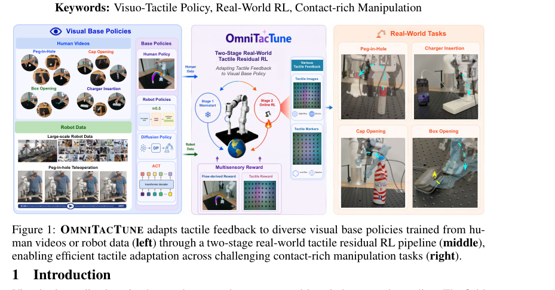
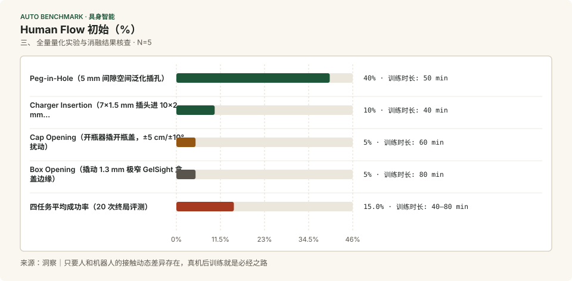

# 洞察｜只要人和机器人的接触动态差异存在，真机后训练就是必经之路

2026-10-26 · arXiv:2607.03723 · UMD & Georgia Tech (CoRL 2026) · 有来源缺口

[本地原件归档](../../../raw/1d8f83a4195dc01552fdd84dc1a6d767de81afa2f37969a4855a04666324737d) · 固定材料版本 `digest-material-1d8f83a4195dc01552fdd84dc1a6d767de81afa2f37969a4855a04666324737d@1` · [一手原站](https://arxiv.org/abs/2607.03723) · [触发线索（具身纪元）](https://mp.weixin.qq.com/s/TGbWkskYVUxaStG3SeC9XQ)

> [!IMPORTANT]
> 用户关注点（TG）：这种鲜明的观点好好，研究一下这篇论文，还有作者的学术背景

## 针对性追查与回应

- 来源：[arXiv:2607.03723 · OmniTacTune (CoRL 2026 / RSS 2026 Tac-for-FM Best Paper)](https://arxiv.org/abs/2607.03723) · [官方项目主页](https://colinyu1.github.io/omnitactune-site/)
- 口径与利益披露：论文系马里兰大学（UMD）与佐治亚理工学院（Georgia Tech）联合发布的学术成果（2026-07-04 提交 arXiv），一作 Kelin Yu 获 Amazon Research Award 资助并曾/将在 Amazon Robotics 与 Amazon Industrial Robotics 实习，合作者 Yunhai Han 任 NVIDIA Seattle Robotics Lab 实习研究员；触发线索系具身纪元对《灵光一现Eaiaha!》第五期对谈的中文快剪整理，下文全部机制、数据与背景均回溯自论文原文与五位作者官方学术主页。
- ==核心结论==：Kelin Yu（於柯霖）团队的底层判断高度成立——人类（27 自由度软体手+皮肤机械感受器）与机器人（平行夹爪+硅胶视触觉弹性体）的接触动力学差异决定了纯粹依靠人类视频或遥操作模仿学习只能解决“接触前空间走位（Pre-Contact）”，一旦切入毫米级插拔与动态撬动（Post-Contact），真机在线残差强化学习几乎不可绕过。OmniTacTune 的真正工程贡献不在发明新 VLA 主干，而在于用“12 分钟自主采集+ControlTac 力扰动轨迹增强”冷启动了原本没有离线触觉示范的 Flow-Tactile Critic 与编码器，并通过“接口级策略无关（Policy-Agnostic）”残差接口，在 40–80 分钟内把人类光流/遥操 Flow/ACT/Diffusion Policy/π0.5 等弱视觉基座从 5%–40% 拉升至 85%–100%（四任务均值 93.75%）。从学术脉络看，这是一条极具含金量的「Stanford 李飞飞多感官触觉仿真派（Ruohan Gao & Danfei Xu）× Georgia Tech 结构化控制与人类迁移派（Harish Ravichandar & Yunhai Han）」跨校合流。

---

### 一、 作者团队学术背景与学派谱系全梳理

五位作者分别来自 UMD Multisensory Machine Intelligence Lab 与 Georgia Tech STAR Lab，人员配置呈现出明显的“师承接力 + 跨校多感官融合”特征：

| 作者与署名角色 | 当前单位与学位履历 | 导师与核心学派渊源 | 产业经历、奖项与代表前作演进 |
| :--- | :--- | :--- | :--- |
| Kelin Yu（於柯霖，共同一作* / 主导作者） | UMD 计算机系三年级博士生（2024-08 入学）；Georgia Tech 电子工程与数学双学士（2018–2022 Highest Honor）、CS 硕士（2022–2024-05） | 博士导师 Ruohan Gao（合作 Yiannis Aloimonos、Pratap Tokekar）；GT 硕士导师 Danfei Xu、Ye Zhao 及博士生导师 Yunhai Han | Amazon Robotics AI 实习生（标定漂移检测每次错抓省 \$12）及 2026-06 Amazon Industrial Robotics 研究实习生；获 UMD Dean's Fellowship、Apple AI/ML Fellowship 提名；主导或参与 T-MECH 2024、MimicTouch（CoRL 2024 / NeurIPS Workshop 最佳论文）、GenFlowRL（ICCV 2025）、ControlTac（CoRL 2026）、HumanEgo（IROS Workshop 双最佳论文）及 Amazon 合作人形手触觉工作 TMA / ReDex |
| Haode Zhang（张皓德，共同一作*） | CMU 机器人硕士生（MSR）；本科毕业于上海交通大学（SJTU）；2024-08 赴 ASU 实习、2025-07 赴 UMD 暑期科研实习 | UMD 期间由 Ruohan Gao 与 Kelin Yu 直接指导；ASU 合作 Wanxin Jin；SJTU 合作 Yong-Lu Li（李永露） | 主研机器人学习与人类偏好对齐；代表作包括 HSBC 假设空间批量割集奖励对齐（ICML 2025 共一）、BSV/Scene Dynamic Field 直觉物理多模态大模型（ICLR 2026）及 OmniTacTune（CoRL 2026 共一） |
| Yunhai Han（韩云海，核心合作者） | Georgia Tech 机器人学博士生（2026-04 通过开题）；UCSD 机械工程硕士（合作 Henrik Christensen、Michael Yip）；燕山大学机械学士（RoboMaster YSU Eagle 视觉组长） | GT 博士导师 Harish Ravichandar；博士委员会含 Zsolt Kira、Danfei Xu、Yunzhu Li、Dinesh Jayaraman | 2026-05 起任 NVIDIA Seattle Robotics Lab 研究实习生/兼职研究员；与 Kelin Yu 同获 2026 Qualcomm Innovation Fellowship Finalist；打通 Koopman 算子灵巧控制（CoRL 2023 Oral、KOROL CoRL 2024、CoRL 2026）、人类视频迁移（ImMimic CoRL 2025 Oral、Video2Sim2Real CoRL 2026 Dex Oral）与触觉残差（MimicTouch CoRL 2024） |
| Harish Ravichandar（资深作者） | Georgia Tech 交互计算学院助理教授（2021 起）、IRIM 与 ML@GT 核心教员；Anna Univ. 学士、UF 硕士、UConn 博士、GT 博士后 | Georgia Tech STAR Lab（Structured Techniques for Algorithmic Robotics）创立者与主任 | 获 NSF CAREER Award 与 GT 杰出博士后奖；主张以几何、动力学和本体约束作为机器人学习的“结构化脚手架”，强调数据节俭与局部增量自适应（Structured Adaptation） |
| Ruohan Gao（高若寒，通讯作者） | UMD 计算机系助理教授（UMIACS、MRC、AIM 教员）；UT Austin 博士（2021）、Stanford 博士后（2021–2023） | 博士师从 Kristen Grauman（获 UT Austin 全校唯一最佳博论 Michael H. Granof Award）；Stanford SVL 博后师从李飞飞（Fei-Fei Li）、吴佳俊（Jiajun Wu）、Silvio Savarese | UMD Multisensory Machine Intelligence Lab 主任；获 2025 Sony 教员创新奖与 2026 Spring Amazon Research Award；在 Stanford 主导 ObjectFolder 2.0（CVPR 2022）、ObjectFolder Benchmark（CVPR 2023）及经典视听触操作工作 See, Hear, and Feel（CoRL 2022），并在 UT Austin 提出静态图运动流生成 Im2Flow（CVPR 2018 Oral） |

- ✅ 学派谱系复核（本工作台核查）：从学脉连接看，Kelin Yu 在 Georgia Tech 硕士阶段受李飞飞门生 Danfei Xu（与本库已有 EgoScale 学者档案一致）及 Ye Zhao、Yunhai Han 训练，完成了“人手多模态触觉示范 + 残差强化学习”的原型 MimicTouch（CoRL 2024）；博士赴 UMD 投奔同样出身 Stanford SVL 的 Ruohan Gao 后，将 Ruohan Gao 的客体中心运动流（Im2Flow → GenFlowRL）与多感官触觉基座（ObjectFolder / ControlTac）注入这套残差框架，从而在 OmniTacTune 中实现了“视觉运动流先验 + 生成式触觉数据增强 + 策略无关在线残差 RL”的三合一闭环。

---

### 二、 论文核心技术拆解：无离线触觉样本时，如何让任意视觉基座学会触觉修正？

#### 1. 硬件栈与基础策略输入定义
- 真机系统采用 xArm7 七自由度机械臂 + 末端二指夹爪安装 GelSight Mini 视触觉传感器 + 第三视角标定的 Intel RealSense D435 RGB 相机（30 Hz），人类示范借助 Meta Quest 头显（60 Hz 手部追踪 + ArUco 标定重映射），遥操作采用 OpenTeach；真机控制频率为 10 Hz，单回合上限 300 步；离线监督训练使用单卡 RTX A6000，真机在线异步学习与部署推理使用单卡 RTX 5080。
- 论文主打 Human Flow Policy 作为核心基座（如图 Figure 1 与 Figure 2 架构所示）：先以 DINOv2 + SAM 分割目标物体并采样 32 个关键点，由 CoTracker 3 追踪视频轨迹，经 LoRA 微调（rank 16 / alpha 32，每任务 50 条示范）的 Im2Flow2Act 流生成器预测完整物体光流并离散为 L=30 个稀疏子目标。策略输入包含初始质心、当前质心与子目标相对位姿变化，动作块长度 K=8。

#### 2. 两阶段设计破解两大训练死结（对比 PLD 与 ViTAL）
传统纯视觉真机残差 RL 如 PLD（arXiv:2511.00091）可直接用离线机器人示范预热 Critic，但在“视觉预训练基座无触觉输入”的新设定下，面临两大瓶颈：① 回放缓冲区与 Flow-Tactile Critic 缺乏当前任务的真实接触转移；② 预训练触觉编码器存在跨传感器/跨任务表征偏移。

1. Stage 1（12 分钟自主预热 Warm-Start + ControlTac 轨迹增强）：
   - 冻结视觉基座以零残差（a_t^r = 0）自主运行 12 分钟，填充容量 10,000 步的回放缓冲区。
   - 仅在检测到真实接触（GelSight 标记点平均位移 m_t > 1.5 px）的转移上，用 Bellman Critic 损失与冻结解码器图像重建正则联合更新触觉编码器适配层（L_E = L_Q + 0.1 L_rec，潜向量维度 32）。
   - ControlTac 轨迹级增强：先通过图像修复抹除 GelSight 标记点以匹配 ControlTac 无标记训练分布，针对每条真实接触轨迹采样统一法向力扰动 Δf ∈ [-3, 10] N（例如 -3 N 与 +3 N）及位姿偏移生成 2 条时序一致的新触觉轨迹，再把原始标记点掩码复写贴回，在不增加真机交互次数的条件下大幅扩展了不同受力条件下的触觉覆盖。
2. Stage 2（接口级策略无关在线残差 SAC + 多感官稠密奖励）：
   - 冻结基策略，使用 SAC（折扣 γ=0.99，batch 256，lr=3e-4）训练轻量残差策略（Residual Actor）与双 Critic。最终执行动作 a_t = a_t^b + s_t · a_t^r，其中 Residual 缩放系数 s_t 每 500 个在线步从 0.05、0.10 逐步放宽至 0.15，辅以 BC 正则防止随机初始残差带偏基策略。
   - 政策无关接口设计：残差策略不读取基座内部隐状态，仅接收本体状态 q_t、稀疏光流子目标特征 z_t^f、经接触门控 g_t = 1[m_t > 1.5 px] 控制的触觉特征 g_t · z_t^τ、当前基动作 a_t^b 及短时动作块 a_{t:t+K}^b。这使其无需修改主干即可外挂于 Flow Policy、ACT、Diffusion Policy 与 LoRA 微调后的 π0.5。
   - 归一化多感官奖励（w_r=1.0, w_g=0.5, w_f=2.0 除以 3.5，叠加安全惩罚 w_s=1.0 与人工终局成功奖励 +1）：抓取前由末端距物体初始 3D 质心距离驱动（d_max=0.15 m），抓取后由稀疏物体流匹配误差驱动（对比 Figure 3 消融，逐帧密集关键点会过度约束导致 ACT 失效，稀疏子目标才保留局部修正空间），接触深度 >0.10 给抓握激励，标记点位移 >8.0 px 立即触发大负奖励并安全复位。

---

### 三、 全量量化实验与消融结果核查

#### 1. 四项富接触任务总榜（Figure 4 与 Figure 5，每任务 50 条人类示范训基座）

| 实验任务（与物理难点） | 训练时长 | Human Flow 初始 | PLD*（无触觉预热） | PLD（Visual Only） | ViTAL（从零训） | OmniTacTune（本文） |
| :--- | :---: | :---: | :---: | :---: | :---: | :---: |
| Peg-in-Hole（5 mm 间隙空间泛化插孔） | 50 min | 40% | 65% | 60% | 50% | 100% |
| Charger Insertion（7×1.5 mm 插头进 10×2 mm 孔，±5 cm/±10° 扰动） | 40 min | 10% | 60% | 30% | 50% | 100% |
| Cap Opening（开瓶器撬开瓶盖，±5 cm/±10° 扰动） | 60 min | 5% | 50% | 40% | 45% | 90% |
| Box Opening（撬动 1.3 mm 极窄 GelSight 盒盖边缘） | 80 min | 5% | 35% | 20% | 30% | 85% |
| 四任务平均成功率（20 次终局评测） | 40–80 min | 15.0% | 52.5% | 37.5% | 43.75% | 93.75% |

#### 2. 五类视觉基座兼容与“50 分钟在线 RL vs 补采 40 条触觉遥操”对照（Peg-in-Hole，Table 1）

| 对比基线 / 骨干架构 | 50 条视觉示范基座初始 | 额外 50 分钟增至 90 条遥操+触觉模仿 | 仅 50 条基座 + 50 分钟 OmniTacTune 在线 RL |
| :--- | :---: | :---: | :---: |
| ACT（Action Chunking Transformer） | 25%（正文 §4.2 记 20%） | 60%（ACT + Tactile 特征拼接） | 80%（+55–60 pct） |
| Diffusion Policy / RDP | 30% | 65%（RDP 快慢双分支视触觉） | 90%（+60 pct） |
| π0.5（LoRA 微调 VLA） | 15%（正文 §4.2 记 20%） | 45%（π0.5 + Tactile Token SFT） | 75%（+55–60 pct） |
| Teleop Flow Policy | 50% | 未单列 | 90%（+40 pct） |
| Human Flow Policy | 40% | 不适用（人类视频无真机触觉） | 100%（+60 pct） |

- ✅ 轨迹平滑度与表征兼容性核查（本工作台核查）：论文附录 C.1（Table 4）用频域平滑度 M-SPARC 与时间域急动度 M-LDLJ 定量解释了“为什么遥操比人类视频更难做接触学习”——人类示范 M-SPARC 为 -2.889（M-LDLJ -18.03），Human Flow 策略平滑至 -2.664（-17.29）；而 Meta Quest 遥操作示范因操作员缺乏力觉反馈出现剧烈高频抖动，M-SPARC 骤降至 -7.320（-19.70），遥操策略进一步恶化至 -9.521（-20.89），且这解释了为何 Charger/Cap/Box 三项高难度接触任务甚至无法采集可用遥操基座。触觉表征横向对比（§4.4）中，AnyTouch2 与仅用低维标记点的两层 MLP 取得相近终局表现，而 Sparsh 与 T3 在高动态 Charger Insertion 中表现偏弱，印证两者预训练缺乏动态操作触觉分布。
- ⚠️ 口径差异与内部数字一致性核查（本工作台核查）：核对 arXiv:2607.03723v1 原文发现三处需关注的实验边界：① §4.2 正文将 ACT 与 π0.5 初始成功率写为 20% 与 20%，而 Table 1 与图表汇总写作 25% 与 15%（可能源自 10 次与 20 次评测口径切换或排版未同步）；② Figure 5 训练曲线各检查点仅评测 10 次，终局柱状图 Figure 4 与正文则基于 20 次评测；③ 在更难的 Charger/Cap/Box 任务中，论文将残差动作空间限定在 x/y/z 平移与 yaw 旋转（4 DoF），且物体已预先抓取在夹爪中，尚未验证从零自由抓取起跑的端到端 6 DoF 高动态工具使用。

---

### 四、 深度研判：与库内 Ego4WAM / GR00T 2 的张力互补及“真机后训练必经之路”的边界条件

将 OmniTacTune 置入本工作台已入库的「人类视频扩展与世界—动作模型」坐标轴，可精准划出何时无需真机后训练、何时必须上真机残差 RL：

1. ❌ 对“无脑堆人类视频/仿真即可一步到位”的反证（本工作台推断）：与本库 [Ego4WAM (arXiv:2609.40341)](Ego4WAM%EF%BC%9A%E5%BD%93%E4%BA%BA%E7%B1%BB%E6%95%B0%E6%8D%AE%E8%BF%88%E5%90%91%E7%99%BE%E4%B8%87%E5%B0%8F%E6%97%B6%EF%BC%8C%E6%8E%A2%E7%B4%A2%E6%95%B0%E6%8D%AE%E6%97%B6%E9%95%BF%E4%B9%8B%E5%A4%96%E7%9C%9F%E6%AD%A3%E5%80%BC%E5%BE%97%20scaling%20%E7%9A%84%E5%85%B3%E9%94%AE%E7%BB%B4%E5%BA%A6.md) 和 [NVIDIA GR00T 2](GR00T%202%20Official%20Technical%20Release_%20Scaling%20World-Action%20Models%20on%20402,000%20Hours%20of%20Human%20Video%20with%20X-Adapt%20&.md) 互为上下游拼图——Ego4WAM 证明海量人类视频+WAM 可将叠衣等宏观任务的真机数据压缩 15 倍，但其在 RoboDojo 绝对成功率仍停留在 14.35%（Precision 22.25%）；GR00T 2 虽凭借 40.27 万小时人类视频实现 70% 均值进展与 5-Shot 95%（预筛选任务子集），却因输入缺指尖触觉且视频 VAE 16 倍空间压缩而在 0.1 mm 级紧密配合时缺乏力反馈。OmniTacTune 恰好证明：人类视频与视觉基座负责把成功率从 0% 带到 10%–40% 的“粗对齐区间”，而把成功率推向 ≥90% 部署门槛的“最后一毫米接触动力学对齐”，无法靠增采遥操（+50 min 仍落后 20%–30%）或仿真解决，只能由真机交互闭环承担。
2. ⚠️ 物理成本与工业部署红线（本工作台核查）：论文第 5 节也诚实坦承了真机 RL 的现实代价——40–80 分钟在线训练仍依赖人工复位（Manual Reset），且反复接触对脆弱的 GelSight 硅胶弹性体造成物理磨损；同时 10 Hz 控制周期与 5 mm（Peg-in-Hole）至 0.5 mm 级容差仍属实验室桌面基准，尚未触及汽车/3C 产线 <0.1 mm 金属刚性装配所需的 500–1000 Hz 阻抗力控与零人工值守自恢复要求。

### 观点与可反驳条件

- ==观点==：只要人类手爪（软组织多指+分布式触觉）与机械臂执行器（刚体夹爪+异质触觉传感器）之间的接触动力学差异未被物理统一，面向接近 100% 工业交付成功率的具身策略就不可能靠离线模仿或人类视频一次性闭环，真机在线残差强化学习+轻量触觉适配是效率显著高于补采遥操的必经之路；但 OmniTacTune 当前 10 Hz 控制与依赖人工复位的模式仅验证了“实验室小样本单任务可行性”，尚未证明在无人工干预产线长程运行中的传感器寿命与经济性。
- ==推翻条件==：
  1. ① 触觉世界模型与高精度仿真替代条件：若未来在无需任何真机在线试错（0 分钟真机 RL）的条件下，仅靠高保真触觉生成世界模型（如 ControlTac 耦合动作条件视频/触觉扩散模拟器）在仿真中完成残差策略训练，并零样本迁移至未见品牌视触觉传感器及 1.3 mm 撬盒、1.5 mm 插头等 4 项真机任务上取得 ≥90% 平均成功率，则“真机交互后训练必经之路”的核心命题将被推翻。
  2. ② 带力反馈遥操大规模模仿反超条件：若在严格同等 50–80 分钟时间预算内，使用带双边力反馈（Bilateral Teleoperation）的遥操作硬件采集高顺滑度（M-SPARC > -3.0）视触觉示范微调 RDP 或 VLA，在 Charger Insertion 与 Box Opening 上取得不低于 OmniTacTune（分别 ≥100% 与 ≥85%）的成功率，则“在线 RL 样本效率必然优于模仿数据增补”的论断将被修正。
  3. ③ 硬件损耗与复位成本否决条件：若在 10 项以上连续产线部署中统计，GelSight 类视触觉弹性体在 100 小时真机 RL 碰撞磨损下更换维护及人工复位总耗时超过直接工程编写传统六维力控+视觉伺服（Visual Servoing + Impedance Control）的交付工时，则该路线在工业场景的商业可行性将被证伪。

---

## 原文摘录与一手信源存证

> 马里兰大学与佐治亚理工学院的研究者提出了 OmniTacTune：保留预训练视觉策略的动作能力，通过真机强化学习训练触觉残差策略，学习接触过程中的动作修正。
> — 原文摘录，文字段落 1；证据 `digest-material-1d8f83a4195dc01552fdd84dc1a6d767de81afa2f37969a4855a04666324737d-excerpt-1@2`

> 每个任务先采集 50 条人类示范，训练 Human Flow 视觉基策略。20 次初始测试中，四项成功率依次只有 40%、10%、5% 和 5%。除 ViTAL 外，各方法都先进行 12 分钟预热。四项任务的总训练时间依次为 50、40、60 和 80 分钟，最终模型各评估 20 次。
> — 原文摘录，文字段落 2；证据 `digest-material-1d8f83a4195dc01552fdd84dc1a6d767de81afa2f37969a4855a04666324737d-excerpt-2@2`

一手材料：

- OmniTacTune: Policy-Agnostic Real-World RL for Tactile Residual Adaptation of Visual Policies (arXiv:2607.03723) · UMD Multisensory Machine Intelligence Lab & Georgia Tech STAR Lab · [原站](https://arxiv.org/abs/2607.03723) · [主体档案：Kelin Yu](../entities/people/Kelin%20Yu.md) / [主体档案：ColinYu1](../entities/people/ColinYu1.md) / [主体档案：Kelin Yu (arXiv)](../entities/people/Kelin%20Yu%20%28arXiv%29.md) · [本地原件](../../../raw/3921027b4096cac092699a0e7d5dbb9a4419b2f9bb269561690b6e45212845ce)
  材料版本 `digest-material-3921027b4096cac092699a0e7d5dbb9a4419b2f9bb269561690b6e45212845ce@1`；获取方式 `http_full_text`。
  > Visual policies learned from human videos, teleoperation, and robot demonstrations offer scalable motion priors, but often fail in contact-rich manipulation, where success significantly depends on local force and contact geometry. — 原文提取
  > Visual robot policy learning has made tremendous progress, driven in large part by scaling. — 原文提取
- OmniTacTune Official Project Page (UMD & Georgia Tech) · UMD Multisensory Machine Intelligence Lab & Georgia Tech STAR Lab · [原站](https://colinyu1.github.io/omnitactune-site/) · [主体档案：Kelin Yu](../entities/people/Kelin%20Yu.md) · [本地原件](../../../raw/cdb9608958c73e70ec1dd1e16601a1169b90355d9d63272b451a4be8dc12ec15)
  材料版本 `digest-material-cdb9608958c73e70ec1dd1e16601a1169b90355d9d63272b451a4be8dc12ec15@1`；获取方式 `http_full_text`。
  > A complete walkthrough of the OmniTacTune pipeline and all four contact-rich tasks. — 原文提取
  > A one-take demo of online real-world RL — the policy is trained in ~40 minutes directly on hardware, with no resets staged for the camera. — 原文提取

归属与范围：已穿透至一手论文全文（arXiv:2607.03723v1 HTML 全文，2026-07-04 提交，CoRL 2026 录用暨 RSS 2026 Tac-for-FM Workshop 最佳论文）、官方项目主页（colinyu1.github.io/omnitactune-site）以及五位署名作者（Kelin Yu、Haode Zhang、Harish Ravichandar、Yunhai Han、Ruohan Gao）全部官方学术主页；同时结合本工作台已入库的 Ego4WAM（arXiv:2609.40341）、NVIDIA GR00T 2 / X-Adapt 与 PLD（arXiv:2511.00091）完成横向边界比对。微信推文《具身纪元》与访谈节目《灵光一现Eaiaha!》退居触发线索。未公开开源代码仓链接及 Eaiaha! 第五期完整文字逐字稿仍保留规范缺口。

来源缺口：

- `not_disclosed`：OmniTacTune 项目主页（colinyu1.github.io/omnitactune-site）与 arXiv:2607.03723v1 截至 2026-11 仅开放 Paper/arXiv/Video/X 链接，尚未公布官方训练与真机控制开源代码仓及模型权重，核心超参数与模块细节均依论文正文与附录核验。 [线索](https://colinyu1.github.io/omnitactune-site/)
- `unavailable`：触发线索中提及的《灵光一现Eaiaha!》第五期完整版文字对谈《触觉如何让机器人学会接触：对谈 OmniTacTune 作者於柯霖》微信长文未在本次同步拉回，受访观点仅以触发线索快剪精华及论文正文为凭。 [线索](https://mp.weixin.qq.com/s?__biz=MzY5NjM5OTIzMA%3D%3D&mid=2247483740&idx=1&sn=43c1479d5eeab63da18eabd06126a1fa)

[返回赛道总览](../赛道总览.md#digest-1d8f83a4195dc015) · [返回导读索引](README.md) · [主体档案库](../entities/README.md)
