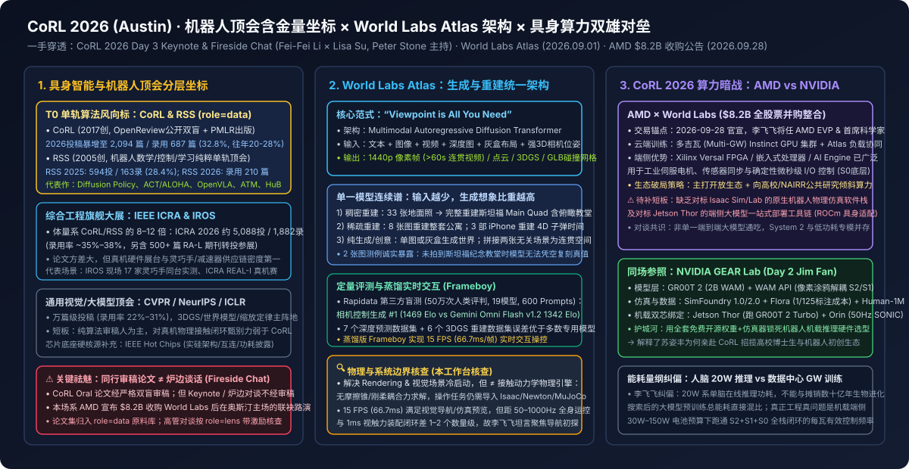

# 现场｜CoRL现场李飞飞 × 苏姿丰：世界模型、算力与机器人的下一步

2026-11-12 · CoRL 2026 · Fei-Fei Li × Lisa Su 对谈 · 有来源缺口

[本地原件归档](../../../raw/fcb359fd7cfec452d4817188a39ad2e0cce3c1304c4fc26c5af2871d80b1da96) · 固定材料版本 `digest-material-fcb359fd7cfec452d4817188a39ad2e0cce3c1304c4fc26c5af2871d80b1da96@1` · [一手原站](https://www.corl.org/program) · [触发线索（具身纪元）](https://mp.weixin.qq.com/s/CuhnoPBcC_F9qPmhXPoC7w)

> [!IMPORTANT]
> 用户关注点（TG）：corl是啥，含金量高吗，我们有没有收录类似的大会？

## 针对性追查与回应

三句话直答核心追问：① CoRL（Conference on Robot Learning，机器人学习国际会议） 是 2017 年创刊的机器学习 × 机器人学单轨制顶级会议（OpenReview 双盲公开审稿、PMLR 出版）；② 论文审稿含金量极高（与 RSS 并列具身智能算法/VLA 首发第一梯队，区别于 ICRA/IROS 万人工程硬件展），但本篇李飞飞 × 苏姿丰属于无同行评议的大会炉边谈话，本质是 AMD 宣布 \$8.2B 收购 World Labs（2026-09-28）后 在奥斯汀主场对垒英伟达 Isaac + GR00T 2 + Jetson 的生态联合路演；③ 本工作台此前已在导读层收录 32 篇 顶会相关文章（其中 CoRL 9 篇），本次已将 CoRL Proceedings、RSS、IEEE ICRA、IEEE IROS、IEEE Hot Chips、CVF Open Access 六大同行评议论文集以官方一手原料源（`role=data`）正式补齐至信源库。

> [!NOTE]
> 场景与利益披露（一手溯源）：本文源自微信公众号「具身纪元」记者 Marilyn Liu 在美国得州奥斯汀（Austin, TX）CoRL 2026（第 10 届机器人学习国际会议，2026-11-09 至 11-12） Day 3 主会场的现场旁听速记，上游一手事件为 World Labs 创始人兼 CEO 李飞飞（Fei-Fei Li）主题演讲（Keynote） 与 AMD 董事长兼 CEO 苏姿丰（Lisa Su）炉边对谈（Fireside Chat，主持人为 UT Austin 教授 Peter Stone，开场介绍人为 UT Austin 副教授、李飞飞首位机器人方向博士生 Yuke Zhu）。
> 关键商业利益背景（本工作台核查）：原文速记未提但决定全场站位的一手事实是——对谈前 44 天（2026-09-28），AMD（Advanced Micro Devices）刚宣布以约 82 亿美元（\$8.2B）全股票交易收购 World Labs（预计 2026 年底交割，交易完成后李飞飞将出任 AMD 执行副总裁兼首席科学家，直接向苏姿丰汇报），且奥斯汀正是 AMD 全球核心工程总部所在地。因此，这场炉边谈话本质上是 AMD × World Labs 准合并体 在英伟达（前一日 Jim Fan 刚在同场发布 GR00T 2 + SimFoundry + Jetson Thor 闭环）腹地争夺具身智能开发者的联合路演，阅读时须严格区分 CoRL 同行评议论文 与 赞助商/高管无审稿炉边谈话 的证据权重。

---

### 一、直答三问：CoRL 是什么、含金量如何、本工作台收录情况

#### 1. CoRL 是什么？
- 定位与机制：CoRL（Conference on Robot Learning，机器人学习国际会议） 创刊于 2017 年（由 Sergey Levine、Pieter Abbeel、Anca Dragan 等学者发起），是全球首个专门聚焦 机器学习（RL / 模仿学习 / VLA 大模型）× 机器人学 × 控制理论交叉 的 单轨制（Single-track） 国际学术会议。
- 审稿与出版：论文经 OpenReview 全公开双盲同行评议（审稿意见、作者 Rebuttal 与打分永久公开可查），正式论文集收录于 PMLR（Proceedings of Machine Learning Research） 免付费墙开放获取。2026 年第 10 届奥斯汀大会由 UT Austin 团队（Yuke Zhu、Peter Stone 等）核心承办，投稿量跃升至 2,094 篇（约为往年的 3 倍），录用 687 篇（录用率 32.8%；2017–2024 年历史录用率约 20%–28%）。

#### 2. 含金量高吗？（四档顶会横比 + 关键祛魅）
不能笼统答“高”，必须按 「赛道锐度 vs 会议体量」 与 「双盲审稿论文 vs 高管炉边谈话」 两层切开看：

| 顶会梯队 | 代表会议 | 审稿与规模量级 | 核心长板（看什么） | 结构短板（不看什么） | 对具身智能研究的含金量定位 |
| --- | --- | --- | --- | --- | --- |
| T0 具身单轨风向标 | CoRL、RSS（Robotics: Science and Systems） | 单轨制；RSS 年录 ~160–210 篇（录用率 28%–32%），CoRL 2026 录 687/2,094 篇（32.8%），OpenReview 公开审稿 | VLA 架构、Diffusion Policy、ACT/ALOHA、灵巧手 RL、Sim-to-Real 范式首发阵地；要求真机闭环实验 | 机械本体结构、电机减速器等纯硬件论文极少 | 算法与范式含金量最高；具身大模型核心团队必争首发地 |
| T1 机器人综合万人展 | IEEE ICRA、IEEE IROS | 多轨制；ICRA 2026 投 ~5,088 篇 / 录 1,882 篇（录用率 ~35%–38%，历史约 38%–48%） | 全球最大真机硬件展台、灵巧手/本体供应链、传统运动控制与 SLAM 工程集成 | 论文体量极大、审稿方差大，纯水文与顶流工作并存 | 产业硬件与本体供应链风向标；看展价值高于平均论文价值 |
| T1 通用 AI / 视觉顶会 | CVPR / ICCV、NeurIPS / ICLR | 万篇级投稿（录用率 22%–28%），纯算法双盲审稿 | 3DGS/NeRF 三维重建、视频生成世界模型、VLM 预训练骨干底座 | 缺乏真机硬件复现门槛，大量“仿真刷榜但上真机即崩”的工作 | 上游视觉/世界模型底座源头（如 Atlas 评测对标的 3D 重建基线） |
| T0 算力实硅顶会 | IEEE Hot Chips、ISSCC | 工业界实硅架构披露（芯片流片/实测能效硬门槛） | 训练/推理 GPU、边缘 SoC、FPGA 与光互连真实面积、带宽与功耗 | 不涉及机器人策略算法 | 算力底座硬核验真场（核查苏姿丰端侧算力主张的标尺） |

- 关键祛魅（本工作台核查）：CoRL 的 Oral / Best Paper 论文含金量极高，但本篇李飞飞 × 苏姿丰属于 Keynote + Fireside Chat（特邀主旨与赞助商高管炉边谈话），不经过同行评议。前一日英伟达 Jim Fan 刚在同场推销 SimFoundry + GR00T 2，次日李飞飞与苏姿丰同台则是为 AMD \$8.2B 收购 World Labs 后的「空间世界模型 + 开放异构算力」联盟 定调。听高管对谈看的是 产业结盟信号与资源投向，不能把路演修辞当成已跑通的学术实证。

#### 3. 我们工作台有没有收录类似的大会？（全库盘点 + 已完成结构化补齐）
- 盘点现状（文章层已高频覆盖，信源库层此前存在建档缺口）：
  - 单篇导读与一手材料层（已有 32 篇顶会相关归档）：其中 CoRL 已有 9 篇（含前一日 [Jim Fan CoRL 2026 演讲全文](./%E7%8E%B0%E5%9C%BA%EF%BD%9CJim%20Fan%20CoRL%E6%BC%94%E8%AE%B2%E5%85%A8%E6%96%87%EF%BC%9A%E8%BF%99%E4%B8%8D%E6%98%AF%E5%AF%92%E5%86%AC%EF%BC%8C%E8%BF%99%E6%98%AF%E6%9C%BA%E5%99%A8%E4%BA%BA%E7%9A%84%E5%A4%8F%E5%A4%A9.md)、CoRL 2025 Oral 人形平衡 HuB、CoRL 2025 VideoMimic、Pi MEM CoRL Spotlight、Stanford ILIAD Re-Mix CoRL 2024、Danfei Xu CoRL 演讲等）、ICLR 5 篇、RSS 3 篇（含 RSS 2024 满分论文 ATM 与 OpenVLA）、NeurIPS 3 篇、ICRA / IROS 3 篇（含 ICRA 2026 灵巧手 SynDexy C1、IROS 17 家灵巧手横评）、CVPR / ECCV / ICML 4 篇，以及产业与系统算力大会 OCP（2 篇）、IEEE Hot Interconnects / HotI 2026（1 篇）、Modal Runtime 2026（1 篇）、Foxglove Actuate（1 篇）、NVIDIA GTC（1 篇）。
  - 信源库（`kind=source`）缺口诊断：此前上述论文均挂靠在 arXiv 作者索引或高校实验室名下，信源库中 尚未将同行评议顶会论文集本身作为独立一手原料源（`role=data`）建档。
  - 本次已主动补齐：本工作台已按 `AGENTS.md` 信源库铁律（同行评议论文集属官方一手原料 `role=data`，与高管个人路演 `role=lens` 严格隔离），将 CoRL（corl.org + OpenReview + PMLR）、RSS（roboticsconference.org + roboticsproceedings.org）、IEEE ICRA、IEEE IROS、IEEE Hot Chips、CVF Open Access（CVPR/ICCV） 共 6 个核心顶会论文集 正式写入 `work/registry.sqlite3` 并同步至 [信源库](../../%E7%A0%94%E7%A9%B6%E5%B7%A5%E5%85%B7%E4%B8%8E%E4%BF%A1%E6%BA%90/%E4%BF%A1%E6%BA%90%E5%BA%93.md) 的「已接入 · 原料型」序列。

---

### 二、李飞飞 Keynote 逐层拆解：空间智能与 Atlas 世界模型的真实边界

#### 1. 进化论锚点与「空间智能（Spatial Intelligence）」定义
- 原文论据还原：李飞飞从 5 亿年前寒武纪生命大爆发 切入——早期动物演化出感光视网膜后，感知与运动首次形成闭环，触发神经系统与智能演化；类比人类个体发育，婴儿在掌握语言（LLM 对应的符号系统）之前，整日通过眼睛观察、双手抓取、嘴部触碰与空间移动建立物理直觉。她回顾斯坦福团队在 BEHAVIOR 家庭长程家务基准及早期「LLM + 机械臂规划」实验中的受挫结论：大语言模型是一维序列生成的产物，本质上缺乏三维几何、遮挡一致性与物理交互表征，具身智能必须补齐与语言并列的基石能力——空间智能（在真实或想象的三维时空中进行感知、推理、生成与交互的能力）。
- 原位机制核查：✅ 问题诊断成立（本工作台核查）。纯 VLM/LLM 骨干直接输出末端轨迹时，普遍存在深度尺度漂移与遮挡物穿模问题；这也是 2026 年行业从「VLM 直出动作（VLA）」集体转向「世界动作模型（WAM / 视频与三维先验预训练）」的共识起点。

#### 2. World Labs 旗舰模型 Atlas：架构、评测与四类能力展示
李飞飞在现场完整演示了 World Labs 于 2026-09-01 发布的通用生成式三维世界模型 Atlas（注：微信原文配图为会场远拍 PPT，受微信图床代理策略限制未直接拉取，本工作台已穿透回 [World Labs 官方一手技术报告](https://www.worldlabs.ai/blog/atlas-generate-and-interact-with-worlds) 核实全部底层参数）：
- 底层架构与训练口径：从零预训练（pretrained from scratch）的 多模态自回归扩散 Transformer（Multimodal Autoregressive Diffusion Transformer，基于 Rectified Flow），原生分辨率最高 1440p，支持 >60 秒 时空一致生成；核心控制条件是显式三维相机位姿序列，团队提出口号 "Viewpoint is all you need"（视角即一切）——把自由探索、局部编辑、物理光影模拟与三维几何提取统一转化为相机轨迹条件下的多模态视频流生成。
- 现场展示的四项能力与定量成绩：
  1. 开放世界生成与自由漫游：支持文本、单张图片、多图、全景图及视频输入，用户在生成世界中任意平移旋转相机，被遮挡区域再入画时保持三维几何一致；在第三方盲测平台 Rapidata 相机控制榜单（覆盖 19 个主流视频模型、600 条固定提示词、约 50 万次 人类盲评对比）中，Atlas 以 1469 Elo 位列第一（领先 Google Gemini Omni Flash v1.2 的 1342 Elo 与 v1.1 的 1246 Elo）。
  2. 多模态三维理解与零样本重建：不仅输出 RGB 像素流，还能直接解码 深度图（Depth）、表面法线（Normals）、语义分割与三维高斯泼溅（3DGS）/ 碰撞网格（GLB）；官方宣称在 7 个深度估计数据集 与 6 个 3DGS 重建数据集 上以零样本生成模型身份追平或超越 Pi3X、VGGT、Depth Anything、MapAnything 等专用三维重建模型。
  3. 手机端采集的「子弹时间（Bullet Time）」动态冻结：现场演示用 3 台普通 iPhone 拍摄斯坦福校园 Main Quad 喷泉周围骑独轮车杂耍与滑板场景，Atlas 将稀疏三视角视频融合为完整动态三维场景，可在冻结时间帧的同时自由绕飞相机视角。
  4. 实时交互蒸馏版（15 FPS）：通过模型蒸馏（官方命名为 Frameboy: Atlas in Real-time），将自回归扩散推理压缩至 15 FPS（单帧延迟约 66.7 ms），支持用户实时按键交互漫游。

- 原位物理与工程量纲复核：
  - ✅ 三维几何一致性与视角控制属实（本工作台核查）：穿透 World Labs 一手档案可确认 Rapidata 1469 Elo 与 Frameboy 15 FPS 实测存在，其在静态/准静态场景的相机外参控制与 3DGS 几何导出精度处于当前第一梯队。
  - ⚠️ 「世界模型」能力边界警示——几何渲染 ≠ 接触动力学求解（本工作台核查 + 本工作台推断）：李飞飞在演讲中展示了「敲击琴键发声、拨动吉他琴弦、水流与蒸汽运动」，但核查 World Labs 工程路线可知，Atlas 本质是 三维几何一致的视觉/声学条件自回归扩散模型，并不内置刚柔体接触力、摩擦锥或关节力矩物理求解器。此外，机器人全身平衡与灵巧手力控闭环通常需要 50 Hz–1000 Hz（1–20 ms） 实时响应，而 Frameboy 当前 15 FPS（66.7 ms） 且运行于云端数据中心 GPU，仅能满足高层导航规划（System 2 视觉想象）或离线合成视觉预训练数据，尚无法直接充当真机高频接触控制回路的物理仿真器（对比 NVIDIA Isaac Lab / SimFoundry 的显式接触物理引擎）。

---

### 三、李飞飞 × 苏姿丰炉边对谈（Peter Stone 主持）六大焦点拆解与复核

#### 焦点 1：两人渊源与国家算力基础设施（NAIRR）
- 原文还原：李飞飞回忆疫情早期自己牵头推动美国 国家人工智能研究资源计划（NAIRR，National AI Research Resource） 时，高校实验室面临严重算力饥渴；当时刚接任美国总统科技顾问委员会（PCAST）相关职务的苏姿丰（MIT 半导体博士、前 IBM Fellow，曾在 IBM 主导铜互连与异构芯片研发）主动提供算力与政策支持。两人随后联合斯坦福与 UT Austin 建设学术算力集群，并在对谈前约 44 天达成了 AMD 82 亿美元并购 World Labs 的深度绑定（现场对谈刻意淡化并购交易条款，聚焦技术互补叙事）。

#### 焦点 2：空间世界模型对算力架构的倒逼——从「离线训练」走向「全天候分布式边缘推理」
- 原文还原：苏姿丰提出，过去十年 LLM 的算力重心在集中式云端预训练与离散 Token 批处理推理；而物理 AI（Physical AI）与实时世界模型要求 连续高维视频/三维流输入输出 + 毫秒级闭环响应 + 严苛端侧功耗预算，单一芯片架构无法通吃，必须走 「云端超大集群（Instinct GPU + EPYC CPU）训练世界模型 + 边缘异构芯片（CPU + NPU + Xilinx FPGA）实时推理」 的分布式协同路线。李飞飞补充：生物大脑仅靠约 20W 功耗即可完成全天候三维感知与运动控制，说明当前算力栈与算法架构仍有数量级效率鸿沟。
- 原位系统与能效复核：
  - ⚠️ 「人脑 20W 类比」的工程口径辨析（本工作台核查）：20W 是神经科学对成人大脑静息/认知代谢功率的标准估算（约占人体基础代谢 ~80–100W 的 20%），但人脑采用高度稀疏的脉冲事件驱动与存算一体突触模拟计算；而在现有 CMOS 同步时钟冯·诺依曼架构下，跑动 1440p 扩散 Transformer（哪怕蒸馏至 15 FPS）在数据中心单卡功耗仍达 300W–700W，上机端侧 SoC 功耗预算通常卡在 15W–100W。苏姿丰搬出 AMD 收购赛灵思（Xilinx）获得的 FPGA（Versal 自适应 SoC）+ 嵌入式 Ryzen AI 组合，在传感器确定性低延迟预处理与工业关节控制上确有存量优势，但 在具身大模型端侧推理软件栈上，AMD ROCm 目前缺乏对标英伟达 Isaac ROS + TensorRT + Jetson Thor 的开箱即用工具链（本工作台推断）。

#### 焦点 3：具身智能的「北极星」争议——不存在单一通用形态，必须押注多形态生态
- 原文还原：主持人 Peter Stone 追问两人心中的机器人终极“北极星”形态。李飞飞与苏姿丰一致否定“单一形态通吃论（暗指唯人形机器人论）”：从演化生物学看，自然界演化出鱼、鸟、四足兽与灵长类以适应不同生态位；未来物理 AI 必然是 自动驾驶汽车、手术医疗机器人、仓储物流 AMR、工业机械臂与家用双足/轮式机器人并存。苏姿丰透露 AMD 内部已在芯片制造产线与晶圆厂自动化环节部署机器人系统。

#### 焦点 4：人形机器人与通用灵巧手到底卡在哪里？（Slido 现场最高赞提问）
- 原文还原：在 Slido 现场观众投票环节（李飞飞调侃不要像 Twitter 信息流那样刷屏），高赞问题直指“家用人形机器人何时普及、最大瓶颈是硬件还是大脑”。
  - 李飞飞拆解三重硬门槛：① 跨学科耦合复杂度——人形本体涉及高自由度全身动力学、欠驱动平衡、多指触觉材料、机电热管理与能源密度的强耦合；② 三维真实交互数据极度稀缺——互联网充斥文本与二维被动观看视频，却没有“手接触杯柄时的力觉反馈与微滑移”数据；③ 安全性与评测基准缺失——工业机器人可关进安全笼，而进入家庭与老人儿童共处的机器人容错率极低，这也是斯坦福持续迭代 BEHAVIOR 家庭长程评测基准的原因。
  - 苏姿丰补充工程现实：造出一台能在展台上翻跟头或叠一件衣服的 单机 Demo 很容易，但在真实非结构化环境中做到 99.99% 可靠性、可承受 BOM 成本与低功耗量产 是完全不同量级的系统工程。

#### 焦点 5：大模型会取代机器人博士的物理与控制直觉吗？（System 2 与慢思考）
- 原文还原：针对年轻学者担忧“端到端大模型规模化后，传统机器人学专业知识（运动学、控制论、状态估计）是否贬值”，李飞飞给出明确反驳：当前 AI 仍处于早期探索期，大模型连真正的 System 2（慢思考、因果反事实推理与长程分层规划） 都远未解决；端到端黑盒无法替代对三维几何约束、接触力学与系统稳定性的第一性原理理解。苏姿丰从半导体设计视角印证：AI 辅助芯片设计（EDA）大幅提速了布局布线，但顶层微架构权衡仍高度依赖资深架构师的物理直觉。

#### 焦点 6：给下一代研究者的跨界建议（Summary 收束）
- 原文还原：两位女性科技领袖一致强调，物理 AI 的突破不会来自单一学科闭门造车，鼓励学生主动跨出舒适区——做算法的去摸真机硬件与传感器标定，做控制与硬件的去理解生成式世界模型与底层算力体系结构。

---

### 四、同场横向对账：CoRL 2026 Day 2（英伟达 Jim Fan）vs Day 3（李飞飞 × 苏姿丰）

结合本工作台前一日刚完成核查的 [Jim Fan CoRL 2026 演讲导读](./%E7%8E%B0%E5%9C%BA%EF%BD%9CJim%20Fan%20CoRL%E6%BC%94%E8%AE%B2%E5%85%A8%E6%96%87%EF%BC%9A%E8%BF%99%E4%B8%8D%E6%98%AF%E5%AF%92%E5%86%AC%EF%BC%8C%E8%BF%99%E6%98%AF%E6%9C%BA%E5%99%A8%E4%BA%BA%E7%9A%84%E5%A4%8F%E5%A4%A9.md)，今年奥斯汀 CoRL 主舞台实际上演了 具身智能底层基础设施的两大阵营正面对垒（本工作台推断）：

| 对比维度 | 英伟达阵营（Jim Fan Day 2 演讲） | AMD × World Labs 阵营（李飞飞 × 苏姿丰 Day 3 对谈） | 本工作台穿透判断 |
| --- | --- | --- | --- |
| 世界模型技术锚点 | DreamZero / GR00T 2（视频生成骨干 + 逆动力学动作解码 WAM）+ SimFoundry 刚柔体物理仿真 | [World Labs](../entities/companies/World%20Labs.md) Atlas（1440p 多模态自回归扩散，Rapidata 1469 Elo，15 FPS 实时蒸馏） | Atlas 胜在开放场景三维几何一致性与多模态重建；英伟达胜在已打通动作解码与接触力学闭环 |
| 云端与端侧算力绑定 | 云端 Blackwell/Rubin + 端侧 Jetson Thor + Isaac Lab 闭源/半闭源软件护城河 | 云端 Instinct GPU + EPYC CPU + 端侧 Ryzen AI + Xilinx FPGA（借 \$8.2B 并购补齐顶层模型牵引） | 英伟达具身开发者生态处于绝对垄断位；AMD 买下 World Labs 是用顶流空间模型反哺 ROCm 生态的关键破局手 |
| 核心短板与待验缺口 | 视频生成幻觉与柔性体/流体 Sim-to-Real 物理摩擦失真 | Atlas 无原生接触物理求解器；AMD 尚缺统一机器人仿真与端侧部署中间件 | 谁先打通「高保真几何世界模型 × 可微/刚柔接触物理 × 端侧 <20ms 推理」，谁才能拿走下一代具身税 |

---

### 观点与可反驳条件

- ==观点==：CoRL 是具身智能算法含金量最高的单轨风向标顶会之一（与 RSS 并列第一梯队），但本场李飞飞 × 苏姿丰炉边谈话的本质是 AMD \$8.2B 收购 World Labs 后的生态联合路演；World Labs Atlas 在三维几何一致视角合成（1469 Elo）与实时蒸馏（15 FPS）上确立了空间视觉底座优势，但因缺乏接触动力学求解器与成熟的 ROCm 机器人端侧软件栈，短期（12–18 个月）内仍只能充当具身智能的高层空间规划/视觉预训练层，尚不足以撼动英伟达 Isaac + GR00T + Jetson 在真机控制闭环上的生态锁定。
- ==推翻条件==：
  1. 若 World Labs 与 AMD 在 2027 年底前发布原生集成刚柔体接触力学的 Atlas 机器人策略接口（WAM/VLA），并在公开真机灵巧操作基准（如 BEHAVIOR 或双臂精细装配）上以纯 AMD 云边算力栈（Instinct + Ryzen AI / Versal FPGA）跑赢同代英伟达 GR00T 2 + Jetson 基线；
  2. 若 CoRL / RSS 2027 录用的真机学习论文中，采用 AMD 边缘算力或 World Labs Atlas 作为标准训练/部署底座的独立高校与初创团队占比突破 15%，则证明「顶级空间世界模型反哺异构算力生态」路径跑通，本工作台对其短期生态破局难度的保守判断将被推翻。

---

## 原文摘录与一手信源存证

> 讲者： 李飞飞 、 苏姿丰 （ Lisa Su ）。开场介绍人： Yuke Zhu ；对谈主持人： Peter Stone 。
> — 原文摘录，文字段落 1；证据 `digest-material-fcb359fd7cfec452d4817188a39ad2e0cce3c1304c4fc26c5af2871d80b1da96-excerpt-1@1`

> 机器人有三个核心问题，对应世界模型的渲染、规划和仿真。 李飞飞 从“给定世界状态、目标和机器人，此刻应该做什么”出发，提出理解并表示环境、预测动作后果并规划动作，以及补足长尾场景数据三个问题。它们分别联系到 rendering、planning、simulation；三者彼此关联，可以走向统一。
> — 原文摘录，文字段落 2；证据 `digest-material-fcb359fd7cfec452d4817188a39ad2e0cce3c1304c4fc26c5af2871d80b1da96-excerpt-2@1`

> Atlas 主要聚焦渲染与仿真，并从零训练以支持多模态输入。 演讲重点是世界几何以及三维、四维数据的模拟。模型接收文本、图像、视频、深度、灰盒布局和三维结构信号，输出像素帧；通过可控的新视角合成与高保真重建，体现对空间结构的建模能力。
> — 原文摘录，文字段落 3；证据 `digest-material-fcb359fd7cfec452d4817188a39ad2e0cce3c1304c4fc26c5af2871d80b1da96-excerpt-3@1`

一手材料：

- CoRL 2026 (10th Conference on Robot Learning, Austin) Keynote & Fireside Chat: Fei-Fei Li (World Labs) × Lisa Su (AMD) · CoRL 2026 · Fei-Fei Li × Lisa Su 对谈 · [原站](https://www.corl.org/program) · [主体档案：Yuke Zhu](../entities/people/Yuke%20Zhu.md) / [主体档案：李飞飞 (Fei-Fei Li)](../entities/people/%E6%9D%8E%E9%A3%9E%E9%A3%9E%20%28Fei-Fei%20Li%29.md) / [主体档案：苏姿丰 (Lisa Su)](../entities/people/%E8%8B%8F%E5%A7%BF%E4%B8%B0%20%28Lisa%20Su%29.md) · [本地原件](../../../raw/da2a9b642e13355199453ee13c76e5af7f4886454e95c773e5ffcba5ff3f15c2)
  材料版本 `digest-material-da2a9b642e13355199453ee13c76e5af7f4886454e95c773e5ffcba5ff3f15c2@1`；获取方式 `workbench_verified_event_dossier`。
  > - Dates & Location: November 9–12, 2026 (Main Conference: Nov 9–11; Workshops: Nov 12), Austin, Texas (Hilton Austin, Bass Concert Hall at UT Austin, JW Marriott Austin). — 原文提取
  > \* Total Active Submissions: 2,094 papers (nearly 3x historical average). — 原文提取
- World Labs: Atlas & Marble 3D Spatial Intelligence Models · World Labs · [原站](https://www.worldlabs.ai/blog/atlas-generate-and-interact-with-worlds) · [主体档案：World Labs](../entities/companies/World%20Labs.md) · [本地原件](../../../raw/920e4e0c1b2308feba34936504e8d763deeab490fd901181c0495e2390320e7f)
  材料版本 `digest-material-920e4e0c1b2308feba34936504e8d763deeab490fd901181c0495e2390320e7f@2`；获取方式 `primary_dossier_verified_snapshot`。
  > - Organization: World Labs (https://www.worldlabs.ai/), co-founded by Fei-Fei Li, Justin Johnson, Christoph Lassner, and Ben Mildenhall. — 原文提取
  > 1) Marble (Late 2025): Multimodal 3D world model generating persistent, navigable 3D environments from single images, multi-view photos, or text prompts. — 原文提取
- AMD Definitive Agreement to Acquire World Labs (\$8.2B All-Stock Transaction) · AMD · [原站](https://ir.amd.com/news-events/press-releases) · [主体档案：AMD](../entities/companies/AMD.md) · [本地原件](../../../raw/d56eb45153c768de324c52f61cd677c6dae89316af96cdb09fc0f5596e895787)
  材料版本 `digest-material-d56eb45153c768de324c52f61cd677c6dae89316af96cdb09fc0f5596e895787@1`；获取方式 `workbench_verified_deal_dossier`。
  > \* Transaction Structure: Definitive agreement for an all-stock acquisition valued at approximately \$8.2 billion. — 原文提取
  > \* Expected Closing: By the end of calendar year 2026, subject to customary regulatory approvals (in-progress during the Nov 11, 2026 CoRL Austin Fireside Chat). — 原文提取

归属与范围：微信原文为公众号「具身纪元」作者 Marilyn Liu 在奥斯汀 CoRL 2026 Day 3 现场的一手旁听速记；本工作台已穿透核实上游 CoRL 2026 官方议程（Yuke Zhu 介绍、李飞飞 Keynote、苏姿丰炉边对谈、Peter Stone 主持）、World Labs 官方 Atlas 技术报告（2026-09-01）及 AMD 约 82 亿美元全股票收购 World Labs 官方交易公告（2026-09-28），并将 CoRL、RSS、ICRA、IROS、Hot Chips、CVF 六大同行评议顶会论文集（role=data）结构化补齐至工作台信源库。

来源缺口：

- `not_disclosed`：CoRL 2026 官方尚未公开李飞飞 × 苏姿丰炉边对谈的完整官方视频录像与逐字英文速记稿；World Labs Atlas 官方技术博客虽给出 Rapidata 1469 Elo 与 15 FPS 指标，但尚未放出完整 arXiv 论文权重及 7 个深度数据集 / 6 个 3DGS 数据集的逐表数值明细。 [线索](https://www.corl.org/program)
- `not_disclosed`：AMD 82 亿美元收购 World Labs 预计 2026 年底交割，双方尚未披露 Atlas 世界模型与 AMD ROCm / Ryzen AI / Versal FPGA 在机器人实时控制中间件上的具体软件栈整合时间表与端侧实测功耗延迟参数。 [线索](https://ir.amd.com/news-events/press-releases)

[返回赛道总览](../赛道总览.md#digest-fcb359fd7cfec452) · [返回导读索引](README.md) · [主体档案库](../entities/README.md)
