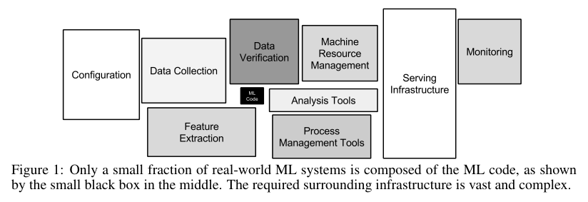

# 离开英伟达到Dream Labs当API负责人后，他发现决定机器人能力的诸多因素中，模型只占很小一部分

2026-11-05 · Kaushil Kundalia (Dream Labs) · D. Sculley et al. (NeurIPS 2015) · 有来源缺口

[本地原件归档](../../../raw/aadcf0a4850a3bfd044d0d45b30a8ff50b72ce5b127bbc44856ec0da654f4701) · 固定材料版本 `digest-material-aadcf0a4850a3bfd044d0d45b30a8ff50b72ce5b127bbc44856ec0da654f4701@1` · [一手原站](https://dreamlabs.ai/research/dream-1/)

## 深度拆解与复核

- ==核心结论==：前 [NVIDIA](../entities/companies/NVIDIA.md) GR00T 早期成员、[Dream Labs](https://dreamlabs.ai/research/dream-1/) 研发负责人 [Kaushil Kundalia](../entities/people/Kaushil%20Kundalia.md) 将 Google 经典的 ML 隐性技术债命题（成熟系统中机器学习代码仅占至多 5%，胶水代码与周边基建占至少 95%）推进至物理具身场景：在物理交互回路中，数据加载器、通道顺序、动作执行分块与同步/异步控制不再只是工程配套，而是直接改写消融实验数字的隐蔽自变量；对照 Dream Labs 同步披露的 Dream-1 公开技术资料，以统一末端位姿（EEF）接口换取 27 种未见机器人零样本泛化时，性能上限仍反过来受制于各本体逆运动学（IK）求解器与关节限位，证明模型之外的系统边界决定商业可用性。

#### 一、业务切口与核心机制

文章（SourceMind 编译，属 RT-1 至 MolmoAct 2 演进讨论后的工程复盘）指出，LLM 流程的混杂因素相对可控，而机器人 VLA 策略嵌入真实物理执行回路后，同一份检查点权重在同一测试台上也可能因推理与控制同步/异步切换、动作执行长度变化、观测归一化口径或遥操作采集习惯改变而出现截然不同的分数。围绕“控制住中心小方块之外的实验变量”，Kundalia 梳理了七类系统工程机制：

1. 存储模型逻辑化（替代目录即数据库）：反对用文件系统目录加 `_v2`、`_fixed_res360` 后缀拼装 Parquet、JSON 与 MP4，主张采用如 Lance 的列式存储表——将帧率、归一化统计量写入自描述模式元数据，状态与动作子键拆分为独立有类型列，把逐帧 JPEG 或视频块内联存表以实现 O(1) 随机帧访问并消除 Parquet 与视频不同步，由存储层原生提供版本管理与数据血缘。
2. 检查点溯源注册（消除人脑记忆）：每次训练启动前自动写入包含配置哈希、父检查点、数据集修订版与消融标签的不可变记录（如 `yam-eef-20261003` 可读短标识），利用 MLflow、Aim 或 ClearML 封装统一注册接口，避免去 Slack 问人后误拿检查点空耗 GPU 小时数。
3. 上游静默回归防护：机器人栈中故障常在下游真机掉点时才暴露（如语言标注仅首字符入模、RGB 通道顺序颠倒、预训练全程复用同一条错误指令，却不报错崩溃）。需在 `src/` 共享路径与杂乱实验代码间设立硬边界，在合并 `main` 前跑通独立同分布（IID）抽样检查、基准值校验与可靠不误报红的 CI 测试体系。
4. 评估服务化与持久化工作流：反对用人工 YAML 与电子表格记录得分，主张将评估做成自动触发、固定动作长度与评分标准的统一服务及排行榜；对反复出现的集群同步、错误重跑，采用 Temporal 等持久化工作流引擎提供幂等性与重试，防止上游修复标注后下游因手工重跑遗漏而残留过期副本。
5. 跨硬件单一抽象与 AI 原生 CLI：为不同构型单独起环境循环只会成倍放大后续整合成本，应自始由专人守住单一传感器与动作接口抽象；同时保持清晰 CLI、API 与可预测日志，使人类工程师与编程智能体能用同一套集群客户端跨云迁移并自动化编排训练与 PR 审查。

#### 二、核心数据核查、口径纠偏与工程边界

场景与利益披露：Kaushil Kundalia 为 Dream Labs 创始研究员兼 Dream API 负责人，其手记兼具实战工程复盘与推广「公开机器人模型 API 基础设施」的双重语境（Dream Labs 于 2026 年 10 月披露获 9,000 万美元种子轮融资）；论文理论锚点源自 Google 发表的《Hidden Technical Debt in Machine Learning Systems》（NeurIPS 2015）。

| 核查维度 / 对象 | 文章表述与引述口径 | 上游一手出处对照（NeurIPS 2015 PDF / Dream Labs 官方资料） | 本工作台核查与工程边界 |
| --- | --- | --- | --- |
| ML 代码与周边基建占比 | 引述 Google《机器学习系统中的隐性技术债》，指机器学习代码仅占小黑框、周边基础设施庞大 | [NeurIPS 2015 PDF p.5](https://proceedings.neurips.cc/paper/2015/file/86df7dcfd896fcaf2674f757a2463eba-Paper.pdf) 原文明确：成熟 ML 系统至多 5% 为机器学习代码、至少 95% 为胶水代码与管线丛林 | ✅ 理论来源与原图框架核实准确；具身场景因异步控制与摄像头校准，95% 周边层更易成为实验混淆变量 |
| Dream API 跨硬件抽象落地 | 强调跨机器人形态统一接口、可读标识如 `yam-eef-20261003` 与 API/CLI 分层 | [Dream-1 技术发布](https://dreamlabs.ai/research/dream-1/) 与 [dreamlabs GitHub](https://github.com/dreamlabs-co/dreamlabs) 显示其主训本体确为双臂 YAM，SDK 拆分 `dreamcli`（内置 `i2rt`/`pyroki`/`jaxls`）与 `dream.DreamClient`，并以共享 EEF 位姿接入 27 款仿真与 21 段真机 | ✅ 工程架构高度互证；但 Dream Labs 自陈 EEF 模式将避障与轨迹规划推给本地 IK 求解器，复杂构型（Dexmate 配 Sharpa 灵巧手 77 分钟、YAM 换夹爪 98 分钟）仍须 FaaS 微调 |
| “首个面向公众的机器人模型 API”与单价 | Kundalia 自称负责“首个面向公众开放的机器人基础模型 API” | 同期已有 [X Square Robot](../entities/companies/X%20Square%20Robot%20%28%E8%87%AA%E5%8F%98%E9%87%8F%E6%9C%BA%E5%99%A8%E4%BA%BA%29.md) `WALL-API-1.0` 与 [Physical Intelligence](../entities/companies/Physical%20Intelligence.md) `Pi API Beta`；Dream-1 官网明示定价 3 美元/小时（Flash 版 2 美元/小时），每次返回 1.6 秒动作块 | ⚠️ 市场先发排他宣称属创始人营销口径，且未披露网络抖动超时保护与企业级 SLA；`kaushil.dev` 个人英文博客因 TLS 异常（SSLError）暂未取回原文对照 |

本工作台核查显示，Kundalia 指出的「数据加载与动作块时序混杂」与本库此前对多篇具身论文的审计高度一致：例如 [Xiaomi-Robotics-0 (arXiv:2602.12684)](https://arxiv.org/abs/2602.12684) 实测若异步动作前缀对齐不当会导致叠毛巾陷入死循环，而 [Astranomy](https://research.nvidia.com/labs/srl/projects/astranomy/) 中把物理时钟在推理期暂停也会虚高模型得分。本工作台推断，具身研发团队在 10 人以下阶段刻意跳过 Temporal 或完整注册表尚可接受，但一旦跨越双平台并发实验阈值，缺乏 Lance 级模式校验与服务化评估台将使 30% 以上的 GPU 算力消耗在无效消融归因上。

#### 三、赛道横向对比与定位

| 具身基座 / 平台方 | 核心接口与工程定位 | 跨硬件抽象与数据基建方式 | 已公开定价 / 算力约束边界 |
| --- | --- | --- | --- |
| Dream Labs (Dream-1 / Dream API) | 公开云端 WAM 推理 + FaaS 微调服务 | 共享末端 EEF 位姿空间 + 本地 IK 求解器，`dreamcli` / `DreamClient` 双模式 | 3 美元/小时（Flash 2 美元/小时），单小时约 2,250 次调用；多指灵巧手与非标末端仍需 77–98 分钟微调 |
| [X Square Robot（自变量机器人）](../entities/companies/X%20Square%20Robot%20%28%E8%87%AA%E5%8F%98%E9%87%8F%E6%9C%BA%E5%99%A8%E4%BA%BA%29.md) (`WALL-API-1.0`) | 通用 VLA 云端接口 + 开源 `xr_harness` / `xinfer` | 依托 `x2robot` 跨本体微调与任务脚手架 | 官方文档采用邮件申请开通，商业并发定价与旗舰权重尚未公开 |
| [Physical Intelligence](../entities/companies/Physical%20Intelligence.md) (`π0.5` / `Pi API`) | 端云协同 VLA 基座与开放模型权重 | Stop-Gradient 隔离动作噪声，支持桌面级本地部署与微调 | 本地延迟约 46.96 ms（RoboLab-120），未依托云端统一按小时计费 |
| [NVIDIA](../entities/companies/NVIDIA.md) (`GR00T 2` / `Isaac Lab`) | 开源基座权重 + 本地标注/仿真工具链（SimFoundry / FLORA） | 端侧 Jetson Thor（124 ms）+ Jetson Orin 50 Hz 参考架构 | 模型权重开放而锁死云端 H100/B200 与端侧芯片算力消耗 |
| [Foxglove](../entities/companies/Foxglove.md) | 机器人多模态观测、日志与回放可观测性平台 | 统一 MCAP 时序记录格式与可视化调试工作台 | 专注传感器与控制流观测（不直接提供策略生成模型） |

### 观点与可反驳条件

- ==观点==：Kundalia 的工程复盘切中了当前具身智能行业「重模型结构轻系统确定性」的普遍盲区——在动作块长度、同步/异步推理与多相机对齐尚未锁死为标准基建前，大量跨实验室论文榜单对比与微调消融结论实际上混入了不可复现的系统噪音；Dream Labs 试图把这套数据、评估与控制抽象封装为 `Dream API` + `FaaS` 公共底座，但其商业成败不取决于论文榜单微弱领先，而取决于本地 IK 适配与云端 1.6 秒动作块在非 YAM 异构硬件及工业复杂工况下的真实容错上限。
- ==推翻条件==：
  1. ① 若未来 12 个月内多家独立第三方机构在标准开源评测基准（如 RoboDojo-RealWorld 18 项真机任务）上证明，使用 Dream API 零样本接入超过 5 种非并行夹爪异构本体（如多指灵巧手或移动底盘双臂）无需 FaaS 微调即可稳定取得 >= 70% 完整任务成功率，且云端往返抖动不引发操作跌落，则「EEF 抽象严重受限于本地 IK 与几何差异、商业化仍高度依赖单任务微调」的判断将被推翻；
  2. ② 若行业公开评测普遍采用未统一推理延迟与控制周期的端到端通用黑盒 API 仍能实现跨季度稳定复现且实验室无需自建 Lance/Temporal 级数据溯源基础设施即可跑通规模化数据飞轮，则本文关于「95% 周边系统控制才是具身实验可解释性与研发效率核心壁垒」的判断将被推翻。

---

## 原文摘录与一手信源存证

> Kaushil Kundalia 曾是 NVIDIA 机器人基础模型项目 GR00T 的早期成员，如今在Dream Labs 负责机器人基础模型接口 Dream API。在复盘过去两年的研发经历时，他提出一个判断：决定机器人表现的诸多因素中，模型只占很小一部分，周围的数据、控制和评估系统同样左右着实验结果。
> — 原文摘录，PDF p.1；证据 `digest-material-aadcf0a4850a3bfd044d0d45b30a8ff50b72ce5b127bbc44856ec0da654f4701-excerpt-1@1`

> 为什么重要： 即使模型权重完全相同，改变推理与控制的配合方式、每次执行动作的长度，也可能让同一套机器人测试台给出截然不同的分数。对正在搭建实验室的团队来说，控制这些变量，直接关系到能否判断一次改进究竟来自哪里，以及哪些结果值得继续投入。
> — 原文摘录，PDF p.1；证据 `digest-material-aadcf0a4850a3bfd044d0d45b30a8ff50b72ce5b127bbc44856ec0da654f4701-excerpt-2@1`

> 举个例子： Kundalia 见过语言标注只有第一个字符传进模型、RGB 颜色通道顺序颠倒，甚至整个预训练过程都在使用同一条错误指令。这些错误没有让程序崩溃，却会在机器人表现变差时才暴露，迫使研究人员从机器人端一路往回排查。
> — 原文摘录，PDF p.1；证据 `digest-material-aadcf0a4850a3bfd044d0d45b30a8ff50b72ce5b127bbc44856ec0da654f4701-excerpt-3@1`

一手材料：

- Hidden Technical Debt in Machine Learning Systems · D. Sculley et al. / Google / NeurIPS · [原站](https://proceedings.neurips.cc/paper/2015/file/86df7dcfd896fcaf2674f757a2463eba-Paper.pdf) · [主体档案：Google Research](../entities/labs/Google%20Research.md) / [主体档案：Kaushil Kundalia](../entities/people/Kaushil%20Kundalia.md) · [NotebookLM](https://notebook.google.com/notebook/33f0076b-fc09-42cc-9cd9-fecfb847ce1c) · [Drive](https://drive.google.com/file/d/1J9FSyaSh0leUyzjsdkGmfHyiOd5X39Hc/view?usp=drivesdk)
  材料版本 `digest-material-1a67da09a8bd5ba9a3577176e30aa2fbd88534e6baf0bc31522b4999f643d2a1@1`；获取方式 `http_pdf`。
  > D. Sculley, Gary Holt, Daniel Golovin, Eugene Davydov, Todd Phillips \{dsculley,gholt,dgg,edavydov,toddphillips\}@google.com Google, Inc. — PDF p.1
  > Dietmar Ebner, Vinay Chaudhary, Michael Young, Jean-Franc¸ois Crespo, Dan Dennison \{ebner,vchaudhary,mwyoung,jfcrespo,dennison\}@google.com Google, Inc. — PDF p.1
- Zero-Shot to New Robots: Introducing Dream-1 · Dream Labs · [原站](https://dreamlabs.ai/research/dream-1/) · [主体档案：Dream Labs](../entities/labs/Dream%20Labs.md) · [本地原件](../../../raw/71d0f1b62dbf1c544188010bb144bea7df5166781b492ac4203ef03ed54a34b5)
  材料版本 `digest-material-71d0f1b62dbf1c544188010bb144bea7df5166781b492ac4203ef03ed54a34b5@1`；获取方式 `http_full_text`。
  > , a World Action Model that controls robots it has never seen, performs tasks it was never shown, and runs from \$3/hour. — 原文提取
  > a new bimanual robot with parallel grippers, connect it to our API, and it can start performing tasks out of the box. No fine-tuning, no demonstrations from that robot, and no machine learning expertise required. — 原文提取
- dreamlabs-co/dreamlabs: Python client for DreamAPI · Dream Labs (GitHub) · [原站](https://github.com/dreamlabs-co/dreamlabs) · [主体档案：Dream Labs](../entities/companies/Dream%20Labs.md) · [本地原件](../../../raw/1852a64158b68bbcf2817359c45c6df1fdddffbc7497fde9cb5cd34e30e44a4f)
  材料版本 `digest-material-1852a64158b68bbcf2817359c45c6df1fdddffbc7497fde9cb5cd34e30e44a4f@1`；获取方式 `http_full_text`。
  > \`dreamlabs\` is the Python client for DreamAPI, which hosts \*\*Dream-1\*\*, the Dream Labs robot model. — 原文提取
  > - \*\*\`dreamcli\`\*\* runs your robot on our control loop: setup, cameras, arms and Live View, with no code to write. - \*\*\`dream.DreamClient\`\*\* calls Dream-1 from your own control loop: you send observations, it returns actions. — 原文提取

归属与范围：完成来源分诊并保留归档NeurIPS 2015经典论文PDF全文（Hidden Technical Debt in Machine Learning Systems）；新增抓取Dream Labs官方Dream-1技术发布页与dreamlabs-co/dreamlabs SDK开源仓快照；核实kaushil.dev因TLS握手异常无法直接抓回，保留英文原始个人手记链接与Dream API首创性声明缺口。

来源缺口：

- `unavailable`：Kaushil Kundalia关于Dream API与机器人研发笔记的原始英文个人博客手记（kaushil.dev）经实测存在TLS握手异常（SSLError）无法直连抓回，SourceMind中文完整译文已归档入库，保留英文原始手记一手链接缺口。
- `pending_verification`：Kundalia文中关于Dream API为首个面向公众开放的机器人基础模型API的主张（同期存在Pi API及WALL-API-1.0），以及数据管道静默错误对机器人消融实验定量影响比例，保留为研究者手记经验判断，尚未经第三方横向基准复核。

[返回赛道总览](../赛道总览.md#digest-aadcf0a4850a3bfd) · [返回导读索引](README.md) · [主体档案库](../entities/README.md)
