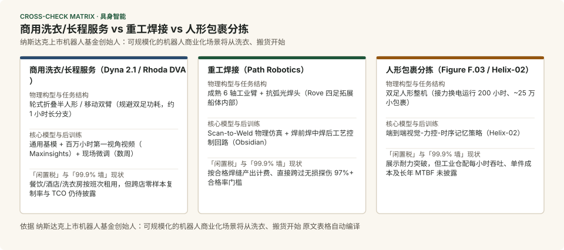

# 纳斯达克上市机器人基金创始人：可规模化的机器人商业化场景将从洗衣、搬货开始

2026-10-26 · RoboStrategy (Nasdaq: BOT · Andrew Kang) · 有来源缺口

[本地原件归档](../../../raw/0b18531c6078880db55ee56a429c9c55475379d92ff9295314738077d1c3e82d) · 固定材料版本 `digest-material-0b18531c6078880db55ee56a429c9c55475379d92ff9295314738077d1c3e82d@1` · [一手原站](https://robostrategy.co/news/the-chatgpt-moment-for-robotics)

## 深度拆解与复核

- ==核心结论==：[RoboStrategy](../entities/funds/RoboStrategy.md)（Nasdaq: BOT）创始人 Andrew Kang（2026-10-23 一手文章，SourceMind 编译）拆破「具身智能何时迎来 ChatGPT 时刻」的流行迷思：2022-11-30 发布的 ChatGPT 凭借共享云端 GPU 零边际成本与容忍幻觉的文案试错，5 天达 100 万用户、2 个月破 1 亿；==而机器人横亘着「闲置税」（买断 CapEx 或 RaaS 租赁 OpEx 下哪怕每周仅工作 1 小时也要承担整机折旧）与「99.9% 这道墙」（99% 可靠性仍不够用，错误焊接或给药不可逆），决定其只能按年沿商用洗衣、搬货与焊接等 B2B 结构化任务「先可靠性、后规模化」推进==。但本工作台核查暴露两处关键硬偏差：BOT 基金实质持有正文力推的全部三大案例（Figure AI、Dyna、Path），且文中「Path Robotics 与 HII 签 6 亿美元合同」及「自动驾驶路测达 1,000 万–1,600 万辆」均存在严重协议上限简化与 L2+ ADAS 混入 L4 分母的口径漂移。

#### 一、业务切口与核心机制

1. 分发先行 vs 可靠性先行：ChatGPT（GPT-3.5）上线初期幻觉频发，却因人类可在输出前修改文案、PPT 与合同且无需自购 GPU，以免费/低价迅速触达 1 亿用户。物理世界恰好反过来：买家无论采用 CapEx 一次性购机还是通过 Robot-as-a-Service（RaaS）按 OpEx 租用，闲置每一小时都等同于被征收「机器人闲置税」，只有当具身模型多任务泛化并可灵活移动时才有望摊薄闲置成本；同时物理错误无法像撤回一段文字那样低成本修正，导致可靠性门槛普遍跨过 99.9%，哪怕 UPS、BMW、三星持续加码自动化投入，总融资也仍远低于过去几年的纯软件 AI。
2. System 2 + System 1 双系统与能力对齐矩阵：作者指出过去 4 年机器人大脑受益于 OpenAI、Anthropic、Google DeepMind、NVIDIA、Alibaba 及高校实验室通用模型与视频预测模型的外溢——System 2（由通用 AI 改造）负责慢速场景理解与规划推理，System 1（部分由视频预测模型改造）负责快速直觉运动指令。在原文 5 分制能力矩阵中，以 [Dyna Robotics](../entities/companies/Dyna%20Robotics.md)（Dyna-2.1）与 Rhoda AI（Rhoda DVA）为代表的前沿机器人模型，在长时程工作流程（约 1 小时多分支流程 3/5）、跨班次持久记忆（3/5）、已知任务可靠性（4/5）及错误恢复（3/5）上已越过 2022 年 11 月 GPT-3.5 水平，但「从部署中自动学习」仍仅 1/5（仍需人工后训练，对比 2026 年 10 月 GPT-6 已实现约 100 万 token 上下文与跨应用数小时自主执行，GPT-3.5 当时仅约 4,000 token）。
3. 商业化优先队列（商用先行于家用）：相较于单次失误即涉人命与国别/州/市级牌照、还需自建城市维保充电场站的自动驾驶（Waymo 与 Cybercab），商业领域对结构化任务的容错和 ROI 计算更清晰——先依靠通用基座模型结合特定工作流程微调把单项任务周期从数月缩至数周，随缩放定律降低后训练成本，再由洗衣、机床上下料与物料搬运向家庭消费市场扩散。

#### 二、核心数据核查、口径纠偏与工程边界

场景与利益披露：作者 Andrew Kang（前 Mechanism Capital 创始合伙人）现任纳斯达克上市封闭式机器人基金 RoboStrategy, Inc.（股票代码 BOT，2026-05-11 挂牌，FP Strategies LLC 担任投资管理人，截至 2026-10-31 基金净资产 2.8897 亿美元、每股 NAV 11.80 美元）创始人兼 CEO。尽管原文末尾仅附带「组合可能包含讨论公司」一行免责提示，本工作台核查 RoboStrategy 官网完整持仓列表（robostrategy.co/portfolio）发现，正文 Section 4 作为商业落地标杆重点展开的三大私有机器人标的——Figure AI（2025 年投）、Dyna Robotics（2025 年投）与 Path Robotics（2025 年投）——全部位列 BOT 公开在册持仓（同列还含 Apptronik、Standard Bots、Maven Robotics 等）。阅读时须将其视为「上市公募壳载体对旗下私募底层资产的投资人沟通稿」。

- ✅ 核查一（Figure 200+ 小时直播、Rhoda DVA 与 GPT-6 2026 年代际基准实证核对，本工作台核查）：经交叉检索第三方档案，原文所引案例与模型时间线均具备真实事实底座——FigureAI 于 2026 年 5 月基于 Figure F.03 本体与 Helix-02 端到端模型完成原定 8 小时延展至 200 小时连续直播（实测约 191+ 小时无远程遥操连续分拣近 25 万件包裹并自主换电接力）；Rhoda AI 于 2026 年 3 月获 Premji Invest 领投 4.5 亿美元 A 轮（估值 17 亿美元），其 Direct Video-Action（DVA / FutureVision）模型先在亿级互联网视频预训练物理动态再经逆动力学映射动作，将单个工业新工位遥操数据需求压至 10–15 小时；OpenAI 亦于 2026 年 10 月初上线 GPT-6（Sol / Luna / Astra），证明原文对照表中 2026 年 10 月 GPT-6 列并非虚构占位。
- ❌ 核查纠偏二（Path Robotics 6 亿美元合同简化失真与自动驾驶 1,600 万辆严重混用 L2+ ADAS 分母，本工作台核查）：
  1. 原文称 [Path Robotics](../entities/companies/Path%20Robotics.md) 今年早些时候宣布与造船巨头 [HII (Huntington Ingalls Industries)](../entities/companies/HII%20%28Huntington%20Ingalls%20Industries%29.md) 签订「6 亿美元合同」。经对照本库 Path Robotics 档案及 HII 官方公告，该协议系 2026 年 8 月 HII 发布的 7 年期 High-Yield Production Robotics（HYPR）绩效框架协议，Path Robotics 与 GrayMatter Robotics 联合中标最高总额 9 亿美元（\$900M） 绩效上限（部分早期媒体阶段性拆出 6 亿美元口径），属于按交付里程碑触发的非保底长期框架上限，且 Path 并未跨出重工焊接去覆盖通用仓配。
  2. 原文图 4「路测自动驾驶车辆」曲线给出 2021 年 50 万（0.5M）→ 2022 年 90 万 → 2023 年 240 万 → 2024 年 490 万 → 2025 年 950 万 → 2026 年预测约 1,600 万辆（16M，正文写「1,000 多万辆」），紧接着用来推演 Waymo 与 Cybercab 城市 L4 无人驾驶普及曲线。这一曲线存在 3 个数量级的分母偷换：2025–2026 年全球真正无人化 L4 Robotaxi 商业车队规模仅在数千辆量级，950 万至 1,600 万辆统计囊括的是装有 L2/L2+ 辅助驾驶（如智驾包、NOA）的消费乘用车，不能用来度量「无安全员自主交付与城市重运维」的 L4 成熟度。
- ⚠️ 核查三（RoboStrategy 上市封闭式基金的二级市场结构摩擦，本工作台推断）：与直接持有未上市股权或买断运营现金流的产业方不同，公开投资者通过 Nasdaq: BOT 间接押注物理 AI 面临三重载体损耗——封闭式基金不可按净值赎回、私募持仓依赖董事会主观公允价值评估且月度更新 NAV、以及常见相对 NAV 的剧烈二级溢价/折价波动（加之招股声明首财年截至 2026-08-31 按 C-corporation 缴税后再转 RIC）。即便 2027 年商业洗衣与焊接机器人如期扩产，BOT 股价短期回报仍可能被交易溢价收敛所主导。

| 核查条目 | 原文主张与数字 | 一手/多源实证核对结果 | 核验状态 |
| :--- | :--- | :--- | :--- |
| 案例利益绑定 | 仅文末声明「组合可能包含讨论公司」 | 核查 robostrategy.co/portfolio 确认 Figure AI、Dyna、Path 均为 2025 年建仓在册持仓 | ⚠️ 利益高度重合 |
| Path × HII 协议 | 「与 HII 签订高达 6 亿美元合同」 | HII 官方 HYPR 为 7 年期与 GrayMatter 联合中标最高 \$900M 绩效上限框架，非保底在手订单 | ❌ 口径混同上限与订单 |
| 自动驾驶规模曲线 | 2021 年 0.5M 增至 2026E 约 16M（正文「1,000 多万辆」） | 实际混入 L2/L2+ 乘用车 ADAS 存量；全球 L4 无安全员商业车队规模差 3 个数量级 | ❌ 分母混用错位 |
| 模型能力参照系 | FigureAI 200+ 小时直播；Dyna 2.1 / Rhoda DVA 跨过 GPT-3.5 | Figure F.03+Helix-02 直播处理 ~25 万包裹、Rhoda $450M A 轮（10–15h 微调）与 GPT-6 均吻合 | ✅ 实证匹配 |

#### 三、赛道横向对比与定位

把 Andrew Kang「先可靠性后规模化 + 商业结构化优先」的判断放在本工作台具身智能已有研究坐标中，与 [Scale VP 部署层分析](%E5%85%B7%E8%BA%AB%E5%9F%BA%E6%A8%A1%E4%B9%8B%E4%B8%8A%EF%BC%8C%E8%BF%98%E6%9C%89%E5%BA%94%E7%94%A8%E5%B1%82%EF%BD%9CScale%20VP%E5%90%88%E4%BC%99%E4%BA%BA%EF%BC%9A%E9%83%A8%E7%BD%B2%E5%85%AC%E5%8F%B8%E5%B0%86%E5%88%86%E8%B5%B0%E6%A8%A1%E5%9E%8B%E5%85%AC%E5%8F%B8%E7%9A%84%E8%9B%8B%E7%B3%95.md)（2026-10-23 同日发布）形成互补照应，同时凸显不同构型商业化落地的硬瓶颈：

| 对比维度 | 商用洗衣/长程服务（Dyna 2.1 / Rhoda DVA） | 重工焊接（Path Robotics） | 人形包裹分拣（Figure F.03 / Helix-02） |
| :--- | :--- | :--- | :--- |
| 物理构型与任务结构 | 轮式折叠半人形 / 移动双臂（规避双足功耗，约 1 小时长分支） | 成熟 6 轴工业臂 + 抗弧光焊头（Rove 四足拓展船体内部） | 双足人形整机（接力换电运行 200 小时、~25 万小包裹） |
| 核心模型与后训练 | 通用基模 + 百万小时第一视角视频（Maxinsights）+ 现场微调（数周） | Scan-to-Weld 物理仿真 + 焊前焊中焊后工艺控制回路（Obsidian） | 端到端视觉-力控-时序记忆策略（Helix-02） |
| 「闲置税」与「99.9% 墙」现状 | 餐饮/酒店/洗衣房按班次租用，但跨店零样本复制率与 TCO 仍待披露 | 按合格焊缝产出计费、直接跨过无损探伤 97%+ 合格率门槛 | 展示耐力突破，但工业仓配每小时吞吐、单件成本及长年 MTBF 未披露 |

### 观点与可反驳条件

- ==观点==：==Andrew Kang 用「机器人闲置税」与「99.9% 可靠性墙」精准定义了具身商业化为何必然走「商业结构化场景（洗衣、搬货、机床上下料、工业焊接）先放量、家庭消费场景后置」的多年渐进曲线，不存在 ChatGPT 式两个月一亿用户的软件爆点==；但必须剔除文中将 L2+ 辅助驾驶混入 1,600 万辆自动驾驶车队的统计误差，以及将 HII 联合框架上限简化为单一公司确定订单的持仓乐观滤镜——即使商业需求成立，通过二级溢价封闭式基金（BOT）参与私募机器人标的也无法等价于直接享有底层部署商的单位经济效益。
- ==推翻条件==：
  1. ① 若到 2027 年底，以 Dyna Robotics、Rhoda AI 或 Figure AI 为代表的头部商业部署标的中，公开披露的跨客户多站点（>=10 家独立外部付费客户）商用机队总台数仍不足 500 台，或单任务微调周期未能稳定压缩至 2 周以内且现场人工接管工时占比 >20%，则文中「后训练成本骤降已打通从演示向规模部署复制曲线」的判断将被推翻。
  2. ② 若在 2028 年前，面向消费家庭的家政或养老通用机器人在安全认证与无监督可靠性（>99.9%）上实现比预期更快的单机 BOM 下探（零售价 <=1.5 万美元且年化退货/维保故障率 <5%），令消费端出货量反超工业与商用洗衣/搬运场景，则「商用结构化场景显著领先家用消费市场放量」的顺序假设将被推翻。

---

## 原文摘录与一手信源存证

> RoboStrategy基金创始人Andrew Kang 在 10 月 23 日发表于 RoboStrategy 的文章中判断：机器人难以复制 ChatGPT 两个月获得一亿用户的增长路径。它的普及会按年、按任务推进，前提是先把工作做得可靠、划算。
> — 原文摘录，PDF p.1；证据 `digest-material-0b18531c6078880db55ee56a429c9c55475379d92ff9295314738077d1c3e82d-excerpt-1@1`

> 为什么重要： 这给判断机器人行业进展提供了一个具体尺度：客户能否以可接受的成本，持续获得可靠的工作成果。演示中的一次成功，距离客户愿意长期付费，还有利用率和出错代价需要考虑。
> — 原文摘录，PDF p.1；证据 `digest-material-0b18531c6078880db55ee56a429c9c55475379d92ff9295314738077d1c3e82d-excerpt-2@1`

> “机器人闲置税”。 一台机器人即使每周只工作一小时，买家仍要承担整台设备的成本。它必须在有限的工作时间里创造足够高的价值。
> — 原文摘录，PDF p.1；证据 `digest-material-0b18531c6078880db55ee56a429c9c55475379d92ff9295314738077d1c3e82d-excerpt-3@1`

一手材料：

- The ChatGPT Moment for Robotics · Andrew Kang / RoboStrategy · [原站](https://robostrategy.co/news/the-chatgpt-moment-for-robotics) · [主体档案：RoboStrategy](../entities/funds/RoboStrategy.md) · [NotebookLM](https://notebook.google.com/notebook/cac99041-d3b9-449e-a192-12bb4b1ad391) · [Drive](https://drive.google.com/file/d/1QbBJwDYOW1kHDrwx9mVLNhxq9RAFkTxG/view?usp=drivesdk)
  材料版本 `digest-material-9b8a769299aad4fa8c807661f0bd0b8bac5a53dd20ddf8a45e6085ec8ee54a7d@1`；获取方式 `http_full_text`。
  > Rewind to November 30, 2022. OpenAI releases ChatGPT. — 原文提取
  > It was a starting shot heard around the world. The unprecedented user adoption was only part of the “moment”. — 原文提取

归属与范围：已穿透核验 Andrew Kang 于 2026-10-23 在 RoboStrategy 官网发布的 25,494 字符英文原文（robostrategy.co/news/the-chatgpt-moment-for-robotics）及内嵌能力对比表与自动驾驶规模图；核实 RoboStrategy（Nasdaq: BOT，2026-05-11 上市，截至 2026-10-31 净资产 \$288.97M、每股 NAV \$11.80）官网在册持仓（Figure AI、Dyna Robotics、Path Robotics、Apptronik 等）与正文重点案例高度重叠，核验 Figure 200+ 小时分拣直播与 Rhoda AI \$450M A 轮（DVA 架构），并纠偏正文 Path Robotics \$600M 合同口径（实为 HII 与 Path/GrayMatter 7 年最高 \$900M 联合绩效框架）与图 4 自动驾驶 1,600 万辆混用 L2/L2+ ADAS 与 L4 无人车队的分母错位。

来源缺口：

- `not_disclosed`：RoboStrategy 原文及官网未公开组合内单家未上市公司（Figure AI、Dyna Robotics、Path Robotics、Apptronik 等）的具体持股比例、公允价值重估方法论细节，亦未列出图 4「路测自动驾驶车辆 0.5M→16M」曲线的具体行业统计口径（L2+ ADAS vs L4）与第三方数据出处。 [线索](https://robostrategy.co/news/the-chatgpt-moment-for-robotics)
- `not_disclosed`：能力评分表对前沿机器人模型（Dyna 2.1 / Rhoda DVA）各项 1–5 分制评分系作者主观框架归纳，未附带统一基准测试集任务成功率、跨班次人工接管率或 99.9% 工业门槛的第三方审计样本。 [线索](https://robostrategy.co/news/the-chatgpt-moment-for-robotics)

[返回赛道总览](../赛道总览.md#digest-0b18531c6078880d) · [返回导读索引](README.md) · [主体档案库](../entities/README.md)
