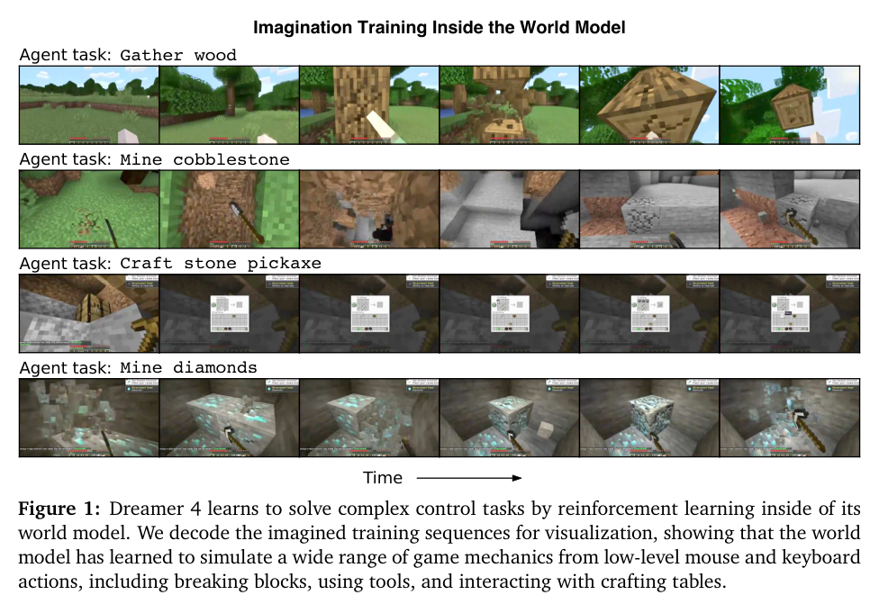
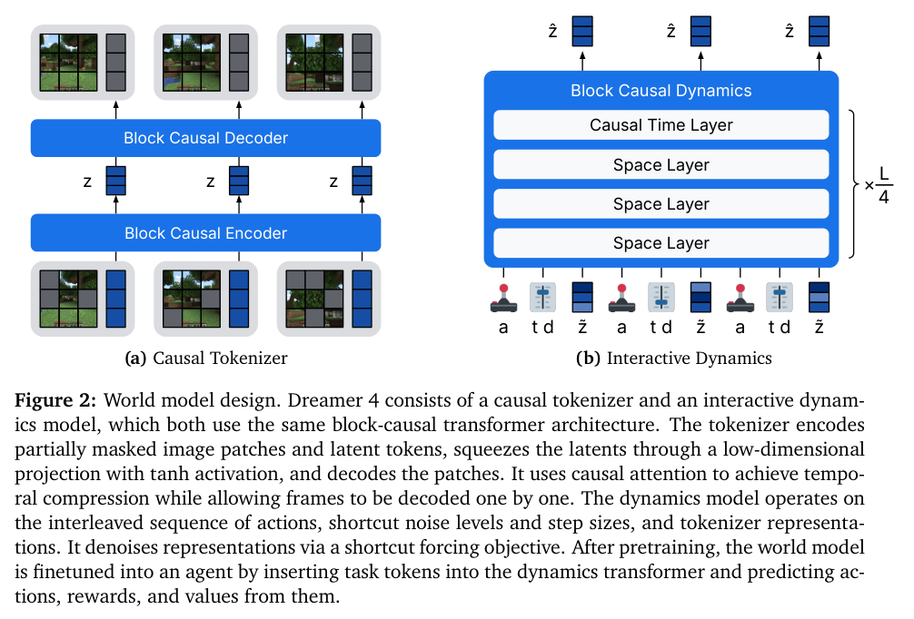

# 英伟达投了！华人科学家造具身大脑，融资8亿元

2026-11-24 · Embo 官方公告 · a16z · 有来源缺口

[本地原件归档](../../../raw/db795e235a6c83b8afde9789e57b7858de4d84cb0782c5eebc10124c545b386f) · 固定材料版本 `digest-material-db795e235a6c83b8afde9789e57b7858de4d84cb0782c5eebc10124c545b386f@1` · [一手原站](https://embo.com/introducing-embo) · [触发线索（机器人前瞻）](https://mp.weixin.qq.com/s/xtRo1OSMIPC4fn0M2xwaeQ)

## 深度拆解与复核

- 口径与利益披露：中文触发稿件（机器人前瞻，2026-11-24）为二手编译，实质内容取自美国具身智能初创公司 Embo 于 2026-11-23 发布的官方公告《Introducing Embo》（embo.com/introducing-embo）、公司主页（embo.com/company）及领投方 Andreessen Horowitz（a16z）合伙人 Justine Moore、Raghu Raghuram 与 Matt Bornstein 联名备忘录《Investing in Embo》。上述一手材料均属创业公司首发募资官宣与领投机构背书口径，核心诉求在于吸引前沿研究人才（careers 页开放 Pretraining、RL、Data、Evals、Infra 与 Mechatronics 等全职岗位，旧金山现场办公）并确立「世界模型替代纯遥操模仿学习」的叙事定位；正文未发布任何真机量化基准、示范视频或客户交付指标。

### 一、 一手原文对照与团队学术谱系穿透

1. 融资与主体身份核验：Embo 总部位于旧金山，2026-11-23 正式走出隐身期并宣布完成 $110M（约合人民币 8.6 亿元，中文标题简写 8 亿元）种子轮融资，由 a16z 领投，Khosla Ventures、DST Global 与 NVIDIA（据中文报道通过旗下 NVentures 参投）跟投。Embo 在官网及 X 账号（@EmboAI）宣称致力于为人型/通用机器人构建通用大脑，解决两项核心瓶颈：跨场景泛化（在单间厨房训练后即开箱即用适配未见厨房）与异常恢复韧性（物体滑落或抽屉卡滞时自主纠正）。
2. 创始人与实验室谱系核查：中文标题所指「华人科学家」主要对应联合创始人兼 CTO Wilson Yan，联合创始人兼 CEO 为 Danijar Hafner（曾任 Google DeepMind Staff Research Scientist，10 年研究经历）。官网与二人个人主页显示：Danijar Hafner 主导了 Dreamer 系列世界模型（其中 DreamerV3 以第一作者发表于 Nature，arXiv:2301.04104；Dreamer 4 为 Danijar Hafner 与 Wilson Yan 共同一作、Timothy Lillicrap 合著，arXiv:2509.24527，通过 Shortcut Forcing 在完全离线数据下经想象训练在 Minecraft 采得钻石，单序列超 20,000 步像素动作）；Wilson Yan 博士毕业于 UC Berkeley（导师 Pieter Abbeel），曾于 Perplexity 担任首位实习生并任职 Meta（@wilson1yan 标注 @AIatMeta）与 Google DeepMind（Senior Research Scientist），代表作包括一作 VideoGPT（arXiv:2104.10157，VQ-VAE+自回归 Transformer）及与 Hao Liu 共同一作、Matei Zaharia/Pieter Abbeel 合著的 LWM（arXiv:2402.08268，采用 Blockwise RingAttention 将上下文从 4K 扩展至 1M tokens，即官网所称全球首个百万 Token 上下文模型）。
3. 三阶段统一架构设计：对照 Embo 官网与 a16z 公告，团队拟放弃仅靠单一真机遥操模仿学习的路线，转而构建单一统一多模态世界模型（Unified Multimodal Model）：首先在互联网海量视频与文本上从零预训练（学习物体属性、物理交互与任务演变规律）；其次使用自有「人形机器人集群（humanoid fleet）」采集的真实机器人经验进行微调，把视觉物理知识接地至电机与传感器；最后通过强化学习（同时结合「世界模型内部想象场景试错」与「真实世界交互 RL」）提升高频运动控制与失败恢复能力。官网同时称团队成员曾在 Google DeepMind、Meta Superintelligence Labs、NVIDIA Cosmos、UC Berkeley 与 MIT 任职或求学，参与过 Dreamer、VideoGPT 与 Diffusion Forcing（MIT Boyuan Chen 等人工作，支持逐 Token 独立噪声水平的长序列因果扩散生成）等项目。

### 二、 原位交叉核查与第一性原理边界

- ✅ 团队头衔与论文归属核查：本工作台核查确认，中文报道将 Danijar Hafner 译为「Google DeepMind 高级研究科学家」略低估其实际离职前职级（danijar.com 标明为 Staff Research Scientist，且 10 年期间包含早期研究与博士阶段；embo.com/company 确证「10 years with Google DeepMind」与 Nature 一作）；同时 Dreamer 4（arXiv:2509.24527）实为 Danijar Hafner 与 Wilson Yan 共同一作，直接解释了二人的联合创业基础。官网宣称开放招募 Mechatronics Engineer 与 Robot Technician，表明 Embo 自建了旧金山本地人形真机测试与微调团队，而非纯无硬件算法空壳。
- ⚠️ 「70,000 GPUs」训练基建与资金约束复核：本工作台核查 embo.com/introducing-embo 原文，精确表述为「Previously, we have built world model agents and developed the infrastructure to train multimodal models across 70,000 GPUs」——即 70,000 GPUs 属于团队成员此前在 Meta Superintelligence Labs、NVIDIA Cosmos 或 Google DeepMind 的过往基建履历，并非 Embo 当前拥有的算力。按当前 H200/B200 集群单卡硬件及配套网络折算，7 万卡级别集群 CapEx 达数十亿美元量级，$110M 种子轮融资显然无法自建该规模集群，若按本赛道千万小时 B300 预训练账本对照（14B–30B 压缩 WAM 单 Epoch 需 702–1,505 卡 B300 约 30 天，含 3–5 倍消融倍率需 $10M–$30M 算力预算），$110M 种子轮扣除旧金山高薪科研人力与人形机队采购后，在云端租卡仅够支撑 1–2 代中等规模世界模型预训练验证。
- ⚠️ 「今年 4 月成立」与实体时间线口径核查：中文报道称 Embo 成立于 2026 年 4 月，但本工作台通过 X 元数据接口核查发现 @EmboAI 账号创建于 2025-06-30，且官网与 a16z 公告均未明文披露公司法人注册日期及 $110M 种子轮估值。此外，Diffusion Forcing 与 NVIDIA Cosmos 对应的具体创始/核心工程师姓名未在官网披露，不能将相关代表作的完整原始团队直接等同于 Embo 现有全员。
- ⚠️ 世界模型「想象 RL」跨越物理控制墙的工程缺口（本工作台推断）：将 Dreamer 4 在离散鼠标键盘动作空间（Minecraft 离线像素）与 VideoGPT/Diffusion Forcing 长程视频预测直接外推至人形真机，必须跨过本赛道已验证的三道硬门槛：第一，视觉像素预测不包含 1–10 ms 刚性接触力与指尖滑移反馈，纯靠视频世界模型「脑补」无法学出精细装配与柔体摩擦边界；第二，若单靠端到端统一多模态视频模型输出高频动作，在 Jetson Thor 等端侧芯片上极易撞上 70–125 ms 推理延迟墙（对比 GR00T 2 Turbo 通过 4x16x16 VAE 压缩才将 2B WAM 压至 124 ms），如何与 50–100 Hz 全身运控小脑及 1,000 Hz 伺服 PD 回路解耦，官网完全未披露具体频率分层设计。

| 核验维度 | 触发中文报道口径 | 一手官网 / a16z / 论文核实口径 | 可信度与缺口标注 |
| --- | --- | --- | --- |
| 融资与估值 | 完成 $110M（约 8.6 亿元人民币）种子轮，a16z 领投，Khosla / DST / NVentures 参投 | 金额与投资方列表获 embo.com 与 a16z 官宣证实（NVIDIA 参投由媒体与中文稿具名为 NVentures），估值与出资比例未披露 | 事实确认（缺估值与股比） |
| 创始人履历 | Danijar Hafner（Dreamer / 10 年 GDM / Nature 一作）；Wilson Yan（VideoGPT / 百万 Token 模型 / Meta & GDM） | 履历、Nature 一作（DreamerV3）、arXiv:2104.10157、arXiv:2402.08268 及二人共一作 Dreamer 4（arXiv:2509.24527）全部核实 | 事实确认（Hafner 实为 Staff RS） |
| 团队与 7 万卡 | 源自 GDM / Meta Superintelligence Labs / NVIDIA Cosmos / UCB / MIT，曾搭建 7 万卡训练基建 | 官网确认过往跨机构履历及曾为 70,000 GPUs 搭建多模态训练基建，未披露除两位创始人外的具名成员 | 口径校准（系过往履历非现役集群） |
| 技术与真机 | 互联网视频预训练 + 人形集群微调 + 想象与真机 RL，应对流式视频高密度信息与高频控制 | 官方披露三阶段统一多模态路线，但零公开真机视频、零控制频率（Hz）、零人形本体型号与触觉方案 | 路线确认（缺真机量产指标） |

### 观点与可反驳条件

- ==观点==：==Embo 实质上是把「Dreamer 世界模型想象强化学习 + VideoGPT/RingAttention 长序列视频时空建模 + 7 万卡级超算工程」打包成纯粹的前沿基础模型全栈押注，代表了具身大脑与 GR00T 2 / π0.7 正面赛马的学术创业组合==；但 $110M 种子轮在算力租赁与人形机队重资本消耗下面临严苛资金窗口，其胜负不取决于互联网视频预测逼真度，而取决于能否在 18 个月内用真机证明「想象 RL 确实降低了未见环境的真机遥操与纠错样本需求」，并解决高频接触力控与端侧推理延迟约束。
- ==推翻条件==：
  1. 跨环境真机效率验证：若 Embo 在 2027 年底前公开的真机技术报告与独立第三方评测中，能以不超过同代纯遥操 VLA 基线 20% 的真机示范时长，在至少 5 类未见真实物理环境与刚性/柔体混合操作任务上跑出 >=85% 一次成功率与自主错误恢复（1.0x 原速 uncut 演示且端侧控制频次达 >=10 Hz），则本工作台对其「互联网视频想象 RL 跨过接触盲区与延迟墙的落地风险警示」将被推翻。
  2. 资金与算力复用瓶颈暴露：若 Embo 在融资后 18 个月内未披露实质性真机进展、转向纯仿真/云端推理 API 路线，或在后续融资中因百万小时视频训练与真机采集成本倒挂被迫缩减人形硬件集群，则其「靠统一世界模型实现通用人形大脑开箱即用」的商业路线将被证伪。
  3. 硬件解耦替代效应：若行业在 2027 年普遍收敛至「S2 低频云端规划 + S1 轻量 UMI/触觉 WAM + S0 冻结运控小脑」的模块化路线（如 Dyna-2.1 与 GR00T 2 Turbo），而单一端到端视频世界模型因算力/能耗比劣势无法在端侧部署，则 Embo 单一统一模型架构的竞争优势将被推翻。

---

## 原文摘录与一手信源存证

> 机器人前瞻11月24日报道，昨天，美国具身大脑公司Embo宣布完成1.1亿美元（约合人民币8.6亿元）种子轮融资。该轮融资投资方有a16z，Khosla Ventures、DST Global、NVentures（NVIDIA）等。
> — 原文摘录，文字段落 1；证据 `digest-material-db795e235a6c83b8afde9789e57b7858de4d84cb0782c5eebc10124c545b386f-excerpt-1@1`

> Embo成立于今年4月，总部位于旧金山。该公司专注于提升机器人的通用能力，致力于为机器人打造大脑。
> — 原文摘录，文字段落 2；证据 `digest-material-db795e235a6c83b8afde9789e57b7858de4d84cb0782c5eebc10124c545b386f-excerpt-2@1`

一手材料：

- Introducing Embo · Embo · [原站](https://embo.com/introducing-embo) · [主体档案：Embo](../entities/companies/Embo.md) / [主体档案：Danijar Hafner](../entities/people/Danijar%20Hafner.md) / [主体档案：Wilson Yan](../entities/people/Wilson%20Yan.md) · [本地原件](../../../raw/8d88e13cb98c248347a9193296c16a5d564fcbb9f758958030a042e94d6ce5bf)
  材料版本 `digest-material-8d88e13cb98c248347a9193296c16a5d564fcbb9f758958030a042e94d6ce5bf@1`；获取方式 `http_full_text_snapshot`。
  > Embo is building the next generation of frontier AI models, with a deep understanding of physical reality and fine-grained motor skills. We are partnering with a16z in a \$110M Seed round. — 原文提取
  > with a deep understanding of physical reality and fine-grained motor skills. — 原文提取
- Embo Company & Founding Leadership · Embo · [原站](https://embo.com/company) · [主体档案：Embo](../entities/companies/Embo.md) · [本地原件](../../../raw/5c388fbd64f9015c62e2d0967a535410d07a95d409d8983bbff066bdeb736fc4)
  材料版本 `digest-material-5c388fbd64f9015c62e2d0967a535410d07a95d409d8983bbff066bdeb736fc4@1`；获取方式 `http_full_text_snapshot`。
  > Our mission is to build the general brain for robots to make goods and services abundant and affordable for everyone. — 原文提取
  > Today's robots work in highly controlled environments, but they often get confused when encountering environments and objects they have never seen. — 原文提取
- Investing in Embo · a16z · [原站](https://a16z.com/announcement/investing-in-embo/) · [主体档案：a16z](../entities/funds/a16z.md) / [主体档案：a16z (@a16z)](../entities/companies/a16z%20%28%40a16z%29.md) / [主体档案：Justine Moore (@venturetwins)](../entities/companies/Justine%20Moore%20%28%40venturetwins%29.md) · [本地原件](../../../raw/802ef6fad46978306afde0c0fc9bb1ca68777502c3328c5150658fc77964340d)
  材料版本 `digest-material-802ef6fad46978306afde0c0fc9bb1ca68777502c3328c5150658fc77964340d@1`；获取方式 `http_full_text_snapshot`。
  > Robots can already do remarkable things in demos: fold laundry, prepare food, and sort objects. But demos often hide how fragile those skills still are. — 原文提取
  > AI is now moving off the screen and into the physical world, and that requires models that understand how the physical world works. What kind of model will get us there remains an open question. — 原文提取
- Training Agents Inside of Scalable World Models (Dreamer 4) · Danijar Hafner & Wilson Yan · [原站](https://arxiv.org/abs/2509.24527) · [主体档案：Danijar Hafner](../entities/people/Danijar%20Hafner.md) / [主体档案：Wilson Yan](../entities/people/Wilson%20Yan.md) · [本地原件](../../../raw/a690e2217eb542877338e66302c77436a8e1682031136193b41e2b1954c54718)
  材料版本 `digest-material-a690e2217eb542877338e66302c77436a8e1682031136193b41e2b1954c54718@1`；获取方式 `http_full_text_snapshot`。
  > World models learn general knowledge from videos and simulate experience for training behaviors in imagination, offering a path towards intelligent agents. — 原文提取
- World Model on Million-Length Video And Language With Blockwise RingAttention · Hao Liu, Wilson Yan, Matei Zaharia, Pieter Abbeel · [原站](https://arxiv.org/abs/2402.08268) · [主体档案：Wilson Yan](../entities/people/Wilson%20Yan.md) · [本地原件](../../../raw/974b9a9bb3146eef07c9e6b1d84e8ee49c2efd54148e0312a51e98827579234d)
  材料版本 `digest-material-974b9a9bb3146eef07c9e6b1d84e8ee49c2efd54148e0312a51e98827579234d@1`；获取方式 `http_full_text_snapshot`。
  > Enabling long-context understanding remains a key challenge in scaling existing sequence models -- a crucial component in developing generally intelligent models that can process and operate over long temporal horizons that potentially consist of millions of tokens. — 原文提取
- VideoGPT: Video Generation using VQ-VAE and Transformers · Wilson Yan, Yunzhi Zhang, Pieter Abbeel, Aravind Srinivas · [原站](https://arxiv.org/abs/2104.10157) · [主体档案：Wilson Yan](../entities/people/Wilson%20Yan.md) · [本地原件](../../../raw/8ff11d6f270042cf266010359b0e2ae3fbdbec7c4b034cc251178772b7b969a9)
  材料版本 `digest-material-8ff11d6f270042cf266010359b0e2ae3fbdbec7c4b034cc251178772b7b969a9@1`；获取方式 `http_full_text_snapshot`。
  > We present VideoGPT: a conceptually simple architecture for scaling likelihood based generative modeling to natural videos. — 原文提取

归属与范围：已穿透至 Embo 官方公告（embo.com/introducing-embo 与 embo.com/company）、领投方 Andreessen Horowitz (a16z) 官方备忘录（a16z.com/announcement/investing-in-embo/），以及核心创始人代表作 Dreamer 4（arXiv:2509.24527）、Blockwise RingAttention 百万上下文模型 LWM（arXiv:2402.08268）与 VideoGPT（arXiv:2104.10157）原始摘要；核验 X 认证主体账号与团队履历，将中文触发稿「机器人前瞻」降级为 trigger\_source。本轮融资估值、自有 GPU 集群规模、人形硬件合作方、真机控制频率与未点名成员名单保留规范来源缺口。

来源缺口：

- `unavailable`：X 平台上的原发官宣帖文单帖全文与互动评论区（含 @EmboAI / @danijar 首发帖、NVIDIA Robotics 恭喜回复及 Yann LeCun 原帖「Robot world models, awesome!」）受 X 登录墙限制未抓回原始 status 页面，仅通过 fxtwitter 档案认证与第三方媒体转述核验。 [线索](https://x.com/EmboAI)
- `not_disclosed`：Embo 与 a16z 官方公告均未披露 \$110M 种子轮的投后估值、各机构出资占比（a16z、Khosla Ventures、DST Global、NVentures 等）及具体股权结构，亦未独立证实中文报道所称「今年 4 月成立」的工商注册日期（其 X 账号 @EmboAI 注册于 2025-06-30）。 [线索](https://embo.com/introducing-embo)
- `not_disclosed`：「70,000 GPUs」为团队成员此前在大厂构建多模态模型训练基础设施的过往履历，而非 Embo 现有自有或租用算力集群规模；Embo 尚未披露当前实际集群卡数/卡型、互联网视频预训练总小时数、人形机器人集群硬件型号/合作 OEM、触觉/力控传感器配置及端侧推理控制频率（Hz）。 [线索](https://embo.com/introducing-embo)
- `not_disclosed`：官方未公布除 CEO Danijar Hafner 与 CTO Wilson Yan 之外、来自 Meta Superintelligence Labs、NVIDIA Cosmos 及 Diffusion Forcing（MIT）的具体核心成员姓名，亦未发布任何真机实验视频、基准测试成功率分母或客户试点信息。 [线索](https://embo.com/company)

[返回赛道总览](../赛道总览.md#digest-db795e235a6c83b8) · [返回导读索引](README.md) · [主体档案库](../entities/README.md)
