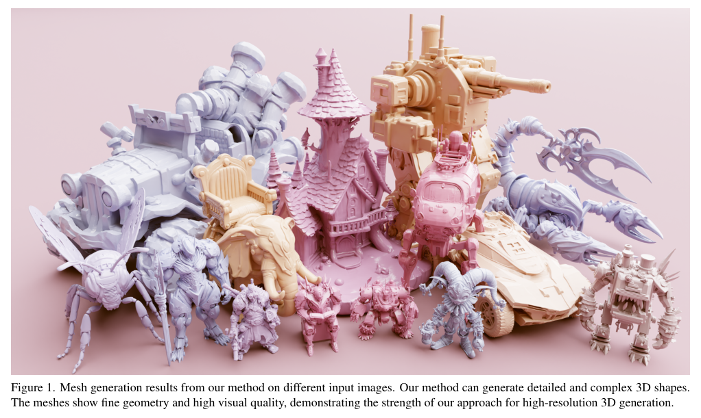
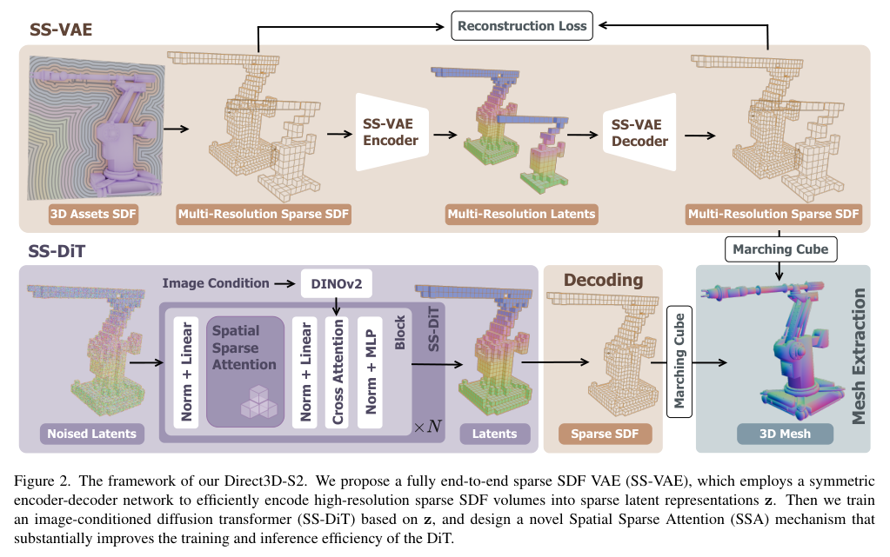

# 苹果背后的华人科学家，要做一家物理AI独角兽

2026-11-26 · 格秩科技 Envision AI（权龙团队 2026-11-25 首发专访）· DreamTech Direct3D-V3 / HKUST MVSNet 一手论文 · 有来源缺口

[本地原件归档](../../../raw/77d4ca33f8897fbf966f2d8a369888a82cce396bec5f6c335bcc65a1092502e3) · 固定材料版本 `digest-material-77d4ca33f8897fbf966f2d8a369888a82cce396bec5f6c335bcc65a1092502e3@1` · [一手原站](https://news.pedaily.cn/202611/572356.shtml) · [触发线索（新质动能）](https://mp.weixin.qq.com/s/RuXb7paKjrnqoh96hCiRWA)

## 深度拆解与复核

### 一、业务切口、技术谱系与稀疏原生架构

- 溯源说明：触发线索为微信公众号「新质动能」（2026-11-26）二级整合稿；本文已穿透核对 2026-11-25 格秩科技（Envision AI）成立日首发创始人受访记录（[投资界官宣专访](https://news.pedaily.cn/202611/572356.shtml) 与 [QbitAI 权龙独家访谈](https://www.qbitai.com/2026/11/512498.html)）以及团队一手开源学术原件（[Direct3D-S2 arXiv:2505.17412](https://arxiv.org/abs/2505.17412)、[Direct3D-V3 ACM TOG 2026](https://dreamtechai.github.io/Direct3D-V3/)、[MVSNet arXiv:1804.02505](https://arxiv.org/abs/1804.02505)、[LingBot-Map arXiv:2604.14141](https://arxiv.org/abs/2604.14141) 与 [NVIDIA SRL Astranomy](https://research.nvidia.com/labs/srl/projects/astranomy/)）。由于格秩科技目前尚无独立官网与公开论文仓库，下文严格隔离受访单方披露与独立可复现论文数据，未审计商采与成本基准单列缺口。

格秩科技（Envision AI）于 2026 年 6 月在深圳注册（工商主体为格秩科技（深圳）有限公司，注册资本约 126.70 万元人民币），2026 年 11 月宣布完成数亿元天使轮股权融资并正式对外公开。投资方名单涵盖元禾原点、君联资本、南山战新投、初心资本、云天使基金、和利资本、慧科科创投资以及由 CEO 张飞虎此前创办的 DreamTech 追梦每刻。业务切口上，公司不从单一任务机器人控制或孤立静态 3D 网格生成器切入，而是定位下一代原生空间与物理基础模型（Spatial & Physical AI），先发商业变现落在合成数据与模型蒸馏、高精度可编辑 3D 内容与 Unreal Engine 场景构造、刚体机械与厂房物理模拟，远期再向可控视频生成与端侧实时交互延伸。

本工作台推断，格秩科技宣称“上线即跑通稀疏表征与空间稀疏注意力、令训练效率提升一个数量级并将城市级三维建模推理压至 10 美元以内”，并非半年内凭空从零训练出的黑盒，而是直接继承了联合创始人张飞虎、Philip Torr 与姚遥在 DreamTech 时期已开源验证的体素稀疏架构演进链路：

1. 多视图重建工业起点（2015–2020）：董事长权龙（HKUST VisGraph 创始人、1995 年非标定三视图“六点算法”提出者）于 2015 年携博士生方天、姚遥创办三维重建云平台 Altizure，并于 ECCV 2018 发表深度学习多视图立体视觉奠基作 [MVSNet (arXiv:1804.02505)](https://arxiv.org/abs/1804.02505)。Altizure 于 2020 年被苹果收购后，权龙出任苹果空间智能首席科学家、姚遥任高级研究员，团队算法支撑了 ARKit、Vision Pro 与 Object Capture。

2. 空间稀疏注意力与原生体素 DiT（2024–2026）：张飞虎（牛津大学 Philip Torr 博士生）2023 年创办 DreamTech（追梦每刻）并推出原生 3D 大模型 [Direct3D (arXiv:2405.14832)](https://arxiv.org/abs/2405.14832)；2025 年 5 月发布的 [Direct3D-S2 (arXiv:2505.17412)](https://arxiv.org/abs/2505.17412) 首次将 Spatial Sparse Attention（SSA）与输入/隐空间/输出结构一致的稀疏 SDF VAE 结合，仅用 8 张 GPU 即跑通 1024^3 分辨率训练（此前 256^3 稠密体素需至少 32 张 GPU），v1.1 版本相对 FlashAttention-2 实现前向 12.2 倍、反向 19.7 倍加速；2026 年 11 月 19 日开源的 SIGGRAPH Asia 2026 / ACM TOG 论文 [Direct3D-V3 (项目主页)](https://dreamtechai.github.io/Direct3D-V3/) 更进一步取消 VAE 隐空间瓶颈，直接在原生体素 SDF 域用 Diffusion Transformer 生成高达 1536^3 分辨率的精细几何。

3. 流式空间建图与大厂工程拼图：前沿探索负责人姚遥（现任南京大学副教授）同时是蚂蚁灵波开源流式三维重建基础模型 [LingBot-Map (arXiv:2604.14141)](https://arxiv.org/abs/2604.14141) 的共同通讯作者（以 Geometric Context Transformer 实现约 20 FPS 处理逾 10,000 帧，入选 ECCV 2026 Oral 及最佳论文提名），并参与了 [LingBot-World 2.0 (arXiv:2607.07534)](https://arxiv.org/abs/2607.07534) 世界模型研发；工程负责人许景禧（香港中文大学博士、腾讯会议初创成员及视频传输算法负责人）则早自 2024 年即深度参与 Direct3D 论文研发。格秩科技当前提出的“可编程、可计算、可采样、可微分”形式化表征与逻辑编码，本质是把 Direct3D-S2/V3 的静态体素生成升级为嵌入物理约束与可执行代码逻辑的可微世界底座。

### 二、核心数据核查、口径纠偏与工程边界

对照上游原始论文、基准评测报告与行业历史档案，本工作台核查出原文及同期通稿在传播口径上的四项关键事实：

- ✅ 核查（GPT-6 Astra 在 RoboLab-120 的 74.8% 成功率与 18.56 秒延迟陷阱）：NVIDIA 西雅图机器人实验室于 2026 年 10 月发表的 [Astranomy 实证研究](https://research.nvidia.com/labs/srl/projects/astranomy/) 确认，OpenAI 于 2026 年 9 月发布的 GPT-6 Astra 在 RoboLab-120 仿真套件上确实取得 74.8% 任务成功率（远高于同期微调世界动作模型 Cosmos3-Nano-Policy 的 36.8% 与 VLA 模型 pi0.5 的 28.0%）。但原文未披露两条致命工程约束：其一，74.8% 并非模型直出动作，而是把 Astra 包装进持久化 Codex 会话并挂载工具链的 Agentic Policy 成绩（Direct Policy 裸调成功率为 66.3%），单次成功回合平均消耗 3,090 万 token、花费 36.40 美元，且单次调用平均耗时 13.37 秒（Direct Policy 为 18.56 秒，而 pi0.5 为 46.96 毫秒）；其二，RoboLab-120 测试中明确标注“推理期间仿真暂停（Simulation pauses during inference）”。一旦回到重力与摩擦不会暂停的真实物理环境（星海图赵行所指的 20 毫秒防滑落响应），以及银河通用团队实测指出的搭塔、麻将杠牌等精细接触任务（得分跌至 12 分甚至 0 分），外挂语言推理模型在控制频率与接触动力学上的结构性瓶颈立刻暴露。

- ✅ 核查（团队学术成就与跨界路线的原始出处准确）：文章提及的权龙 1988 年 ICCV 论文、1995 年六点算法、2001 年创办 HKUST VisGraph 均与 [HKUST 权龙官方主页](https://cse.hkust.edu.hk/~quan/) 吻合；2026 年 11 月 Anthropic 数学家 Levent Alpoge 借助 Claude 完成 Lean 形式化黎曼猜想证明、以及 Yann LeCun 与 NYU 团队于 2026 年 6 月发布的测试时闭环自适应潜在世界模型 [AdaJEPA (arXiv:2606.32026)](https://arxiv.org/abs/2606.32026) 均有明确公开出处；姚遥参与的蚂蚁灵波 ECCV 最佳论文提名项目经查确指 LingBot-Map（ECCV 2026 Oral & Best Paper Candidate）。

- ❌ 纠偏（张飞虎过往公司 6D.ai 收购方并非谷歌）：原文称“他之前参与创立的 6d.ai 被谷歌收购”。检索 2020 年 3 月原始行业收购档案（[AR Insider 原始报道](https://arinsider.co/2020/03/31/niantic-acquires-6d-ai/)）证实，牛津大学衍生空间建图初创公司 6D.ai 实为已于 2015 年从谷歌分拆独立的 Niantic 收购（用于构建 Pokemon Go 背后的 Real World Platform），而非谷歌直接收购；且 6D.ai 公开报道的联合创始人为 Matt Miesnieks 与 Victor Prisacariu，张飞虎在 6D.ai 的具体创始持股比例或研发分工未见官方原始新闻稿背书。

- ⚠️ 核查存疑（商业创收、10 美元建模成本与 3,000 万数据家底尚无独立核验）：截至 2026-11-26，格秩科技（Envision AI）未公开独立官网、技术报告或以公司名义发布的权重仓库，其 [量子位首发报道](https://www.qbitai.com/2026/11/512498.html) 展示的重工制造厂房长镜头与凸轮/槽轮/液压机械传动 Demo 属于官方单向展示材料。原文所称“单场景成本由 GPT-6 Astra 与 Claude Fable 5 的 100–600 美元压降至 10 美元以内”“3,000 万份空间物理数据、4,000 万条视频、500 万复杂场景”及“已与海内外大厂商业创收”，既未公布对照测试的提示词与网格/纹理/动力学评测基准，也未明确其与同一 CEO 名下 DreamTech（刚刚于一周前开源 Direct3D-V3）在资产权属和商业合同上的切分边界。

### 三、赛道横向对比（空间与物理基座模型的五条技术流派）

将格秩科技放入工作台具身智能已有竞争坐标中（关联 [World Labs](../entities/companies/World%20Labs.md)、[TensorWorld（物原科技）](../entities/companies/TensorWorld%EF%BC%88%E7%89%A9%E5%8E%9F%E7%A7%91%E6%8A%80%EF%BC%89.md)、[光轮智能（Lightwheel）](../entities/companies/%E5%85%89%E8%BD%AE%E6%99%BA%E8%83%BD%EF%BC%88Lightwheel%EF%BC%89.md) 与 [蚂蚁集团（蚂蚁灵波）](../entities/companies/%E8%9A%82%E8%9A%81%E9%9B%86%E5%9B%A2%20%28Ant%20Group%29.md)），五条路线的工程分工与商业切口如下：

| 代表主体 | 核心表征与技术路线 | 已验证公开交付物 | 当前短板与工程边界 |
| --- | --- | --- | --- | 
| 格秩科技（Envision AI） | 稀疏体素表征 + 空间稀疏注意力 + 逻辑编码（可编程/可微形式化物理表征） | 继承团队 Direct3D-S2/V3 开源体素管线与重工/机械刚体 Demo | 未发布独立官网与第三方评测权重；柔性体接触与 1,000 Hz 端侧实时真机控制尚无公开实测 |
| World Labs（已并入 AMD） | 显式 3DGS / GLB / OpenUSD 持久化空间生成（Marble / Atlas） | Rapidata 盲测 1469 Elo、Frameboy 15 FPS 实时交互 | 定位空间几何资产导出，不做柔性体接触动力学求解器 |
| TensorWorld（物原科技） | 物理规律内化先验（GeoPT / Transolver-3 神经 PDE + 世界动作模型） | 成立 4 个月获 1.05 亿美元种子轮、核心成员学术论文 | 公司级权重与真机多体接触 Sim2Real 评测尚未发布 |
| 光轮智能（Lightwheel） | 高保真物理资产 + GPU 物理引擎（Newton）合成数据管线 | 已大规模向具身智能客户交付合成数据与仿真评测 | 偏数据与仿真工程服务（受限于真机与合成数据边际收敛效率） |
| 蚂蚁灵波（Robbyant） | 流式前馈重建（LingBot-Map）+ 视频生成式世界模型（LingBot-World 2.0） | 开源 14B/1.3B 权重、720p/60fps 实时交互与 20 FPS 建图 | 以像素世界预测与建图为主，精密 CAD 级刚体力学约束弱于显式/体素形式化路线 |

本工作台推断，在工作台核心判断框架下（对应赛道 T2 合成数据边界与 T3 流程代码护栏 × 神经物理原语），格秩科技短期最现实的造血点并非直接取代机器人端侧 1,000 Hz 伺服控制，而是依托其稀疏体素原生几何 + 代码逻辑输出能力，在“合成数据生成、高精度可编辑 3D 工业/游戏资产及仿真环境搭建”中替代昂贵的通用大模型试错（把百美元级工具链调用压低至可用商业成本）。

### 观点与可反驳条件

- ==观点==：格秩科技的核心优势不在于“6 个月凭空造出新架构”，而在于将权龙一脉的几何重建/工程积累、张飞虎与姚遥在 DreamTech 验证过的稀疏体素生成（Direct3D-S2/V3）、以及许景禧的高并发工程基建装入同一实体；但其“物理 AI 赛道 Anthropic”叙事仍停留在概念阶段——形式化可微物理表征目前仅在刚体机械与静态大场景透视一致性的官方 Demo 中展示，尚未证明能解决柔性物体接触、摩擦非线性及真实机器人高频率闭环控制问题。

- ==推翻条件==：
  ① 若格秩科技在未来 6–12 个月内公开发布独立第三方可复现评测或技术报告，证明其原生模型在非暂停仿真（或真机）的接触密集操作任务（如搭塔、柔性线缆插拔、精细装配）中达到端到端推理延迟低于 50 毫秒且成功率超过 80%（正面超越 RoboLab-120 上 46.96 毫秒的 VLA 基线而不依赖外挂传统物理引擎），则“短期仍局限于 3D 资产、仿真环境与合成数据层”的边界判断将被推翻；
  ② 若工商登记与开源社区后续显示格秩科技与 DreamTech 完成资产并表且公开发布带可微力学求解器的统一底座权重（同时披露千万级空间物理数据集的采样标准与第三方大厂续约复购数据），则“工程实体化与商业持续性仍待审计验证”的折价应予上调。

### 利益披露与口径核查

- 本文（微信公众号“新质动能”，作者沈潇，2026-11-26）系基于 2026-11-25 格秩科技官宣日多家媒体同题报道的二次整合稿，文末自列参考文章涵盖智东西、机器之心、量子位、IPO 早知道、AI 科技评论、Z Potentials 与甲子光年；上述媒体稿件整体属于新公司融资官宣与创始人背书的正面传播窗口。
- 经对照上游一手源核查：MVSNet、Direct3D-S2、Direct3D-V3、LingBot-Map、AdaJEPA 及 RoboLab-120 上 GPT-6 Astra 的 74.8% 成绩均属真实学术/基准数据，但原文章隐去了 74.8% 依赖 Agentic 脚手架与“推理期间暂停仿真”的实验前提，将 6D.ai 的买方 Niantic 误写为谷歌，且格秩科技单场景低于 10 美元、千万级数据量与商业创收规模均源于公司单方口述，尚未经过独立第三方机构审计核验。

---

## 原文摘录与一手信源存证

> 11月25日，香港科技大学教授、前苹果空间智能首席科学家权龙，正式宣布二次创业，成立空间与物理AI公司格秩科技（Envision AI）。 这家今年6月才注册的公司，已于11月完成股权融资，并已牵手海内外多家头部科技大厂、实现了商业创收。
> — 原文摘录，文字段落 1；证据 `digest-material-77d4ca33f8897fbf966f2d8a369888a82cce396bec5f6c335bcc65a1092502e3-excerpt-1@2`

> 团队把自研稀疏表征与空间稀疏注意力机制结合，让模型把计算资源集中在相关的空间位置，减少不必要的运算。团队称，光这一招就让模型训练效率提升了一个数量级。
> — 原文摘录，文字段落 2；证据 `digest-material-77d4ca33f8897fbf966f2d8a369888a82cce396bec5f6c335bcc65a1092502e3-excerpt-2@2`

一手材料：

- 港科大教授权龙二次创业，成立Envision AI押注空间与物理AI（投资界 2026-11-25） · 投资界 (PEDaily) · [原站](https://news.pedaily.cn/202611/572356.shtml) · [主体档案：投资界 (PEDaily)](../entities/labs/%E6%8A%95%E8%B5%84%E7%95%8C%20%28PEDaily%29.md) · [本地原件](../../../raw/9578376e97fa3352cecfb5abf77440aee8d1f9c1996e12b53bc647f22ded6c3f)
  材料版本 `digest-material-9578376e97fa3352cecfb5abf77440aee8d1f9c1996e12b53bc647f22ded6c3f@1`；获取方式 `web_fetch_full_text`。
  > 权龙二次创业成立Envision AI，专注下一代空间物理基座模型，集结明星团队，已获多家头部科技企业合作创收。 — 原文提取
  > 空间与物理 AI 赛道迎来重磅新势力。 继此前创办的三维重建企业 Altizure 于 2020 年被苹果收购后，香港科技大学首 个计算机视觉实验室创始人、前苹果空间智能方向首席科学家权龙正式宣布二次创业，成立 Envision AI（格秩科技），面向下一代通用原生的空间物理基座模型。 — 原文提取
- 华人计算机视觉泰斗二次创业！离开苹果下场，专注下一代空间与物理AI（量子位 2026-11-25 首发报道） · 量子位 (QbitAI) · [原站](https://www.qbitai.com/2026/11/512498.html) · [主体档案：QbitAI Research](../entities/labs/QbitAI%20Research.md) · [本地原件](../../../raw/66434f57ba5315f149fce878ba3a2ce9face3e38068c0a37a785ae13ac4ea6c6)
  材料版本 `digest-material-66434f57ba5315f149fce878ba3a2ce9face3e38068c0a37a785ae13ac4ea6c6@1`；获取方式 `web_fetch_full_text`。
  > 衡宇 发自 凹非寺 量子位 | 公众号 QbitAI 苹果空间智能首席科学家告别苹果，杀入空间与物理AI赛道创业。 “单纯的3D建模生成，可能逐渐被大语言模型吞掉。”作为视觉几何的世界级奠基者，看到今年9月发布的GPT-6-Astra所展现出的空间理解和三维重建能力，研究三维视觉近40年的 权龙 很难无动于衷。 — 原文提取
- Direct3D-S2: Gigascale 3D Generation Made Easy with Spatial Sparse Attention (arXiv:2505.17412 / NeurIPS 2025) · DreamTech / 南京大学 / 牛津大学 · [原站](https://arxiv.org/abs/2505.17412) · [主体档案：DreamTech（追梦每刻）](../entities/companies/DreamTech%EF%BC%88%E8%BF%BD%E6%A2%A6%E6%AF%8F%E5%88%BB%EF%BC%89.md) · [本地原件](../../../raw/da09fadbf27ec681b42708d02fe911d81cf4013f164723114ddecebd2ce7200a)
  材料版本 `digest-material-da09fadbf27ec681b42708d02fe911d81cf4013f164723114ddecebd2ce7200a@1`；获取方式 `arxiv_abs_full_text`。
  > Abstract: Generating high-resolution 3D shapes using volumetric representations such as Signed Distance Functions (SDFs) presents substantial computational and memory challenges. — 原文提取
  > arXivLabs is a framework that allows collaborators to develop and share new arXiv features directly on our website. — 原文提取
- Direct3D-V3: Latent-Free Diffusion Transformers in the Native Voxel Domain (ACM TOG / SIGGRAPH Asia 2026) · DreamTech / 南京大学 / 香港大学 / 牛津大学 · [原站](https://dreamtechai.github.io/Direct3D-V3/) · [主体档案：DreamTech（追梦每刻）](../entities/companies/DreamTech%EF%BC%88%E8%BF%BD%E6%A2%A6%E6%AF%8F%E5%88%BB%EF%BC%89.md) · [本地原件](../../../raw/2f2b485a6e3094f0d95dc2e0594a3699ded1513d276c9a10ca0faf514e411093)
  材料版本 `digest-material-2f2b485a6e3094f0d95dc2e0594a3699ded1513d276c9a10ca0faf514e411093@1`；获取方式 `github_readme_full_text`。
  > Pass the prepared normal map or white clay image as \`--image\`, together with its aligned coarse mesh. For example, use \`assets/input\_imgs/0\_normal.png\` as the image path in the inference commands below. — 原文提取
- MVSNet: Depth Inference for Unstructured Multi-view Stereo (ECCV 2018) · HKUST VisGraph / Altizure · [原站](https://arxiv.org/abs/1804.02505) · [主体档案：HKUST VisGraph (Long Quan Group)](../entities/labs/HKUST%20VisGraph%20%28Long%20Quan%20Group%29.md) · [本地原件](../../../raw/bc9fdec5c94be69a738a26b343a31d0ac953f856280f6841053941d5ef9727a1)
  材料版本 `digest-material-bc9fdec5c94be69a738a26b343a31d0ac953f856280f6841053941d5ef9727a1@1`；获取方式 `arxiv_abs_full_text`。
  > Abstract: We present an end-to-end deep learning architecture for depth map inference from multi-view images. — 原文提取
  > arXivLabs is a framework that allows collaborators to develop and share new arXiv features directly on our website. — 原文提取
- LingBot-Map: Geometric Context Transformer for Streaming 3D Reconstruction (ECCV 2026 Oral / Best Paper Candidate) · 蚂蚁灵波（Robbyant） / 南京大学 · [原站](https://arxiv.org/abs/2604.14141) · [主体档案：蚂蚁灵波（Robbyant）](../entities/companies/%E8%9A%82%E8%9A%81%E7%81%B5%E6%B3%A2%EF%BC%88Robbyant%EF%BC%89.md) · [本地原件](../../../raw/a9d8d3feb638b70e5c9e6ce04e6f09239eea25973e05d5826627b1cc77f27be0)
  材料版本 `digest-material-a9d8d3feb638b70e5c9e6ce04e6f09239eea25973e05d5826627b1cc77f27be0@1`；获取方式 `arxiv_abs_full_text`。
  > Abstract: Streaming 3D reconstruction aims to recover 3D information, such as camera poses and point clouds, from a video stream, which necessitates geometric accuracy, temporal consistency, and computational efficiency. — 原文提取
  > arXivLabs is a framework that allows collaborators to develop and share new arXiv features directly on our website. — 原文提取
- Astranomy: An empirical study of GPT-6 Astra as a native robot policy (NVIDIA SRL / CoRL 2026 LBR) · NVIDIA Seattle Robotics Lab · [原站](https://research.nvidia.com/labs/srl/projects/astranomy/) · [主体档案：NVIDIA Seattle Robotics Lab](../entities/labs/NVIDIA%20Seattle%20Robotics%20Lab.md) · [本地原件](../../../raw/6bb218204f03bfb47814c399be514b25959a01eebba4ccb869945cc397854ab1)
  材料版本 `digest-material-6bb218204f03bfb47814c399be514b25959a01eebba4ccb869945cc397854ab1@1`；获取方式 `web_fetch_full_text`。
  > Overview 1. Introduction 2. Study Design 2.1. Policy Configurations 2.2. Inference-time ablations 3. Results 3.1. What information and action choices affect Astra's behavior? 3.1.1. — 原文提取
  > Key takeaways A general-purpose model has the capability of operating as a native robot policy for general-purpose pick-and-place. — 原文提取
- AdaJEPA: An Adaptive Latent World Model (arXiv:2606.32026) · NYU Agentic Learning AI Lab · [原站](https://arxiv.org/abs/2606.32026) · [主体档案：NYU Agentic Learning AI Lab](../entities/labs/NYU%20Agentic%20Learning%20AI%20Lab.md) · [本地原件](../../../raw/2a792faf895b0affb568596a002958346616c1e282d4345fc723fc353a7d2d2a)
  材料版本 `digest-material-2a792faf895b0affb568596a002958346616c1e282d4345fc723fc353a7d2d2a@1`；获取方式 `arxiv_abs_full_text`。
  > Abstract: Latent world models enable planning from high-dimensional observations by predicting future states in a compact latent space. — 原文提取
  > arXivLabs is a framework that allows collaborators to develop and share new arXiv features directly on our website. — 原文提取
- Niantic Acquires 6d.ai (AR Insider, 2020-03-31) · AR Insider · [原站](https://arinsider.co/2020/03/31/niantic-acquires-6d-ai/) · [主体档案：AR Insider](../entities/labs/AR%20Insider.md) · [本地原件](../../../raw/354f0f918a2a9a2921085f65661896cc988846aab005b91ea6e254c4400327f8)
  材料版本 `digest-material-354f0f918a2a9a2921085f65661896cc988846aab005b91ea6e254c4400327f8@1`；获取方式 `web_fetch_full_text`。
  > Niantic  announced  today that it’s acquiring  6D.ai . Drivers and synergies include 6D.ai’s spatial mapping and AR-cloud building technology, which align well with Niantic’s own “planet-scale” AR ambitions. — 原文提取
  > Can VR Elevate Leadership Training? Can VR Elevate Leadership Training? — 原文提取

归属与范围：微信原文（新质动能，2026-11-26）系对 2026-11-25 多家科技媒体同日首发通稿的二次改写。本工作台穿透抓取了首发专访报道（量子位、投资界）、团队前期已发表的算法谱系原件（HKUST/Altizure MVSNet arXiv:1804.02505；DreamTech Direct3D-S2 arXiv:2505.17412；SIGGRAPH Asia 2026 / ACM TOG Direct3D-V3；蚂蚁灵波 LingBot-Map arXiv:2604.14141 与 LingBot-World 2.0 arXiv:2607.07534）、NVIDIA Seattle Robotics Lab 的 RoboLab-120 实测报告（Astranomy）、NYU AdaJEPA（arXiv:2606.32026）及 2020 年 Niantic 收购 6D.ai 原始报道。逐项核实了团队谱系与 74.8% 基准的隐藏前提（仿真推理期间暂停物理时钟且单集开销 36.40 美元），同时纠正原文将 6D.ai 买方误写为谷歌的事实偏差，并将格秩科技未公开的模型权重、客户合同与单场景 10 美元建模基准显式隔离为 not\_disclosed / pending\_verification 缺口。

来源缺口：

- `not_disclosed`：格秩科技（Envision AI）截至 2026-11-26 尚未上线独立官方网站、技术白皮书或以公司实体名义开源的代码仓库与模型权重；文章与同期媒体所称“单场景建模成本从 100-600 美元压低至 10 美元以内”“推理耗时从小时级降至分钟级”“3000 万份空间物理数据资产及 500 万复杂场景”“数亿元天使轮具体金额及多家海内外大厂商业创收规模”均无独立第三方评测、审计或合同明细公开披露。
- `pending_verification`：工商信息披露该公司主体为格秩科技（深圳）有限公司（2026 年 6 月注册，注册资本约 126.697 万元人民币），媒体报道的 2026 年 11 月数亿元融资投资方包括元禾原点、君联资本、南山战新投、初心资本、云天使基金、和利资本与 DreamTech（追梦每刻）等，具体工商股权比例变更与分期交割条款尚待进一步核实；张飞虎在 6D.ai 官网/新闻稿中的确切联合创始人头衔亦待牛津/Niantic 原始档案复核。
- `not_disclosed`：格秩科技在重工制造厂房与刚体机械传动（凸轮、槽轮、液压杆）演示中未披露单卡推理帧率（FPS）、几何碰撞穿模率定量指标、可变形/流体/柔性布料接触仿真能力边界，以及其与张飞虎此前创办的 DreamTech（2023 年成立，2026-11-19 刚刚开源 Direct3D-V3）之间的知识产权切分或并表关系。
- `unverified_claim`：实体关系入库跳过 (权龙（Long Quan） --affiliated\_with--\> Apple)：valid\_to 非法日期（需完整 YYYY-MM-DD）

[返回赛道总览](../赛道总览.md#digest-77d4ca33f8897fbf) · [返回导读索引](README.md) · [主体档案库](../entities/README.md)
