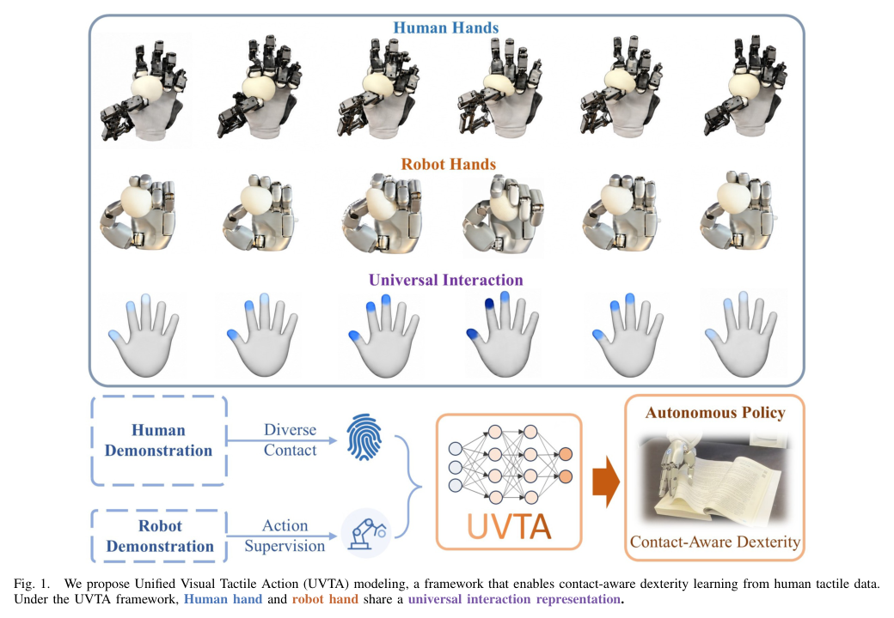
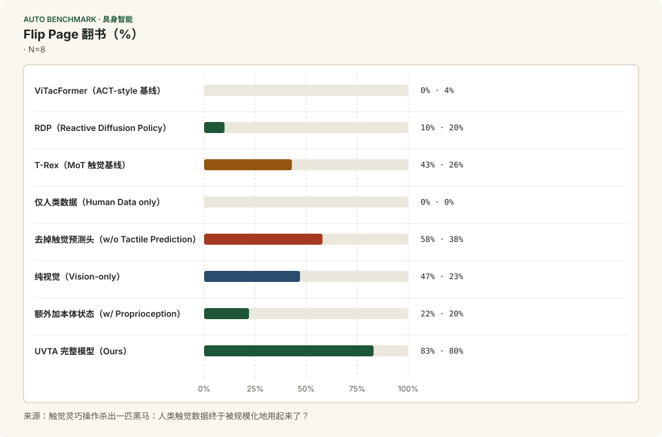

# 触觉灵巧操作杀出一匹黑马：人类触觉数据终于被规模化地用起来了？

2026-10-23 · BIGAI · SJTU · Sharpa Robotics (arXiv:2609.34182) · 有来源缺口

[本地原件归档](../../../raw/054644410fb44adac177b061da255d86d34945f9f1797821e0650ba2cd86814d) · 固定材料版本 `digest-material-054644410fb44adac177b061da255d86d34945f9f1797821e0650ba2cd86814d@1` · [一手原站](https://arxiv.org/abs/2609.34182)

## 深度拆解与复核

- ==核心结论==：[北京通用人工智能研究院](../entities/labs/%E5%8C%97%E4%BA%AC%E9%80%9A%E7%94%A8%E4%BA%BA%E5%B7%A5%E6%99%BA%E8%83%BD%E7%A0%94%E7%A9%B6%E9%99%A2.md)（State Key Laboratory of General Artificial Intelligence / BIGAI，[Siyuan Huang](../entities/people/Siyuan%20Huang.md)、Tengyu Liu）、上海交通大学（Shanghai Jiao Tong University，[Wenqiao Li](../entities/people/Wenqiao%20Li.md)、Chuan Wen）、Beijing Institute of Technology（Jiawen Hao）与 [Sharpa](../entities/companies/Sharpa.md) Robotics（Qianyou Zhao、Xuezhou Zhu、Kaifeng Zhang）联合提出的 Unified Visual-Tactile-Action Modeling（UVTA，[arXiv:2609.34182](https://arxiv.org/abs/2609.34182)），绕开了人类与机器人手部运动学直接重定向的难题，转而以「自研 22-DoF 被动外骨骼 + 指尖 20 维 FSR 触觉手套」在不占用机器人的条件下低成本采集 5,000 条人类触觉交互（Human Demonstrations / Human Trajectories），与 750 条机器人遥操数据共训；通过 VTPM 映射统一 Tactile Space 与 Action Space 表征，并在训练期用世界模型式未来触觉回归头（Tactile Predict Head）强制视觉—触觉共享表征编码接触后果，在 5 项高接触 Dexterous Manipulation 任务取得 70% 阶段成功率（显著高于最强基线 T-Rex 29% 与 Reactive Diffusion Policy 即 RDP 14%），且在 3 项任务上验证 0 至 1,000 条人类示范的非饱和递增趋势（8% → 29% → 51% → 84%），但仍无法零机器人样本独立工作且受限于单任务策略与纯指尖传感。

#### 一、业务切口与核心机制

1. 破局触觉数据两难与 Sharpa 三线拼图定位
   灵巧手接触密集型任务面临经典瓶颈：纯机器人遥操带触觉但受限于硬件与人力昂贵、难以扩表，海量第一人称人类视频便宜却缺失力触觉信号。触发导读（深蓝具身智能）将 Sharpa 体系梳理为三条路径并行的技术矩阵——路线一降低数采入口（DexEMG `arXiv:2603.05861` 用表面肌电腕带替代遥操设备；MoDE-VLA `arXiv:2603.08122` 用 RL 增强遥操配混合灵巧专家 VLA）；路线二把参考动作补齐物理接触（GALATEA 与 TacBPM 在仿真用接触感知 RL 蒸馏控制器）；路线三跨传感器表征复用（FTP-1 以 Morphology-Aware Tactile Token Space 汇集约 3,000 小时、26 源、21 种触觉传感器将跨传感器泛化提升 31%）。UVTA 正处于路线一与路线三的交汇点，并与机器人侧开源的 SharpaDex v1.0（300 小时、28,993 条示教、59 项任务、3,240 万帧、W01 双手采集且 64.9% 帧处于接触态）形成人—机两端互补。
2. 30 Hz 同步可穿戴视触觉动捕外骨骼与 VTPM 硬件对齐
   为摆脱数采过程对真机本体的依赖，团队自研一套穿戴式 Tactile Motion-Capture System：每个指尖安装 4 个 15 × 15 mm² 的力敏电阻（FSR）Pressure 感知区，五指输出 20 维压力信号；手背采用碳纤维被动 22-DoF 连杆外骨骼配合一对 VIVE Tracker 3.0（手腕 6-DoF 位姿），通过带关节硬限位与拇指 CMC/四指 MCP 软耦合的逆运动学映射到 22-DoF Sharpa Wave Hand 关节空间；腕部安装单目鱼眼 RGB 相机且标定对齐机器人末端几何关系，所有通道按共享主机时钟重采样至 30 Hz。机器人端（Sharpa North 平台）通过 Visual-Tactile-to-Piezoresistive Taxel Mapping（VTPM）将 Wave 指尖视触觉形变图聚合为相同的 20 维标准触觉 token，抹平人机触觉传感异构性，并与 224×224 腕部图像经从头训练的 ViT-S/8 Transformer 提取的 384 维视觉 token 拼接为 404 维统一交互表征。
3. 训练期世界模型触觉预测，推理期仅执行机器人动作
   在 Architecture 设计上，404 维表征分流进入双输出头：① Action Predict Head 为 FiLM-conditioned 1D U-Net 条件扩散头（通道 256/512/1024，50 步训练扩散 / 16 步 DDIM 逆向去噪采样 Denoising），预测未来 H = 16 步的 31 维动作块（9 维相对手腕平移+6D 旋转 + 22 维绝对手指角，滚动时域 Rollout 执行前 8 个路点），训练时以 0.5 对 0.5 等权平衡 9 维手腕与 22 维手指 MSE 误差；② Tactile Predict Head 为 404 → 512 → 320（Mish 激活）两层 MLP，直接回归未来 16 步 × 20 维触觉轨迹（权重 λ = 0.2）。核心工程隔离在于：人类样本与机器人样本按等概率加权随机采样共训（300 轮，batch size 250，AdamW），人类动作仅用于监督共享交互表征而永不在部署端下发，且触觉预测输出本身不进入扩散采样与真实控制过程——避免预测误差反过来污染动作。

#### 二、核心数据核查、口径纠偏与工程边界

场景与利益披露：论文由学术单位（北京通用人工智能研究院 BIGAI、上海交通大学、北京理工大学）与商业灵巧手厂商 Sharpa Robotics 联合完成，所有真机测试均在 Sharpa 自家 North 双臂平台（使用右臂及单只 22-DoF Sharpa Wave 灵巧手）开展，带有展示 Sharpa 生态收集—对齐优势的天然立意。本工作台调取 arXiv:2609.34182v2 全文 Table 1–3 及 Appendix IV，对自媒体传播中的两处易混淆口径作精准纠偏。

| 模型配置 / 消融变体 | Flip Page 翻书 | Screw Light Bulb 拧灯泡 | Toggle Switch 拨开关 | Ball Classification 球类分类 | Liquid Transfer Dropper 滴管移液 | 5 任务均分 (Table 1) |
| :--- | :---: | :---: | :---: | :---: | :---: | :---: |
| ViTacFormer（ACT-style 基线） | 0% | 4% | 0% | 0% | 0% | 1% |
| RDP（Reactive Diffusion Policy） | 10% | 20% | 20% | 18% | 0% | 14% |
| T-Rex（MoT 触觉基线） | 43% | 26% | 24% | 36% | 15% | 29% |
| 仅人类数据（Human Data only） | 0% | 0% | 0% | 0% | 0% | 0% |
| 去掉触觉预测头（w/o Tactile Prediction） | 58% | 38% | 50% | 44% | 21% | 42% |
| 纯视觉（Vision-only） | 47% | 23% | 26% | 20% | 14% | 26% |
| 额外加本体状态（w/ Proprioception） | 22% | 20% | 14% | 20% | 15% | 18% |
| UVTA 完整模型（Ours） | 83% | 80% | 88% | 56% | 44% | 70% |

- ✅ 70% 全量均分 vs 84% 缩放曲线口径纠偏（本工作台核查）：自媒体标题常将「84% 成功率」混同于全部任务均分。穿透核对原论文 Table 1 与 Fig. 5 Tactile Data Scaling Curve 可知，5 项任务总平均分为 70%（其中需刚度判别的 Ball Classification 为 56%、高精度捏合吸排液体的 Liquid Transfer Dropper 仅为 44%）；而 0 → 250 → 500 → 750 → 1,000 条人类样本呈现 0% → 8% → 29% → 51% → 84% 单调递增（最后一档净增 33 个百分点），对应的仅是 Flip Page（83%）、Screw Light Bulb（80%）与 Toggle Switch（88%）三项任务的子集均值，该口径已明确剥离。
- ✅ 阶段部分计分规则（Stage-Wise Partial Credit）与本体状态退化核查（本工作台核查）：论文附录 III.B Table 3 明确说明每项任务评估 N = 10 次真机回滚，采用里程碑最高部分得分制而非二元全成败（例如 Flip Page 分开书页边缘给 0.3、同时翻过多页给 0.7、精准单页才给 1.0）。此外 Ablations 消融揭示一个反直觉机制：引入本体状态（w/ Proprioception）导致均分从 70% 骤降至 18%，原因是策略转向死记固定关节轨迹而丧失对视触觉变化的实时顺应性；而仅用人类数据（0%）或 0 条人类数据搭配 150 条机器人数据（0%）均完全失效，证实人机联合共训缺一不可。
- ⚠️ 硬件公开度与跨任务泛化缺口（本工作台核查）：附录 IV 与开源仓库（github.com/uni-vta/UVTA 仅 12 stars）显示，当前实验完全局限于单任务独立策略（每任务单独训一模型）、单一 Sharpa 硬件且仅采集指尖 20 维触觉（全手掌传感器手套在大幅摆动时会产生严重的运动伪影噪声，因此刻意舍弃掌心与指背触觉）。定制外骨骼单套 BOM 成本、IK 标定公差及 FSR 在长期高频按压下的零点漂移衰减均未披露。

#### 三、赛道横向对比与定位

围绕「低成本人类接触经验如何转化为高自由度灵巧手策略」，UVTA 与工作台追踪的 [UMI-Live](%E4%BB%8E%E9%9B%B6%E4%BB%B6%E7%BB%84%E8%A3%85%E3%80%81%E6%95%B0%E6%8D%AE%E9%87%87%E9%9B%86%E5%88%B0%E6%A8%A1%E5%9E%8B%E8%AE%AD%E7%BB%83%EF%BC%8CUMI-Live%E5%85%A8%E6%B5%81%E7%A8%8B%E5%BC%80%E6%BA%90%EF%BD%9C%E5%8F%AF%E5%8A%A0%E8%A3%85%E8%A7%A6%E8%A7%89.md)、[Eka Robotics VFA](%E5%8A%9B%E6%89%8D%E6%98%AF%E7%89%A9%E7%90%86%E4%B8%96%E7%95%8C%E7%9A%84%E6%AF%8D%E8%AF%AD%EF%BC%81MIT%E6%95%99%E6%8E%88%E5%B8%A6%E7%9D%80VFA%28Vision-Force-Action%29%E8%B7%AF%E7%BA%BF%E6%9D%A5%E4%BA%86.md) 及 [EgoWild2Dex](EgoWild2Dex_%20Learning%20Dexterous%20Robotic%20Manipulation%20from%20In-the-Wild%20Human%20Experience%20%28arXiv_2609.23755%29.md) 构成清晰路线对照：

| 代表工作 | 人类端采集硬件 | 跨本体对齐机制 | 机器人端仍需遥操量 | 核心瓶颈与工程边界 |
| :--- | :--- | :--- | :--- | :--- |
| UVTA（BIGAI/SJTU/Sharpa） | 22-DoF 被动外骨骼 + 5 指尖 FSR + VIVE | VTPM 20 维触觉映射 + 训练期未来触觉世界头 | 每任务 150 条真机遥操（不可归零） | 缺掌心/指背触觉，仍需单任务训练与定制外骨骼 |
| Eka Robotics（VFA） | 无人类数采依赖（GPU 仿真 RL） | 物理仿真器力学交互 + 定制力控手协同 | 宣称零人类示范冷启动 | 柔性体 sim-to-real 泛化与产线 8 小时可靠性未公开 |
| UMI-Live | 开源手持夹爪（可选装触觉） | 腕部视角直接几何同构 | 低成本手持硬件替代，限二指平行夹爪 | 难以迁移至 22-DoF 五指手内重抓与多指搓动 |
| EgoWild2Dex（arXiv:2609.23755） | 野外无标定纯 RGB 第一人称视频 | 视觉手物轨迹提取 | 需额外机器人动作微调，缺直接接触力信号 | 遇到遮挡或压电/扭矩敏感动作（拧灯泡）乏力 |

### 观点与可反驳条件

- ==观点==：==UVTA 验证了「异构外骨骼采集人类真实指尖触觉 + 未来触觉轨迹辅助回归」在接触密集任务上的高数据杠杆效应，其核心洞见在于把人类演示从「动作模仿模板」重新定义为「物理接触因果监督源」==；但每项任务仍刚性绑定 150 条机器人遥操与单任务独立策略（且球类分类仅 56%、滴管移液仅 44%），表明它补齐了单一技能的接触表征入口，距离跨物体、跨任务的通用多指 VLA 基座仍有明显架构跨越要走。
- ==推翻条件==：
  1. ① 多任务统一大模型缩放检验：若至 2027 年 Q2，当团队将 UVTA 扩展至类似 SharpaDex 的 50 项以上混杂多任务统一策略训练后，人类触觉数据在 1,000 至 10,000 条区间出现早期收益钝化或任务间负迁移（多任务均分反低于单任务均值 15 个百分点以上），或严苛二元全成功口径下在未见光照/材质实例测试集成功率低于 45%，则“人类触觉缩放曲线可无缝支撑通用多任务灵巧大模型”的预期将被推翻。
  2. ② 纯手背/腕部视觉推算触觉替代假说：若外部工作证明仅凭高频多视角腕部 RGB + 无接触手套人类手部 3D 姿态预测，配合仿真接触动力学蒸馏即可在 Flip Page、Light Bulb、Toggle Switch 三项同类基准上以同等 150 条机器人样本达到 80% 以上成功率，则“必须额外定制穿戴 FSR 触觉外骨骼才能规模化对齐接触物理”的硬件前提将被证伪。

---

## 原文摘录与一手信源存证

> 例如 DexEMG：操作员佩戴表面肌电腕带和动捕手套，用肌肉活动直接预测手部运动学，从而在不操作机器人本体的情况下采集灵巧手遥操作数据。
> — 原文摘录，PDF p.2；证据 `digest-material-054644410fb44adac177b061da255d86d34945f9f1797821e0650ba2cd86814d-excerpt-1@1`

> MoDE-VLA 也从相近的方向切入，用强化学习增强的遥操作生成更高质量的训练数据，再通过混合灵巧专家架构把力与触觉反馈融合进 VLA 主干。
> — 原文摘录，PDF p.3；证据 `digest-material-054644410fb44adac177b061da255d86d34945f9f1797821e0650ba2cd86814d-excerpt-2@1`

> 路线二不再把“运动规划”和“接触控制”塞进同一个模型里端到端学，而是把两者拆开：上层负责生成手—物交互的运动参考，底层负责在仿真或物理引擎里补全接触细节，再蒸馏回可部署的控制器。
> — 原文摘录，PDF p.3；证据 `digest-material-054644410fb44adac177b061da255d86d34945f9f1797821e0650ba2cd86814d-excerpt-3@1`

一手材料：

- Unified Visual-Tactile-Action Modeling from Human Demonstrations for Dexterous Manipulation · Wenqiao Li, Qianyou Zhao, Jiawen Hao, Xuezhou Zhu, Tengyu Liu, Kaifeng Zhang, Chuan Wen, Siyuan Huang / BIGAI, SJTU, Sharpa Robotics · [原站](https://arxiv.org/abs/2609.34182) · [主体档案：Sharpa](../entities/companies/Sharpa.md) / [主体档案：北京通用人工智能研究院](../entities/labs/%E5%8C%97%E4%BA%AC%E9%80%9A%E7%94%A8%E4%BA%BA%E5%B7%A5%E6%99%BA%E8%83%BD%E7%A0%94%E7%A9%B6%E9%99%A2.md) / [主体档案：Wenqiao Li](../entities/people/Wenqiao%20Li.md) · [NotebookLM](https://notebook.google.com/notebook/33f0076b-fc09-42cc-9cd9-fecfb847ce1c) · [Drive](https://drive.google.com/file/d/1scy70vkrHZIdJ4EytpWNk4jbqlKqBtMg/view?usp=drivesdk)
  材料版本 `digest-material-34c12da76a2bd39dfc440d0756a2228429a1a6a91de82b1a838e1dbd84bf82d4@1`；获取方式 `http_pdf_download`。
  > Fig. 1. We propose Unified Visual Tactile Action (UVTA) modeling, a framework that enables contact-aware dexterity learning from human tactile data. — PDF p.1
  > a Unified Visual-Tactile-Action Model that maps both em- bodiments into aligned tactile and action representations and jointly predicts future action and tactile trajectories. — PDF p.1

归属与范围：已完整通读 47,563 字符的一手论文全文（arXiv:2609.34182v2，2026-09-29 发布）并核对项目主页 uni-vta.github.io 与仓库 github.com/uni-vta/UVTA；精准区分 5 项单任务全量加权均分 70%（Table 1）与 3 项缩放实验任务均值 84%（Fig. 5），并揭示其评测采用阶段打分制（Table 3）而非严格二元完成率；微信稿提及的 DexEMG、MoDE-VLA、GALATEA、TacBPM、FTP-1 与 SharpaDex v1.0 均在各自对应位置做了来源隔离。

来源缺口：

- `unavailable`：UVTA 的可穿戴触觉外骨骼动捕手套的具体硬件 BOM 成本、标定公差以及工程加工图纸未在论文中完全公开，目前主要依赖自研定制套件；同时 SharpaDex 虽开源但真机长期部署中的传感器磨损与触觉漂移衰减率未披露。
- `pending_verification`：UVTA 当前评测为 5 项单任务独立训练（single-task policies，各 10 次真机回滚且采用阶段部分计分），在未见物体类别、跨空间光照/纹理剧烈变化或多任务连续复合场景下的泛化能力，尚未经多任务统一大模型与跨实验室独立真机部署复核。

[返回赛道总览](../赛道总览.md#digest-054644410fb44ada) · [返回导读索引](README.md) · [主体档案库](../entities/README.md)
