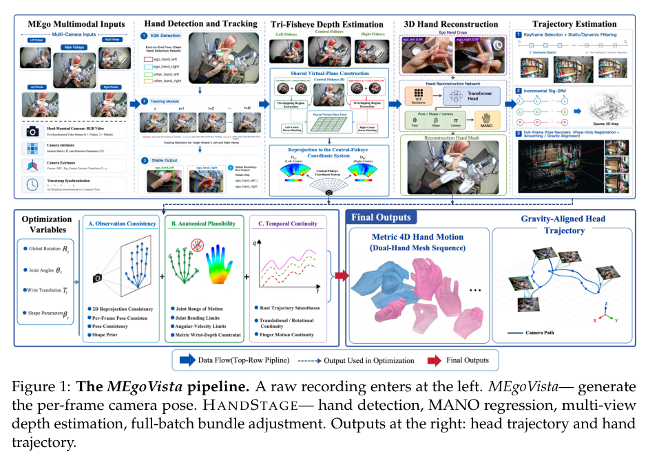
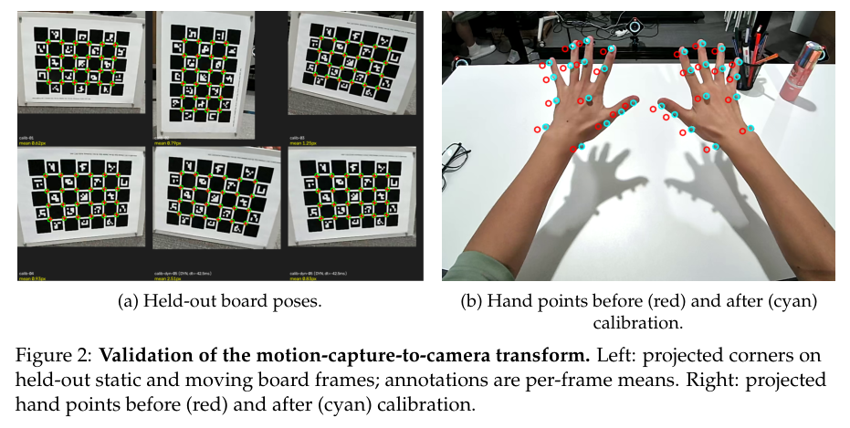

# 高精度还原指尖细节 觅蜂科技提出4D数据重建框架MEgoVista

2026-10-12 · 觅蜂科技 (Maniformer) · arXiv:2609.16684 · 有来源缺口

[本地原件归档](../../../raw/9266aa5607776fc89cfb230a55e2e5d790efda66396e5f8dae704056fa35702e) · 固定材料版本 `digest-material-9266aa5607776fc89cfb230a55e2e5d790efda66396e5f8dae704056fa35702e@1` · [一手原站](https://arxiv.org/abs/2609.16684)

## 深度拆解与复核

- ==核心结论==：上海觅蜂科技（Maniformer）发表的 `MEgoVista`（[arXiv:2609.16684v3](https://arxiv.org/abs/2609.16684)，2026-10-22）直指当前第一视角数据重建中最常被美化指标掩盖的漏洞——单目深度先验（如 `UniDepthV2`）无法锁定真实物理米制尺度，而常见的 Procrustes 对齐误差（`PA-MPJPE`）在评分前人为消除了平移、旋转和手掌尺度。依托自研三目鱼眼头戴终端 `MEgo View` 的标定立体基线初始化、`TriVP` 跨视角深度融合与佩戴者手部所有权消歧，MEgoVista 在 26 镜头 120 Hz 青瞳（Chingmu）独立光学动捕审计下实现手指姿态误差 `PA-MPJPE-p` = 4.29 mm（优于 `HaWoR` 16.30 mm 与 `Dyn-HaMR` 49.18 mm）、头部稳态轨迹 `ATE RMSE` = 0.65–2.83 mm 与手部漏检/误检归零，并凭借 `MEgoDeploy` GPU 工程栈在 RTX 5090 上达成 14.05× 端到端提速（处理耗时从 11.10× 视频时长压至 0.79× 实时速度）。但本工作台核查论文第 6 节与 Table 3 发现：即便在标定多目硬件加持下，不进行任何对齐的绝对相机系手腕空间误差 `CT-p` 依然高达 14.30 mm（为手指形态误差 4.29 mm 的 3.3 倍），且动捕测试仅涵盖头戴 3 鱼眼室内短序列，反映出野外绝对手物空间真值仍受动捕求解器参考基准与腕部近距耦合的物理限制。

#### 一、业务切口与四重硬件—算法架构

1. 硬件基准锚定（[MEgo View 官方规格](https://www.maniformer.ai/en/mego) 与 3.1 节）
   MEgoVista 拒绝直接从消费级无标定单目相机恢复尺度，依托 `MEgo View` 头戴端携带的 3 颗 60 fps 全局快门鱼眼相机（中央相机 MID 分别与 LEFT、RIGHT 组成两组宽基线立体对，采用冻结标定的 `Kannala-Brandt` 模型；官网完整套件另含 1 颗立体相机与 2 颗腕部广角相机，全系统 7 路 2M @ 60 fps 视觉流 + 亚毫秒无线硬件触发同步）。
2. 四级重建与生产加速栈
   - 佩戴者手部身份消歧与初始化：训练端到端检测器在检测边界框的同时联合判定手部所有权（wearer vs bystander）与左右手归属，辅以轻量跟踪器并用 `WiLoR`/`HaMeR` 类回归器输出每帧相机系 MANO 初值。
   - 三目虚拟平面立体深度（TriVP）：针对鱼眼外缘大畸变和安装偏角，构建以基线为轴的共面旋转校正，送入 `FoundationStereo` 网络预测双对稠密深度与置信度，在 MID 视角仲裁融合后解析重投影回原始鱼眼像素网格。
   - 全序列 MANO 时空与生理约束优化：先按置信度、深度离散度与骨骼比例剔除坏帧，再联合优化双手整段轨迹（包含 2D 重投影 `L_reproj`、TriVP 手腕深度 `L_sdepth`、姿态先验 `L_pose`、平滑项与 Huber 抑制漂移项，以及近似 `MS-MANO`/`BioPR` 的可微 `C^1 relu^2` 生理限位屏障）。
   - 广义相机头部追踪（6-DoF 世界系）与 `MEgoDeploy`：用 IMU 旋转与加速度提名关键帧、Lucas-Kanade 光流过滤静止/弱追踪帧，通过标定外参对左右目特征做 DLT + Levenberg-Marquardt 三角化固定绝对尺度（规避单目纯旋转退化），并将惯性重力对齐后置于视觉 BA 优化之外以防 IMU 漂移污染几何。工程层 `MEgoDeploy` 通过 FP16 `TensorRT` 融合网络 + FP32 几何/C++ 鱼眼核（单作业核心前向由 10.191 s → 7.203 s → 2.991 s，提速 3.41×）、常驻 GPU 缓冲池与 10 槽交错多作业调度（GPU 利用率从 34.1% 升至 80.3%），在 9 段总长 278.81 s 视频上将端到端耗时从 3094.1 s 压至 220.2 s（降低 92.9%）。

#### 二、核心数据核查、口径纠偏与工程边界

场景与利益披露：本论文版权属上海觅蜂具身智能科技有限公司（Maniformer.ai，官网同步售卖 MEgo 系列硬件与数据平台服务，中文传播稿《具身纪元》另称论文由觅蜂科技联合西北工业大学与西安交通大学完成，arXiv PDF 列明 Weihuang Chen、Hongbin Sun、Jinli Suo 为学术顾问，未明文写出两校全称）。与其他仅展示可视化定性视频的商业公司相比，Maniformer 在行业内罕见公开了独立 26 相机 Chingmu 动捕误差审计并主动惩罚漏检帧（不跳过难帧刷分），实证含金量高。

| 对比方法 | 手部检测 P / R / F1 ↑ | 手指形态 PA-MPJPE-p ↓ | 绝对手腕深度 CT-p ↓ | 2D 投影 EPE-P ↓ | 时序抖动 Jitter ↓ | 适用与失效工况 |
| :--- | :--- | :--- | :--- | :--- | :--- | :--- |
| MEgoVista (Ours) | 1.00 / 1.00 / 1.00 | 4.29 mm | 14.30 mm | 9.90 px | 1.11 mm/frame² | 3 鱼眼硬标定立体深度；美甲场景唯一未混入顾客手 |
| HaWoR | 0.96 / 0.99 / 0.98 | 16.30 mm | 46.70 mm | 83.10 px | 16.71 mm/frame² | 单目+单目学习深度；奶茶/洗宠场景左手与腕部显性偏移 |
| Dyn-HaMR | 0.73 / 1.00 / 0.84 | 49.18 mm | 184.38 mm | 96.42 px | 3.50 mm/frame² | 遮挡与多人交互下 Precision 跌至 0.73（大量幻觉/错认旁手） |
| HaPTIC | — (失败) | — | — | — | — | 在本文多人同框场景下未能输出有效序列 |

| 头部轨迹方法 (22/20 片段) | Session 1 全段/稳态 ATE RMSE | Session 2 全段/稳态 ATE RMSE | Fitted Scale 偏差 | 40 s 单片段平均耗时 | 工程特征 |
| :--- | :--- | :--- | :--- | :--- | :--- |
| MEgoVista (offline) | 2.87 mm / 2.83 mm (0.158°) | 0.75 mm / 0.65 mm (0.258°) | 1.0118 / 0.9951 | 206.0 s | 无前 5 秒初始化瞬态突变（剔除仅变 0.04 mm） |
| ORB-SLAM3 (离线精修) | 3.27 mm / 2.12 mm (0.184°) | 1.00 mm / 0.92 mm (0.260°) | 0.9923 / 1.0008 | — | 强依赖前 5 s 惯性初始化（剔除后降错 1.15 mm）；短 30 s 切片易吃亏 |
| DROID-W (剔除 4/22 失败) | 26.18 mm（4 段尺度崩至 395 mm） | — | 0.8608× (败段 0.80–2.68×) | 627.5 s (慢 3.0×) | 无标定基线兜底时 18% 序列发生严重尺度漂移 |
| MASt3R-SLAM (剔除 1/22 丢帧) | 121.59 mm | — | 0.5268× (全集低估 0.23–0.66×) | 715.4 s (慢 3.5×) | 严重系统性尺度收缩 |

1. ✅ 本工作台核查（`PA-MPJPE-p` 4.29 mm 与 `CT-p` 14.30 mm 的本质鸿沟）：中文转述主要聚焦“手指姿态误差 4.29 毫米”，但论文第 6 节非常坦诚地提醒读者——4.29 mm 是经过 Procrustes 相似变换（消除旋转、平移与整体手掌尺寸缩放）后剩下的纯粹指关节弯曲误差，而真正决定机器人夹爪或机械手能不能摸准物体在空间何处的、不做任何对齐的相机系手腕位置误差 `CT-p` 为 14.30 mm（仍是 `HaWoR` 46.70 mm 的三分之一，削减 69%，但距离真正毫米级末端盲操仍有差距）。并且，论文第 4.2 节自曝当前 Chingmu 商业动捕系统的 15 标记点手部骨骼求解器本身在激烈抓握时也有求解漂移（论文仅能过滤指尖距标记 > 40 mm、冻指 < 0.02 mm/frame 与 > 6× 跳变），验证了标定板刚体变换（静态 0.62–1.25 px、动态 0.83–2.51 px）却无法证明光学手部骨架真值绝对零误差。
2. ⚠️ 本工作台核查（硬件规格口径出入与场景覆盖限制）：第一，论文第 3.1/3.3 节明确写明 `MEgo View` 采样 `500 Hz` IMU，而 Maniformer 官网 `MEgo View Core Parameters` 写为车规级 9 轴 `1000 Hz` IMU，可能源于固件迭代或工程原型版本差异；第二，论文全部动捕评测只检验了“头戴 3 鱼眼”在约 30–104 秒室内序列的表现，官网配备的 2 颗腕部广角相机并未进入本次定量评测；第三，14.05× 加速（220.2 s 处理 278.81 s 视频）需依赖 RTX 5090 与 10 路高排队并发，属于纯离线数据标注产线而非低延迟实时流推理。

#### 三、赛道横向对比与定位

| 路线代表 | 传感器与尺度来源 | 手指形态精度 / 空间位姿误差 | 工程吞吐与定位 |
| :--- | :--- | :--- | :--- |
| 觅蜂科技 MEgoVista + MEgo View | 3 颗 60 fps 标定鱼眼 + IMU；立体基线直接锁尺度 | PA-MPJPE-p 4.29 mm；非对齐 CT-p 14.30 mm；头部 ATE 0.65–2.83 mm | MEgoDeploy 达 0.79× 视频实时；主攻无本体真实场景高质量 4D 伪标签 |
| [Perceptron](../entities/companies/Perceptron.md) Egocentric 1.0 | 任意无标定单目 RGB 视频 | HOT3D PA-MPJPE 5.21 mm；腕对齐 MPJPE 15.63 mm（无相机绝对位姿） | \$29/h 自助 API；适合零门槛语义+手形标注，缺米制空间尺度与多视角抗遮挡 |
| [Maxinsights](../entities/companies/Maxinsights.md) MaxSLAM | 硬件硬同步双目头戴 + IMU | 相机 ATE 4.24 mm（58.37 min 动捕对账）；完整率 99.90% | 当日 MaxLoop 质检 96% 良率，已有 200 万h+ 实采现货与 MaxGlove 触觉扩展 |
| [Unidata](../entities/companies/Unidata.md) Pico 4 Ultra 多目方案 | 消费级头显 + 4×ZED + Orin（软件 NTP 同步） | 无世界系 SLAM 轨迹输出（交付原始立体与 90 Hz 骨骼） | 硬件采购门槛最低，但 11 ms P95 同步限值与 30 fps 限制精微接触对齐 |

### 观点与可反驳条件

- ==观点==：MEgoVista 的核心工程贡献在于以“标定鱼眼立体初始化固定米制尺度 + 佩戴者手部所有权消歧 + 26 镜头独立动捕按漏检扣分审计 + 14.05× GPU 工程栈”证明了：高质量野外 4D 手物数据的竞争正从单目视觉模型精调转向“自研标定多目穿戴硬件 × 离线几何求解 × 工业级 GPU 调度”的垂直集成；即便如此，14.30 mm 的非对齐手腕绝对误差说明纯靠头戴视觉仍未打穿精细工业装配所需的亚厘米级手物接触真值边界，双腕相机融合与触觉力反馈（如其配套 `MEgo Gripper` 的 0.05 N 阵列）仍是下一步必需拼图。
- ==推翻条件==：
  1. ① 若 2027 年底前纯单目基础模型（不依赖多目立体标定硬件）在第三方盲测动捕序列上将未对齐相机系绝对腕部位置误差 `CT-p` 稳定压至 < 10 mm 且多人同框手部所有权误判率 < 1%，则 `MEgo View` 三目鱼眼专用硬件在 4D 手部重建环节的壁垒将被显著削弱；
  2. ② 若觅蜂科技在未来 12 个月内未能公布基于 `MEgo View` + `MEgoVista` 4D 伪标签规模化训练下游灵巧手/VLA 模型的真实真机成功率对照提升数据（如零样本操作提升 > 20 个百分点），或 `MEgoDeploy` 在含双腕 7 路流全开与室外长时程序列下出现明显算力回落与尺度漂移，则其全套管线的全链条商业化 ROI 将受质疑。

---

## 原文摘录与一手信源存证

> 第一视角（Ego）视频让数据采集从专业场地走进真实生活和工作，成为具身智能预训练的重要数据来源。但拍下操作，并不意味着就能获得具身模型预训练所需的4D数据，系统还需要准确辨认佩戴者的双手、还原手指的弯曲姿态，并测量手在空间中的移动距离。
> — 原文摘录，PDF p.1；证据 `digest-material-9266aa5607776fc89cfb230a55e2e5d790efda66396e5f8dae704056fa35702e-excerpt-1@1`

> ”，用以将Ego视频更精准地转化为4D数据。论文实验结果显示，MEgoVista在Ego视频上具备较高的重建精度，可将无需预先布置场景的第一视角录制数据，有效转化为具有真实尺度的双手动作和头部运动轨迹。
> — 原文摘录，PDF p.1；证据 `digest-material-9266aa5607776fc89cfb230a55e2e5d790efda66396e5f8dae704056fa35702e-excerpt-2@1`

> 通过独立动捕系统测评和真实场景对比，研究团队检验了MEgoVista的重建精度与跟踪表现。结果显示，经位置、朝向和尺度对齐后，MEgoVista的手指姿态误差为4.29毫米，低于HaWoR的16.30毫米和Dyn-HaMR的49.18毫米；动作抖动指标为1.11毫米／帧²，也低于两种对比方法。在制作奶茶、美甲和给宠物洗澡三个真实场景的画面对比中，MEgoVista整体跟踪更稳定，在美甲场景中也是三者中唯一正确区分佩戴者与顾客双手的系统。
> — 原文摘录，PDF p.1；证据 `digest-material-9266aa5607776fc89cfb230a55e2e5d790efda66396e5f8dae704056fa35702e-excerpt-3@1`

一手材料：

- \[2609.16684\] MEgoVista: Multi-view Ego-aware Motion Estimation for Metric 4D Hands and Head in the Wild · MEgoVista authors · [原站](https://arxiv.org/abs/2609.16684) · [主体档案：Jiangong Xiao](../entities/people/Jiangong%20Xiao.md) / [主体档案：Maniformer (觅蜂科技)](../entities/companies/Maniformer%20%28%E8%A7%85%E8%9C%82%E7%A7%91%E6%8A%80%29.md) · [NotebookLM](https://notebook.google.com/notebook/cac99041-d3b9-449e-a192-12bb4b1ad391) · [Drive](https://drive.google.com/file/d/1fIYN8LpxR94H60t9Xtb0kcngcbS2z1mr/view?usp=drivesdk)
  材料版本 `digest-material-41d9198cfd5853a326d21dc71c7dc29adafc5117a8135e33899f13c1dd98c9dc@3`；获取方式 `http_pdf`。
  > Learning manipulation from human video requires high-fidelity hand-motion re- construction in metric units. — PDF p.1
  > Egocentric video has become a central data source for embodied AI. — PDF p.1
- MEgo Series | Maniformer (MEgo Gripper & MEgo View Core Parameters) · Maniformer (觅蜂科技) · [原站](https://www.maniformer.ai/en/mego) · [主体档案：Maniformer (觅蜂科技)](../entities/companies/Maniformer%20%28%E8%A7%85%E8%9C%82%E7%A7%91%E6%8A%80%29.md) · [本地原件](../../../raw/aa0c51fd5412303c80491c29d413d3647ca5280d612eff388a803a7d8e5109a2)
  材料版本 `digest-material-aa0c51fd5412303c80491c29d413d3647ca5280d612eff388a803a7d8e5109a2@1`；获取方式 `http_full_text`。
  > The MEgo Gripper is a high-precision data acquisition gripper specially designed for robotic arm end-effectors. — 原文提取
  > The MEgo View is the industry's first dual-perspective high-fidelity data acquisition device. — 原文提取

归属与范围：完成一手信源核验与补充：复用 arXiv:2609.16684v3 (2026-10-22) 完整论文并抓取 Maniformer 官网 MEgo 系列硬件规格页(https://www.maniformer.ai/en/mego)文本快照；核实 26 台青瞳 Chingmu 动捕下的 PA-MPJPE-p (4.29 mm)、未对齐腕部距离误差 CT-p (14.30 mm)、头部轨迹 ATE RMSE (0.65–2.83 mm) 及 MEgoDeploy 14.05x 加速指标；揭示论文 500 Hz IMU 与官网 1000 Hz IMU 标注差异及非对齐 CT-p 物理误差，保留学术合作单位官网交叉核验缺口。

来源缺口：

- `pending_verification`：arXiv:2609.16684v3 全文版权归属 Maniformer 且仅测试头戴 3 颗鱼眼相机在室内 Chingmu 动捕房 30–104 秒片段中的精度，未披露官网 MEgo View 配套双腕广角相机的联合重建误差、室外无回环长距离漂移以及 MEgoDeploy 开源或对外 API 定价计划；另中文报道所称联合西北工业大学与西安交通大学，arXiv PDF 正文中未明文标注两校单位全称（仅列学术顾问 Weihuang Chen、Hongbin Sun、Jinli Suo）。
- `not_disclosed`：论文 3.1 节与 3.3 节标明 MEgo View 集成 500 Hz IMU，而 Maniformer 官网产品规格页标称为 1000 Hz 车规级 9 轴 IMU，且官网未披露 MEgo View / MEgo Gripper 的终端硬件售价及 MEgoDeploy 单小时云端推理电费/折旧成本。
- `unverified_claim`：实体关系入库跳过 (Maniformer (觅蜂科技) --produces--\> MEgoVista)：谓词 'produces' 不允许 to 实体类型 'company'（仅允许 \['product'\]）
- `unverified_claim`：实体关系入库跳过 (Maniformer (觅蜂科技) --produces--\> MEgo View)：谓词 'produces' 不允许 to 实体类型 'company'（仅允许 \['product'\]）
- `unverified_claim`：实体关系入库跳过 (Maniformer (觅蜂科技) --produces--\> MEgoDeploy)：谓词 'produces' 不允许 to 实体类型 'company'（仅允许 \['product'\]）

[返回赛道总览](../赛道总览.md#digest-9266aa5607776fc8) · [返回导读索引](README.md) · [主体档案库](../entities/README.md)
