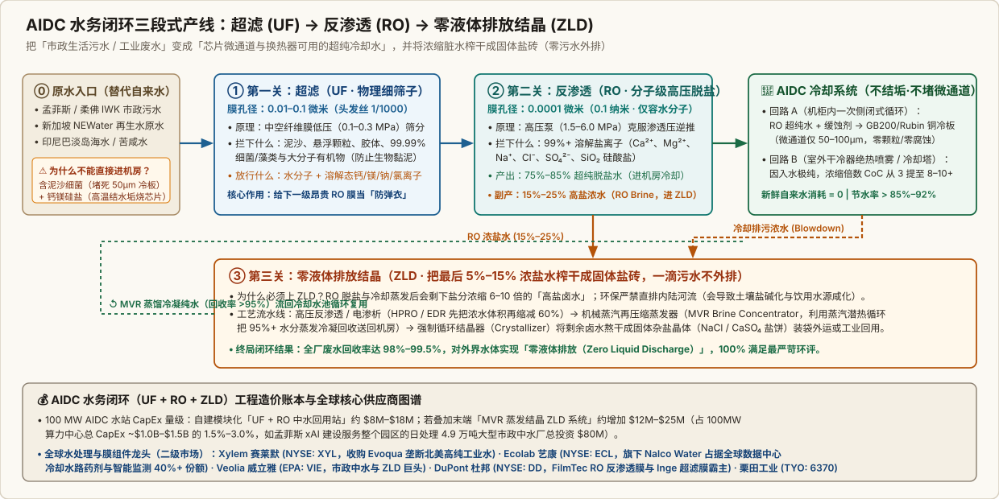

<a id="digest-511c8df78fabbd5b"></a>
# 2026年11月，东南亚数据中心为何集体踩刹车？

2026-11-09 · IMDA & BCA · Cushman & Wakefield · 待云端同步

[本地原件归档](../../../raw/511c8df78fabbd5b60acd172f0eb4d58793c8a5ddaa20b6857d3bf81ff211f91) · 固定材料版本 `digest-material-511c8df78fabbd5b60acd172f0eb4d58793c8a5ddaa20b6857d3bf81ff211f91@1` · [一手原站](https://www.imda.gov.sg/resources/press-releases-factsheets-and-speeches/factsheets/2024/singapore-green-data-centre-roadmap) · [触发线索（天睿财经）](https://mp.weixin.qq.com/s/PfoAMaMbVL0KDIKCyelaoA)

> [!IMPORTANT]
> 用户关注点（TG）：really？感觉德州的数据中心无序扩张在其他地方重演，而新加坡类似于孟菲斯，居民和政府是确切受益的前提是制定好标准；孟菲斯/新加坡的标准中，有什么硬性要求值得效仿？对应的AIDC solution有什么更改

## 针对性追查与回应

- 来源：[Singapore IMDA《Green Data Centre Roadmap》& BCA-IMDA《Green Mark for Data Centres (GMDC: 2024)》/ SS 564 / SS 715 官方技术规范](https://www.imda.gov.sg/resources/press-releases-factsheets-and-speeches/factsheets/2024/singapore-green-data-centre-roadmap) · [Cushman & Wakefield《Asia Pacific Data Centre H1 2026 Update》](https://www.cushmanwakefield.com/en/insights/asia-pacific-data-centre-update) · [马来西亚柔佛州数据中心协调委员会 (JPPPDNJ) / 国家能源 (TNB CRESS & UHV) / Ranhill SAJ 审批指引](https://www.tnb.com.my/) · [泰国投资促进委员会 (BOI) 公告与能源部第 9 类电价改革草案 (Thansettakij)](https://www.boi.go.th/) · [World Economic Forum《Data Centres and Water Scarcity》 (2026-11-03)](https://www.weforum.org/)
- 口径与利益披露（场景与利益标注）：触发线索《天睿财经》（作者“博弈为王”）系大宗商品期货（COMEX 与沪铜）交易视角的二级市场综述，其行文激励在于解释 2026 年 11 月美国中期选举后铜价回调与远期算力溢价压缩，故将东南亚三国不同层级的行政动作（泰国跨部门合规补课、印尼单项目未批先建叫停、柔佛淘汰高耗水低等级机房）笼统归因为“算力热潮降温”。而上游监管机构（新加坡 IMDA/PUB、马来西亚 TNB/SPAN、泰国能源部）的真实政策动机并非排斥 AI 基建，而是终结跨国云厂将电网扩容、进口 LNG 气源溢价与市政饮用水折旧转嫁给本地居民的“德州式负外部性套利”，用硬性 PUE/WUE 与自备水电标准倒逼 AIDC 工程架构代际升级。
- ==核心结论==：
  1. 东南亚“集体踩刹车”真相复核：并非砍掉 AI 算力需求，而是告别 2022–2024 年承接新加坡外溢时的“免税送水电”粗放招商——马来西亚柔佛州（在运 1110 MW、在建 602 MW、规划 2486 MW，管线合计 3088 MW，空置率仅 0.7%）自 2025 年 11 月起暂停高耗水开式水冷扩建至少 18个月、累计驳回约 30% 申请（封杀耗水强度超高等级机房近百倍的 Tier 1/2 设计）；泰国于 2026 年 9 月 4 日对 49个 在建项目劝导暂缓、117个 待批项目暂停审批（上半年刚批复 88个 项目，含 5 月批复的 9130亿 泰铢 / 270亿 美元三大项目及 TikTok System Thailand 单笔 8423.5亿 泰铢 / 255亿 美元投资）；印尼西爪哇省长于 9 月 28 日叫停 9 月 22 日刚动工的 BDX（BDx Indonesia CGK4）640 MW 园区（缺 AMDAL 环评与 PBG 施工许可，且满负荷日取水 3.3万 立方米威胁 Jatiluhur 水库稻米灌溉），巴淡岛则因旱季居民断水强制新建数据中心配套海水淡化厂。
  2. 「德州无序扩张」vs「新加坡顶层标准 + 孟菲斯底线契约」的制度分野：德州（及早期柔佛/泰国）之所以激起社区反噬，根源在于“免除州销售税与县房产税 + 学区税罗宾汉上缴 + ERCOT 孤网 765kV 输电成本转嫁居民电费 + 干旱期抽吸市政/地下水”；相反，新加坡（事前精密顶层选拔）与孟菲斯（事后市政硬性契约锁定）确立了六大值得效仿的硬性准入法则——新加坡以 GMDC: 2024 满载 PUE <= 1.25、WUE <= 1.80–2.00 m³/MWh（强制使用 NEWater 再生水/工业水/闭环冷却）、清洁能源占比 >= 50%、SS 715 高温服务器准入及每 MW 算力经济增加值（EVA）筛选高附加值算力；孟菲斯与柔佛新政则锁死 ① 市政饮用水零挤占（xAI 出资 \$80M 建中水厂 + 柔佛 Ranhill SAJ / IWK 污水回用强制令）、② 电网扩容与燃料成本 100% 内部化（自建变电站 + 150 MW Megapack 储能 + 马来西亚 TNB 超高压成本归因电价与照付不议 Take-or-Pay + 泰国第 9 类用户自担进口 LNG 成本）、③ 放弃 PILOT 免税并将 25% 全额房产税锁死周边 5 英里受损社区。
  3. 对应的 AIDC Solution 六大工程架构更改：当 PUE <= 1.25、WUE <= 1.8（饮用水配额归零）与电网冲击隔离成为准入铁律，传统通用机房（5-15 kW/柜、开式蒸发冷却塔 + 冷水机组、415V AC 配电）在 40-200 kW/柜的 GPU 时代彻底出局，倒逼 AIDC 解决方案全面切换为：① 芯片级 40–45°C 高温微通道冷板液冷（DLC，ASHRAE W45） 接管 85%+ 热负荷；② 室外排热由开式冷却塔改为「闭式干冷器（Dry Cooler）+ 峰值绝热喷雾（Adiabatic）/ 两相浸没液冷」，在 32–35°C 热带气候下实现免冷水机组（Chiller-less）自然冷却，将 WUE 从 2.5–3.5 L/kWh 压降至 0.0–0.20 L/kWh；③ 水源端 100% 接入市政再生水（UF+RO 超滤反渗透）或海水淡化闭环；④ 电源侧转向「表后微电网（BTM SOFC 燃料电池 / H级燃机）+ 绿电直购（马来西亚 CRESS / 泰国 Direct PPA）」；⑤ 并网侧标配 20%–30% 容量配比的构网型储能（Grid-Forming BESS + 机架超级电容） 吸收毫秒级百兆瓦训练负载阶跃；⑥ 机房供配电升级为 ±400V / 800V HVDC 高压直流母线直供机架，削减 3%–5% 转换损耗并降低 40%+ 低压母排用铜量。
- 关联主体档案：[Ecolab (NYSE: ECL)](../entities/companies/Ecolab.md) · [Xylem (NYSE: XYL)](../entities/companies/Xylem.md) · [Veolia (EPA: VIE)](../entities/companies/Veolia.md) · [DuPont (NYSE: DD)](../entities/companies/DuPont.md) · [IMDA Singapore](../entities/labs/IMDA%20Singapore.md) · [Cushman & Wakefield](../entities/labs/Cushman%20%26%20Wakefield.md) · [Tenaga Nasional Berhad (TNB)](../entities/companies/Tenaga%20Nasional%20Berhad%20%28TNB%29.md) · [World Economic Forum](../entities/labs/World%20Economic%20Forum.md) · [Thailand BOI](../entities/labs/Thailand%20BOI.md) · [SpaceX](../entities/companies/SpaceX.md) · [Bloom Energy](../entities/companies/Bloom%20Energy.md)

---

### 一、 东南亚与全球算力踩刹车逐国事实复核（原文 12 项核心数据原位核查）

针对文中引述的东南亚三国（泰国、印尼、马来西亚柔佛）、欧美地方公投及华尔街资本开支与铜需求数据，本工作台核查 穿透核对了泰国 BOI、能源部改革草案（Thansettakij 披露）、印尼 IESR、戴德梁行（Cushman & Wakefield）、世界经济论坛（WEF）、贝恩（Bain）与渣打银行、IEA、NBC / Data Center Watch（Redbud Consulting）、瑞银（UBS）及摩根士丹利（Morgan Stanley）的一手原始报告：

| 序号 | 区域 / 议题 | 原文核心主张与量纲锚点 | 原位核查定性 | 一手出处复核、背景补全与系统机制核查（本工作台核查） |
| :---: | :--- | :--- | :---: | :--- |
| 1 | 泰国审批与 9·4 暂缓令 | 2026 上半年 BOI 批复 88个 项目，5 月 3 个大项目投 9130亿 泰铢（270亿 美元），TikTok System Thailand 占 8423.5亿 泰铢（255亿 美元）；9 月 4 日劝导 49个 在建项目暂缓、暂停 117个 待批项目（在运 35个） | ✅ 属实<br/>*(需补齐行政职权边界)* | 经核对泰国投资促进委员会（BOI）公告，TikTok System (Thailand) 获批在曼谷、北揽府与差春骚府（EEC 东部经济走廊）部署超大规模算力主机，核准投资额确为 8423.5亿 泰铢。2026 年 9 月 4 日，泰国副总理兼财长 Ekniti Nitithanprapas 主持新成立的“数据中心业务政策委员会”，因曼谷周边频发“以普通仓库名义报建算力机房、违规囤积数万升备用柴油、冷却塔噪音与尾气扰民”事件，对 合计 166个 项目（49个 在建 + 117个 待批） 下达协同暂缓令。本工作台核查：泰国政府并无法定单方吊销已发施工许可的强行停工权，该措施实质是从“多头分散招商”转向“全国统一准入标准”的合规补课。 |
| 2 | 泰国第 9 类电价与 LNG 成本隔离 | 11 月能源部披露改革草案（Thansettakij 报道，尚未立法），将数据中心划为第 9 类高耗电用户，自担进口 LNG 发电成本，扩大绿电直购试点 | ✅ 属实<br/>*(切中东南亚电价补贴痛点)* | 泰国发电高度依赖天然气（占电力结构近 60%），随着国内气田枯竭，边际增量负荷完全依赖高价现货进口液化天然气（LNG，2026 年泰国推进将 LNG 年进口能力从 1,900 万吨扩至 2,700 万吨）。此前泰国电力局（EGAT）通过燃料调整费（Ft）将进口 LNG 溢价均摊给全国居民；11 月能源部与能源监管委员会（ERC）草案将大型数据中心单列为 第 9 类特种高耗电用户（Category 9），强制其 100% 承担边际进口 LNG 发电成本，按预订容量缴纳 450万 泰铢/MW（约 \$13万/MW）银行履约保函，并开放电网第三方准入（TPA）下的 绿电直购协议（Direct PPA）。 |
| 3 | 印尼西爪哇 BDX 停工与巴淡岛缺水 | 西爪哇省 BDX 园区规划 640 MW，9 月 22 日开工、9 月 28 日被省长勒令停工（缺环评与施工许可），满负荷日取水 3.3万 立方米挤占稻米灌溉水库；巴淡岛抽地下水致居民水压不足 | ✅ 属实<br/>*(定位至 BDx CGK4 园区)* | 系新加坡 BDx Data Centers 与 Indosat / Lintasarta 合资建设的西爪哇 Purwakarta 县 CGK4 AI 算力园区（获国家电力公司 PLN 845 MVA 供电配额，首期 120 MW 原定 2027 年初投产）。9 月 22 日奠基后仅 6 天，西爪哇省长 Dedi Mulyadi 于 9 月 28 日下令停工：一是未办结法定环境影响评估（AMDAL）与建筑施工许可（PBG）；二是园区距西爪哇核心粮仓水源 Jatiluhur 水库 仅 5 公里，满载峰值取水达 384 升/秒（折合 3.32万 立方米/日），引发印尼基本服务改革研究所（IESR）与农户对旱季稻田断水的强烈抗议。同期，紧邻新加坡的 巴淡岛（Nongsa 数字园） 因厄尔尼诺干旱叠加机房取水导致居民断水数月，当局已强制新建数据中心自建 专属海水淡化厂。 |
| 4 | 马来西亚柔佛管线与 18 个月水冷冻结 | 戴德梁行统计柔佛在运容量由 2023 年 94 MW 升至 2026 上半年 1110 MW；在建 602 MW、规划 2486 MW，管线合计 3088 MW；2025 年 11 月起暂停高耗水水冷扩建至少 18个月，用水对标新加坡 | ✅ 属实<br/>*(数据源自 C&W H1 2026)* | 核对戴德梁行（Cushman & Wakefield）《亚太数据中心 2026 上半年报告》，柔佛总存量（在运 1110 MW + 管线 3088 MW）达 4198 MW，跃居亚太“算力动力核心（Powerhouse）”，亚马逊、微软、字节跳动、阿里云密集落地古来（Sedenak）与依斯干达公主城（Nusajaya），机柜空置率压至极值 0.7%。因开式冷却塔抽水导致新山/古来居民区水压骤降，柔佛州政府自 2025 年 11 月起要求开发商 推迟高耗水蒸发冷却扩建项目至少 18个月（至 2027 年中）；柔佛州数据中心发展协调委员会（JPPPDNJ）已累计 驳回约 30% 的新建申请，全面封杀耗水强度极高的 Tier 1/2 机房，强制要求 WUE <= 1.8 m³/MWh 并接驳 Ranhill SAJ 与国家排污公司 IWK 的再生水（Reclaimed Water）。 |
| 5 | AI 机柜功率跃迁与东南亚绿电搁置 | 传统机柜 5-15 kW，AI-GPU 机柜 40-200 kW；贝恩与渣打报告显示 2021–2025 年越、泰、印 50%-60% 新能源项目因电网不足搁置，年电网改造需 180亿 美元；IEA 测算 2030 年电力需求翻倍以上 | ✅ 属实<br/>*(揭示工期错配根源)* | 核对贝恩（Bain & Company）与渣打银行《东南亚绿色经济报告》，东南亚并不缺绿电投资意向，但超过 35% 的宣布资本开支无法落地，其中越南、泰国、印尼 50%–60% 的可再生能源项目在 2021–2025 年间停滞或取消，头号瓶颈是国家电网输电走廊不足与 PPA 机制僵化（区域电网年投资仅约 110 亿美元，远低于 180亿–290亿 美元的年均需求）。本工作台测算：一座 100 MW AI 机房模块化土建仅需 12–18个月，而东南亚 275kV/500kV 输电变电站与跨区电网扩容周期长达 5–10年，工期错配达 4–6倍。 |
| 6 | WEF 水资源短缺与 70% 厂外隐性水耗 | WEF 2026-11-03 报告：全球约 1/4（25%）数据中心位于每年至少一个月缺水地区，2040 年代升至 1/3；2030 年全球耗水占比约 0.1%，但约七成耗水在厂外发电与芯片制造 | ✅ 属实<br/>*(系统边界重要纠偏)* | 世界经济论坛（WEF）2026 年 11 月 3 日报告指出，尽管 2030 年数据中心直接冷却取水仅占全球总取水量的 0.1%，但其呈极度空间集聚性（单座 100 MW 传统蒸发水冷机房日耗水相当于 3万–5万 人口城镇生活用水）。更关键的是 全生命周期水足迹（Scope 1+2+3 Water）：园区水表计量仅占约 25%–30%，其余 约 70% 耗水发生在厂区外的火电厂蒸汽循环冷却（Scope 2，每发 1 MWh 煤电/气电耗水 1.5–2.5 m³）与晶圆厂超纯水清洗（Scope 3）。 |
| 7 | 美国中期选举反弹与 1300 亿美元项目受阻 | NBC 民调 76% 选民反对社区建大型数据中心；全美 45项 地方公投中 33项 限制建设，超 400项 地方法令约束；2026Q1 至少 75个 项目推迟或否决（涉资 1300亿 美元）；纽约州暂停 50 MW 以上项目一年，加州蒙特雷帕克公投否决 | ✅ 属实<br/>*(与德州/孟菲斯选情互证)* | 核对 Data Center Watch 与 Redbud Consulting 追踪数据，2026 年一季度全美确有 至少 75个 数据中心项目因地方抗议、分区否决或并网延误被推迟或取消，涉及潜在投资约 1300亿 美元（单季受阻规模追平 2025 全年）。纽约州长 Kathy Hochul 已签署行政令对 >= 50 MW 数据中心实施为期 1 年的州级环评许可暂停（以编制通用环评声明 GEIS）；加州蒙特雷帕克市（Monterey Park）通过暂停与禁止新建条例；这与本工作台此前核实的 2026-11-03 德州州长选举民主党人 Gina Hinojosa 凭“暂停新数据中心+冻电价”爆冷翻蓝、孟菲斯市议会 10-20 通过 135 天新项目冻结令 形成完整证据链闭环。 |
| 8 | 云厂 CapEx 增速拐点与大摩铜需求测算 | 2026Q1 微软、亚马逊、谷歌、Meta 四家合计 CapEx 约 1306亿 美元；瑞银测算超大规模云厂 CapEx 2026 年增 76%、2027 年 25%、2028 年 6%；红杉指出 AGI 商业化延后；大摩测算数据中心耗铜 2025 年 50万 吨（1.5%）、2026 年 74万 吨、2027 年 100万 吨（2.8%）、2028 年 130万 吨（3.3%），COMEX 库存高位 | ⚠️ 宏观总量属实，但需区分结构转移<br/>*(本工作台复核)* | 瑞银（UBS）模型确预测全球超大规模云厂 CapEx 在 2026 年同比增长 76%（跨过万亿美元门槛）后，增速将于 2027 年回落至 25%、2028 年降至 6%（2026–2028 三年累计约 4.1 万亿美元）；摩根士丹利铜需求曲线（50万 $\to$ 74万 $\to$ 100万 $\to$ 130万 吨，占全球铜需求从 1.5% 升至 3.3%）亦核对无误。但 本工作台复核 指出：将铜需求放缓单纯归因于项目审批暂停并不完整——更深层的工程变量是 机架配电向 800V HVDC 演进（同功率电流减半、低压母排用铜量下降 40%）以及 Scale-up 域内 CPO 光互连对无源铜缆（DAC/ACC）的替代。 |

---

### 二、 制度对比：为什么「德州式无序扩张」在东南亚重演，而「新加坡 + 孟菲斯标准」能让政府与居民确切受益？

用户在关注点中敏锐指出：*“感觉德州的数据中心无序扩张在其他地方重演，而新加坡类似于孟菲斯，居民和政府是确切受益的前提是制定好标准。”*

通过对比 德州（及 2022–2024 年早期的柔佛、巴淡岛、泰国） 与 新加坡、孟菲斯 的制度账本，本工作台推断：决定数据中心沦为“民粹公敌”还是“地方财政与基建引擎”的根本分水岭，不在于机房规模大小，而在于政府是否在准入端建立起「负外部性 100% 内部化 + 财政收益定向锁死受损社区」的硬性制度闭环：

```text
┌──────────────────────────────────────────────────────────────────────────────────────────────────────────┐
│                 两种算力扩张制度模型的政治经济学与资源账本对比（德州模式 vs 新加坡/孟菲斯模式）             │
└──────────────────────────────────────────────────────────────────────────────────────────────────────────┘

  ❌ 【模式 A：德州式 / 早期东南亚“飞地式”无序扩张】（收益私有化，成本社会化 —— 必然触发选票与停工反噬）
  ├── 1. 财政空心化：德州免除 10–15 年 6.25% 州销售税（年损 $1.3B–$1.6B）+ 县房产税减免 50%–85% + 学区税被州政府
  │      “罗宾汉机制（Recapture）”抽走；泰国/印尼早期给予 BOI 长期免税，百亿机房仅留 30–100 个低薪保安运维岗。
  ├── 2. 电网成本转嫁：德州 ERCOT 孤网新建数百亿 765kV 输电线，科技巨头用 4CP 机制逃避分摊，输电费与现货稀缺电价
  │      全部转嫁居民月度账单（6年涨 35%–50%）；泰国早期将进口高价 LNG 燃料成本混入公共电价 Ft 由全民买单。
  └── 3. 水源无偿掠夺：采用廉价开式蒸发冷却塔（WUE > 2.5 L/kWh），在德州旱区/印尼西爪哇稻米产区/巴淡岛/柔佛直接抽吸
         市政自来水或地下水，导致居民水压崩溃、农业灌溉断流，最终引发州长翻蓝（德州）或省长勒令停工（西爪哇）。

  ✅ 【模式 B：新加坡（事前精密顶层选拔）+ 孟菲斯 & 柔佛新政（事后硬性契约锁定）】（外部性内部化，收益锁死本地）
  ├── 1. 新加坡（资源极度稀缺下的“精英选拔制”）：2019–2022 主动停批立规，2024–2026 凭 GMDC:2024 与 DC-CFA 配额竞标，
  │      强制 PUE <= 1.25、WUE <= 1.8（100% 禁饮用水，接驳 NEWater 再生水/海水）、绿电 >= 50%，且按每 MW 绑定的
  │      本地 AI 研发总部、高薪岗位与算力经济增加值（EVA）择优授牌。
  ├── 2. 孟菲斯（老工业城盘活下的“底线契约制”）：xAI 放弃 PILOT 免税，实缴 $12M–$28M/年全额房产税，市议会立法（CBO）
  │      将 25% 房产税锁死在机房周边 5 英里低收入社区 + 签约翻修 4 所公立学校；强制自建变电站 + 150 MW Megapack 储能
  │      （严禁涨居民电费）+ 出资 $80M 建 1,300 万加仑/日中水回用厂（严禁抽孟菲斯砂层饮用蓄水层）。
  └── 3. 柔佛与泰国 2025–2026 新政（亡羊补牢效仿新加坡+孟菲斯）：柔佛封杀 Tier 1/2 机房、冻结开式水冷 18 个月、强制
         接驳 Ranhill SAJ / IWK 再生水（WUE <= 1.8）；TNB 实施超高压（UHV）成本归因电价 + 照付不议（Take-or-Pay）惩罚；
         泰国能源部单列第 9 类电价强制算力商自担进口 LNG 成本并缴 450 万泰铢/MW 保函。
```

---

### 三、 孟菲斯、新加坡与柔佛新政中「值得效仿的六大硬性要求」基准矩阵

回答用户的第一个核心追问：*“孟菲斯/新加坡的标准中，有什么硬性要求值得效仿？”*
我们将 新加坡（IMDA Green DC Roadmap / BCA GMDC: 2024 / SS 564 / SS 715）、孟菲斯（xAI 全额纳税契约 / 市议会 CBO 法案 / TVA-MLGW 电价隔离墙） 以及正在向两者对齐的 柔佛与泰国新政 拆解为 六条可直接抄作业的量化硬性条款：

| 监管维度 | 新加坡硬性标准 (GMDC: 2024 / SS 564 / SS 715 / DC-CFA) | 孟菲斯硬性标准 (City Council CBO / MLGW-TVA / SCHD) | 柔佛 / 泰国 / 印尼 2025–2026 效仿新政 | 值得全球监管与产业效仿的核心机制（为什么管用？） |
| :--- | :--- | :--- | :--- | :--- |
| 1. 能效硬门槛 (PUE) 与 IT 高温运行标准 | • 新建准入（GMDC Platinum）：100% 满载 PUE <= 1.25（GoldPlus <= 1.28，存量改造目标 <= 1.30），且考核 25%/50%/75% 部分负载曲线；<br/>• 制冷系统能效：水冷系统总能效 <= 0.50–0.55 kW/RT；<br/>• SS 697 / SS 715 热带与 IT 规范：鼓励机房送风提至 26°C–32°C、液冷进液提至 40°C–45°C，要求 IT 设备侧节电 >= 30%。 | • 旧厂房改造虽未设州级 PUE 立法，但受限于单站点变电站容量上限（首期 150 MW 电网配额需塞入 10 万张 H100/H200），工程上被迫采用高密超算液冷冷板机柜以将非 IT 功耗压至最低。 | • 柔佛 JPPPDNJ：一刀切 禁止审批 Tier 1 与 Tier 2 低等级机房，联邦 DESAC 税收优惠要求 PUE <= 1.35–1.40；<br/>• 泰国 9·4 新规：暂停 166个 项目以制定全国最低 PUE 与能效准入线。 | 从源头消灭“电老虎外壳”：在常年 32°C 高湿的热带气候下强制 PUE <= 1.25，在热力学上直接判处传统风冷机房死刑，倒逼运营商上马芯片级液冷与高温送风（SS 715）。 |
| 2. 水资源红线 (WUE) 与市政饮用水零挤占 | • WUE 硬上限：WUE <= 1.80–2.00 m³/MWh（液冷 AI 集群压至 <= 0.2–0.5）；<br/>• 水源强制替代（PUB）：严禁新建机房消耗市政饮用自来水排热，100% 强制接驳 NEWater（超净再生水）、工业水、海水冷却或闭式干冷，且浓缩倍数 CoC >= 6–8。 | • 饮用蓄水层保护铁律：严禁长期抽取“孟菲斯砂层蓄水层（Memphis Sand Aquifer）”优质饮用水；<br/>• 强制自建中水厂：xAI 被迫出资 8,000 万美元 建设日处理 1,300 万加仑（4.92 万 m³/日）市政污水再生厂（同时供给自身冷却与 TVA 火电厂），4 月停工即遭市府与议会 135 天冻结令施压倒逼 2027Q1 复工。 | • 柔佛：暂停高耗水开式水冷扩建 18个月，执行 WUE <= 1.8 m³/MWh，强制接入 Ranhill SAJ 替代工业水与 IWK 市政污水厂再生中水；<br/>• 印尼巴淡岛：强制新数据中心自建 专属海水淡化厂；西爪哇叫停未审先抽灌溉水库的 BDX 640 MW 项目。 | 把“冷却水”与“居民水龙头”物理隔离：数据中心要用水冷，要么自己掏几千万美元帮城市建污水处理厂（孟菲斯/柔佛 IWK 模式）把市政污水变成工业冷却水，要么改用零水干冷器。 |
| 3. 电网扩容与边际燃料成本 100% 内部化 | • 开发商 100% 自担高压变电站接驳、电缆隧道与电网冗余改造 CapEx，新加坡能源市场管理局（EMA）通过竞争性电力市场完全隔离工商业大用户与居民电价补贴。 | • 《居民电价保护承诺》（Ratepayer Protection）：xAI 全额自费建设专用变电站并采购 150 MW Tesla Megapack 储能阵列 平抑瞬态冲击，TVA 与 MLGW 明确保证 零电网升级成本分摊至普通家庭账单。 | • 马来西亚 TNB 电价改革：取消一般工商业电价补贴，设立 超高压（UHV）专属电价，按“成本归因原则”由开发商 100% 承担输电网升级费；执行 照付不议（Take-or-Pay） 容量预订与低利用率双倍罚款（打击圈电套利）；<br/>• 泰国能源部草案：划入 第 9 类高耗电用户，100% 自担边际进口 LNG 发电成本 + 缴纳 450万 泰铢/MW 保函。 | 终结“硅谷用算力、本地居民交电费”：用专属分类电价（泰国 Cat 9 / 马来 UHV）+ 变电站自建 + 照付不议容量费，彻底锁死输电 CapEx 与边际燃气溢价向居民账单的转嫁通道。 |
| 4. 清洁能源与表后微网硬性配比 | • 新增配额强制要求 >= 50% 绿电/低碳能源路径：包括跨境绿电进口（EMA 规划 2035 年前从马、印、老、澳进口 4–6 GW 低碳电力）、生物甲烷、太阳能或 掺氢/纯氢就绪（Hydrogen-ready）燃料电池与燃机。 | • 联邦众议员当选人 Brent Taylor 与 TVA 框架推进 合规表后自备电源（Behind-the-Meter Power），但联邦法官 Debra Brown 裁定 禁止用免环评临时拖车燃机钻漏洞，倒逼转向具备固定源排污许可（Title V）的清洁微电网与储能。 | • 马来西亚 CRESS 框架：国家数据中心工作组强制新项目采购 >= 30% 可再生能源，通过 TNB CRESS（企业可再生能源供应计划）向绿电开发商直购并支付系统接入费（SAC）；<br/>• 泰国：向数据中心全面开放电网第三方准入（TPA）下的 Direct PPA 绿电直购。 | 以算力买单带动区域绿电与微网投资：针对东南亚 50%–60% 绿电因电网瓶颈搁置的死局，强制算力商通过 CRESS / Direct PPA 或表后清洁微网为绿电并网付费。 |
| 5. 税收减免取消与受损社区定向锁死 | • 拒绝无条件免税招商，在 DC-CFA 中按 每 MW 创造的本地经济增加值（EVA）、AI 模型研发中心落地、高薪工程岗位与主权算力共享比例进行打分淘汰。 | • 放弃 PILOT 免税 + 25% 社区定向锁死：xAI 为抢工期放弃 10–15 年 PILOT 房产税减免，首期实缴 >\$12M/年（二期后 ~\$28M/年）全额房产税；孟菲斯市议会通过 《社区利益法案》（CBO），强制将 AI 数据中心市级房产税的 25%（年约 \$3.2M–\$3.3M） 通过类 TIF 机制 100% 锁死在机房周边 5 英里低收入非裔社区，外加签约出资翻修周边 4 所公立学校。 | • 柔佛与泰国新规：从“拼免税年限”转向“算综合本地账”，泰国能源部与 BOI 新规要求投资方在竞标时提交具法律约束力的本地就业、税收留存与减碳效益承诺书，淘汰纯摆服务器的“飞地仓库”。 | 解决“县长招商、邻里受害”的政治死结：效仿孟菲斯 *“零免税 + 25% 房产税刚性锁死周边 5 英里”*，让受施工扬尘、噪音影响的周边居民第一时间看到学校翻修、道路重铺与治安改善。 |
| 6. 环评前置、专用分区与噪音/排放护栏 | • 严格执行裕廊岛、大士与罗央工业区专用数据中心规划分区（Zoning），施工与运营全周期纳入 SS 564 环境与能源管理体系实时遥测审计。 | • 2026 年 10 月 20 日通过 135 天新项目暂停令 + 90 天行政审查，补齐数据中心专用城市分区（Zoning）、厂界分贝噪音上限、地下水取水计量公开与固定源尾气在线监测。 | • 印尼与泰国：印尼以西爪哇 BDX 停工立威，明确未取得完整 AMDAL（环评） 与 PBG（施工许可） 严禁未批先建；泰国取缔“仓库改机房”违规储油行为。 | 把合规红线画在打桩之前：防止企业用“先开工造既成事实、再逼政府补票”的策略绑架地方公共资源。 |

---

### 四、 对应的 AIDC Solution 工程架构更改（从「耗水抽电巨兽」到「零水闭环+微网直供」的六大硬件演进）

回答用户的第二个核心追问：*“对应的 AIDC solution 有什么更改？”*
当新加坡、孟菲斯、柔佛与泰国将上述六大硬性标准写入准入法典，传统通用数据中心（5–15 kW/柜、风冷 CRAC + 冷水机组 Chiller + 开式蒸发冷却塔、415V/480V AC 传统配电、纯靠公网供电）在物理与合规上彻底无法过审。

本工作台测算 表明，面向 2026–2028 年交付的新一代高密 AI 数据中心（如部署 NVIDIA GB200 / GB300 NVL72 或 Vera Rubin NVL72，单机架功率达 132–145 kW、峰值 192–200 kW），其工程解决方案（AIDC Solution）正在发生 散热水务侧与供配电微网侧的六大结构性重构：

#### 1. 工程架构演进总览对比表（传统算力机房 vs 符合新加坡/孟菲斯标准的下一代 AIDC Solution）

| 子系统层级 | 传统算力 / 早期粗放型数据中心方案 (已被柔佛/新加坡/孟菲斯淘汰) | 符合「新加坡 + 孟菲斯标准」的下一代 AIDC Solution 工程方案 | 核心物理与工程量纲收益 (本工作台测算) |
| :--- | :--- | :--- | :--- |
| ① 机架与芯片热采集层 (Indoor Thermal) | • 单柜功率：5–15 kW（早期风冷 GPU 柜 30–40 kW）<br/>• 精密空调（CRAC/CRAH）冷通道封闭送风（送风 18°C–22°C）<br/>• 服务器风扇占 IT 总功耗 12%–18% | • 单柜功率：132–200 kW（NVL72 架构）<br/>• 直达芯片微通道冷板液冷（Direct-to-Chip DLC） 捕获 85%–90% 热负荷 + 液气换热背门（RDHx）捕获剩余 10%–15%<br/>• 遵循 ASHRAE W45 规范：CDU 供液温度拉升至 40°C–45°C（回液 50°C–55°C），或采用 两相浸没式氟化液冷却 | • 液体体积比热容为空气的 ~3,500 倍，循环泵功仅为风冷风扇功耗的 1/10<br/>• 满足新加坡 SS 715 规范，IT 侧风扇与散热寄生功耗削减 30%+ |
| ② 室外排热与制冷主机层 (Heat Rejection) | • 机械压缩式冷水机组（Chiller，产出 7°C–12°C 冷冻水，COP 4.0–5.0）<br/>• 开式横流/逆流蒸发冷却塔（Open-Loop Cooling Tower），靠水蒸发潜热排热<br/>• 热带 PUE 高达 1.50–1.80，WUE 高达 2.20–3.50 L/kWh | • 彻底砍掉冷水机组（Chiller-less）与开式蒸发冷却塔<br/>• 主力方案：闭式翅片干冷器（Closed-loop Fin-Fan Dry Cooler）+ 峰值绝热微雾辅助（Adiabatic Misting）<br/>• 利用 50°C–55°C 回液与热带 32°C–35°C 环境空气之间的 15K–20K 正温差，直接向大气对流排热 | • 热带气候下实现 全年 8,500+ 小时免冷水机组自然冷却（Free Cooling）<br/>• 整站 PUE 压降至 1.12–1.20（轻松跨过新加坡 <= 1.25 铂金线）<br/>• WUE 压降至 0.00–0.18 L/kWh（节水 >92%，满足柔佛 18 个月禁水令） |
| ③ 水源与厂内水处理层 (Water Loop) | • 直接市政饮用自来水管道补水或打井抽取地下水<br/>• 浓缩倍数低（CoC = 3–4），大量含杀菌剂/阻垢剂冷却排污水（Blowdown）直排市政管网 | • 市政饮用水零接入<br/>• 外源：接驳 新加坡 NEWater / 柔佛 IWK 市政污水回用管线 / 巴淡岛海水淡化<br/>• 厂内：标配模块化 超滤 + 反渗透（UF + RO）中水站 + 零液体排放（ZLD）结晶系统，浓缩倍数提升至 CoC >= 8–10 | • 新鲜市政饮用水消耗量 归零（0 m³/MWh）<br/>• 100 MW 园区日省市政自来水 5,000–7,500 立方米（彻底消除西爪哇/巴淡岛式社区冲突） |
| ④ 园区主电源与绿电耦合层 (Primary Power) | • 100% 被动依赖公用电网高压专线（等待并网排期 4–7 年）<br/>• 备用电源采用 N+1 高污染、高噪音柴油发电机组（Diesel Genset，仅限断电应急） | • 表后基荷微电网（Behind-the-Meter Microgrid）：部署 60%+ 高电效率固体氧化物燃料电池（如 Bloom Energy SOFC，支持掺氢/生物甲烷） 或 H 级联合循环燃机（CCGT）+ 余热吸收式制冷（CCHP）<br/>• 绿电耦合：绑定马来西亚 TNB CRESS / 泰国 Direct PPA / 新加坡跨境绿电进口 | • 绕开 50%–60% 绿电并网搁置死局，交付周期从 5年+ 缩短至 9–15个月<br/>• 满足新加坡 >= 50% 低碳电力与马来 >= 30% 绿电硬指标，消除柴油黑烟与噪音投诉 |
| ⑤ 电网交互与瞬态平抑层 (Grid Interface) | • 无储能缓冲，万卡 GPU 同步训练的剧烈功率波动直接冲击市政变电站，造成电网电压闪变与频率跌落 | • 变电站侧构网型储能（Grid-Forming BESS）+ 机架级超级电容（Supercapacitor Shelf） 双级滤波<br/>• 按 IT 负荷 20%–30% 功率配比（如 100 MW 机房配 25–30 MW / 60–100 MWh 锂电储能） 实施毫秒级削峰填谷与黑启动 | • 100% 吸收 AI 训练 All-Reduce 同步通信引发的 毫秒级 30%–50% 负载阶跃（$\Delta P/\Delta t$）<br/>• 规避马来西亚 TNB 照付不议峰值罚款，兑现孟菲斯“零电网冲击”承诺 |
| ⑥ 机房供配电拓扑层 (Power Delivery) | • 10–35kV AC -> 工频变压器 -> 415V/480V AC -> 双变换 UPS (AC/DC/AC) -> 列头柜 PDU -> 机架 54V PSU<br/>• 4 级电力电子转换，总损耗 8%–10% | • 中压直转 ±400V DC 或 800V HVDC 高压直流母线直供机架（或巴拿马电源 / 固态变压器 SST）<br/>• 砍掉传统集中式 AC UPS，改用 机架内置锂电备电单元（BBU Shelf）+ 碳化硅（SiC）/ 氮化镓（GaN）高密 DC-DC 转换器 | • 端到端转换效率从 90%–91% 提升至 95.5%–97.0%，直接降低 PUE 0.04–0.05<br/>• 电压翻倍使电流减半，机房低压配电母排与电缆 用铜量锐减 40%–50% |

#### 2. 核心工程物理机制拆解（为什么这些更改在热力学与电气工程上是必然的？）

1. 散热与水务侧的物理革命：为什么「45°C 温水液冷 + 闭式干冷器」能在 35°C 热带彻底废掉耗水冷却塔？（本工作台测算）
   - 传统风冷的热力学死结：在新加坡、柔佛或雅加达，全年室外干球温度高达 31°C–35°C、湿球温度 26°C–28°C。传统风冷服务器为了保证芯片结温 $T_j \le 85^\circ\text{C}$，由于空气与散热器之间存在巨大的对流热阻（$\Delta T_{\text{air-to-die}} \approx 50\text{K–60K}$），机房冷通道送风温度必须压低至 18°C–22°C，这意味着冷冻水供水温度必须低至 7°C–12°C。要把热量从 7°C 的冷水排向 35°C 的热带大气（逆温差 $\Delta T = -28\text{K}$），物理上必须开启高耗电的机械压缩式冷水机组（Chiller）进行卡诺循环逆向泵热，并配套 开式蒸发冷却塔 利用水蒸发潜热（$\Delta H_{\text{vap}} \approx 2,420\text{ kJ/kg}$）降低冷凝温度。每排走 $1\text{ MWh}$（$3.6\times 10^6\text{ kJ}$）的 IT 废热加冷机压缩机功，理论纯蒸发耗水约 $1.6\text{ m}^3$，加上为防止结垢而排放的浓缩排污水（Blowdown），实际 WUE 高达 2.2–3.5 m³/MWh——一座 100 MW 的传统水冷数据中心每天要喝掉 5,500–8,000 立方米 饮用水（印尼西爪哇 BDX 640 MW 园区规划峰值日取水 3.3万 立方米正由此算出）。
   - 45°C 温水直达芯片冷板（DLC）的热力学破局：在 NVIDIA GB200 / GB300 NVL72 与 Vera Rubin 架构中，高导热微通道铜冷板直接贴合 GPU 裸晶与 HBM4 堆栈，液固界面热阻比风冷降低一个数量级（$\Delta T_{\text{liquid-to-die}} \approx 15\text{K–20K}$）。因此，只需供给 40°C–45°C 的高温冷却液（ASHRAE W45） 即可将芯片结温安全控制在 $70^\circ\text{C}–80^\circ\text{C}$；经机柜吸热后，CDU 一次侧回水温度高达 50°C–55°C。
   - 热带全年免冷机干冷（Chiller-less Dry Cooling）：当回水温度达到 52°C 时，即便面对东南亚正午 35°C 的酷热空气，流体与大气之间依然拥有 +17K 的充足正向传热温差。此时完全不需要冷水机组压缩机做功，也完全不需要开式冷却塔蒸发水，只需将热水泵入屋顶的 闭式铝翅片干冷器（Dry Cooler） 靠风机吹风即可直接把热量排入大气，实现 WUE = 0.0 L/kWh；仅在每年极少数环境温度突破 37°C 的尖峰小时，向干冷器翅片表面喷洒少量由 NEWater / IWK 中水制备的去离子微雾（Adiabatic 绝热辅助），全年综合 WUE 可稳定控制在 0.05–0.18 m³/MWh，一举解决东南亚与美国干旱州的缺水死穴。

2. 供电与微网侧的电气革命：为什么「表后 SOFC/CCGT + 构网型 BESS + 800V HVDC」成为过审标配？（本工作台核查）
   - 消除 AI 脉冲负载对市政电网的冲击（为什么孟菲斯与 TNB 盯着储能不放）：与传统云计算平稳的随机请求不同，万卡至十万卡级大模型同步训练（Synchronous Distributed Training）在计算阶段（GEMM 满载）与通信同步阶段（All-Reduce / Barrier 等待）之间以毫秒至秒级周期反复切换。一座 100 MW 的 AI 算力集群会在 10–50 毫秒 内产生 30 MW–50 MW 的陡峭有功功率阶跃（$\Delta P/\Delta t$）。如果直接挂在柔佛、曼谷或孟菲斯的市政公网上，这种高频巨幅功率冲击会直接拉垮局部电网频率、烧毁老旧有载调压变压器，并迫使电网公司开启昂贵的旋转备用燃机。通过在 AIDC 解决方案中标配 *“机架内置锂电 BBU / 超级电容 Shelf（平抑毫秒级尖峰）+ 园区变电站侧 20%–30% 容量构网型储能 BESS（平抑秒至分钟级波动与晚高峰削峰）”*，算力园区向公网呈现的负荷曲线将变成一条平坦直线（Load Factor >95%），从而满足孟菲斯电价隔离与马来西亚 TNB 超高压并网规程。
   - ±400V / 800V HVDC 直流配电对能效与铜耗的双重削减：当单机架功率从 15 kW 暴涨 10 倍至 150–200 kW（如 GB300 / Rubin Ultra），若沿用传统 480V AC 进柜再转 54V DC 母排，单柜电流将高达 2,500–3,500 A，不仅机架背部铜母排重达百公斤，且 $I^2R$ 发热极大。下一代 AIDC 方案直接在中压变压器后通过固态整流输出 ±400V DC（等效 800V HVDC） 直通机架电源框，省去传统 UPS 的逆变与机架 PSU 的 PFC 整流两级转换，将供电链路损耗从 8%–10% 压降至 3.5%–4.5%——对一座 100 MW 园区而言，相当于白省出 4–5 MW 电力（年省电费 \$3.5M–\$4.5M），同时减少数百吨配电铜材消耗，这也从工程底层印证了摩根士丹利对远期单位算力耗铜强度边际收敛的测算。

3. 水务闭环侧的物理拆解：什么是「超滤（UF）+ 反渗透（RO）+ 零液体排放结晶（ZLD）」三段式水务产线？（本工作台核查 & 本工作台测算）

   

   - 为什么要把水处理搞得像半导体超纯水厂一样复杂？（物理病灶）：
     当新加坡 PUB、柔佛 JPPPDNJ 与孟菲斯市政府严禁数据中心抽取市政自来水，强制改用 市政污水处理厂出水（如柔佛 IWK、孟菲斯生活污水）或海水/苦咸水 时，这些原水含有大量 悬浮泥沙、细菌藻类、有机胶体 以及 溶解态钙/镁/硅/氯离子（$\text{Ca}^{2+}, \text{Mg}^{2+}, \text{SiO}_2, \text{Cl}^-$）。如果直接灌进机房，会立刻引发两大灾难：
     - 灾难 A（堵死芯片冷板）：NVIDIA GB200 / Rubin 液冷铜冷板内部的微通道（Microchannel）宽度仅有 50–100 微米（比头发丝还细），哪怕几微米的悬浮颗粒或细菌繁殖出的生物黏泥（Biofilm），就会在几周内把微通道彻底堵死，导致 GPU 局部过热烧毁；
     - 灾难 B（换热器结垢报废 + 浓缩倍数受限）：室外冷却塔或绝热干冷器喷雾在蒸发排热时，只有纯水变成水蒸气飞走，水里的钙镁硅盐会不断浓缩（浓缩倍数 Cycles of Concentration, CoC）。一旦超过溶解度极限，就会在换热器表面结成坚硬的碳酸钙/硅酸镁水垢（导热系数极低，仅 1–2 W/(m·K)，不到铜的 1/200）。传统自来水最多浓缩 CoC = 3–4 倍 就必须把浓水排掉（Blowdown），导致 每蒸发 1 吨水还要额外排掉 0.3–0.5 吨废水。
   - 三段式水务闭环流水线（用大白话拆解 UF + RO + ZLD）：
     1. 第一关：超滤（UF, Ultrafiltration ——「纳米级物理细筛子」）
        - 它是啥：由成千上万根中空纤维高分子膜丝组成的低压过滤柱，膜孔径为 0.01–0.1 微米（约头发丝直径的 1/1,000）。
        - 干什么活：在 0.1–0.3 MPa 低压下，把市政污水里的 泥沙、铁锈、悬浮微粒、胶体、藻类以及 99.99% 的细菌与病毒 全部物理拦截在外，产出的水肉眼清澈透明（浊度 < 0.1 NTU）。
        - 局限与配合：UF 拦不住溶解在水里的盐离子（钙、镁、钠、氯离子直径仅 0.0001–0.001 微米，会直接钻过超滤膜）。因此 UF 的核心使命是 作为前道防弹衣，保护下一级昂贵且娇贵的 RO 反渗透膜不被泥沙细菌糊死。
     2. 第二关：反渗透（RO, Reverse Osmosis ——「分子级高压脱盐机」）
        - 它是啥：孔径缩小到 0.0001 微米（0.1 纳米，与水分子自身尺寸相当） 的致密芳香族聚酰胺复合膜（如杜邦 FilmTec）。
        - 干什么活：自然界中水会从淡水向盐水渗透；RO 用 1.5–6.0 MPa（15–60 个大气压）的高压柱塞泵 硬生生反推，只允许水分子（$\text{H}_2\text{O}$）挤过膜孔，将 99.0%–99.7% 的溶解盐离子（$\text{Ca}^{2+}, \text{Mg}^{2+}, \text{Na}^+, \text{Cl}^-, \text{SO}_4^{2-}, \text{SiO}_2$） 死死拦在膜外（这也是新加坡著名的 NEWater 超净再生水核心工艺）。
        - 对 AIDC 的直接收益：产出的 75%–85% 超纯脱盐水 电导率极低，送入机柜内液冷回路永不结垢、不腐蚀铜冷板；送入室外冷却回路则可将 浓缩倍数从 CoC = 3–4 直接拉升至 CoC = 8–12，仅此一项即可减少 70%–85% 的排污耗水量。
     3. 第三关：零液体排放结晶（ZLD, Zero Liquid Discharge ——「把最后 15% 高盐卤水熬干成盐砖」）
        - 为什么前两关还不够：RO 制造出 80% 纯水的同时，会留下 15%–25% 盐度浓缩了 4–6 倍的高盐浓水（RO Reject Brine），外加冷却塔排出的高盐排污水（Blowdown）。在内陆缺水区（如美国亚利桑那凤凰城、德州、内华达）或生态敏感区，环保局严禁将这些高盐卤水直排入河（会导致下游农田盐碱化与饮用水源咸化）。
        - 它是啥：一套针对高盐废水的 「极限浓缩 + 热法蒸发结晶」 终端装置。先用高压反渗透（HPRO）或电渗析（EDR）把浓水体积再压缩一半，随后送入 机械蒸汽再压缩蒸发器（MVR Brine Concentrator）与强制循环结晶器（Crystallizer）——利用压缩机回收水蒸气潜热，把其中 95%–98% 的水分蒸发冷凝成蒸馏水送回机房复用，而把剩下的所有盐分彻底熬干、离心脱水成 固态结晶杂盐饼（$\text{NaCl} / \text{CaSO}_4$ 固体盐砖） 装袋外运填埋或作工业融雪盐。
        - 终局效果：全厂水资源综合回收率推升至 98.0%–99.5%，厂界对外排水管道彻底封堵（一滴液态废水都不排出厂外），实现真正意义上的 零液体排放（ZLD）。
   - AIDC 水务闭环（UF + RO + ZLD）工程造价账本与二级市场核心受益标的（本工作台测算）：
     - CapEx 与 OpEx 量纲：对于一座标准 100 MW AIDC 园区，配套模块化 UF + RO 中水回用站 的资本开支约为 \$8M–\$18M（若如孟菲斯 xAI 自建辐射整个工业区、日处理 4.92 万吨 的大型市政级中水再生厂则为 \$80M）；若环评强制要求末端加装 MVR 蒸发结晶 ZLD，则需额外增加 \$12M–\$25M CapEx（合计占 100MW AIDC 总投资 \$1.0B–\$1.5B 的 1.5%–3.0%），运行吨水综合电耗约为 1.5–3.5 kWh/m³（UF+RO）至 15–25 kWh/m³（含 MVR-ZLD 末端浓水段）。
     - 全球二级市场核心供应商图谱与 `/w` 专项深度研究入口：
       - [Ecolab 艺康（NYSE: ECL）—— `/w` 深度研究主稿](../ecolab/research.md) ｜ [交互式 Tearsheet](https://mojojolite-sketch.github.io/%E5%88%86%E5%B8%83%E5%BC%8F%E8%AE%A1%E7%AE%97/ecolab/refs/index.html) ｜ [主体档案](../entities/companies/Ecolab.md)：全公司 >90% 为经常性收入（毛利率 44.5%），旗下 Nalco Water（纳尔科） 设立王牌部门 Global High Tech，不仅通过 3D TRASAR 荧光示踪传感器垄断 Microsoft、Google、Meta、Digital Realty（全美 85 座机房）外循环冷却水高浓缩倍数（High-CoC）阻垢缓蚀药剂，更在 2025–2026 年斥资 \$6.55B 连续完成两笔关键并购——\$1.8B 现金收购 Ovivo Electronics（2025-12-16 交割，先进晶圆厂 UPW 超纯水，年收 ~\$500M）与 \$4.75B 现金收购 CoolIT Systems（2026-07-02 交割，全球 AI 服务器直达芯片微通道冷板与 CDU 绝对龙头，NTM 营收 ~\$550M），结合自研 3D TRASAR Direct-to-Chip 冷却液实时监测，推动 2026Q3 Global High Tech 有机销售额同比暴增 +63%（带动 Global Water 板块单季营收大涨 +20% 至 \$2,479.6M，锁定 2030 年 \$4.0B 营收目标；当前备考 Global High Tech 年化 ~\$1.65B 占全公司备考总营收 ~\$18.2B 的纯度约为 9.0%）；
       - [Xylem 赛莱默（NYSE: XYL）—— `/w` 深度研究主稿](../xylem/research.md) ｜ [交互式 Tearsheet](https://mojojolite-sketch.github.io/%E5%88%86%E5%B8%83%E5%BC%8F%E8%AE%A1%E7%AE%97/xylem/refs/index.html) ｜ [主体档案](../entities/companies/Xylem.md)：2023 年 5 月以 \$7.5B 全股票收购工业超纯水龙头 Evoqua Water Technologies（成本协同超 \$140M），2026Q2 与陶氏化学（Dow Inc.）签下 23 年期 \$850M 工业水务基础设施外包长单，2026Q3 旗下 Applied Water (AW)（含 Bell & Gossett 数据中心冷冻水循环泵与板式换热器）实现 +9% 有机增长，全公司 Adjusted EBITDA Margin 创下 23.9% 历史新高（期末积压订单达 \$5.5B）。Xylem 以 ~55% 市政公用事业水务压舱，直接数据中心收入占比约 2%–4%，并于 2026-10-27 宣布剥离 ~9% 低利润率非核心资产（AW International 与 Specialty Flow Control）及自 2027-01-01 起重组为三大板块；
       - [Veolia 威立雅（EPA: VIE）](../entities/companies/Veolia.md)：全球市政污水再生与工业级 HPD 蒸发结晶（ZLD） 工程巨头，2025 年 5 月斥资 \$1.75B（~€1.5B）向 CDPQ 买断旗下工业水务平台 WTS（原苏伊士/GE Water，含 ZeeWeed UF 膜与 Sievers TOC 分析仪）剩余 30% 股权 实现 100% 控股，近期连续斩获美国中西部半导体基地 16 年 \$550M DBO 合同 及新加坡/美国晶圆厂 €243M UPW + ZLD 大单；
       - [DuPont 杜邦（NYSE: DD）](../entities/companies/DuPont.md)：全球反渗透膜（FilmTec RO）、超滤膜（Inge UF）与半导体级核子级混床离子交换树脂（AmberLite EDI/IX）底层耗材寡头；2025 年 1 月正式宣布撤回水务分拆计划，在 2025 年 11 月 1 日完成电子业务 Qnity (NYSE: Q) 分拆后，将 DuPont Water Solutions（年收 ~\$1.5B） 保留在新杜邦核心板块 Healthcare & Water Technologies 内（2026Q3 该板块营收 \$865M，单季 Operating EBITDA Margin 高达 30.4%）；
       - Gradiant（MIT 孵化超纯水与 ZLD 独角兽）与 Kurita Water 栗田工业（TYO: 6370）：Gradiant 于 2026 年 5 月完成 \$2.0B 估值 E 轮融资，凭专利 RO Infinity (CFRO) 抗结垢浓缩反渗透拿下美国四大半导体基地 \$300M UPW 订单 及 西得州超大规模 AI 数据中心零地表水排放（ZLD）总包合同；栗田工业则在收购欧洲微电子超纯水工程商 Arcade Engineering 后，于 2025 年 4 月 1 日将全球 RO 膜专用阻垢剂与膜诊断龙头 Avista Technologies 全面整合进 Kurita America。

   - 2023–2026 全球数据中心与半导体超纯水（UF / RO / UPW / DLC / ZLD）重大并购与标志性订单核查台账表（本工作台核查）：

| 公司主体与代码 | 标志性并购 / 资本动作 (2023–2026) | 近期代表性大单与高景气财务数据 (SEC 10-K/10-Q 核验) | 在 AIDC 水热闭环中的卡位与商业模式 | AI / 高科技纯度（分母对账） |
| :--- | :--- | :--- | :--- | :--- |
| [Ecolab 艺康 (NYSE: ECL)](../ecolab/research.md)<br>市值 \$86.0B · 37.3x FY26E P/E | • 2025-12-16 交割：\$1.8B 现金收购 Ovivo Electronics（晶圆厂 UPW，年收 ~\$500M）<br>• 2026-07-02 交割：\$4.75B 现金收购 CoolIT Systems（全球 DLC 微通道冷板与 CDU 龙头，NTM 营收 ~\$550M） | • 2026Q3 Global High Tech 有机营收同比暴增 +63%<br>• 2026Q3 Global Water 营收 \$2,479.6M (+20% YoY)；全司营收 \$4,694.8M (+12.7%)，有机营业利润率 19.6%<br>• 锁定 Digital Realty 全美 85 座机房与 Microsoft 液冷/水务 | 全栈闭环（>90% 经常性收入）：<br>外循环 Nalco 3D TRASAR 阻垢药剂 + 内循环 CoolIT 50–100μm 微通道冷板/CDU + 3D TRASAR Direct-to-Chip 冷却液监测 + 上游 Ovivo UPW | 备考 Global High Tech（~\$1.65B）占备考总营收（~\$18.2B）约 9.0%（2030 目标 \$4.0B 对应 ~18.5%） |
| [Xylem 赛莱默 (NYSE: XYL)](../xylem/research.md)<br>市值 \$22.6B · 18.3x FY26E P/E | • 2023-05-24 交割：\$7.5B 全股票收购 Evoqua Water Technologies（成本协同 >\$140M）<br>• 2026-10-27：宣布剥离 AW Int'l 与 Specialty Flow Control（占营收 ~9%）并于 2027-01 重组为三大板块 | • 2026Q2 签下陶氏化学（Dow）23 年 \$850M 工业水务外包长单（推动 Q2 订单 +42% 至 \$3.1B）<br>• 2026Q3 AW 板块有机增长 +9%（北美数据中心冷冻水泵拉动），全司 Adj. EBITDA 利润率创 23.9% 新高，积压订单 \$5.5B (+13%) | 基建期设备工程 CapEx + 外包服务：<br>WSS（原 Evoqua）供应园区前置 UF+RO+EDI 超纯水撬装站与移动水车；AW（Bell & Gossett）供应机房外循环离心泵与板换 | 全司营收 ~\$9.0B（~55% 为市政水务）；直接数据中心占 ~2%–4%，泛算力+微电子+电力占 ~6%–8% |
| [Veolia 威立雅 (EPA: VIE)](../entities/companies/Veolia.md)<br>市值 ~€22.5B · ~12.5x P/E | • 2025-05 宣布 / 06 交割：斥资 \$1.75B (~€1.5B) 向 CDPQ 收购 WTS（原苏伊士/GE Water）剩余 30% 股权 实现 100% 控股（释放 €90M 协同） | • 斩获美国中西部半导体基地 16 年 \$550M DBO 合同（日处理 2.5 万吨）<br>• 斩获新加坡与美国晶圆厂 €243M UPW + ZLD 订单 | 重资产 DBO 特许运营 + 末端 ZLD：<br>ZeeWeed UF 膜 + Sievers TOC 在线监测 + HPD MVR 蒸发结晶零排放工程 | 集团总营收 ~€45.3B，微电子与数据中心水务（2030 目标 €1.0B）占比 <2.5% |
| [DuPont 杜邦 (NYSE: DD)](../entities/companies/DuPont.md)<br>市值 ~\$34B · ~17.5x P/E | • 2025-01-15：撤回水务业务分拆计划<br>• 2025-11-01：完成电子业务 Qnity (NYSE: Q) 分拆，将 DuPont Water Solutions 留作新杜邦核心引擎 | • 2026Q3 新杜邦 Healthcare & Water Technologies 板块营收 \$865M (+4% 有机)，单季 Operating EBITDA \$263M（利润率高达 30.4%） | 底层核心膜元件与树脂耗材军火商：<br>FilmTec Fortilife 抗污染高回收率 RO 膜 + Inge UF 膜 + AmberLite 半导体混床抛光树脂 | 水务单列营收 ~\$1.5B/年（占新杜邦 ~22%），其中微电子与数据中心高纯膜/树脂占全司约 ~5% |
| Gradiant (未上市独角兽)<br>E 轮估值 \$2.0B | • 2026-05：完成 \$2.0B 估值 E 轮融资；整合并购组建半导体超纯水品牌 alkaLi | • 累计斩获美国纽约/弗吉尼亚/爱达荷/犹他四大半导体基地 \$300M UPW 与废水回用合同<br>• 签下 西得州超大规模 AI 数据中心零地表水排放（ZLD）总包合同 | 极限浓水回收与 ZLD 工艺包：<br>专利 RO Infinity (CFRO) 无垢反渗透 + CGC 载气浓缩，实现 98%–99.5% 零排放闭环 | 半导体与 AI 数据中心占公司营收 >65%（一级市场纯度最高） |
| Kurita 栗田工业 (TYO: 6370)<br>市值 ~¥6,800亿 (~\$4.5B) | • 2023–2024：收购欧洲微电子超纯水工程商 Arcade Engineering<br>• 2025-04-01：将全球 RO 膜化学品龙头 Avista Technologies 正式并入 Kurita America | • 锁定台积电日本熊本厂（JASM）及北美先进封装厂 UPW 超纯水供水服务与膜阻垢剂长单 | 亚太晶圆厂 UPW 运营 + 全球 RO 膜专用阻垢/杀菌剂与 Black Box 荧光诊断 | 电子超纯水占栗田总营收约 ~45%（主要集中于半导体晶圆厂） |

---

### 观点与可反驳条件

- ==观点==：2026 年下半年东南亚（柔佛、泰国、印尼）与欧美的数据中心审批收紧，本质并非 AI 算力真实需求见顶，而是对“德州式无序扩张（免税+抽干市政饮用水+向居民账单转嫁电网/LNG 成本）”的制度性出清。未来全球算力基建将全面收敛至 「新加坡顶层能效/水效准入（PUE <= 1.25、WUE <= 1.8、零饮用水、绿电 >= 50%）+ 孟菲斯底线社区契约（全额纳税且 25% 锁死周边 5 英里、自建中水厂与储能变电站）」 的混合监管范式；在工程交付端，不具备 「40–45°C 高温冷板液冷 + 闭式干冷器（免冷机零水排热）+ 表后清洁微网/构网型 BESS + 800V HVDC 直供」 能力的传统风冷/开式水冷方案将彻底丧失准入资格，AIDC 资本开支中液冷热管理、中水闭环与表后微网储能的价值量占比将从早期的 12%–15% 结构性抬升至 25%–32%。
- ==推翻条件==：
  1. ① 若马来西亚柔佛州（JPPPDNJ）在 2027 年中 18 个月冻结期满后，重新无条件放行采用开式蒸发冷却塔、直接抽取 Ranhill SAJ 市政饮用水且 WUE > 2.0 m³/MWh 的 Tier 1/2 数据中心项目；
  2. ② 若泰国能源部与 BOI 在 2027 年正式立法中撤回“第 9 类高耗电用户（Category 9）”分类，继续允许超大规模数据中心享受居民交叉补贴电价并将进口 LNG 燃料溢价通过 Ft 机制转嫁给普通家庭；
  3. ③ 若在常年环境温度 >32°C 的东南亚热带园区中，部署 NVIDIA GB200 / Vera Rubin NVL72 的新一代“45°C 温水冷板 DLC + 闭式干冷器”实测全年运行 PUE 未能降至 1.28 以下，或实测 WUE 依然高于 1.0 m³/MWh，则上述关于热带免冷机干冷架构替代开式水冷塔的工程推论将被证伪。

---

## 原文摘录与一手信源存证

> 2026年11月美国中期选举落幕，数据中心监管成为市场热议话题。全球对算力建设收紧的担忧快速向外传导，铜等大宗商品的市场预期随之发生变化。而在亚太的东南亚，现实变化已经提前上演：一大批AI算力项目踩下刹车。
> — 原文摘录，文字段落 1；证据 `digest-material-511c8df78fabbd5b60acd172f0eb4d58793c8a5ddaa20b6857d3bf81ff211f91-excerpt-1@1`

> 过去 AI算力 行业比拼建设速度、追求规模扩张；如今，项目能不能顺利落地成为最大考验。资源承载能力、合规审查、对当地经济的实际价值，都是绕不开的现实问题。
> — 原文摘录，文字段落 2；证据 `digest-material-511c8df78fabbd5b60acd172f0eb4d58793c8a5ddaa20b6857d3bf81ff211f91-excerpt-2@1`

> 这不是东南亚独有的现象。欧美多地同样收紧数据中心审批，民众针对资源消耗、民生影响的投诉不断增多。泰国、印尼、马来西亚已经暂停或暂缓不少新建算力项目，矛盾集中在供电缺口、水资源紧张、环保纠纷、本地收益不足四大方面。欧美民间对算力无序扩张的反对，也已经转化为公投、地方政策。资本市场过去流传的“AI引爆铜需求、算力无限扩张、资本开支持续大涨”的判断，正在被资源与监管现实重新修正。
> — 原文摘录，文字段落 3；证据 `digest-material-511c8df78fabbd5b60acd172f0eb4d58793c8a5ddaa20b6857d3bf81ff211f91-excerpt-3@1`

一手材料：

- Singapore Green Data Centre Roadmap & BCA-IMDA Green Mark for Data Centres (GMDC: 2024) / SS 564 / SS 715 Technical Reference Dossier · IMDA & BCA · Cushman & Wakefield · [原站](https://www.imda.gov.sg/resources/press-releases-factsheets-and-speeches/factsheets/2024/singapore-green-data-centre-roadmap) · [主体档案：IMDA Singapore](../entities/labs/IMDA%20Singapore.md) / [主体档案：World Economic Forum](../entities/labs/World%20Economic%20Forum.md) / [主体档案：Ecolab](../entities/companies/Ecolab.md) · [待上传原件](../../../raw/ba2055af0f99a165d2f2103f28019d4b1e222ccca4cfec65373cdd7ee95ca704)
  材料版本 `digest-material-ba2055af0f99a165d2f2103f28019d4b1e222ccca4cfec65373cdd7ee95ca704@1`；获取方式 `primary_regulatory_dossier`。
  > Published by: Infocomm Media Development Authority (IMDA) & Building and Construction Authority (BCA), Republic of Singapore, alongside Cushman & Wakefield Asia Pacific Data Centre Update (H1 2026). — 原文提取
- Southeast Asia & US Data Centre Regulatory, Grid, Water & CapEx Verification Dossier (Cushman & Wakefield H1 2026, Johor JPPPDNJ / TNB, Thailand BOI, BDx CGK4) · Cushman & Wakefield · Johor JPPPDNJ · Thailand BOI · [原站](https://www.cushmanwakefield.com/en/insights/asia-pacific-data-centre-update) · [主体档案：Cushman & Wakefield](../entities/labs/Cushman%20%26%20Wakefield.md) / [主体档案：Tenaga Nasional Berhad (TNB)](../entities/companies/Tenaga%20Nasional%20Berhad%20%28TNB%29.md) / [主体档案：Thailand BOI](../entities/labs/Thailand%20BOI.md) · [待上传原件](../../../raw/3da739de9deac5142b51a6a69433d51ef3b77fff2e6a7e5d52ed8e211943e979)
  材料版本 `digest-material-3da739de9deac5142b51a6a69433d51ef3b77fff2e6a7e5d52ed8e211943e979@1`；获取方式 `primary_regulatory_dossier`。
  > 2. Thailand: BOI Approvals, September 4 Pause on 166 Projects, and Category 9 LNG Cost Internalization - BOI Approval Surge (H1 2026): Thailand's Board of Investment (BOI) approved 88 data centre and cloud projects in H1 2026. — 原文提取

归属与范围：本轮已完成东南亚三国（泰国BOI与能源部第9类电价草案、印尼BDx CGK4西爪哇640MW停工令与巴淡岛海水淡化强制令、马来西亚柔佛C&W 2026H1管线与18个月水冷冻结令）、WEF水资源报告、Bain/渣打东南亚电网报告、Data Center Watch美国受阻项目及UBS/Morgan Stanley资本开支与铜需求的一手溯源核查；并系统对比德州无序扩张与新加坡（GMDC:2024 / SS 564 / SS 715）+孟菲斯（CBO 25%房产税社区锁死+中水厂+表后储能电价隔离）的六大硬性标准，给出AIDC散热水务与供配电微网的六项工程架构演进。

[返回赛道总览](../赛道总览.md#digest-511c8df78fabbd5b) · [返回导读索引](README.md) · [主体档案库](../entities/README.md)
