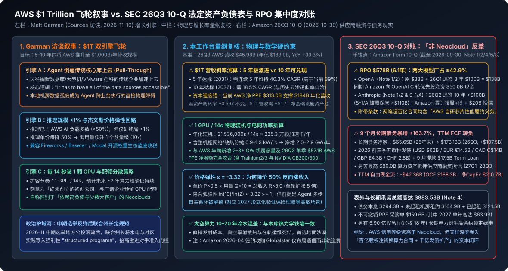
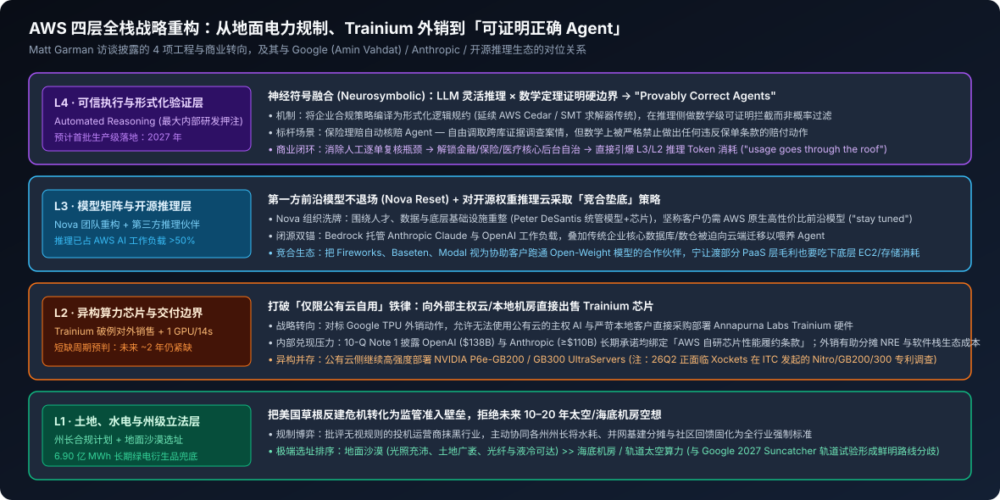

# AWS CEO Matt Garman 深度访谈（Sources）：5–10 年冲击万亿美元营收、每 14 秒装一卡、推理尚不足 1% 与形式化验证 Agent

2026-11-10 · Matt Garman (AWS) · Sources 专访 × 26Q3 10-Q · 待云端同步

[本地原件归档](../../../raw/83e000a76fbd20771a0c788b78be5fd556e854897a2c5c823b613716c06c555d) · 固定材料版本 `digest-material-83e000a76fbd20771a0c788b78be5fd556e854897a2c5c823b613716c06c555d@1` · [一手原站](https://sources.news/p/aws-ceo-matt-garman-1-trillion) · [触发线索（Sources (Alex Heath)）](https://www.youtube.com/watch?v=1C_MErgk2Z0)

> [!IMPORTANT]
> 用户关注点（TG）：看看这个访谈：

## 针对性追查与回应

### 口径与利益披露：西雅图专访背后的政治公关与资本叙事

- 受访嘉宾场景与利益相关（Matt Garman，Amazon Web Services Chief Executive Officer / AWS CEO）：Garman 于 2005 年暑期以西北大学 Kellogg MBA 实习生身份加入 Amazon，2006 年出任 EC2 首位产品经理，历任计算服务副总裁与全球销售及营销高级副总裁，2024 年 6 月接掌 AWS。本次播客单集（YouTube 视频标题 *AWS CEO Matt Garman on building a \$1 trillion business*，官方配套文章标题 *Amazon AWS CEO: AI boom is just getting started*）于 2026 年 11 月 6 日周五在西雅图当面录制（Recorded in Seattle on Friday, 2026-11-06），恰逢两个高度敏感的时点交汇——其一，11 月 3 日美国中期选举刚落幕，多地候选人以反对数据中心扩张作为竞选纲领，选民在地方公投中压倒性支持限制条款；其二，Amazon 刚于 10 月 30 日递交 2026Q3 Form 10-Q，披露合并 TTM 自由现金流转负至 -423.57 亿美元、全年资本开支指引逼近 2,200 亿美元、长期债务净额在 9 个月内激增 163.7%。Garman 此时出面受访，核心商业诉求有四：① 向各州州长释放合作信号，将水电与社区合规标准转化为抬高激进竞争对手准入门槛的州级规制；② 用「5–10 年冲击 1 万亿美元（\$1 trillion）年营收」与「推理尚不足终局 1%」的远期空间对冲华尔街对巨额折旧的焦虑；③ 淡化 Amazon 内部 Nova 大模型团队高管动荡，重申第一方前沿模型决心并为破例对外出售 Trainium 芯片定调；④ 将 AWS 塑造成客户高度分散的稳健基础设施底座，与依赖高息债务和少数大客户的 Neoclouds 做风险切割。
- 主持人背景与栏目商业模式（Host & Author: Alex Heath，*Sources* 创始人）：前 *The Verge* 副主编兼旗舰通讯 *Command Line* 主笔，2025 年 9 月独立创办聚焦 AI 产业竞速的调查通讯与播客（Podcast）*Sources*（Heath Media LLC，同步分发于官方站点 sources.news、YouTube @sourcespod、Spotify 与 Apple Podcasts），依靠 VIP 付费订阅及科技企业赞助变现（首季冠名赞助商为 Mercury、Granola、Atlassian，本期单集插播广告为将 AI Answers 引入 Yahoo Search 的 Yahoo Scout）。栏目核心竞争力在于密集获取硅谷一线掌门人（此前刚对话 Google CEO Sundar Pichai 探讨太空算力）的当面交锋与独家表态，在议题设置（Episode highlights）上天然偏好放大巨头间的路线分歧与万亿级规模叙事。
- 原件边界说明：*Sources* 官方站点（Official Canonical Source URL: `https://sources.news/p/aws-ceo-matt-garman-1-trillion`）公开发布了主持人撰写的西雅图专访实录与核心原话摘录，但未附带总时长 3,170.6 秒（Duration 52m 51s）音视频的逐字时间轴字幕（接口字段 transcription: null），且触发渠道（Trigger Channel URL）YouTube 与 Substack 音频流端点受反爬验证门禁限制；以下拆解严格锚定官方发表的专访实录与直接引语，并逐项拉通 Amazon 2026Q3 Form 10-Q（CIK 0001018724，2026-10-30 披露） 及本工作台既有档案进行交叉对账。

---

### 一、中期选举反建浪潮、州长合规同盟与「地面沙漠 vs 太空轨道」选址决断

1. 草根公投反弹后的「合规筑墙」策略：
   - 面对 2026 年 11 月中期选举中各州选民在地方公投（local referendums）里大比例投票限制数据中心扩张的政治现实，Garman 开篇即做行业切割，直言部分吹嘘无视地方监管的数据中心开发商败坏了全行业名声，强调 "All data center producers are not created equal"（并非所有数据中心建设者都一视同仁）。
   - 当被追问行业必须做出何种实质改变时，Garman 披露 AWS 正主动与美国各州州长（governors）合作，推动将 Amazon 在电力获取、水资源保护与社区回馈上的内部标准，转化为所有运营商都必须遵守的「更结构化的强制项目」（more structured programs），试图在给地方社区更优补偿条款的前提下保住扩产审批通道。
   - ✅ 本工作台核查（政治经济学与跨区域规制对账）：Garman 的表态与本库在分布式计算赛道追踪的全球机房规制收紧完全咬合。2026 年美国中期选举期间涉数据中心竞选广告支出突破 3.8 亿美元，得州农村选区因 ERCOT 孤网成本分摊与县级无分区规划权引发保守派选民倒戈，孟菲斯更于 2026 年 10 月 20 日出台 135 天新数据中心冻结令；海外市场同样如此——新加坡 IMDA 绿算路线图以 PUE <= 1.3 硬门槛按配额审批 300 MW 增量，马来西亚柔佛州自 2025 年 7 月起将高压数据中心电价上调 10%–15% 并收紧工业供水审批。AWS 联合州长立规的本质是典型的「龙头监管俘获」：拥有 6.90 亿 MWh（加权剩余期限 18 年，据 26Q3 10-Q Note 4 披露）长期可再生能源电力衍生品合约与雄厚社区公关预算的超大规模云厂，完全承受得起严苛的水电与并网配套门槛，而赶工期的中小投机开发商与高杠杆 Neocloud 将被州级强制合规直接清出局。

2. 正面否定 Sundar Pichai 的太空数据中心时间表，首选地面沙漠：
   - 针对主持人此前专访 Google CEO Sundar Pichai 时热议的「太空轨道数据中心」（如 Google 计划 2027 年发射试验星的 Project Suncatcher 及 SpaceX 轨道算力构想），Garman 明确给出冷水温差：受制于发射入轨经济性（economics）与散热、维护等工程现实挑战（practical challenges），将大规模数据中心搬上太空在未来「10 到 20 年」（another decade or two）内都遥不可及；在各类非常规选址替代方案中，他明确倾向于地面沙漠（deserts）。
   - ✅ 本工作台核查（热力学第一性原理与 10-Q 并购侧面印证）：Garman 的工程判断与本库《StarMind AI1 太空算力热力学与发射质量终极铁墙》的定量复核结论高度一致。在真空轨道环境中，算力卫星完全丧失空气对流与蒸发冷却，只能依赖斯蒂芬-玻尔兹曼定律（$q = \varepsilon \sigma T^4$）通过大面积展开式辐射板向深空排热；即便按马斯克激进的去重甲化与双面刀锋氨相变辐射板（1,300–1,400 W/m²）测算，受限于 HBM4 显存 85°C–95°C 结温刷新墙与 20–25K 回路传热温差，单 GW 轨道算力干重仍高达 1.0–1.33 万吨，折合需连续发射 67–133 发 满载星舰，且面临低轨地球红外热回流（~180 W/m²）与微陨石击穿冷却回路的致命风险。反观地面沙漠，土地连片、光伏辐照度极高，且可直接铺设地下万兆光缆与闭式干冷/零液体排放（ZLD）水循环系统。更值得玩味的是，Amazon 2026Q3 10-Q Note 4 披露公司刚于 2026 年 4 月 13 日签署最终合并协议收购卫星运营商 Globalstar, Inc.（对价为每股 \$90.00 现金或 0.3210 股 Amazon 普通股，现金比例上限 40%）——这证明 Amazon 并非忽视商业航天，而是极为清醒地将近地轨道资产严格限定于「广域通信连接」，拒绝为违背近中期热力学账本的太空机房买单。

---

### 二、冲击 1 万亿美元 年营收的双引擎飞轮：Agent 如何倒逼传统数据库搬出地下室

1. 不只是新增 AI 账单，而是靠 Agent 撬动沉睡十年的传统核心系统迁移：
   - Amazon 管理层认为 AWS 有望在未来 5 到 10 年内成长为年营收 1 万亿美元（\$1 trillion）的业务。Garman 给出的核心产业洞察并非单纯累加模型训练与 Token 账单，而是指出：AI Agent 正在加速传统旧云业务（older cloud business）的二次爆发。
   - 过去十余年里，大量跨国企业虽然将前端网页与边缘应用搬上了公有云，却始终把核心关系型数据库、大型机账本与内部数仓留在自建机房（on-premises），因为维持现状并不妨碍日常运转；但当企业试图部署跨部门自主工作的 AI Agent 时，Garman 一针见血地指出："It has to have all of the data sources accessible"（Agent 必须能够打通访问所有数据源）。留在本地机房的数据孤岛瞬间从「可容忍的历史包袱」变成「阻塞 Agent 干活的硬障碍」，迫使原先搁置核心系统迁移项目的企业董事会全面提速上云。
   - ✅ 本工作台核查（与 Google Amin Vahdat 访谈交叉印证）：这一机制与本库归档的 Google AI 基础设施负责人 Amin Vahdat 深度访谈形成直接互证——Vahdat 从集群遥测侧观察到，多步推理与企业 Agent 的铺开非但没有让传统计算萎缩，反而以远超预期的斜率同步拉爆了通用 CPU、低延迟存储与东西向网络带宽需求。AWS 作为全球存量企业数据库（Aurora / Redshift / DynamoDB）与对象存储（S3）份额最大的底座，正是这波「为喂养 Agent 而搬迁核心数据资产」浪潮的最大受益者。

2. ⚠️ 本工作台测算与复核（\$1 Trillion 增长斜率与资产周转率硬约束）：
   - 调取 Amazon 2026Q3 Form 10-Q（Note 8 分部报告）：AWS 2026Q3 单季净销售额为 459.84 亿美元（同比加速增长 39.3%，2025Q3 为 330.06 亿美元；2026 前三季度累计营收 1,258.03 亿美元，同比增长 35.1%），折合当前年化营收运行率（Annualized Run Rate）为 1,839.36 亿美元；2026Q3 单季营业利润达 177.73 亿美元（营业利润率高达 38.65%，同比大增 55.4%）。
   - 以 1,839.36 亿美元 年化基数倒推 10,000 亿美元 目标的复合年均增长率（CAGR）：
     - 5 年达标情景（2031 年）：需连续 5 年维持 40.3% 的复合年增速（$(1000 / 183.936)^{1/5} - 1 = 40.32\%$）。这意味着在近两千亿美元体量之上，未来五年平均增速必须比当前 AI 算力最紧缺季度的 39.3% 还要高出 1 个百分点，受限于北美与欧洲变电站并网排队周期（3–5 年）及全球先进封装产能，5 年达标属于典型的管理层上限愿景。
     - 10 年达标情景（2036 年）：所需复合年增速降至 18.5%（$(1000 / 183.936)^{1/10} - 1 = 18.46\%$），在全球 IT 支出约 80%–85% 仍驻留本地机房的存量替代空间下具备工程与财务可实现性。
   - 重资产周转率校验：10-Q Note 8 显示，AWS 分部净物业与设备（Property and equipment, net）已从 2025 年底的 1,900.55 亿美元 猛增至 2026 年 9 月 30 日的 3,130.09 亿美元（仅 2026Q3 单季 AWS 分部净增 PPE 即达 571.16 亿美元，前三季累计净增 1,472.36 亿美元）。当前 AWS 年化营收与分部净 PPE 之比约为 0.59x（即每投入 1 美元 净硬件与机房资产支撑约 0.59 美元 年收入）。若软件与高毛利 PaaS 层无法显著抬升资产周转率，支撑 1 万亿美元 年营收意味着 AWS 账面需常年维持 1.5 万亿–1.7 万亿美元 级别的净算力基础设施资产池。

---

### 三、「每 14 秒装 1 颗 GPU」与算力配给学：穿透「非 Neocloud」叙事下的千亿债务与客户集中度

1. 物理装卡速度复核与「为尚未诞生的初创公司留卡」：
   - Garman 披露 AWS 目前正以 每 14 秒新增 1 颗 GPU（adding one GPU every 14 seconds） 的速度扩容，但即便如此，他预计算力产能短缺仍将持续约两年（another couple of years）。在稀缺算力的分配优先级上，他拒绝把全部增量锁死给极少数超大型训练客户，而是刻意为广谱企业及「尚未创立的初创公司」（startups that haven't been founded yet）预留配额，并借此强调 AWS 的风险结构根本不同于「依赖高额债务与屈指可数几个大客户」（dependent on debt and a handful of large customers）的新兴算力云（Neoclouds）。
   - ✅ 本工作台测算（装机节奏与机房功率量纲复核）：一年共 31,536,000 秒，按每 14 秒 上线 1 颗加速卡计算，折合年化净增装机量约为 225.26 万颗 加速芯片/年（涵盖 NVIDIA P6e-GB200 / GB300 UltraServers 及自研 Trainium2/3）。按单颗前沿加速卡含宿主机 CPU、光模块互连及液冷/配电损耗（PUE 1.15–1.20）综合分摊功率 0.9–1.3 kW 推算，对应每年需新增并网投运 2.0–2.9 GW 智算中心电力容量；按单 GW 全栈基础设施造价 350 亿–500 亿美元 计，年化资本消耗约 800 亿–1,350 亿美元，与 AWS 前三季 1,472.36 亿美元 的分部 PPE 净增额在物理与财务量纲上严丝合缝。

2. ⚠️ 本工作台核查（10-Q 法定附注穿透：AWS 真的没有大客户集中与债务依赖吗？）：
   - 将 Garman「不同于依赖债务与少数大客户的对手」的访谈话术与 Amazon 2026Q3 Form 10-Q（Note 1、Note 2、Note 4、Note 5） 逐行对账，可以发现两处被公关叙事刻意隐去的硬核财务事实：

| 核查维度 | Garman 访谈定性表述 | Amazon 2026Q3 Form 10-Q 法定披露实况（截至 2026-09-30） | 本工作台对账结论 |
| :--- | :--- | :--- | :--- |
| 积压订单（RPO）客户集中度 | 强调客户多元分散、为未成立初创企业留配额，区别于绑定少数大客户的算力商 | AWS 在手 RPO 总额 5,780 亿美元（加权剩余期限 6.1 年）。但 Note 1 披露：① OpenAI 于 26Q1 在原 380 亿美元 基础上追签 8 年 1,000 亿美元，合计 1,380 亿美元；② Anthropic 于 26Q2 追签 10 年 >1,000 亿美元（据 Anthropic 2026-11-10 S-1/A 披露最低承诺 >=1,100 亿美元）。仅此两家模型厂即占 AWS 全部 RPO 的 >=42.9%（>=2,480 亿美元）。 | ⚠️ 增量高度集中 |
| 供应商股权输血闭环 | 未提及大额算力订单背后的股权与授信对价 | Note 2 披露：① 2026Q1–Q3 Amazon 分三笔向 OpenAI C 轮优先股注资 500 亿美元 现金（\$15.0B + \$13.7B + \$21.3B）；② 对 Anthropic 除累计股权/可转债持仓（账面公允价值达 2,387 亿美元）外，另签 200 亿美元 里程碑信贷额度（已提 50 亿美元，余 150 亿美元）。 | ⚠️ 典型资本换订单闭环 |
| 自研芯片对赌条款 | 仅谈客户需要多元选择与外部销售 | Note 1 明确注明：OpenAI 与 Anthropic 的超百亿美元长期采购承诺均附带 「与 AWS 芯片性能相关的合同履约义务」（contractual obligations related to the performance of AWS chips）。 | ⚠️ 潜藏硬件交付违约风险 |
| 资产负债表与杠杆扩张 | 暗讽竞争对手依赖债务（dependent on debt）扩张 | 合并现金 CapEx 26Q3 单季达 772.59 亿美元（TTM 达 2,151.92 亿美元），致 TTM 自由现金流转负至 -423.57 亿美元。长期债务净额 9 个月内由 656.48 亿美元 暴增 +163.7% 至 1,731.25 亿美元——前三季横跨 USD（620 亿美元）、EUR（145 亿欧元）、CAD（140 亿加元）、GBP（43 亿英镑）、CHF（28 亿瑞郎）五币种发债，9 月提款 175 亿美元 Term Loan，并新签最高 800 亿美元 算力资产抵押供应商融资授信（Loan Facility，27Q1–28Q3）；表内外合同总承诺达 8,835.81 亿美元。 | ⚠️ 主体信用虽优，增量同样重度举债 |

   - 穿透定性：与本库此前核查的 ING 折价抛售 5 亿美元 Project Jupiter / Stargate 项目级债务相比，AWS 的优势在于拥有年经营现金流 1,683 亿美元 的零售与存量公有云母体兜底，无需靠垃圾债利率做单项目融资；但从增量现金流结构看，Amazon 同样在以「单年超千亿美元跨币种举债 + 设备抵押贷款 + 向头部模型厂注资数百亿美元换取十年算力包销」的重资本模式狂奔，并非置身于杠杆周期之外。

---

### 四、推理尚不足终局 1%：杰文斯价格弹性回路与开源权重推理云的「垫底竞合」

1. 推理已过半壁江山，但距离终局仍处 <1% 起跑线：
   - Garman 透露，模型运行即推理（inference）目前已占 AWS AI 工作负载的大多数（majority，即 >50%）；但当被问及推理市场演进到了哪个阶段时，他的判断是："I don't think it's even 1%"（我认为连终局规模的 1% 都还不到）。
   - 支撑这一判断的核心微观经济学经验法则是 Garman 披露的实测价格弹性：推理单价每下降 50%，客户调用量就会激增一个数量级（10x，an order of magnitude more usage），推动总营收持续净增长。
   - ✅ 本工作台推断与复核（需求价格弧弹性量纲校验）：设初始单价为 $P_0$、调用量为 $Q_0$，单价腰斩至 $0.5 P_0$ 后调用量放大至 $10 Q_0$，则单轮降价后的总收入 $R_1 = 0.5 P_0 \times 10 Q_0 = 5.0 R_0$（净扩大 5 倍），对应对数弧弹性绝对值 $|\varepsilon| = \ln(10) / \ln(2) \approx 3.32 \gg 1$。这一强杰文斯悖论（Jevons Paradox）在单次问答向多步长程 Agent 切换期完全成立：当百万 Token 推理成本从 \$15 跌破 \$0.5 时，原本因成本过高被锁死的代码库全量扫描、7×24 小时日志自治巡检与多分支蒙特卡洛规划同时跨过盈亏平衡线。但需清醒看到，10x 弹性存在物理饱和阈值——一旦企业核心工作流完成首轮 Agent 化渗透，弹性系数终将向常规云计算的 1.2–1.8 收敛。

2. 为何主动拥抱与自身抢生意的 Fireworks、Baseten 与 Modal：
   - 在推理服务生态上，Garman 明确把 Fireworks、Baseten 与 Modal 视为帮助客户使用开源权重模型（open-weight models）的合作伙伴（partners），哪怕这些平台在模型托管与 Serverless 推理层直接与 AWS SageMaker / Bedrock 构成竞争。他的底层准则是：无论客户上层选哪家模型或哪套推理框架，都要让 AWS 成为垫在最底层的必选基础设施。
   - 本工作台交叉对账：结合本库在《Meta 收购 Conductor 与多智能体沙盒演进》中对 Modal（自研 Rust 容器运行时与极速冷启动 GPU 池）、Cloudflare 与 Akamai 的拆解，开发者在调用 DeepSeek、Qwen 或 Llama 等开源权重模型时，极度看重毫秒级扩缩容与算子级量化调优体验，传统公有云原生控制台往往响应笨重。Garman 的算盘非常务实：与其强推自有 PaaS 把高增长 AI 原生团队逼向 CoreWeave 或自建裸金属，不如向 Fireworks、Baseten、Modal 批发底层 EC2 GPU 实例、S3 数据湖与私有网络带宽——守住高粘性的「数据重力 + 算力批发收税权」。

---

### 五、Nova 大模型重整旗鼓与 Trainium 自研芯片破例对外出售

1. 回应 Nova 团队洗牌：第一方前沿模型绝不退场：
   - 针对外界高度关注的 Amazon Nova 模型团队架构重整与高层变动（原 AGI 负责人 Rohit Prasad 离任、Adept 联创 David Luan 离职，由老将 Peter DeSantis 统合模型、自研芯片与量子计算），Alex Heath 直接发问这是否意味着 Amazon 正从自研前沿模型（frontier models）战略后撤。Garman 予以正面否认："We're just as invested in that strategy as we've ever been"（我们在该战略上的投入力度一如既往），将此次调整定性为吸取早期路径教训后围绕人才、数据与底层基础设施（talent, data, and infrastructure）的系统性重构，坚称客户在第三方头部模型之外依然需要 AWS 原生打造的前沿模型，并留下一句 "stay tuned"。
   - 本工作台推断：结合本库归档的 Anthropic S-1/A 路演披露（Claude 占企业级高价值编码与复杂推理心智高地，但推理毛利率与定价高企），AWS 保留第一方 Nova 系列的真正战略价值并非在极限奥赛题上击败 Claude 或 GPT，而是提供一颗深度针对自家 Trainium / Inferentia 指令集协同编译、单 Token 成本极低的第一方主力模型，防止在推理占比超 50% 的时代沦为纯粹替 OpenAI 和 Anthropic 打工的「低毛利机房房东」。

2. 打破公有云围墙：决定向 AWS 外部直接出售 Trainium 芯片：
   - 访谈确认了一项重大硬件商业模式转向——AWS 决定将自研 Trainium 芯片对外销售（sell Trainium chips outside AWS），允许客户在 AWS 公有云之外的本地数据中心或主权云环境中直接部署（与近期 Google 开放对外销售 TPU 的动作正面对位）。
   - ⚠️ 本工作台核查与推断（三重工程与财务动因）：
     - 争夺主权 AI 与强监管本地留存市场：国防、主权基金及部分欧洲/中东国家级智算中心严禁核心权重与公民数据出境上公有云；过去这部分硬件预算 100% 流向 NVIDIA 与 AMD，开放外销使 Annapurna Labs 得以切入非公有云硬件池。
     - 分摊先进制程流片成本并催熟 Neuron 软件栈：3nm 世代（Trainium3）掩膜、HBM3e/HBM4 采购保底与编译器研发的固定摊销极高，同时 10-Q Note 1 暴露 OpenAI（\$138B）与 Anthropic（>=\$110B）两大合同均嵌有「AWS 芯片性能履约条款」；只有尽可能扩大外部真实开发者的算子踩坑面，才能填平 AWS Neuron SDK 与 NVIDIA CUDA 之间的软件生态鸿沟。
     - 对冲第三方硬件专利与供应链摩擦：26Q3 10-Q Note 4 法律诉讼附注披露，Xockets, Inc. 已于 2026 年 5–6 月向美国国际贸易委员会（ITC）提起调查并申请禁令救济，指控 AWS Nitro 系统及搭载 NVIDIA 芯片的 EC2 P6e-GB200 UltraServers、GB300 服务器侵犯其 DPU 数据路径专利。加速自主可控的 Trainium 全栈内外双循环，亦是降低外部供应链与知识产权掣肘的关键后手。

---

### 六、最大内部研发押注：形式化自动推理与 2027「可证明正确 Agent」

1. 用数学定理证明给概率大模型套上硬边界（Provably Correct Agents）：
   - 访谈收官部分披露了 Garman 最看重的差异化技术底牌：他将自动推理（Automated Reasoning，即基于数学逻辑与形式化验证的符号系统）定性为 「大概是 Amazon 目前规模最大的内部研发投资」（probably Amazon's biggest internal research investment）。
   - 工程架构上，AWS 试图将形式化自动推理与生成式大模型深度耦合，打造「可证明正确的智能体」（provably correct agents）——让 Agent 在处理复杂开放任务时保持大模型的灵活检索与推理能力，但在执行决策边界上受到数学定理证明级的刚性约束，从机制上杜绝违反预设规则的可能。
   - 标杆落地场景与时间表：Garman 给出的具体生产案例是保险理赔处理（processing an insurance claim）——Agent 可以自主调阅事故材料、核查保单细则并完成案情调查，但形式化验证护栏会在数学上严格阻止它做出任何违背既定核赔政策的赔付决定，从而把目前企业不敢放手、必须靠人工逐单复核的后台流程彻底自动化。他预计明年（2027 年）就将看到首批生产级部署落地，并直言其背后的算力变现逻辑："If you do unlock that, the usage suddenly goes through the roof even more."（一旦真正打通这一步，算力调用量将再次迎来爆发式跃升）。

2. ⚠️ 本工作台推断（形式化验证的「语义接地缺口」工程复核）：
   - AWS 在形式化验证领域确有深厚家底（由 Byron Cook 领衔的 Automated Reasoning Group 长期用 SMT 求解器与定理证明验证 S3/IAM 权限安全性，并开源了策略语言 Cedar 与 Rust 验证器 Kani，此前亦已在 Bedrock Guardrails 中推出 Automated Reasoning Checks 预览）。
   - 但从计算机科学边界审视，「数学上可证明正确」存在一道绕不开的「形式化规约与感知接地鸿沟」（Specification & Grounding Gap）：定理证明器只能 100% 保证「如果输入状态满足符号变量 $X$，则输出动作绝不违背逻辑公式 $\Phi$」；然而在真实保险理赔中，把模糊的非结构化病历、定损照片或争议责任认定翻译成符号变量 $X$ 的那一步，依然由具备幻觉率的神经网络完成。如果前端感知把「免责条款中的既往症」误提取为「突发外伤」，后端的数学证明哪怕再严密也会得出错误的合规模板放行结论。因此本工作台判断：2027 年「可证明正确 Agent」将率先在输入输出高度结构化、规则边界清晰可枚举的场景（如云权限变更、结构化保单条款核验、金融合规风控规则引擎、标准化代码重构验证）率先跑通放量，而难以一步跨越非结构化现实世界的语义歧义墙。

---

### 观点与可反驳条件

- ==观点==：AWS 依托「企业为跑通 Agent 被迫将本地遗留核心数据库搬上公有云」的结构性拉力，在 10 年维度（约 18.5% CAGR）迈向 1 万亿美元 年营收具备坚实的产业底座，且对太空算力泡沫的冷峻拒绝展现了成熟基础设施龙头的物理常识；但 Garman 在访谈中淡化了 AWS 增量订单对「股权输血换算力包销」与千亿级跨币种举债的高度依赖（OpenAI 与 Anthropic 两家即占 \$578B RPO 超 42.9%）。未来 18–24 个月决定 AWS 资本回报率（ROIC）能否跑赢折旧洪峰的核心胜负手，在于自研 Trainium 芯片能否兑现两大模型厂合同中的性能履约条款，以及 2027 年形式化验证 Agent 能否真正打穿金融保险等高监管企业生产流以接力推理消耗。
- ==推翻条件==：
  ① RPO 兑现与自研芯片性能条款证伪：若 2027–2028 年间 Amazon 10-Q/10-K 披露 OpenAI（\$138B）或 Anthropic（>=\$110B）因 Trainium3/4 集群有效算力利用率（MFU）或 Neuron 软件栈不达标而触发合同中的「AWS 芯片性能履约条款」豁免/削减承诺额，或 AWS 分部季度同比增速在 2027 年底前跌破 22%，则「5–10 年冲击万亿美元且风险优于 Neocloud」的增长逻辑被证伪。
  ② 企业遗留数据库迁移与形式化验证 Agent 商业化证伪：若 2027 年 AWS 推出的「可证明正确 Agent」（Automated Reasoning Guardrails）在保险、银行等受监管行业因非结构化数据接地误判率过高而停留在 PoC 试点阶段，未能带动传统关系型数据库/数仓迁移提速，导致 AWS 推理与核心云收入无法覆盖单年超 2,000 亿美元 级别的资本开支，使 Amazon 合并 TTM 自由现金流连续 8 个季度深陷负值区间（低于 -200 亿美元），则「Agent 解锁推理百倍弹性并自我造血」的飞轮假设失效。
  ③ 外部出售 Trainium 市场接受度证伪：若至 2028 年中，AWS 对外销售 Trainium 硬件未能拿下至少 3 个百兆瓦（>=100 MW）或十亿美元级外部主权云/大型政企本地部署订单，则说明脱离 AWS 托管服务与股权绑定的纯自研芯片在开放市场上仍无法抗衡 NVIDIA CUDA 与 Google TPU 的生态壁垒。

---

## 原文摘录与一手信源存证

> Episode Title (YouTube / Podcast): AWS CEO Matt Garman on building a \$1 trillion business Official Companion Post Title (Sources): Amazon AWS CEO: AI boom is just getting started Subtitle: Amazon’s cloud chief on the politics of building data centers, the future of inference, and making AI agents follow the rules.
> — 原文摘录，文字段落 1；证据 `digest-material-83e000a76fbd20771a0c788b78be5fd556e854897a2c5c823b613716c06c555d-excerpt-1@1`

> Matt Garman says data center operators who boast about ignoring regulations have given the industry a bad name.
> — 原文摘录，文字段落 2；证据 `digest-material-83e000a76fbd20771a0c788b78be5fd556e854897a2c5c823b613716c06c555d-excerpt-2@1`

> “All data center producers are not created equal,” the AWS CEO tells me.
> — 原文摘录，文字段落 3；证据 `digest-material-83e000a76fbd20771a0c788b78be5fd556e854897a2c5c823b613716c06c555d-excerpt-3@1`

一手材料：

- Amazon AWS CEO: AI boom is just getting started (Sources Podcast: AWS CEO Matt Garman on building a \$1 trillion business) · Sources (Alex Heath) × Matt Garman (AWS CEO) · [原站](https://sources.news/p/aws-ceo-matt-garman-1-trillion) · [主体档案：Alex Heath](../entities/people/Alex%20Heath.md) / [主体档案：Matt Garman](../entities/people/Matt%20Garman.md) / [主体档案：Amazon Web Services (AWS)](../entities/companies/Amazon%20Web%20Services%20%28AWS%29.md) · [待上传原件](../../../raw/9b85f45eb80d2a530cbb3c2ac4b7100bc0ea34bb206ace7d546c5988b362a166)
  材料版本 `digest-material-9b85f45eb80d2a530cbb3c2ac4b7100bc0ea34bb206ace7d546c5988b362a166@2`；获取方式 `http_full_text`。
  > Amazon’s cloud chief on the politics of building data centers, the future of inference, and making AI agents follow the rules. — 原文提取
  > Matt Garman says data center operators who boast about ignoring regulations have given the industry a bad name. — 原文提取
- Amazon.com, Inc. Form 10-Q for the Quarterly Period Ended September 30, 2026 · Amazon.com, Inc. (SEC EDGAR CIK 0001018724) · [原站](https://www.sec.gov/Archives/edgar/data/1018724/000101872426000040/amzn-20260930.htm) · [主体档案：Amazon Web Services (AWS)](../entities/companies/Amazon%20Web%20Services%20%28AWS%29.md) · [待上传原件](../../../raw/3c54beb3da72e7db6efdd1d5aa0e571666a896b0d9126a704667c4a005804aee)
  材料版本 `digest-material-3c54beb3da72e7db6efdd1d5aa0e571666a896b0d9126a704667c4a005804aee@2`；获取方式 `http_full_text`。
  > For the transition period from            to             . — 原文提取
  > Indicate by check mark whether the registrant has submitted electronically every Interactive Data File required to be submitted pursuant to Rule 405 of Regulation S-T during the preceding 12 months (or for such shorter period that the registrant was required to submit such files). — 原文提取

归属与范围：主访谈内容归属于 Sources 主理人 Alex Heath 于 2026-11-10 发布的西雅图当面专访实录及 AWS CEO Matt Garman 本人表态（视角与管理层口径，未经独立审计）；所有分部营收、营业利润、资本开支、自由现金流、五币种债务明细及 OpenAI/Anthropic 积压订单（RPO）与注资数据均锚定 Amazon.com, Inc. 2026Q3 Form 10-Q 法定披露；增长率倒推、装机功率换算与形式化验证语义接地边界均显式标注为本工作台测算或推断。

来源缺口：

- `unavailable`：Sources 官网（sources.news/p/aws-ceo-matt-garman-1-trillion）仅公开发布主持人 Alex Heath 撰写的西雅图专访核心实录与直接引语，未提供 52 分 51 秒音视频的完整时间轴逐字稿（API 字段 transcription 为 null），且 YouTube 视频页与 Substack 音频流分发端点受反机器人验证门禁限制；本条目严格以官方配套文字实录与 SEC 10-Q 原件为引用边界，不猜测未刊出的口语细节。 [线索](https://sources.news/p/aws-ceo-matt-garman-1-trillion)
- `not_disclosed`：Amazon 2026Q3 Form 10-Q 与本次访谈均未披露 AWS 纯 AI 工作负载（训练 vs 推理）的精确美元收入拆分、Trainium 芯片向 AWS 公有云外部客户直接销售的定价/毛利率与首批签约主权云名单，以及 OpenAI（\$138B）与 Anthropic（\>=\$110B）长期采购合同中『AWS 自研芯片性能履约义务』的具体算力/能效考核阈值。 [线索](https://www.sec.gov/Archives/edgar/data/1018724/000101872426000040/amzn-20260930.htm)

[返回赛道总览](../赛道总览.md#digest-83e000a76fbd2077) · [返回导读索引](README.md) · [主体档案库](../entities/README.md)
