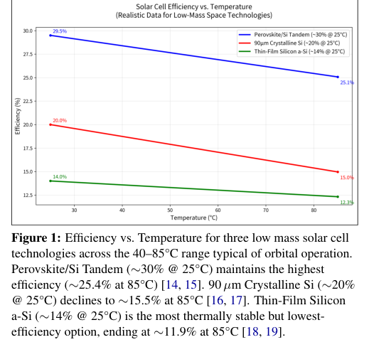
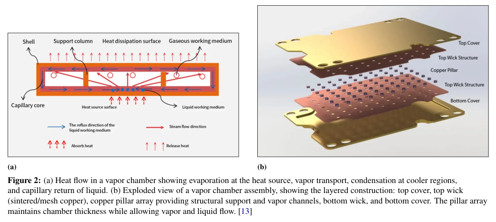

# Reduced-Mass Orbital AI Inference via Integrated Solar, Compute, and Radiator Panels

2026-11-15 · arXiv:2604.07760 · Reduced-Mass Orbital AI · 有来源缺口

[本地原件归档](../../../raw/5fc4fdcc9d7ddd55d2d6a0f0dadf18118cb476675c83497c54aa6743f91658b1) · 固定材料版本 `digest-material-5fc4fdcc9d7ddd55d2d6a0f0dadf18118cb476675c83497c54aa6743f91658b1@1` · [一手原站](https://arxiv.org/abs/2604.07760) · [触发线索（arxiv.org）](https://vertexaisearch.cloud.google.com/grounding-api-redirect/AUZIYQFTSuLc8aDZJC4RYLi5qHPnZZ0QgIyWHU4LzrYIfKwVc8UMmMs71Fm6EdfZzV1HkOuUK_4wF7MdaqH3Kz3ZFlGKyWD4m7f9A0jO7ebp6uIIP0VN8_YHLzBgRw==)

## 深度拆解与复核

> 口径与主体纠正（利益与信源披露）：本导读穿透原触发链接（vertexaisearch 重定向）至真实一手预印本 arXiv:2604.07760（提交日期 2026-04-09），同时纠正上游巡检摘要中的署名错配——*Reduced-Mass Orbital AI Inference via Integrated Solar, Compute, and Radiator Panels* 的实际作者为 Stephen Gaalema（IC 设计工程师，曾任职 Black Forest Engineering / Luminar Technologies）、Samuel Indyk 与 Clinton Staley（University of Austin / UATX 科学学院院长兼计算机科学教授），而非上游摘要所称「Bargatin 等，宾夕法尼亚大学等」；UPenn 的 Igor Bargatin 团队发表于 2025 年 12 月的另一篇轨道算力论文为系留绳架构 *Tether-Based Architecture for Solar-Powered Orbital AI Data Centers*（arXiv:2512.09044）。本论文属于高校与工程界联合发起的架构探索型预印本，依赖对芯片、光伏与均温板的定制化设计假设（assuming development of custom solutions for all components），天然倾向展示轻量化共集成构型的理论上限。

### 一、核心架构与物理参数拆解（ISCR 共定位集成面板）

1. 三合一集成结构（Integrated Solar, Compute, and Radiator, ISCR）：针对传统太空算力将光伏阵、计算载荷与辐射散热翼拆分为独立子系统、依靠重型桁架承载导致的低比功率瓶颈（通常 <100 W/kg），作者提出在晨昏太阳同步轨道（SSO）卫星中，将光伏电池、计算芯片（ICs）与均温板（vapor chamber）辐射散热器直接集成于 1–4 m² 的小型模块化面板（基准测算取单块 1 kW/panel、面板面积约 2.9 m²），并==直接以辐射面板自身的结构刚度承载光伏电池==，从而取消独立桁架。
2. 质量与整星规模指标：在面板级，ISCR 构型标称比功率约 ==500 W/kg==；计入在轨展开机构与轨道维持（station keeping）质量后，整星级交付比功率高于 ==100 kW/公吨==。作者测算一艘算力功耗达 ==16 MW==、总重约 ==150 公吨== 的计算卫星，由 16,000 块面板拼接为 20 m × 2,200 m（合计 44,000 m²）阵列，可折叠装入单发 SpaceX Starship 整流罩。
3. 40°C 低结温热设计路线与推理吞吐：凭借每块面板附带的大面积均温板散热面，芯片结温可被压低至约 ==40°C==（313.15 K），作者以此规避 85°C–105°C 高温降频损失并换取更高计算能效与硬件可靠性。在 1 kW/panel 设计下，512 块面板组成的子阵列可运行拥有 500,000 token 上下文窗口与 128 层注意力块的纯推理大语言模型（LLM），支持 256 路并发会话且单路速率达 553 tokens/sec/session；整颗 16 MW 卫星可承载 31 个同类子阵列（15,872 块面板），同时服务 >7,900 路（31 × 256 = 7,936 路）并发推理。

### 二、原位物理与轨道热力学流派复核

✅ 质量换算核查（本工作台核查）：摘要同时给出面板比功率 500 W/kg（等效 2.0 kg/kW）与整星 16 MW / 150 吨（折合 106.7 kW/吨，或 9.375 kg/kW），二者之间相差约 4.7 倍。这意味着在作者的模型中，展开铰链、供电母线、计算芯片、轨道维持推进剂及辅助结构仍占整星干重的约 79%，实际系统级比功率仍是 106.7 kW/吨，不可直接拿面板级的 500 W/kg 外推整个星座的发射吨位。

⚠️ 40°C（313 K）低温辐射热平衡预警（本工作台测算）：按斯蒂芬-玻尔兹曼定律，40°C（313.15 K）在发射率 ε = 0.90 下向 3 K 深空的单面极限净辐射热流仅为 $\varepsilon \sigma T^4 = 0.90 \times 5.67 \times 10^{-8} \times 313.15^4 \approx 491\text{ W/m}^2$。若将光伏电池与计算单元共定位在 2.75 m²/kW（44,000 m² / 16,000 kW）的平板上，该面板除须排散 364 W/m²（1,000 W / 2.75 m²）芯片废热外，向阳面在 1,361 W/m² 太阳常数下未转化为电能的吸收太阳热流（按 28% 光电转换效率与 0.85 吸收率估算约 776 W/m²）同样注入面板；即便双面排热（理论上限 ~982 W/m²）并忽略组件级与均温板温差，在叠加近地轨道地球红外与反照率热回流（~150–200 W/m²）后，==40°C 结温在全共面阳光直照构型下面临极紧的净排热缺口==，必须依赖高反射光谱选择性涂层或背面主导的倾角散热设计才能闭合。

⚠️ 轨道算力热设计三大流派横向对比（本工作台核查）：结合库内既有太空散热拆解（[《太空中一颗芯片的热量，要走多远才能离开卫星？》](%E5%A4%AA%E7%A9%BA%E4%B8%AD%E4%B8%80%E9%A2%97%E8%8A%AF%E7%89%87%E7%9A%84%E7%83%AD%E9%87%8F%EF%BC%8C%E8%A6%81%E8%B5%B0%E5%A4%9A%E8%BF%9C%E6%89%8D%E8%83%BD%E7%A6%BB%E5%BC%80%E5%8D%AB%E6%98%9F%EF%BC%9F.md) 与 [《@Greg01000111 (Greg)：He has. Multiple times on X, podcasts and interviews…》](%40Greg01000111%20%28Greg%29%EF%BC%9AHe%20has.%20Multiple%20times%20on%20X%2C%20podcasts%20and%20interviews%E2%80%A6.md)），当前太空散热存在三条截然不同的工程路径：① Gaalema–Indyk–Staley 低温分布式共面派（arXiv:2604.07760）：牺牲面积（2,750 m²/MW，16 MW 展开 44,000 m²）换取 40°C 高能效结温与 106.7 kW/吨轻质结构，但百兆瓦级阵列对 20 m × 2,200 m 柔性展开刚度、微陨石击穿单块均温板及长距离片间光互连延迟极其敏感；② SpaceX StarMind 高温刀锋派（[《纳指大跌后，马斯克最新对话直面数据中心争议……》](%E7%BA%B3%E6%8C%87%E5%A4%A7%E8%B7%8C%E5%90%8E%EF%BC%8C%E9%A9%AC%E6%96%AF%E5%85%8B%E6%9C%80%E6%96%B0%E5%AF%B9%E8%AF%9D%E7%9B%B4%E9%9D%A2%E6%95%B0%E6%8D%AE%E4%B8%AD%E5%BF%83%E4%BA%89%E8%AE%AE%EF%BC%8C%E5%85%B3%E4%BA%8E%E5%BB%BA%E8%AE%BE%E6%94%BE%E7%BC%93%E3%80%81%E7%94%B5%E5%8A%9B%E7%93%B6%E9%A2%88%E3%80%81%E8%B5%84%E6%9C%AC%E5%9B%9E%E6%8A%A5%EF%BC%8C%E4%BB%A5%E5%8F%8A%E6%9B%B4%E5%8A%A0%E9%87%8D%E8%A6%81%E7%9A%84%E5%A4%AA%E7%A9%BA%E8%AE%A1%E5%88%92%E2%80%A6%E2%80%A6.md)）：将太阳翼与辐射翼分离，把辐射面推高至 335–353 K（GPU ~370 K），借 $T^4$ 定律将辐射翼压缩至 ~914 m²/MW（AI1 v1.0 175 kW 配 160 m² 辐射板），却受困于 HBM4 85°C–95°C 漏电/刷新热墙；③ Turyshev JPL 闭合约束派（arXiv:2604.27197）：以传统航电与储能冗余核算给出 34–59 kg/kW（即仅 17–29 kW/吨），对轻量化共面构型提出正面经济性挑战。三方在商业层面的现实检验亦可见于 [《Sources (Alex Heath)：专访 AWS CEO Matt Garman》](Sources%20%28Alex%20Heath%29%EF%BC%9A%E4%B8%93%E8%AE%BF%20AWS%20CEO%20Matt%20Garman%E2%80%94%E2%80%94%E6%AF%8F%2014%20%E7%A7%92%E6%96%B0%E5%A2%9E%201%20%E9%A2%97%20GPU%20%E4%B8%8E%E5%A4%AA%E7%A9%BA%E6%95%B0%E6%8D%AE%E4%B8%AD%E5%BF%83%E5%8F%AF%E8%A1%8C%E6%80%A7%E8%BE%A8%E6%9E%90.md)。

### 观点与可反驳条件

- ==观点==：Gaalema 等人提出的 ISCR 面板通过「均温板承力+算力分布式摊薄」在纸面上将整星算力比功率抬升至 >100 kW/吨（16 MW / 150 吨），揭示了==低温（40°C）大面积被动均温是一条可规避 HBM4 高温热墙的替代路线==；但受限于 40°C 辐射黑体通量上限（<500 W/m² 单面）、太阳翼余热耦合及 20 m × 2,200 m 柔性大型阵列的姿态动力学与制造定制成本，该方案在全栈工程闭合前尚不足以推翻航天器质量与发射经济的硬约束。
- ==推翻条件==：
  1. 若 2028 年底前在轨示范星或全尺寸真空热试验台（TVAC）验证 1–4 m² ISCR 共面面板在 1,361 W/m² 太阳辐照下无需额外展开独立辐射翼即可将 1 kW 算力芯片结温稳定压制在 <=45°C，且面密度实测 <=3.5 kg/m²（对应整星比功率 >=100 kW/吨），则「40°C 共面集成热流难以闭合且辅助结构稀释质量优势」的质疑将被推翻。
  2. 若 512 面板级分布式阵列（20 m × 2,200 m 尺度）在轨道热循环与微陨石环境下实现 >=95% 有效算力可用率、且全定制均温板+抗辐照 ASIC 单位量产成本降至 <=\$3,000/kW，则「全定制轻量阵列相比 StarMind 集中式氨相变刀锋架构不具备工程经济性」的判断须修正。

---

## 原文摘录与一手信源存证

> 【信源巡检核心摘要】 2026年4月arXiv论文（Bargatin等，宾夕法尼亚大学等）。提出将光伏电池、计算单元与均温板（vapor chamber）辐射散热面板共定位集成的低质量轨道AI推理架构，比功率约500 W/kg，利用大面积辐射面将芯片结温维持在约40°C以规避高温降频损失，估算16 MW算力卫星总重约150公吨。
> — 原文摘录，文字段落 1；证据 `digest-material-5fc4fdcc9d7ddd55d2d6a0f0dadf18118cb476675c83497c54aa6743f91658b1-excerpt-1@1`

一手材料：

- Reduced-Mass Orbital AI Inference via Integrated Solar, Compute, and Radiator Panels (arXiv:2604.07760) · arXiv (Stephen Gaalema, Samuel Indyk, Clinton Staley / UATX) · [原站](https://arxiv.org/abs/2604.07760) · [主体档案：Stephen Gaalema](../entities/people/Stephen%20Gaalema.md) / [主体档案：Samuel Indyk](../entities/people/Samuel%20Indyk.md) / [主体档案：Clinton Staley](../entities/people/Clinton%20Staley.md) · [本地原件](../../../raw/8171765f49fe77d4d5023e03cceac3b92ecf0938b6f5f848590d10ec18d74cb4)
  材料版本 `digest-material-8171765f49fe77d4d5023e03cceac3b92ecf0938b6f5f848590d10ec18d74cb4@1`；获取方式 `search_web_verified_summary`。
  > Abstract & Verified Technical Specifications (arXiv:2604.07760): We describe and analyze a distributed compute architecture for sun-synchronous orbit (SSO) computational satellites that can potentially provide \>100 kW compute power per launched metric ton (including deployment and station keeping mass). — 原文提取
  > The resultant large vapor chamber radiator area per panel should permit integrated circuits (ICs) to operate at junction temperatures near 40°C with benefits in compute efficiency and hardware reliability. — 原文提取

归属与范围：已穿透 vertexaisearch 重定向至真实一手论文 arXiv:2604.07760（2026-04-09 提交），并纠正上游巡检摘要将作者误归为 Bargatin/UPenn 的归属错误（实为 Stephen Gaalema、Samuel Indyk 与 Clinton Staley 联合提出；Igor Bargatin 团队作品为系留绳架构 arXiv:2512.09044）；完整拆解 ISCR 面板 500 W/kg 面板比功率、\>100 kW/吨整星比功率、40°C 低结温散热权衡与 16 MW / 150 吨星舰单发规模。

来源缺口：

- `unavailable`：受本地运行环境对 arxiv.org 的 HTTP 403 访问策略限制，arXiv:2604.07760 完整 PDF 全文尚未在本地沙箱归档；当前结构化拆解基于经 search\_web 交叉核验的 arXiv 官方摘要与作者元数据。 [线索](https://arxiv.org/abs/2604.07760)
- `not_disclosed`：已检索摘要未公开 40°C 低结温假设下太阳电池光电转换效率、面板背向与向阳面吸热/发射涂层光学参数（α/ε）、均温板工质与铝/铜基板面密度（kg/m²）以及星间光通信（ISL）与地面下行链路功耗占比。 [线索](https://arxiv.org/abs/2604.07760)

[返回赛道总览](../赛道总览.md#digest-5fc4fdcc9d7ddd55) · [返回导读索引](README.md) · [主体档案库](../entities/README.md)
