
# Revising Down Accelerator Demand and Shipment Outlook; Nvidia Bears the Brunt (SemiAnalysis Accelerator Model Update)

2026-11-13 · SemiAnalysis · 有来源缺口

[本地原件归档](../../../raw/58d10bf4e878d844843388507a45180d60bfd83245bd6707e6cb7863198241dc) · 固定材料版本 `digest-material-58d10bf4e878d844843388507a45180d60bfd83245bd6707e6cb7863198241dc@1` · [一手原站](https://semianalysis.com/institutional/revising-down-accelerator-demand-and-shipment-outlook-nvidia-bears-the-brunt/)

> [!IMPORTANT]
> 用户关注点（TG）：收录这个

## 针对性追查与回应

- ==核心结论==：SemiAnalysis（Myron Xie、Ivan Chiam，2026-11-13）在《Accelerator Model Update》中全面下修 2027–2030E 全球 AI 加速卡资本开支与新增功耗预测：名义加速卡资本开支在 2027E/2028E/2029E/2030E 分别下修 19% / 28% / 41% / 40%（2028E 由 \$1,054B 降至 \$758B，2030E 由 \$1,531B 降至 \$923B），新增算力功耗 2030E 下修 34%（由 122.8 GW 降至 80.7 GW，主要削减落在 2028–2030 年）。==但下修绝非全行业均匀承压，而是按「perf/TCO 与 perf/W 排序 × 资产负债表融资叠加层（Financing Overlay）」发生剧烈非对称洗牌==：Nvidia 承担绝大部分下修冲击（2027E–2030E 计算营收砍 22% / 39% / 56% / 66%、综合功耗砍 14% / 35% / 50% / 59%，且 Feynman 世代起下压毛利率致 ASPs 暴降 29.3%–44.2%）；Broadcom 凭借高性价比定制 ASIC 与全案债权融资兜底能力，2026–2030 汇总 ASIC 营收仅降 11%（主力源自 HBM 降价传导而非实体砍单）；MediaTek 则受制于 EMIB-T 良率与融资短板被重砍 Triggerfish 生命周期销量 42%；AMD GPUs 靠 Meta/OpenAI 认股权证护体且 MI400/MI450-MC 提前至 4Q26 放量；Amazon Trainium 2027–2028 保持零下修。
- ==场景与利益披露==：本材料为独立第三方付费行业研究（SemiAnalysis LLC，role=lens/independent_research，非 Financial Industry Regulatory Authority 或 Securities Investor Protection Corporation 成员，亦非向 U.S. Securities and Exchange Commission 注册之投资顾问或经纪商），依据 2026-11-13 对比 2026-11-02 版专有 Accelerator & HBM Model（含配套 AI Cloud & TCO Model SKU / NON-SKU 与 Datacenter Model）输出修订结论，不构成法定审计披露。报告第 15–17 页《Analyst Certifications》《Investment Activities and Conflicts of Interest》《ETF and Regulatory Status Disclaimer》显式披露利益相关边界：作者及附属风投/私募实体可能直接或间接持有文中提及公司的公开或私募头寸，亦可能参与指数或 ETFs 研究合作；报告第 18–19 页另列明机构研究团队（含 Doug OLaughlin、Dylan Patel、Daniel Nishball、Clara Ee、Sravan Kundojjala、Oliver Kennon、Ellie Holbrook、Chaim Eisenberg 等）及三篇关联研报——《ARR Is Not Enough to Sustain the Full Buildout // The Q3 ARR Slowdown, Blue Wave, and Credit Freeze Shift Demand Right; Resetting Our GW and ARR Forecasts》（Joey Brookhart、Oliver Kennon 等，2026-11-10）、《Shengyi Quality Issues Trigger Reshuffle in Nvidia's NVSwitch CCL Supply Chain》（Tony Chien，2026-11-09）与《US Midterm Impact: How the Blue Wave Hits the Datacenter Buildout: AI Trade Down but Not Out》（2026-11-04）。同时，报告对 Broadcom、Google TPU、AMD GPUs 竞争力及 Nvidia GPUs 远期降价幅度的排序高度依赖专有模型参数与主观假设。
- 关联主体与跨库互证：[主体档案：SemiAnalysis](../entities/companies/SemiAnalysis.md) · [前日追踪：Nvidia and the World Without Jensen](Nvidia%20and%20the%20World%20Without%20Jensen.md) · [泡沫周期对照：What the Dot-Com Crash Teaches Us About AI Infrastructure (with Mike Volpi)](What%20the%20Dot-Com%20Crash%20Teaches%20Us%20About%20AI%20Infrastructure%20%28with%20Mike%20Volpi%29.md) · [Anthropic Form S-1/A（IPO 定价 \$70–\$78，代码 ANT）](Anthropic%2C%20PBC%20%E5%90%91%20SEC%20%E6%8F%90%E4%BA%A4%20Form%20S-1_A%20%E7%AC%AC%E4%BA%8C%E6%AC%A1%E4%BF%AE%E8%AE%A2%E7%89%88%EF%BC%88IPO%20%E5%AE%9A%E4%BB%B7%20%2470%E2%80%93%2478%EF%BC%8C%E4%BB%A3%E7%A0%81%20ANT%EF%BC%89.md) · [Anthropic IPO 路演纪要与 PPT](../../AI%E4%BA%A7%E4%B8%9A%E4%B8%8E%E5%95%86%E4%B8%9A/blogs/Anthropic%20%E8%B7%AF%E6%BC%94%E7%BA%AA%E8%A6%81%E5%85%A8%E6%96%87%2BPPT.md) · [Barclays《AI CDS》信贷研究导读](../../%E5%AE%8F%E8%A7%82%E4%B8%8E%E9%87%91%E8%9E%8D/blogs/2008%E5%86%8D%E7%8E%B0%EF%BC%81%E4%B8%80%E6%96%87%E8%AF%BB%E6%87%82%E5%8D%8E%E5%B0%94%E8%A1%97%E6%9C%80%E7%83%AD%E9%97%A8%E4%BA%A4%E6%98%93%EF%BC%9AAI%20CDS.md)

---

### 一、三大下修动因与「名义支出 vs 硅片出货 / HBM 位需求」劈叉机制

#### 1. 宏观与信贷三重下修动因

1. 前沿实验室 Token 营收重置（Q3 净新增 ARR 放缓）：受 2026 Q3 前沿实验室净新增 ARR 增速回落影响（详见姊妹报告《ARR Is Not Enough to Sustain the Full Buildout》），SemiAnalysis 下调新增算力供给增速以匹配下游营收对总计算成本的可持续覆盖；作者虽称对高 ROI 部署仍较市场共识乐观，但承认二级与一级资本市场平均预期决定基建融资上限。
2. 资本市场债股双紧、去超大规模云厂背书项目收缩：股权与债权投资者明显收紧对 AI 资本开支的投放偏好，尤其是缺少超大规模云厂（hyperscaler）长期承购（offtake）的项目（对应《Trouble in Paradise: Framing the AI Debt Market》），直接压低非云厂背书数据中心的土地、电力与壳体（shell）开发量，收窄系统部署电力池。
3. 美国中期选举「Blue Wave」与监管延后：中期选举结果把原计划于 2H27–1H28 投产的 5.8 GW 美国数据中心（US DC）电力供给向外推迟（对应《Elections Post-Mortem: SpaceX in Pain, 5.8GW Delayed》与《US Midterm Impact: How the Blue Wave Hits the Datacenter Buildout》），叠加监管审批推迟压低 2028 年机房总容量；作者明确强调，前两项商业 ARR 与信贷动因远比选举监管因素更具主导性。

#### 2. 名义资本开支下修与 HBM 价格通缩传导

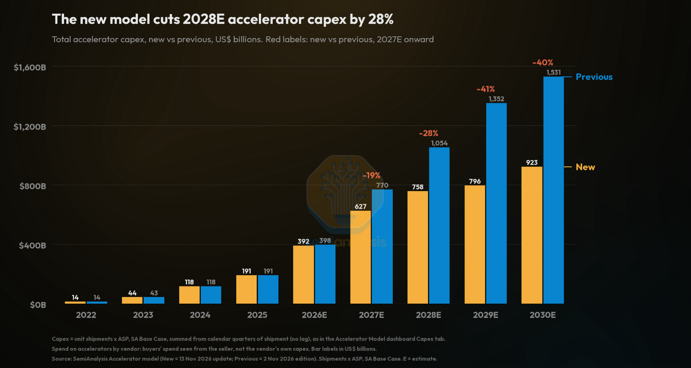

图 1 展示了按「出货量 × ASP」口径核算的全球加速卡卖方收入（Capex = unit shipments × ASP，即买方采购支出）：2022–2025 年基数基本锁定于 \$14B（前 \$14B）、\$44B（前 \$43B）、\$118B、\$191B，2026E 微调至 \$392B（前 \$398B）；真正的劈叉从 2027E 起逐年放大——2027E 由 \$770B 降至 \$627B（-19%），2028E 由 \$1,054B 降至 \$758B（-28%），2029E 由 \$1,352B 降至 \$796B（-41%），2030E 由 \$1,531B 降至 \$923B（-40%）。

正文特别指出，名义支出大幅下修并非纯由物理出货坍塌引起，很大一部分来自供应链供需重新平衡后的「价格通缩回归常态」——2027 年原预测支出攀升本就由存储涨价推高，如今伴随配套《Memory Model Update》下调 HBM 单价并传导至各款加速卡 BOM 成本（叠加 Nvidia Feynman 世代起下调毛利率加成），名义美元跌幅明显深于硅片物理出货跌幅。

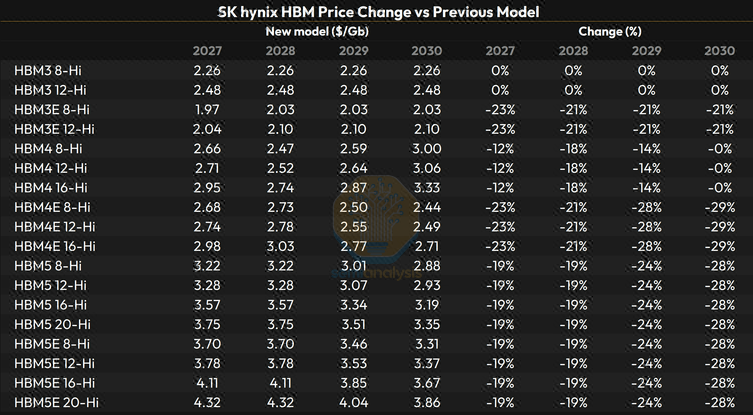

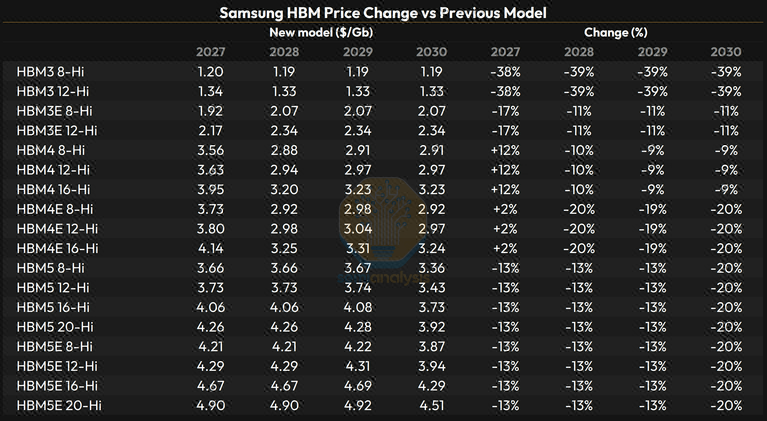

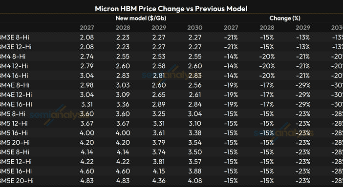

从图 2 至图 4 实读三大原厂 2027–2030 年 HBM 单价（\$/Gb）修订幅度，可见清晰的分代与分厂分化：

- SK hynix（图 2）：HBM3（8-Hi \$2.26/Gb、12-Hi \$2.48/Gb）维持 0% 不变；HBM3E 8-Hi/12-Hi 下调 21%–23% 至 \$1.97–\$2.10/Gb；主力 HBM4 8-Hi/12-Hi/16-Hi 在 2027–2029 年分别下调 12% / 18% / 14%（2028 年分别降至 \$2.47 / \$2.52 / \$2.74/Gb，2030 年回归 -0%）；HBM4E 与 HBM5/5E 分别大幅下修 21%–29% 与 19%–28%（如 HBM5 12-Hi 由 2027 年 \$3.28/Gb 阶梯降至 2030 年 \$2.93/Gb，HBM5E 20-Hi 2030 年降至 \$3.86/Gb）。
- Samsung（图 3）：旧制程 HBM3 8-Hi/12-Hi 重砍 38%–39% 至 \$1.19–\$1.34/Gb，HBM3E 降 11%–17%；但 2027 年 HBM4（8/12/16-Hi）逆势上修 +12%（达 \$3.56 / \$3.63 / \$3.95/Gb）、HBM4E 小幅上调 +2%，随后 2028–2030 年重新下调 9%–20%（HBM5/5E 全线降 13%–20%）。
- Micron（图 4）：HBM3E 8-Hi/12-Hi 在 2027–2030 年新版单价为 \$2.08 / \$2.23 / \$2.27 / \$2.27/Gb（2027–2029 年分别降 21% / 15% / 13%）；HBM4 8-Hi/12-Hi/16-Hi 在 2027–2029 年降 14% / 20% / 21%（2028 年分别降至 \$2.55 / \$2.60 / \$2.83/Gb）；HBM4E 与 HBM5/5E 在 2027–2029 年分别降 17%–29% 与 15%–23%（注：PDF 原图左缘微裁，且最右列 2030 年变动百分比末位数字裁切，未对被裁切数字做主观补全）。

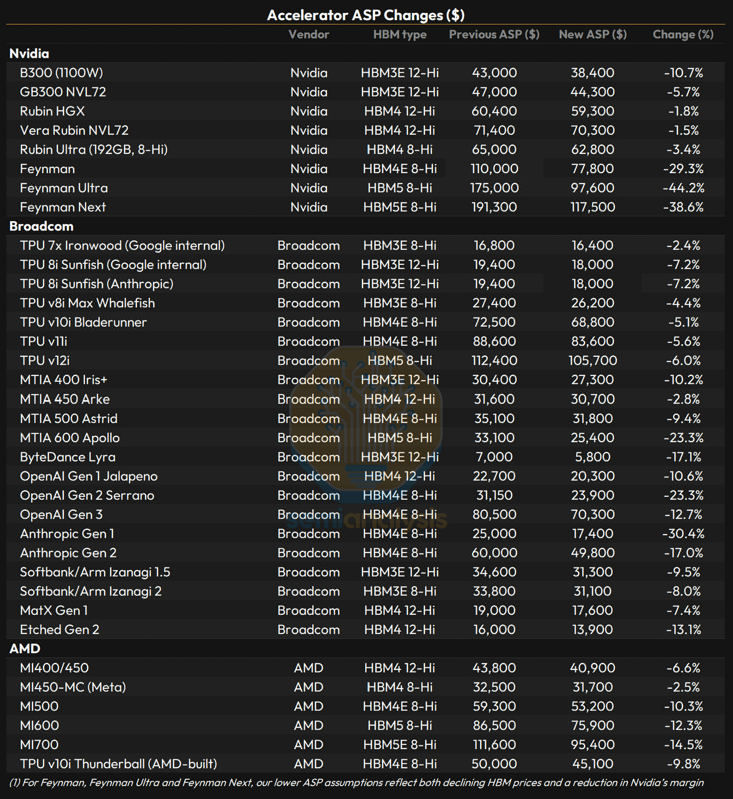

将 HBM 降价传导叠加竞争性降价后，图 5 揭示出三大芯片阵营截然不同的 ASP 命运：Nvidia 当前主力 Blackwell 与 Rubin 仅做温和小修——B300 (1100W) 由 \$43,000 降至 \$38,400（-10.7%）、GB300 NVL72 由 \$47,000 降至 \$44,300（-5.7%）、Rubin HGX 由 \$60,400 降至 \$59,300（-1.8%）、Vera Rubin NVL72 由 \$71,400 降至 \$70,300（-1.5%）、Rubin Ultra (192GB, 8-Hi) 由 \$65,000 降至 \$62,800（-3.4%）；但从 Feynman 世代开始出现断崖式下修，图注（1）明确归因为「HBM 成本下降 + 主动压降 Nvidia 毛利率」：Feynman（HBM4E 8-Hi）由 \$110,000 砍至 \$77,800（-29.3%）、Feynman Ultra（HBM5 8-Hi）由 \$175,000 暴砍至 \$97,600（-44.2%）、Feynman Next（HBM5E 8-Hi）由 \$191,300 砍至 \$117,500（-38.6%）。反观 Broadcom 阵营，Google 内部及 Anthropic TPU 7x Ironwood（\$16,800→\$16,400，-2.4%）、TPU 8i Sunfish（\$19,400→\$18,000，-7.2%）、TPU v8i Max Whalefish（\$27,400→\$26,200，-4.4%）、TPU v10i Bladerunner（\$72,500→\$68,800，-5.1%）、TPU v11i（\$88,600→\$83,600，-5.6%）、TPU v12i（\$112,400→\$105,700，-6.0%）降幅均收敛在 2.4%–7.2%，仅 OpenAI Gen 2 Serrano（\$31,150→\$23,900，-23.3%）、Anthropic Gen 1（\$25,000→\$17,400，-30.4%）与 MTIA 600 Apollo（\$33,100→\$25,400，-23.3%）等新代际降幅超 20%（其余如 OAI Gen 1 Jalapeno \$20,300 降 10.6%、OAI Gen 3 \$70,300 降 12.7%、Anthropic Gen 2 \$49,800 降 17.0%、ByteDance Lyra \$5,800 降 17.1%、MatX Gen 1 \$17,600 降 7.4%、Etched Gen 2 \$13,900 降 13.1%、Softbank/Arm Izanagi 1.5/2 分别降至 \$31,300 与 \$31,100）。AMD 阵营 MI400/450（\$40,900，-6.6%）、MI450-MC (Meta)（\$31,700，-2.5%）、MI500（\$53,200，-10.3%）、MI600（\$75,900，-12.3%）、MI700（\$95,400，-14.5%）及 AMD 代工 TPU v10i Thunderball（\$45,100，-9.8%）亦随存储通缩同步下移。

#### 3. 物理硅面积、HBM 位需求与电力约束下的功耗收敛

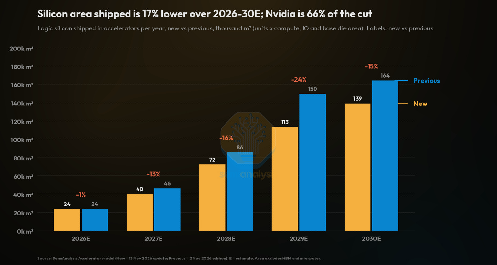

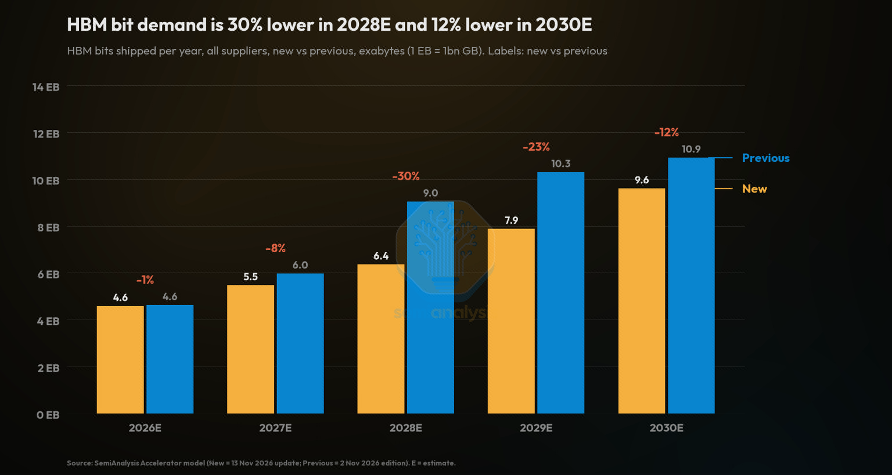

图 6 与图 7 从物理层验证了「量稳于价」的核心命题：2026–2030E 逻辑硅片出货面积（compute、IO 与 base die 之和）合计下修 17%，其中 Nvidia 独自占全部削减量的 66%；但分年绝对面积仍由 2026E 24k m²（前 24k，-1%）、2027E 40k m²（前 46k，-13%）、2028E 72k m²（前 86k，-16%）、2029E 113k m²（前 150k，-24%）稳步扩张至 2030E 139k m²（前 164k，-15%），五年物理硅片吞吐仍增长近 5.8 倍。同期 HBM 位需求（图 7）在 2026E 为 4.6 EB（-1%）、2027E 5.5 EB（前 6.0 EB，-8%）、2028E 6.4 EB（前 9.0 EB，-30%）、2029E 7.9 EB（前 10.3 EB，-23%）、2030E 9.6 EB（前 10.9 EB，-12%）——2030 年 HBM 位需求仅比前版低 12%，远小于名义资本开支 40% 的砍幅。

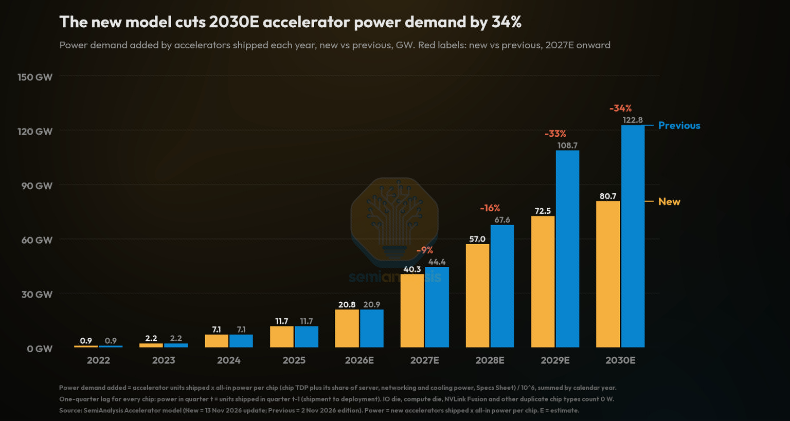

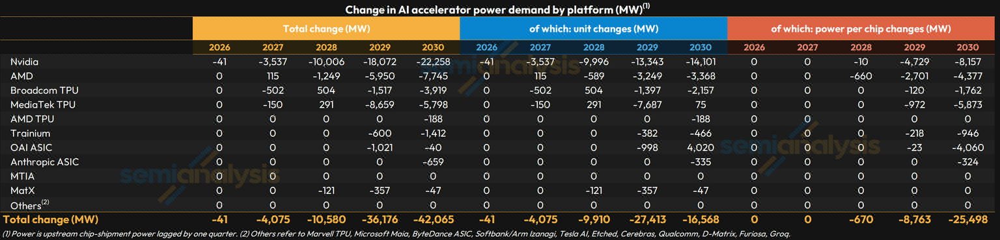

- ✅ 本工作台核查（GW 与 MW 跨表量纲校验）：对照图 8（新增电力需求，滞后芯片出货 1 季度部署）与图 9（分平台 MW 变动表），2026E–2030E 新版预测分别为 20.8 / 40.3 / 57.0 / 72.5 / 80.7 GW（前版 20.9 / 44.4 / 67.6 / 108.7 / 122.8 GW），下修幅度为 2027E -9%、2028E -16%、2029E -33%、2030E -34%。四年对应差额 -4.1 / -10.6 / -36.2 / -42.1 GW 与图 9 底部加总 -4,075 / -10,580 / -36,176 / -42,065 MW 精确吻合。尤为关键的是图 9 揭示的 2030 年结构逆转：在 2030 年总共 -42,065 MW 削减中，芯片出货量减少仅贡献 -16,568 MW（占 39.4%），而「下调单芯片最高功耗假设」贡献高达 -25,498 MW（占 60.6%）。这源于电网与电源仍是硬约束，SemiAnalysis 预计芯片厂将主动收敛 2029–2030 世代单颗 TDP/系统功耗上限，从而使装机规模匹配 Datacenter Model 修订后的全球（不含中国）2027–2029 年可用电力上限。

---

### 二、五大算力平台非对称洗牌：perf/W 排序与资产负债表融资叠加层

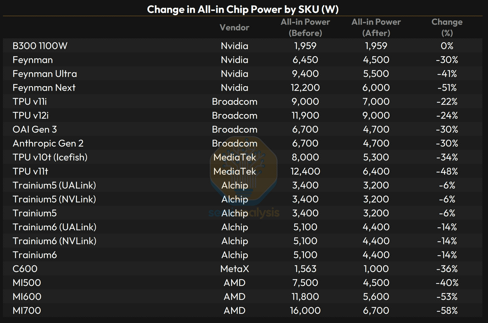

图 10 量化了单颗芯片系统功耗上限的剧烈重设：Nvidia B300 1100W 保持 1,959 W（0%）不变，但 Feynman 由 6,450 W 降至 4,500 W（-30%）、Feynman Ultra 由 9,400 W 降至 5,500 W（-41%）、Feynman Next 由 12,200 W 暴砍至 6,000 W（-51%）；AMD MI500（7,500→4,500 W，-40%）、MI600（11,800→5,600 W，-53%）、MI700（16,000→6,700 W，-58%）砍幅更深；Broadcom TPU v11i（9,000→7,000 W，-22%）、TPU v12i（11,900→9,000 W，-24%）、OAI Gen 3 与 Anthropic Gen 2（均 6,700→4,700 W，-30%），以及 MediaTek TPU v10t Icefish（8,000→5,300 W，-34%）、TPU v11t（12,400→6,400 W，-48%）全线下压至单卡 4.5–9 kW 级物理上限；Alchip 代工的 Amazon Trainium5（3,400→3,200 W，-6%）与 Trainium6（5,100→4,400 W，-14%，含 UALink/NVLink 变体）因原设定本就节制而变动最小；MetaX C600 由 1,563 W 降至 1,000 W（-36%）。

在总功耗蛋糕收窄后，SemiAnalysis 以「perf/TCO 与 perf/W × 资产负债表融资叠加层（Financing Overlay）」对五大算力平台重新分配份额，形成下表所示的极度非对称洗牌：

| 算力平台 / 供应商 | perf/TCO 与融资叠加层定位 | 2027–2030E 营收/功耗下修幅度 | 近期排产调仓与核心客户博弈细节 |
| :--- | :--- | :--- | :--- |
| Nvidia（GPUs / Groq LPUs / standalone CPUs） | 前沿实验室首选队列外围（most marginal）+ 长尾 Neoclouds 高违约与 RASA Act 合规敞口 | 计算营收砍 22% / 39% / 56% / 66%；综合功耗砍 14% / 35% / 50% / 59%（2027–2030 砍 -3,537 至 -22,258 MW）；Feynman 系列 ASP 降 29.3%–44.2% | 3Q26 约 100k 颗 Vera Rubin 推迟至 4Q26（2026 全年保持 ~980k），3Q 补 ~130k GB300、4Q 削减 ~260k GB300s 与 ~150k H200s；微软 2027 年 Vera Rubin 减 200 机架；Groq LPUs 与 standalone CPUs 同步大砍 |
| Broadcom（TPU / OpenAI / Anthropic / MTIA / MatX） | 顶级 perf/TCO 与 perf/W + 强大资产负债表全案融资兜底（土地/电力/壳体/整机） | 2026–2030 汇总 AI ASIC 营收仅降 11%（主因 HBM 降价传导 ASP）；TPU 功耗 2028 +504 MW、2029/2030 降 -1,517 / -3,919 MW | Anthropic TPU 700 MW（含 Crusoe/Goodnight 275 MW 延后及 Nexus in Hubbard 330 MW 未获许可风险）由 2027 推至 2028；OAI Gen 2 Serrano 2029 砍 1 GW 但 OAI Gen 3 2030 上调 26%–56%；MatX Gen 1 销量砍 70% |
| MediaTek（TPU v8t/v9/v10/v11 / ByteDance） | 2029–2030 Google 内部 TPU 量体仍居首（高于 Broadcom 与 AMD/Marvell），但无债权融资兜底且存在 EMIB-T 良率风险 | TPU v9i (Triggerfish) 生命周期砍 42%；TPU v9t (Humufish) 2028–2029 砍 470k 颗；总营收 3Q28–4Q29 降 9%–36% | 无 HBM 采购业务故变动纯为销量驱动；Triggerfish 原本面向 Anthropic 外销而遭重点削减；TPU v10t (Icefish) 2029 爬坡延后至 2030（+10%–39%）；ByteDance SRAM/HBM ASIC 保持 0% 零改动 |
| AMD（MI 系列 + AMD-built TPU v10i Thunderball） | 靠 Meta/OpenAI 认股权证绑定采购 + Anthropic 优惠定价（推理性价比仅次于 TPU） | 2027E 功耗持平（+115 MW，营收 -11%）；2028E–2030E 功耗降 23% / 55% / 57%，营收降 29% / 35% / 32% | 4Q26 逆势将 ~25k 颗 MI400 与 ~30k 颗 Meta 定制 MI450-MC 从 4Q27 提前拉货（4Q26 GPU 营收上调 +33% 至 \$6.76B）；2030 年单季 GPU 营收仍稳步扩至 \$22.63B |
| Amazon Trainium（Alchip 代工） | 自建数据中心管线稳固 + 制造 BOM 低廉 + Amazon 愿战略补贴 Anthropic/OpenAI | 2027–2028 年出货与功耗零下修（0 MW 变动）；2029/2030 功耗降 -600 / -1,412 MW | 2029 年将 Trainium4 切换至 Trainium5 并延长生命周期至 2030 年，同时放缓 Trainium6 爬坡节奏 |

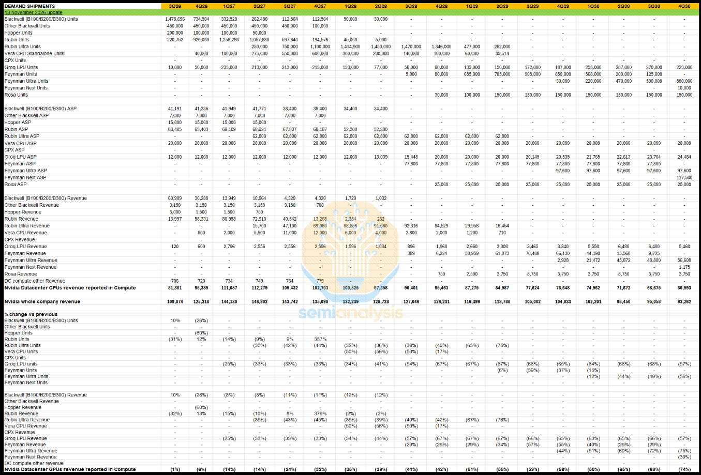

图 11（Nvidia 明细表）显示了这轮重估最残酷的季度曲线：短期 3Q26/4Q26 经 Rubin L6 主板推迟与 GB300/H200 换仓调整后，Nvidia 整体营收分别录得 \$109.07B（表中 109,074 百万美元）与 \$125.32B（125,318 百万美元），Compute GPU 营收为 \$81.88B（-1%）与 \$95.39B（-6%），并于 2Q27 达到全公司单季峰值 \$146.90B（Compute GPU 营收 \$112.28B，已比前版低 14%）。此后曲线出现连续下行：至 4Q30，Compute GPU 单季营收降至 \$66.99B（较前版暴跌 74%），全公司单季营收滑落至 \$93.26B；其间 Groq LPU 2028–2030 年季度出货被砍 34%–68%（2Q28 降至 77k 颗），Vera CPU Standalone 1Q28–4Q28 砍 50% / 56% / 50% / 17%，新增中低端型号 Rosa 则自 4Q28 起按每季 30k–150k 颗（ASP \$25,000）补位。正文同时附注：该模型下调并非针对黄仁勋（Jensen Huang）辞任 CEO 而做，但领导层过渡期无疑放大了份额流失的尾部风险。

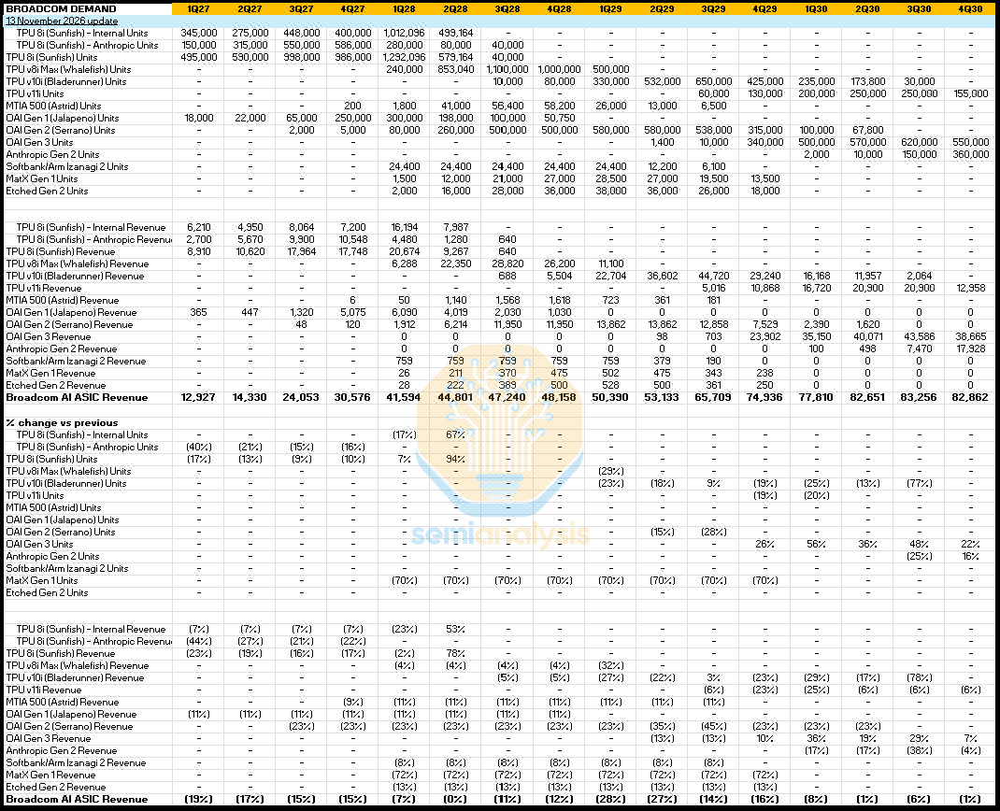

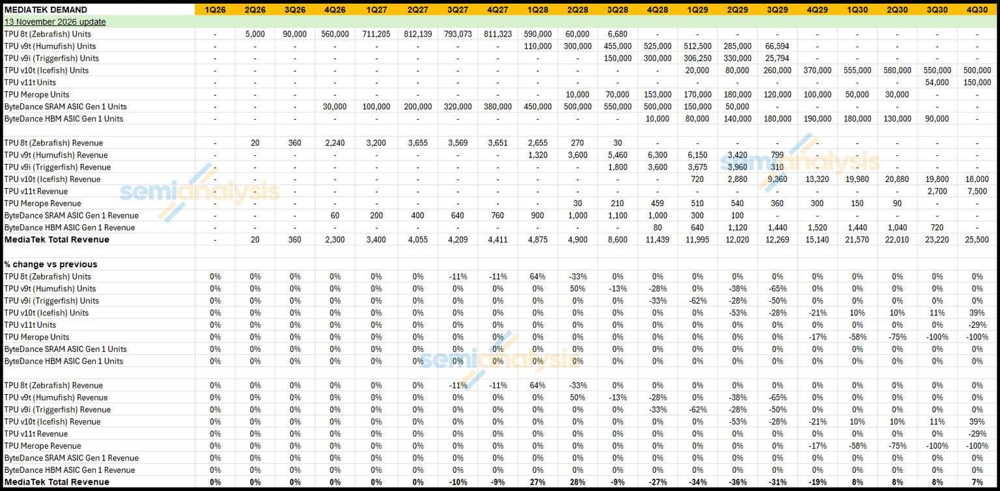

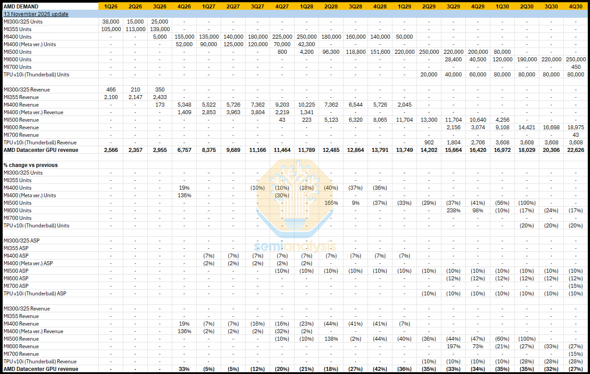

对比图 12 至图 14 可直观看到定制芯片阵营内部的结构迁移：Broadcom（图 12）AI ASIC 单季营收由 1Q27 的 \$12.93B（-19%）一路攀升至 3Q30 的 \$83.26B 与 4Q30 的 \$82.86B（后两年变动率收敛至 -1% 至 -8%），核心托举力量是 OAI Gen 3 在 2030 年放量至单季 500k–620k 颗（营收最高单季 \$43.59B，上调 +22% 至 +56%）以及 Anthropic Gen 2 在 3Q30–4Q30 放量至 150k / 360k 颗；相比之下，MediaTek（图 13）因缺乏对 Anthropic 的全案债务融资工具，Triggerfish 4Q28–3Q29 销量被砍 33% / 62% / 28% / 50%（仅余 300k / 306.25k / 330k / 25.8k 颗），拖累全公司总营收在 4Q28–3Q29 分别下修 27% / 34% / 36% / 31%，直至 2030 年才凭 Icefish 顺延放量回升 +7% 至 +8%（4Q30 单季 \$25.50B）；AMD（图 14）尽管 2028–2030 年长期增速被砍 27%–42%，但受 4Q26 MI400（155k 颗，+19%）与 MI400 Meta 版（52k 颗，+136%）提前拉货以及 2Q29 起量产的 AMD-built TPU v10i Thunderball（2030 年每季 80k 颗、\$3.61B）支撑，单季数据中心 GPU 营收仍保持从 1Q26 \$2.57B 向 4Q30 \$22.63B 的逐年正增长斜率。

---

### 三、跨库实证咬合与独立审视：信贷约束兑现 vs 定制 ASIC 乐观偏差

- ✅ 本工作台核查（与 Anthropic S-1/A 及路演 PPT 的底层先决条件咬合）：本站归档的 [Anthropic Form S-1/A 拆解](Anthropic%2C%20PBC%20%E5%90%91%20SEC%20%E6%8F%90%E4%BA%A4%20Form%20S-1_A%20%E7%AC%AC%E4%BA%8C%E6%AC%A1%E4%BF%AE%E8%AE%A2%E7%89%88%EF%BC%88IPO%20%E5%AE%9A%E4%BB%B7%20%2470%E2%80%93%2478%EF%BC%8C%E4%BB%A3%E7%A0%81%20ANT%EF%BC%89.md) 与 [Anthropic 路演纪要全文+PPT](../../AI%E4%BA%A7%E4%B8%9A%E4%B8%8E%E5%95%86%E4%B8%9A/blogs/Anthropic%20%E8%B7%AF%E6%BC%94%E7%BA%AA%E8%A6%81%E5%85%A8%E6%96%87%2BPPT.md) 从法定招股书端完全印证了 SemiAnalysis 对「电力许可、融资叠加层与 Nvidia 边缘化」的三重判断：其一，Anthropic 至 2045 年 \$8,954 亿算力承诺中多达 \$2,138 亿（23.9%）明确附带对手方项目融资闭合或电网并网先决条件，公司甚至自掏 \$47 亿为开发商提供电力设备担保并斥资 \$34 亿锁定 1.7 GW 卡特彼勒燃机——与本篇披露德州 Crusoe/Goodnight（275 MW 延后）及 Nexus in Hubbard（330 MW 未获许可风险）迫使 700 MW Anthropic TPU 顺延至 2028 年构成精准互证；其二，尽管 Anthropic 首席算力官 Tom Brown 在路演 PPT 第 13 页宣传四大可互换统一算力池，但 S-1/A 真金白银账本显示其 \$1,612 亿主机直租直签 Broadcom、\$1,213 亿+与 \$1,100 亿云承诺分签 Google Cloud 与 AWS，而 Nvidia 除 \$100 亿同步私募及依赖高价 SpaceXAI 短期算力兜底（最高 \$1,205 亿）外并无同等体量直租锁定，坐实本篇对 Nvidia 在其算力栈中「最边缘（most marginal）」的定性；其三，Anthropic 10 月末 ARR 冲至 \$810 亿但 26Q3 仍因高价现货算力转亏 -\$5.67 亿营业利润，印证实验室营收结构对算力降本与上游循环融资（\$260 亿 Class N 私募）的高度敏感。
- ✅ 本工作台核查（与后黄仁勋时代风险及华尔街信贷实况的闭环）：结合前日 [Nvidia and the World Without Jensen](Nvidia%20and%20the%20World%20Without%20Jensen.md) 披露的 Q2 FY27 Form 10-Q 明细，Nvidia 自身表外承诺与担保上限已高达 \$5,305 亿（含 \$360 亿 Neocloud 照付不议与 \$1,085 亿担保上限），若临时 CEO Colette Kress 领导下转向「后乔布斯苹果式」财务保守主义并收紧 Neocloud 信用兜底，恰好与本篇「长尾 Neocloud 融资脆弱性 + RASA Act 封堵中国远程访问（SemiAnalysis 测算此前已累计超 1.5 GW 受限卡绕道入华）」形成直接因果接力。与此同时，[Mike Volpi 互联网泡沫对照导读](What%20the%20Dot-Com%20Crash%20Teaches%20Us%20About%20AI%20Infrastructure%20%28with%20Mike%20Volpi%29.md) 与 [Barclays《AI CDS》信贷研究导读](../../%E5%AE%8F%E8%A7%82%E4%B8%8E%E9%87%91%E8%9E%8D/blogs/2008%E5%86%8D%E7%8E%B0%EF%BC%81%E4%B8%80%E6%96%87%E8%AF%BB%E6%87%82%E5%8D%8E%E5%B0%94%E8%A1%97%E6%9C%80%E7%83%AD%E9%97%A8%E4%BA%A4%E6%98%93%EF%BC%9AAI%20CDS.md) 所记录的二级债券重定价信号——Project Jupiter 银团贷款跌至面值 89–91 美分、CoreWeave 无担保债收益率触及约 15%、10 家核心 AI 发行人以 8% CDX 投资级权重贡献 16% 隐含信贷风险且 CDS 基差转正——证明本篇第二大下修动因并非滞后理论，而是已在信贷市场发生。
- ⚠️ 本工作台推断（模型方法论偏差与单边假设预警）：SemiAnalysis 本次修订在推演链条上存在两处明显向定制 ASIC 与 Broadcom 倾斜的强假设，阅读时须作压力测试：第一，模型将全行业 66% 的硅面积下修及 2030 年单季 GPU 营收 74% 的斩仓几乎全部归由 Nvidia 承担，并把 Feynman Ultra ASP 从 \$175,000 直接腰斩 44.2% 至 \$97,600；同时却假设 Broadcom 2026–2030 营收仅降 11%、且 OpenAI Gen 3 能在 2030 年逆势上调 26%–56% 冲至单季 \$43.59B。这隐含了「定制 ASIC 跨代流片、先进封装良率与多模型软件编译器生态 100% 准时兑现」的完美执行假设——一旦 Serrano/Gen 3 或 Anthropic Gen 2 出现类似 MediaTek EMIB-T 的良率延误，模型向 Nvidia 施加的远期份额与毛利折价存在过度悲观的钟摆风险。第二，报告一面因融资短板将 MediaTek Triggerfish 砍单 42%，一面又承认联发科更低的毛利率带来了更低的全系统总成本；若 Anthropic 凭借 IPO 后超 \$2,160 亿备考现金池自主预付系统款，或 Google 直接为联发科 TPU 方案提供信用背书，该部分砍单具备较强回补弹性。

---

### 观点与可反驳条件

- ==观点==：SemiAnalysis 本轮预测下修准确捕捉到了 2027–2030 年 AI 算力投资从「无上限债务驱动的通用 GPU 军备竞赛」向「电力受限下的 perf/W 与资产负债表融资质量双重筛选」切换的产业拐点，尤其 2030 年功耗砍幅中 60.6% 来自单芯功耗上限收敛而非单纯砍卡，说明物理并网约束将倒逼全行业重塑产品与商业分配格局；但报告将远期份额与毛利率压缩极度集中地押注在 Nvidia 单边失血、同时近乎免除 Broadcom 2030 年代际交付执行风险，其 2029–2030 年 ASIC 对 GPU 的替代斜率更应被视作高斜率情景测试而非既定终局。
- ==推翻条件==：
  1. 向上推翻 Nvidia 份额与毛利压缩假设：若 2027 年至 2028 年上半年 Nvidia 公开季报显示数据中心单季计算营收连续站稳 \$115B 以上且数据中心毛利率维持 ≥72%，同时 Feynman 世代首批次客户合同定价锚未低于 \$95,000（高于本模型 \$77,800 假设逾 22%）且美国 RASA Act 立法未能于 2027 年落地，则模型对 Nvidia 2028E–2030E 砍单 39%–66% 与毛利大幅让渡的悲观斜率将被证伪。
  2. 向下推翻 Broadcom 与定制 ASIC 抗周期免伤假设：若 2027–2028 年间 OpenAI Gen 2 (Serrano) 或 Gen 3、Anthropic 自研 Gen 1/Gen 2 出现超过 2 个季度的流片/CoWoS 交付延期，或 Broadcom 2027–2028 年度 AI ASIC 实际增速低于本模型隐含的 \$81.9B（2027E）→ \$181.8B（2028E）路径逾 20%，同时 Google 自身资产负债表限制对外 TPU 融资担保扩张，则「Broadcom 仅凭全案融资即可免于周期砍单」的判断将被证伪。
  3. 向上推翻「电力与信贷封顶 2030E 至 80.7 GW」全局约束：若 2027 年底前北美核心电力审批改革（或大规模表后燃气轮机/核电 PPA 落地）使 2028 年可用新增数据中心电网并网容量较本轮修正额外释放 >8 GW，且 CoreWeave 等主流 Neocloud 无担保债二级收益率回落至 9% 以下、项目银团建设期贷款重返面值 95 美分上方，则 2028–2030 年全行业 28%–41% 的名义资本开支下修幅度将被明显修正回补。

---

## 原文摘录与一手信源存证

> We revise down our forecast of AI chip/server shipments, spend, and power demand across our forecast horizon, with forecasts more significantly impacted from 2028 to 2030. This is via a combination of lower volumes, pricing reductions, and moderating power-per chip assumptions for future accelerator programs in 2029 and 2030.
> — 原文摘录，PDF p.2；证据 `digest-material-58d10bf4e878d844843388507a45180d60bfd83245bd6707e6cb7863198241dc-excerpt-1@3`

> These reductions will not flow down uniformly to chip platforms and suppliers. Our framework here is that customers will continue to prioritize chips that offer the best perf/TCO and perf/W, with a financing overlay on top, and platforms that rank worst on these metrics will see disproportionate cuts. The result is Nvidia is impacted the most, with the majority of the spending reduction.
> — 原文摘录，PDF p.3；证据 `digest-material-58d10bf4e878d844843388507a45180d60bfd83245bd6707e6cb7863198241dc-excerpt-2@3`

> We reduce Nvidia shipments significantly by 22%/39%/56%/66% on a compute revenue basis in 2027E/2028E/2029E/2030E and 14%/35%/50%/59% on an all-in power basis. We also reduce ASP assumptions beyond the HBM cost adjustment for Feynman and beyond, as we believe Nvidia will need to accept lower margins to maintain competitiveness with other programs.
> — 原文摘录，PDF p.8；证据 `digest-material-58d10bf4e878d844843388507a45180d60bfd83245bd6707e6cb7863198241dc-excerpt-3@3`

一手材料：

- Revising Down Accelerator Demand and Shipment Outlook; Nvidia Bears the Brunt (SemiAnalysis Accelerator Model Update) · SemiAnalysis · [原站](https://semianalysis.com/institutional/revising-down-accelerator-demand-and-shipment-outlook-nvidia-bears-the-brunt/) · [主体档案：SemiAnalysis](../entities/companies/SemiAnalysis.md) / [主体档案：Myron Xie](../entities/people/Myron%20Xie.md) · [本地原件](../../../raw/58d10bf4e878d844843388507a45180d60bfd83245bd6707e6cb7863198241dc)
  材料版本 `digest-material-58d10bf4e878d844843388507a45180d60bfd83245bd6707e6cb7863198241dc@2`；获取方式 `tg_pdf_attachment`。
  > We revise down our forecast of AI chip/server shipments, spend, and power demand across our forecast horizon, with forecasts more significantly impacted from 2028 to 2030. This is via a combination of lower volumes, pricing reductions, and moderating power-per chip assumptions for future accelerator programs in 2029 and 2030. — PDF p.2
  > These reductions will not flow down uniformly to chip platforms and suppliers. Our framework here is that customers will continue to prioritize chips that offer the best perf/TCO and perf/W, with a financing overlay on top, and platforms that rank worst on these metrics will see disproportionate cuts. The result is Nvidia is impacted the most, with the majority of the spending reduction. — PDF p.3

归属与范围：一手来源已锚定用户通过 Telegram 转发的 SemiAnalysis Institutional（2026-11-13）《Revising Down Accelerator Demand and Shipment Outlook; Nvidia Bears the Brunt》19 页完整付费墙原件 PDF（含正文与 14 张 Accelerator & HBM Model 预测表图），同步关联原站链接并登记作者 Myron Xie 与机构 SemiAnalysis 入口；因交互式 Excel 模型文件（Download Model）及正文超链接引用的多份姊妹付费研报未附于本次 PDF 且受付费墙与离线沙箱隔离限制，显式登记 not\_disclosed 与 unavailable 缺口。

来源缺口：

- `not_disclosed`：正文第 1 与第 14 页标注的交互式 Excel 模型（Download Model）未随 PDF 附带，导致各芯片平台逐季 BOM 成本拆分、HBM 供需平衡参数以及配套 Datacenter Model / ODM Model 的具体机房级排期明细暂未公开。 [线索](https://semianalysis.com/accelerator-hbm-model/)
- `unavailable`：正文引用并超链接指向的姊妹付费研报与配套模型——《ARR Is Not Enough to Sustain the Full Buildout》（2026-11-10）、《Trouble in Paradise: Framing the AI Debt Market》、《Elections Post-Mortem: SpaceX in Pain, 5.8GW Delayed》（含《US Midterm Impact: How the Blue Wave Hits the Datacenter Buildout》）及配套《Memory Model Update》（Accelerator & HBM / AI Cloud & TCO Model）——受机构付费墙及沙箱网络隔离限制尚未抓取归档。 [线索](https://semianalysis.com/institutional/arr-is-not-enough-to-sustain-the-full-buildout/)

[返回赛道总览](../赛道总览.md#digest-58d10bf4e878d844) · [返回导读索引](README.md) · [主体档案库](../entities/README.md)
