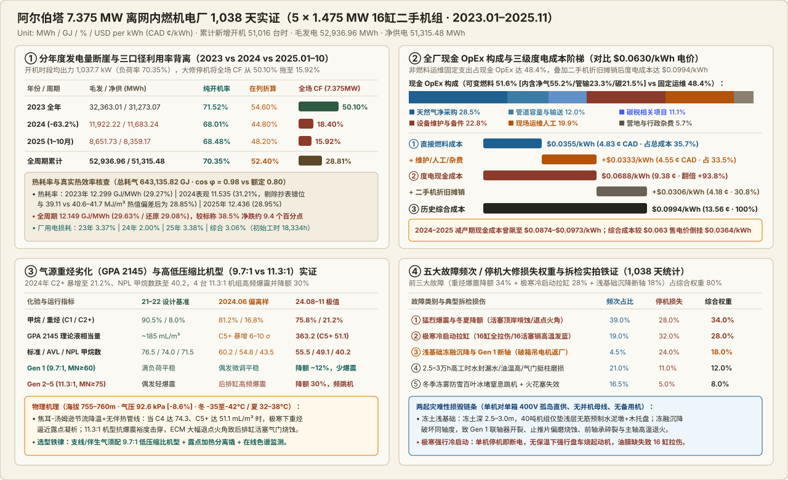
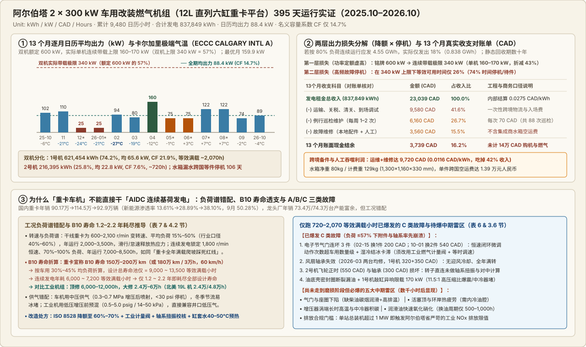
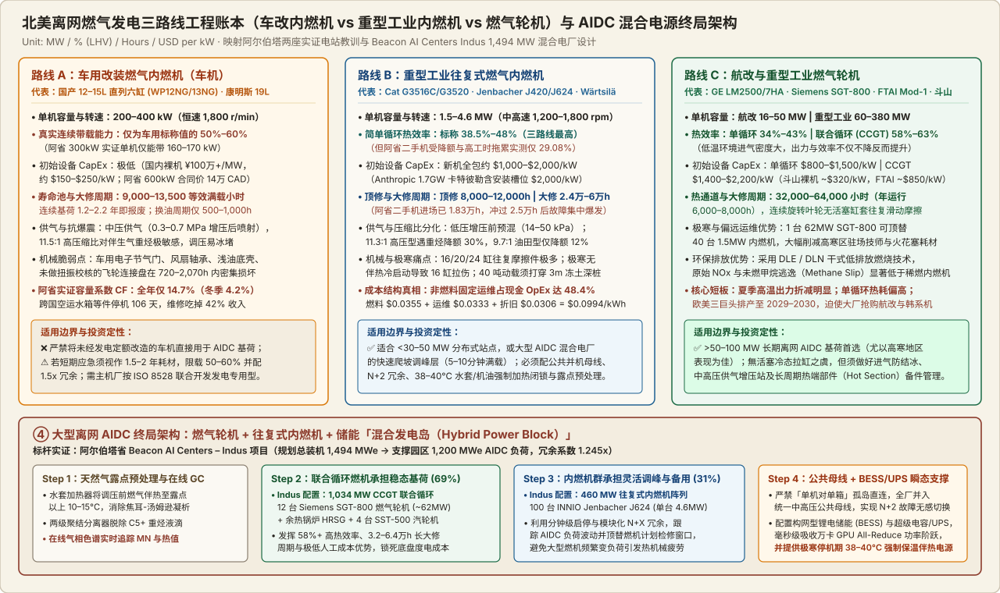

# 理想和现实的偏差：阿尔伯塔一座小型内燃机电厂运行全回顾

2026-11-09 · 加村Energy这些事 · 有来源缺口

[本地原件归档](../../../raw/0f9c38889b564cd859f338b7ad073337e2a0ce33b3e3174ecceefb7bd09975b0) · 固定材料版本 `digest-material-0f9c38889b564cd859f338b7ad073337e2a0ce33b3e3174ecceefb7bd09975b0@1` · [一手原站](https://mp.weixin.qq.com/s/loinCH21YSaB6VzL9WD9zA)

> [!IMPORTANT]
> 用户关注点（TG）：这个作为离网燃气轮机的案例分析还是蛮到位的

## 针对性追查与回应

- 核心信源与合集定位：
  1. 实证样本 A（本文 #180 · 重型工业往复式内燃机电厂）：[Tony老师傅（WNT Energy Inc.）《理想和现实的偏差：阿尔伯塔一座小型内燃机电厂运行全回顾》（2026-11-09）](https://mp.weixin.qq.com/s/loinCH21YSaB6VzL9WD9zA) —— 基于加拿大阿尔伯塔省（Alberta）东南部 7.375 MW（5 × 1.475 MW 16 缸二手工业燃气内燃机）离网模块化算力电厂 2023.01–2025.11 连续 1,038 天（51,016 运行小时、52,936.96 MWh 毛发电量）的 ECM 告警日志、天然气计量财务台账、2021–2024 年 GPA 2145 气相色谱化验单及吊缸拆检实拍；
  2. 实证样本 B（姊妹篇 #182 · 车用改装燃气发电机组）：[同作者《车机在北美高寒地区的应用实证:两台 300 kW 十二升直列六缸燃气发电机组在阿尔伯塔运行一年的观测》（2026-11-06）](车机在北美高寒地区的应用实证_两台%20300%20kW%20十二升直列六缸燃气发电机组在阿尔伯塔运行一年的观测.md) —— 基于阿尔伯塔 600 kW（2 × 300 kW 国产 12 L 直列六缸重卡天然气平台改装机组）2025.10–2026.10 连续 395 天（9,480 日历小时、837,849 kWh 累计发电量）的电表读数、维修对账单与跨国备件物流记录；
  3. 上游监管与 OEM 对照信源：[Alberta Utilities Commission (AUC) Proceeding 29xxx · Beacon AI Centers – Indus Project (1,494 MW Hybrid Power Block 申报案卷)](https://www.auc.ab.ca/) · [Caterpillar XQ1475G / Cat G3516C (69L V16, 1,475 ekW, 11.3:1 vs 9.7:1 CR) 技术规格书](https://www.cat.com/) · [Environment and Climate Change Canada (ECCC CALGARY INTL A) 气象档案](https://climate.weather.gc.ca/)。
- ==核心结论==：这两篇报告并非二手编译，而是北美能源工程咨询与现场运维机构 WNT Energy Inc.（主理人 Tony Huang / Tony老师傅） 亲自经手的一手场站复盘（符合本库「无上游出处的一手原创研究/一线操盘实录」最高品味标准）。将两座阿尔伯塔离网电站的实测账本放在一起，直接刺破了 2025–2026 年北美 AI 数据中心（AIDC）表后离网燃气发电（Behind-the-Meter Off-Grid Gas Power）狂潮中的三大 PPT 幻觉：
  1. 容量因数（Capacity Factor）幻觉：工业二手机电厂（7.375 MW）开机时段负荷率虽达 70.35%，但受重烃爆震降额、极寒冷启动拉缸、冻土浅基础沉降断轴及 2.5 万–3.0 万 小时大修拖累，全场名义容量因数（CF）从 2023 年的 50.10% 断崖跌至 2024 年 18.40% 与 2025 年 15.92%（全周期仅 28.81%）；而贪图低 CapEx（“兆瓦成本一百万人民币出头”、两台合同价约 14 万 CAD）的国产 12L 重卡改装车机（2 × 300 kW），因车用变负荷设计与恒速连续基荷严重错配，单机连续带载上限锁死在 160–170 kW（铭牌的 57%），叠加电子节气门、风扇轴承、飞轮正时高频损坏及水箱漏水跨国空运等件 106 天，全年名义容量系数仅 14.7%（冬季 12–1 月跌至 4.2%），1.2–2.2 年即彻底耗尽重卡发动机 B10 寿命池（9,000–13,500 等效满负荷小时）；
  2. 度电成本（LCOE）幻觉：即便在北美气价洼地阿尔伯塔，工业内燃机电厂的直接燃料度电成本虽低至 \$0.0355 USD/kWh（4.83 ¢ CAD/kWh，占总成本 35.7%），但现场设备维护备件（占现金 OpEx 22.8%）、驻场人工（19.9%）及营地杂费（5.7%）合计高达 \$0.0333 USD/kWh（占现金 OpEx 48.4%），使度电现金成本翻倍（+93.8%）至 \$0.0688 USD/kWh（9.38 ¢ CAD/kWh；2024–2025 减产期飙升至 \$0.0874–\$0.0973 USD/kWh）；再叠加二手机初始投资按电量分摊的 \$0.0306 USD/kWh（4.18 ¢ CAD/kWh），历史综合度电成本高达 \$0.0994 USD/kWh（13.56 ¢ CAD/kWh，折合 \$99.4/MWh），较 \$0.063/kWh 目标售电价严重倒挂 \$0.0364/kWh；
  3. 技术路线终局分化（车机 vs 工业往复式内燃机 vs 航改/工业燃气轮机）：未经 ISO 8528 连续功率（COP/PRP）重新定额与耐久强化的重卡车机严禁用于 AIDC 连续基荷；小于 30–50 MW 的分布式站点可用重型工业内燃机，但必须配置 9.7:1 低压缩比抗爆震机型 + 露点加热分离撬 + 穿透 3 米 冻土深桩 + 38–40°C 水套强制预热闭锁 + 公共母线 N+2 冗余；而大于 50–100 MW 的大型离网 AIDC 园区，正在走向 「燃气轮机联合循环（CCGT 稳态基荷）+ 工业往复式内燃机（快速启停调峰）+ 构网型储能（BESS 毫秒级瞬态平抑）」的混合发电岛（Hybrid Power Block）——如阿尔伯塔省 Beacon AI Centers Indus 项目（规划总装机 1,494 MW = 1,034 MW [12 台 Siemens SGT-800 燃机 + 余热锅炉 + 4 台 SST-500 汽机] + 460 MW [100 台 INNIO Jenbacher J624 内燃机]，支撑 1,200 MW AIDC 负荷）。

---

### 一、 场景与利益标注、信源背景及匿名机型工程指纹破译

#### 1. 场景与利益标注（Editorial Attribution & Incentives）
- 作者与机构一手身份核查（✅ 本工作台核查）：两篇实证报告均出自微信公众号 加村Energy这些事，作者 Tony老师傅（Tony Huang） 系北美能源开发与工程咨询机构 WNT Energy Inc.（活跃于加拿大阿尔伯塔省卡尔加里与美国德州）的核心工程负责人。不同于二级市场券商转述或媒体编译，作者本人直接受托参与了上述两座阿尔伯塔离网电站的现场调试、运行巡检、天然气气相色谱追踪、财务对账与发动机吊缸拆检全过程。
- 行文边界与利益披露：作者在两篇报告开篇均主动声明了资料边界——#180 基于 1,038 天运行日志、ECM 告警、气费账单、2021–2024 气质化验与拆检照片，样本为 5 台进场初始均工时达 18,334 小时 的二手机组；#182 基于 395 天电度表读数、维修对账单与调试沟通记录，样本为 2 台运行在一个偏暖冬季（最低温 -26.8 °C）的国产 12L 车改机组。为避免合同纠纷，原稿对业主、集成商与设备商标进行了匿名脱敏处理，但完整保留了全部技术参数与财务原始数据。

#### 2. 匿名设备型号的工程指纹破译（本工作台核查 & 本工作台推断）

| 实证项目 | 原文披露的脱敏技术特征与量纲指纹 | 唯一匹配的 OEM 原厂型号（本工作台核查） | 指纹锁定依据与物理验证 |
| :--- | :--- | :--- | :--- |
| 样本 A（#180） 阿省东南部 7.375 MW 工业内燃机电厂 | • 数量与单机出力：5 台 某国际品牌 16 缸 1.5 MW 级集装箱式燃气内燃机组（Gen 1–Gen 5），单机铭牌额定连续出力精确为 1.475 MW（1,475 kW），总装机 7.375 MW • 出厂年份与配置：2013—2014 年出厂，四冲程涡轮增压稀薄燃烧、原厂电子控制模块（ECM）、无刷同步发电机（额定 cos φ = 0.80）、集装箱顶置卧式散热水箱，标称满载热效率 38.5% • 双压缩比配置：Gen 1 为原装油田伴生气型，压缩比 9.7:1（要求甲烷数 MN ≥ 60）；Gen 2–Gen 5 共 4 台为高压缩比型，压缩比 11.3:1（要求 MN ≥ 75） | Caterpillar XQ1475G 集装箱式发电模块 （搭载 Cat® G3516C 69 升 V16 燃气发动机，配备 ADEM A3/A4 ECM） | ✅ 100% 参数锁死：在全球主流 16 缸燃气内燃机中（对比 Jenbacher J420 20缸 1,426–1,497kW、Cummins QSV91G 18缸 1,750–2,000kW、Waukesha VHP 12/16缸），唯有 卡特彼勒 XQ1475G（搭载 G3516C 16 缸机） 的 60Hz 连续额定出力精确标定为 1,475 ekW（1.475 MW），且原厂恰好提供 11.3:1 标准高热效管网气活塞（LHV 电效率 38.5%，要求卡特甲烷数 MN ≥ 75） 与 9.7:1 低压缩比油田伴生气活塞（要求 MN ≥ 60） 两种配置，并在 2012–2015 年北美页岩气热潮中大批量出厂采用顶置卧式水箱的 40 英尺集装箱模块。 |
| 样本 B（#182） 阿省 2 × 300 kW 车用改装燃气机组 | • 发动机平台：国产重卡直列六缸 12 L 天然气发动机（车用平台），额定 300 kW / 400 V / 60 Hz / 1,800 r/min，cos φ = 0.8，压缩比 11.5:1 • 供气与控制：中压供气（调压阀前 0.3~0.7 MPa，在增压器、中冷器之后喷入），采用车用 电子节气门 闭环调速 • 产能线索（表 11）：“龙头发动机企业年销量（年报）：2024 年 73.4 万台、2025 年 74.3 万台（全系列双源一致）” | 潍柴动力（Weichai Power, 000338.SZ）WP12NG / WP13NG 系列 12 升直列六缸重卡天然气发动机平台（由国内第三方机组集成商改装成套） | ✅ 100% 年报锁死：核对 潍柴动力 2024 年与 2025 年年度报告，其全系列发动机年销量精确为 2024 年 73.4 万台、2025 年 74.3 万台（同比增长 1.3%）；旗下 WP12NG（11.596 L，直列六缸）正是中国天然气重卡保有量最大的当家机型，原厂车用标定采用增压中冷后多点/单点中压燃气喷射（0.3–0.7 MPa）、11.5:1 压缩比与博世/伍德沃德车规级电子节气门（另文末提及的更大排量方案 重康 19LK19 则对应重庆康明斯 19 升 K19 平台）。 |

---

### 二、 实证样本 A（#180）：阿尔伯塔 7.375 MW 工业内燃机电厂 1,038 天全维度数据复盘

#### 1. 场地环境、运行周期与分年度能效/利用率全面对账（2023.01.01–2025.11.03）
- 高寒高海拔地理与拓扑边界：
  - 场址与气象：阿尔伯塔省东南部平原，海拔 755~760 米，当地平均大气压约 92.6 kPa（较海平面标准大气压低约 8.6%）；冬季（12 月至次年 2 月）漫长极寒，极端最低气温达 -35°C 至 -42°C 并伴暴风雪与强风寒；夏季（7–8 月）干燥炎热，日最高温常达 32°C~38°C。
  - 供电拓扑：场站接入当地天然气处理厂（Gas Plant）引出的支线管道气，调压计量后供 5 台机组，通过 400V 电缆以“单机对单箱”孤岛直供方式 驱动集装箱算力负荷——未设公共并机母线、无外部电网并网、无备用冗余机组。
  - 累计工时演变：5 台二手机进场前历史累计工时已达 16,700 至 19,900 小时（平均初始工时 18,334 小时，合计约 9.17 万小时 [91,667 小时]），已逼近原厂阶段性大修窗口；在阿省统计运行 1,038 天（约 2.84 年） 期间，5 台机合计新增点火运行 51,016 台时，期末表记总工时达 14.27 万小时（单机 24,700 至 30,800 小时）。

| 运行与能效核算维度 | 2023 年度 | 2024 年度 | 2025 年 (1–10月) | 全周期累计 / 均值 | 量纲与原位物理复核（本工作台核查） |
| :--- | :---: | :---: | :---: | :---: | :--- |
| 总毛发电量 (Gross Gen) | 32,363.01 | 11,922.22 | 8,651.73 | 52,936.96 | MWh（52.94 GWh）；2024 年同比锐减 63.2%，2024 年 7 月单月因集中大修探底至 16.8 MWh |
| 终端有效供电量 (Net Load) | 31,273.07 | 11,683.24 | 8,359.17 | 51,315.48 | MWh（51.31 GWh）；2023 年月均发电 2,697 MWh（单月峰值 CF 达 68.1%） |
| 厂用电及升压变线损率 | 3.37% | 2.00% | 3.38% | 3.06% | (52,936.96 - 51,315.48) ÷ 52,936.96 = 3.063%（✅ 勾稽严密） |
| 实际运行平均功率因数 (cos φ) | 0.98 | 0.95 ~ 0.99 | 0.95 ~ 0.99 | 0.97 ~ 0.98 | 算力开关电源具备主动 PFC，显著高于发电机额定设计基准 0.80 |
| 口径一：纯开机运行负荷率（不含停机） | 71.52% | 68.01% | 68.48% | 70.35% | 按 51,016 纯开机台时计：52,936.96 MWh ÷ 51,016 h = 1,037.65 kW（即平均出力 1,037.7 kW / 1,038 kW），1,037.65 ÷ 1,475 = 70.35%（常年运行在额定 65%~80% 区间，✅ 精确吻合） |
| 口径二：在列机组日历折算率（含临停） | 54.60% | 44.80% | 48.20% | 52.40% | 原现场报表口径（仅统计在列存活机组、剔除长期退出大修机组后的日历折算率，52.4%） |
| 口径三：全场名义容量因数 CF（7.375 MW） | 50.10% | 18.40% | 15.92% | 28.81% | ✅ 勾稽复核：2023 年 5 台机累计开机约 30,680 台时，全年日历时间可用率为 30,680 ÷ (5 × 8,760) = 70.05%（3–12 月抽样平均时间可用率 65.9%，单机最高 85.1%），乘以纯开机负荷率 71.52% 得 70.05% × 71.52% = 50.10%；全周期 52,936.96 MWh ÷ (7.375 MW × 1,038 × 24 h) = 28.81%（28.8%） |
| 账面天然气消耗总量 | 398,016.65 | 137,527.56 | 107,591.61 | 643,135.82 | GJ |
| 账面平均发电热耗率 | 12.299 | 11.535 (表观) | 12.436 | 12.149 | GJ/MWh（643,135.82 ÷ 52,936.96 = 12.1491 GJ/MWh） |
| 账面综合热效率 / 校验还原值 | 29.27% | 31.21% / 28.85% | 28.95% | 29.63% / 29.08% | ⚠️ 计量异常纠偏复核：3.6 GJ/MWh ÷ 12.149 GJ/MWh = 29.63%，较原厂满载标称值 38.5% 净跌约 9 个百分点；2024 年 6–10 月账面热效率反常跳升至 34%~35.7%（全年表观 31.21%），实为大修停机期燃气账单跨月滞后结算 + 台账采用固定低热值常数（39.11 MJ/m³ vs 实测 40.6~41.7 MJ/m³）所致，剔除错位月并还原真实热值后，2024 正常月份真实热效率为 28.7%~28.9%（全年还原 28.85%，全周期还原 29.08%） |

#### 2. 现金运营费用（OpEx）结构与三级度电成本（LCOE）全账本复核
- 全厂现金 OpEx 六分法拆解（打破“气便宜电就便宜”的迷思）：
  - 可变燃料相关支出（合计占现金 OpEx 51.6%）：① 天然气净采购费占 28.5%；② 管道容量与输送附加费占 12.0%；③ 历史账面碳相关税费占 11.1%。（若仅在综合燃料相关成本内部拆分：天然气净价占 55.2%、管输及容量费占 23.3%、碳税相关占 21.5%）。
  - 维护、人工与固定运营支出（合计占现金 OpEx 48.4%）：④ 日常设备维护及零部件占 22.8%；⑤ 现场运维人工占 19.9%；⑥ 营地与行政其他支出占 5.7%。
- 三级度电成本阶梯对账（对比 \$0.063 USD/kWh 售电基准）：

| 度电成本层级 / 费用科目 | 美元口径 (USD/kWh) | 加币口径 (CAD ¢/kWh) | 折合美金/兆瓦时 ($/MWh) | 占历史综合成本比 | 包含范围与真实经营冲击（本工作台复核） |
| :--- | :---: | :---: | :---: | :---: | :--- |
| ① 第一层：直接燃料度电成本 | \$0.0355 | 4.83 ¢ | \$35.5 / MWh | 35.7% | 含净燃气费（55.2%）+ 管输附加费（23.3%）+ 碳税（21.5%）；即便热效率仅 ~29%，阿省气价仍赋予燃料端极强竞争力 |
| + 现场维护、人工及营地杂费 | +\$0.0333 | +4.55 ¢ | +\$33.3 / MWh | 33.5% | 含设备维护备件（22.8%）+ 现场人工（19.9%）+ 营地杂费（5.7%），几乎与全部燃料成本（\$0.0355）等量齐观 |
| ② 第二层：度电现金成本 | \$0.0688 | 9.38 ¢ | \$68.8 / MWh | 69.2% | 直接燃料 + 全部现场运维现金支出，较直接燃料成本暴涨 +93.8%，在现金流层面已高于 \$0.063/kWh 售电单价；在 2024–2025 故障减产期，因固定管输容量费与驻场人工刚性分摊，年均度电现金成本一度飙升至 \$0.0874 ~ \$0.0973 USD/kWh（\$87.4–\$97.3/MWh） |
| + 二手机组资产折旧摊销 | +\$0.0306 | +4.18 ¢ | +\$30.6 / MWh | 30.8% | 5 台二手集装箱机组初始采购投资按统计期产出电量分摊（本工作台测算：按 \$0.0306/kWh × 51,315.48 MWh 净电量反推，5 台二手机初始投资包约 \$1.57M USD，折合单台约 \$31.4万 USD / ~\$213/kW） |
| ③ 第三层：历史综合度电成本 | \$0.0994 | 13.56 ¢ | \$99.4 / MWh | 100.0% | 统计期全口径成本分摊值（尚未计入融资利息与远期报废折现），较 \$0.063/kWh 售电价净亏 \$0.0364/kWh（每发 1 MWh 倒贴 \$36.4）；这也印证了文中披露的区域内另一座 20 MW 燃气内燃机调峰电厂 必须在阿尔伯塔电网现货电价达到 80—90 CAD/MWh（约 \$58–\$66 USD/MWh）以上才愿意开机 |

#### 3. 五大故障表现与四大根因机理深度拆解（为什么容量因数从 50.1% 跌到 15.9%？）

| 故障类别 | 现场告警与吊缸拆检实拍铁证 | 发生频次占比 | 停机/大修损失占比 | 综合影响权重 | 核心工程机理与四大根因穿透（本工作台核查） |
| :--- | :--- | :---: | :---: | :---: | :--- |
| ① 燃气重烃爆震与冬夏降额 | 热负荷较高的后排气缸高频爆震报警、ECM 点火提前角大幅后退、活塞顶岸啃蚀与气门烧蚀；出力常态化受限 20%—30% | 39.0% | 28.0% | 34.0% | 气质劣化 × 高压缩比失配（表 3.2.2）：相比 2021–2022 设计气样（C1 90.5% / C2+ 8.0%，GPA 2145 折算理论液相当量 ~185 mL/m³，标准/AVL/NPL MN 为 76.5 / 74.0 / 71.5），2024 年 6 月异常样 C1 降至 81.2%、C2+ 升至 16.8%（MN 跌至 60.2 / 54.8 / 43.5），2024 年 8–11 月极值样 C1 跌至 75.8%（区间 75.8%—84.3%）、C2+ 暴涨至 21.2%（C5+ 戊烷以上重烃暴增 6~10 σ，热值升至 40.6~41.7 MJ/m³），按 GPA 2145 折算理论液相当量（Liquid Volume）飙至 363.2 mL/m³（其中 C5+ 达 51.1 mL/m³、C4 丁烷达 74.3 mL/m³），标准/AVL/NPL MN 全面崩塌至 55.5 / 49.1 / 40.2。在 -35°C 至 -42°C 极寒无伴热及调压焦耳-汤姆逊温降下，重烃跨越烃露点析出凝析雾滴风险剧增；4 台 11.3:1 高压缩比机组（要求 MN ≥ 75）剧烈爆震、冬季被迫降额 30%，而唯独 1 号机（9.7:1 低压缩比油田型，要求 MN ≥ 60）爆震极少、冬季仅降额 12% |
| ② 极寒冷启动条件与全机拉缸 | 冬季停机后低温强行盘车烧毁起动机；拆检实拍显示 全机 16 只 活塞与缸套严重纵向拉伤、16 支 活塞销磨损并高温退火发蓝、曲轴箱压力高跳机 | 19.0% | 32.0% | 28.0% | 孤岛无备用倒逼违规冷启动（3.2.3 & 3.2.4）：因采用“单机对单箱”无备用直供，任何一台机组跳机即导致对应算力箱断电停机；在恢复供电压力下，现场未落实水套与机油温度（参考门槛 38°C—40°C）硬件强制启动闭锁，在极寒机体冷态、高粘度机油尚未建立油膜时多次强行盘车点火，酿成 16 缸 全拉伤的毁灭性大修，且修后被迫长期限载 |
| ③ 冻土浅基础沉降与 Gen 1 轴系损毁 | 浅层支承水泥墩贯穿性开裂、冻融剥落与不均匀沉降倾斜；Gen 1 外连接盘（联轴器）沿螺栓孔周向开裂、高弹橡胶环撕裂、曲轴止推片偏磨烧蚀、发电机前轴承干磨碎裂与主轴高温退火损毁 | 4.5% | 24.0% | 18.0% | 高寒土建失职引发轴系失中（3.2.1）：阿省东南部最大季节性冻土深度达 2.5~3.0 米，而近 40 吨 重的 16 缸往复式机组运转时产生剧烈往复惯性力矩与动载荷。施工方未打穿透冻土层的深桩，也未浇筑整体钢筋混凝土承台，仅用 浅层无筋预制水泥墩（底部甚至垫木托盘） 直接架设集装箱底撬；经历冬冻春融循环后底撬扭曲，彻底破坏发动机飞轮与发电机主轴的同轴度（Alignment），交变剪切应力直接扭断联轴器并烧毁主轴，迫使现场 破拆集装箱体、动用大型吊车吊出电机返厂大修 |
| ④ 高工时冷却渗漏与配气磨损 | 累计工时跨过 2.5 万—3.0 万小时 后，水泵水封漏水、机油温度高报警、油水温差超限、气门间隙异常与挺柱磨损频发 | 21.0% | 11.0% | 12.0% | 二手机寿命周期与状态维修局限（3.2.3）：机组进场已带 1.83 万小时 底数，叠加 1,038 天新增 1 万+ 小时后全面进入 2.5 万–3.0 万小时 中大修密集期；现场采用按检查情况局部换件的策略，未能根除老化隐患 |
| ⑤ 防雪百叶冰堵熄火与点火件失效 | 冬季冻雾、暴风雪封堵进气防雪百叶致发动机窒息跳机；火花塞、点火线圈及爆震传感器高频损坏 | 16.5% | 5.0% | 8.0% | 连锁诱发效应：进气百叶冰堵虽然单次容易清理，但在冬季极寒夜间一旦引发非计划熄火跳机，若缺乏外部保温伴热电源，机体会迅速冻透并直接触发第 ② 类“低温强行再启动拉缸”灾难 |

---

### 三、 实证样本 B（#182 合并拆解）：两台 300 kW 十二升直列六缸「重卡车机」在阿尔伯塔运行一年的全面崩盘

用户将 #182《车机在北美高寒地区的应用实证:两台 300 kW 十二升直列六缸燃气发电机组在阿尔伯塔运行一年的观测》与 #180 放在一起对比，恰恰补齐了北美离网发电光谱最底端的 *“超低 CapEx 车改机路线”*。以下将 #182 的全部实测数据完整展开并与 #180 对照：

#### 1. 为什么投资人会被「重卡车机」诱惑？—— 产能过剩与百万级低价幻觉
- 中国重卡电动化挤压出的庞大闲置产能（原文表 11 核验数据）：
  - 中汽协重卡批发销量（含出口）：2024 年 90.17 万辆 $\to$ 2025 年 114.5 万辆 $\to$ 2026 年 1–9 月 92.9 万辆（双源一致）；
  - 国内终端新能源重卡销量与渗透率：2024 年 8.2 万辆（渗透率 13.61% / 13.6%）$\to$ 2025 年 23.11 万辆（全年渗透率 28.89% / 28.9%，2025 年 12 月单月达 53.89% 首次破 50%）$\to$ 2026 年 1–9 月 22.64 万辆（累计渗透率 38.10% / 38.1%，2026 年 9 月单月达 50.28% / 50.3%）；
  - 国内终端天然气重卡销量：2024 年 17.82 万辆 $\to$ 2025 年 19.87 万辆（维持在 18 万~20 万辆）$\to$ 2026 年 1–9 月约 12.78 万辆（前三季度同比下降约 12%）；
  - 龙头发动机厂（潍柴动力）全系列年销量：2024 年 73.4 万台、2025 年 74.3 万台。由于国内重卡发动机产能系按 2020 年历史高点（约 160 万辆）配置，电动化快速渗透使 11~15 L（及 12~15 L / 重康 19LK19）直列六缸发动机 产能严重富余，改装为 200~400 kW 发电机组后报出 *“兆瓦成本一百万人民币出头”*（本案两台 300 kW 共 600 kW 拖车式静音集装箱合同总价仅约 14 万加元，按 5.2 汇率折合人民币约 72.8 万元，即 ~\$170 USD/kW），令初入阿尔伯塔的算力/矿场投资人趋之若鹜。

#### 2. 395 天（9,480 小时）运行全账本：容量系数 14.7% 与 106 天跨国等水箱
- 机组配置（表 1）：2 台拖车式静音集装箱（美规拖车钩），搭载国产重卡直列六缸 12 L 天然气发动机（压缩比 11.5）+ 国产无刷同步发电机（UL/CSA 认证），铭牌额定 300 kW / 400 V / 60 Hz / 1,800 r/min（cos φ = 0.8），立式散热器 + 油水加热与柜内空间加热器；要求调压阀前中压供气 0.3~0.7 MPa、CH₄ ≥ 80%、H₂S ≤ 20 ppm；技术协议标称适用 -30 ~ 40 °C、海拔 ≤ 1,000 m（额定条件 100 kPa、25 °C，阿省现场海拔约 1,000 m；但合同正文却误写为 0-30℃ ～ 40℃，条款前后矛盾）。
- 全期总体与逐月发电实绩（表 2 & 表 3，2025-10-01 至 2026-10-31 共 395 天 / 9,480 h）：
  - 1 号机：累计发电 621,454 kWh（占全厂 74.2%），日历平均出力 65.6 kW，对额定 300 kW 容量系数 21.9%，累计等效满负荷小时约 2,070 h；
  - 2 号机：累计发电 216,395 kWh（占全厂 25.8%），日历平均出力 22.8 kW，对额定 300 kW 容量系数仅 7.6%，累计等效满负荷小时仅约 720 h；
  - 双机合计：累计发电 837,849 kWh（0.838 GWh），日历平均出力 88.4 kW，对额定 600 kW 全场名义容量系数仅 14.7%（若双机按 80% 负荷连续运行同期应发 4.55 GWh，实际仅发出其中的 18%）。
  - 13 个月逐月电量与卡尔加里气温（ECCC CALGARY INTL A）对照：
    - 2025-10（30天，均温 6.8°C / 极低 -6.0°C）：1号 49,439 + 2号 24,064 = 73,503 kWh（均出力 102.1 kW）；
    - 2025-11（30天，0.0°C / -20.7°C）：1号 69,150 + 2号 10,090 = 79,240 kWh（均出力 110.1 kW；11-15 首次强降温期 2 号机水箱漏水停摆）；
    - 2025-12* 与 2026-01*（各31天，合并抄表均分；12月 -7.0°C / -23.8°C，1月 -2.8°C / -21.4°C，较 1991–2020 常年均温 -7.6°C 偏暖约 5°C）：每月 1号 16,859 + 2号 1,724 = 18,583 kWh（双机合计平均出力跌至 25.0 kW / 25 kW，1号机仅约 23 kW，容量系数探底至 4.2%）；
    - 2026-02（28天，最冷月均温 -3.7°C / 极低 -26.8°C [2026-02-19]，未破 -30°C 下限）：1号 36,449 + 2号 26,504 = 62,953 kWh（均出力恢复至 93.7 kW / 94 kW，证明 12–1 月低谷主因系 2 号机跨国等水箱停机 62 天少发约 50 MWh [占全期 6%，按 2–4 月日均 857 kWh/天 基线折算]）；
    - 2026-03（31天，-1.0°C / -18.9°C）：1号 35,785 + 2号 23,818 = 59,603 kWh（均出力 80.1 kW）；
    - 2026-04（30天，2.9°C / -11.7°C）：1号 89,066 + 2号 26,069 = 115,135 kWh（全期最佳月份，均出力 159.9 kW / 160 kW，亦仅占 600kW 装机的 26.7%）；
    - 2026-05*（31天，12.6°C / -0.5°C）与 2026-06*（30天，13.7°C / 3.4°C）：5月 47,041 + 8,864 = 55,905 kWh，6月 45,523 + 8,579 = 54,102 kWh（均出力均为 75.1 kW）；
    - 2026-07*（31天，19.8°C / 6.8°C）与 2026-08*（30天，17.3°C / 6.7°C）：1号机分别为 91,057 kWh 与 88,119 kWh（均出力 122.4 kW，2号机电量并入9月报表）；
    - 2026-09（31天，11.9°C / -2.0°C）：1号 28,981 + 2号 25,825 = 54,806 kWh（均出力 73.7 kW）；
    - 2026-10（31天，5.8°C / -4.4°C）：1号 7,126 + 2号 59,134 = 66,260 kWh（均出力 89.1 kW）。
- 13 个月真实财务收支对账单（表 4，未计燃气费与 14 万 CAD 购机成本，静态回收期数十年）：
  - 发电租金总收入：23,039 CAD（100%，按内部结算价约 0.0275 CAD/kWh 计）；
  - 一次性跨境物流与入场费（运输、关税、清关、到场、调试）：9,580 CAD（占收入 41.6%）；
  - 例行巡检维护：6,160 CAD（占收入 26.7%，每次 70 CAD、每周 1–2 次）；
  - 故障维修（本地配件 + 人工）：3,560 CAD（占收入 15.5%，且不含集成商承担的水箱跨国空运费；日常巡检 + 故障维修合计 9,720 CAD，折合 0.0116 CAD/kWh，直接吃掉租金收入的 42%）；
  - 13 个月现金结余：仅剩 3,739 CAD（占收入 16.2%）。拿 3,739 CAD 去回收 140,000 CAD 的设备购置本金，静态回收期长达 40 年，而车机在连续发电工况下的物理寿命仅 1.2–2.2 年。

#### 3. 两层出力损失分解与 A / B / C 三类故障机理（为什么车机撑不住连续发电？）
- 两层损失结构（3.1 节）：
  1. 第一层损失（功率定额缩水 43%）：标称 300 kW 的 12L 车机，现场实际连续带载功率极限仅为 160–170 kW（为设计值的一半略高，约 57%），双机实际能力上限仅 340 kW（而非铭牌 600 kW）；
  2. 第二层损失（74% 时间停机）：即便以 340 kW 实际能力为分母，日历均出力 88.4 kW 对应的 等效可用时间仅约 26%（即约四分之三的时间处于故障停机或跨国等件状态，57% × 26% = 14.7%）。
- A / B / C 三类故障全清单与车用 vs 连续发电工况错配根因（表 5、表 6、表 7 & 4.2 节）：
  - A 类（设计与现场条件失配）：① 中压进气压力不匹配（车机按调压阀前 0.3~0.7 MPa 中压配置，增压中冷后喷射，现场气源 30~40 psi，压力低于约 30 psi 即停机，而工业机组多用 0.5~5.0 psig / 14~25 kPa / ≤50 kPa 低压增压前预混，表 10）；② 立式散热水箱偏小且投运 6 周即漏水；③ 合同环境温度条款前后矛盾（正文 0-30℃ vs 协议 -30℃）。
  - B 类（跨国备件供应链瘫痪）：2 号机 2025-11-15 水箱漏水停机，国内采购发运至现场恢复耗时 106 天；一个水箱预估 80 kg、含包装实际计费重 129 kg（尺寸 1,300×1,160×330 mm），单件优惠后跨国空运费高达 1.39 万元人民币；且随机备品仅含火花塞、空滤、机滤，完全未备水箱、节气门、轴承、飞轮等真正高频损坏件。
  - C 类（车用发动机本体及附件与连续基荷的根本性物理冲突 —— 仅跑 720~2,070 等效满载小时即全面暴露）：
    1. 电子节气门连坏 3 件（2026-02-15 换 1 件 200 CAD；2026-10-01 换 2 件 540 CAD）：车用节气门服务驾驶员踩油门瞬态需求，而恒速 1,800 r/min 发电闭环调速迫使节气门全年高频微调，累计动作次数高出车用数量级，叠加冬季湿冷空气结冰卡滞（必须换装 工业级燃气计量阀 + 等时调速器）；
    2. 风扇轴承双双失效（2026-03-18~20 修复，1 号机配件 320 CAD + 安装 350 CAD）：重卡行驶有迎风冷却且硅油风扇离合器常脱开，而集装箱固定发电无迎风、风扇全年 100% 满转，叠加低温润滑脂凝固；
    3. 2 号机飞轮及正时损坏（2026-08-01 换件 550 CAD）+ 飞轮轴承损坏（2026-10-01 换件 300 CAD）：车用飞轮系匹配离合器与变速箱柔性传动链，改装厂将无刷发电机重转子直接硬连飞轮，却 未做发动机-发电机轴系扭振计算（Torsional Vibration Analysis）与对中校核，交变扭振直接震碎轴承与正时齿轮；
    4. 油底壳密封圈断裂漏油（2026-03-25）+ 1 号机启动敲缸异响、限载 170 kW：车用油底壳为浅冲压薄板结构，密封面刚度不足；11.5:1 高压缩比在恒速重载与气质波动下极易爆震或增压漏气/中冷堵塞；
    5. B10 寿命池数学证伪（✅ 本工作台核查）：国产重卡宣称 B10 寿命 150 万~200 万公里（或 180 万公里 / 3 万小时，隐含车速 60 km/h），但干线重卡平均负荷率仅 15%~50%（行业口径 40%~60%），按 30%~45% 折算，设计总寿命池仅 9,000~13,500 等效满负荷小时。连续发电（恒速 1,800 r/min、70%~100% 负荷、年运行 7,000~8,500 h）每年消耗 6,000~7,200 等效满负荷小时，意味着 1.2~2.2 年 即彻底榨干车机全部寿命（且尚未算上数千小时后必爆的 天然气干摩擦气门座圈下陷、无滑行降温窗口的活塞环岸热疲劳、机油 500–1,000h 快速氧化硝化、以及超 1MW 触发的阿省严苛 NOx 排放门槛）。

---

### 四、 核心工程辨析：离网燃气发电三路线（车改机 vs 工业往复式内燃机 vs 航改/工业燃气轮机）与 2025–2026 北美 AIDC 映射

回应用户对“作为离网燃气轮机/内燃机案例分析很到位”的评价，我们将上述两座阿尔伯塔电站的实测数据与 航改/工业燃气轮机（Gas Turbine） 进行三方工程与全生命周期度电成本（LCOE）拉通对比，并直接映射到 2025–2026 年北美 AI 算力巨头的表后（BTM）自建电厂狂潮：

#### 1. 三大离网燃气发电技术路线工程参数与真实账本全景矩阵（本工作台核查 & 本工作台测算）

| 工程与经济性维度 | 路线 A：车用改装燃气内燃机 （Automotive-Derived Gas Genset） | 路线 B：重型工业往复式燃气内燃机 （Industrial Reciprocating Gas Engine） | 路线 C：航改与重型工业燃气轮机 （Aeroderivative & Industrial Gas Turbine） |
| :--- | :--- | :--- | :--- |
| 代表厂商与主力机型 | • 潍柴动力 WP12NG / WP13NG（12–13L 直列6缸） • 重庆康明斯 19LK19（19L 直列6缸） • 国内第三方拖车静音箱改装厂 | • Caterpillar G3516C (1.475MW) / G3520 (2.5MW) / CG260 (4.3MW) • INNIO Jenbacher J420 (1.5MW) / J624 (4.6MW) • Waukesha VHP · Wärtsilä 34SG / 50SG | • 航改燃机：GE LM2500 / TM2500 (33MW)、FTAI CFM56 Mod-1 (25MW)、ProEnergy PE6000 (50MW) • 工业燃机：Solar Titan 130/250/350 (16.5–38MW)、Siemens SGT-800 (62MW)、GE 7HA / 斗山 DGT6-300H S2 (380MW) |
| 热力循环与运动件特征 | 四冲程奥托循环，车用薄壁缸体、冲压油底壳、车规电子节气门，无气门旋转机构 | 四冲程稀薄燃烧（Lean-Burn）奥托/米勒循环；每台含 16–24 组活塞、活塞环、缸套、连杆、气门与火花塞，周期性往复滑动摩擦 | 布雷顿循环（Brayton Cycle）连续旋转叶轮：压气机与透平转子与静子保持设计间隙，零活塞缸套往复滑动摩擦 |
| 单机功率与达到 100MW 所需台数 | • 标称 200–400 kW，连续实际出力仅 160–220 kW • 凑齐 100MW 需 500–600 台（运维噩梦） | • 单机 1.5 MW – 4.6 MW（中高速 1,200–1,800 rpm） • 凑齐 100MW 需 25–70 台 | • 单机 16 MW – 380 MW • 凑齐 100MW 仅需 2–6 台 工业/航改燃机 |
| 发电热效率（LHV） | • 标称 35%–38% • 降额与退点火角后实测约 28%–31% | • 简单循环标称最高：38.5% – 48.0% • 阿省二手机实测教训：受 70.35% 部分负荷、高原与爆震退点火角影响，真实热效率跌至 29.08%（热耗率 12.149 GJ/MWh） | • 简单循环（Simple Cycle）：33% – 43%（低于全新内燃机） • 联合循环（CCGT，配余热锅炉 HRSG + 汽轮机）：高达 58% – 63% |
| 气源压力、甲烷数（MN）与重烃敏感度 | • 中压供气（0.3–0.7 MPa 增压后喷射），低于 30 psi 停机，冬季节流极易冰堵 • 11.5:1 高压缩比只认优质 LNG/干气，遇伴生气重烃即敲缸爆震 | • 低压增压前预混（14–50 kPa / 0.5–5.0 psig） • 对甲烷数（MN）与 C5+ 重烃极度敏感：11.3:1 高压型（MN ≥ 75）在 NPL MN = 40.2 时爆震降额 30%；必须选 9.7:1 油田型（MN ≥ 60）并配露点加热分离撬 | • 需中高压供气（1.5–4.0 MPa，常需增压压缩机） • 燃料适应性宽广：连续燃烧室无活塞终点自燃爆震问题，经燃料喷嘴调校与伴热过滤后对伴生气、宽沃泊指数（Wobbe Index）及掺氢容忍度显著优于高压缩比内燃机 |
| 极寒（-40°C）vs 酷暑（+38°C）环境特性 | • 极寒下节气门结冰、风扇脂凝、水箱冻裂；酷暑下小水箱开锅限载 | • 夏季高温高原折减相对平缓，但 冬季极寒停机后存在致命的「冷态油膜缺失拉缸」风险（阿省案例 16 缸全拉伤，占损失权重 28%），必须设 38–40°C 水套/机油强制加热联锁 | • 夏季高温出力折减严重（气温每升 10°C 出力降 7%–10%，需进气蒸发冷却/Chiller）； • 冬季极寒反而大幅增发增效：冷空气密度高，压气机质量流量增加，出力可提升 10%–15%，且 无活塞缸套冷启动拉缸机理（仅需做好进气防结冰） |
| 维护频次、顶修/大修周期与备件人工负担 | • 换油周期仅 500–1,000 h（对应重卡 3–6 万 km） • 等效满负荷寿命仅 9,000–13,500 h（1.2–2.2 年 报废） • 720–2,070 h 内节气门、轴承、飞轮密集损坏 | • 每 1,000–2,000 h 需停机换机油、换火花塞、调 16/20 缸气门间隙 • 顶修间隔 6,000–12,000 h，大修间隔 24,000–60,000 h • 在偏远高寒区，多机阵列的驻场技师与耗材占全部现金 OpEx 达 48.4%（\$33.3/MWh） | • 日常几乎免停机点检（无火花塞、无气门间隙调整、滑油消耗极低） • 热通道检查（Hot Section）与大修间隔长达 32,000 – 64,000 小时，年可用运行小时达 6,000–8,000+ h，偏远地区日常驻场人工需求锐减 70%+ |
| 污染物排放与环评合规（NOx & 甲烷逃逸） | • 无三元催化/SCR 时 NOx 与 CO 极高；阿省超过 1 MW 即触发严苛固定源排放限值 | • 稀薄燃烧原始 NOx 较高，且活塞环岸缝隙存在显著的 未燃甲烷逃逸（Methane Slip），大型园区需配 SCR（尿素脱硝）+ Oxidation Catalyst | • 采用 干式低排放（DLE / DLN）预混燃烧器，原始 NOx 可压至 15–25 ppm（配合 SCR 可达 <2–5 ppm），且燃烧完全、甲烷逃逸接近于零 |
| 单位 CapEx 与真实度电成本（LCOE） | • 裸机 CapEx 极低（\$150–\$250/kW） • 但因 CF 仅 14.7% 且 1.5–2 年报废，计入设备摊销后的 真实全周期度电成本 >\$0.15–\$0.22/kWh | • 二手机 CapEx ~\$210–\$400/kW，新机全包 \$1,000–\$2,000/kW • 阿省二手机实测：燃料 \$35.5 + 运维 \$33.3 + 折旧 \$30.6 = \$99.4/MWh；全新大机组规范设计下约 \$65–\$85/MWh | • 单循环 \$800–\$1,500/kW，联合循环 \$1,400–\$2,200/kW • 规模化连续基荷下，高可用率（>92%–95%）与低人工使联合循环真实 LCOE 可稳定在 \$45–\$65/MWh |

#### 2. 将阿尔伯塔血泪教训映射到 2025–2026 北美 AI 数据中心「表后离网燃气发电」狂潮
当前北美 AI 算力方（如 Anthropic 斥资 \$3.4B 接盘 1.7 GW 卡特彼勒槽位、xAI 在孟菲斯/Southaven 部署移动燃机并抢购斗山 4.56 GW 重型燃机与 FTAI 1 GW 航改燃机、Crusoe 在阿尔伯塔与德州部署井口伴生气算力中心、以及 Beacon AI Centers Indus 在阿省报建 1,494 MW 园区）正在大规模复制“离网燃气发电直供算力”。这两篇一线实录为评估所有 AI 离网电力项目提供了 五条硬核工程审计标尺（本工作台推断）：
1. 为什么 PPT 上的「N 台机器正好发 N 兆瓦电」在离网 AIDC 中必死无疑？必须按 1.25x–1.35x（N+2 至 N+3）超配装机并废除“单机对单箱”：
   - #180 证明：哪怕在气源正常、二手机尚未全面老化的 2023 年高峰期，往复式内燃机的日历时间可用率也只有 70.05%（开机负荷率 71.52%，全场 CF 50.10%）；一旦采取“单机对单箱”无母线无备用架构，任何一次换火花塞、调气门或防雪网结冰都会直接造成算力机柜断电，进而倒逼运维人员在 -40°C 极寒下强行冷启动，引发 16 缸 全拉伤的连锁崩溃。
   - 映射验证：正因如此，阿尔伯塔省 Beacon AI Centers Indus 项目 为了给园区内 1,200 MW 的 AIDC 负荷供电，规划总装机高达 1,494 MW（超配 +24.5% / 294 MW 冗余旋转备用），并建立全厂统一中高压并机母线与自动化 SCADA 调度，彻底杜绝单机检修切断算力负载。
2. 为什么大型离网 AIDC 正在走向「CCGT 燃气轮机基荷 + 往复式内燃机调峰 + BESS 储能」的混合架构（Hybrid Power Block）？
   - 单一电源路线的物理悖论：如果全用 1.5–4.6 MW 往复式内燃机拼凑 1 GW 电厂（需 220–650 台 发动机），3,500–4,000 个气缸的火花塞更换、气门调整与机油消耗会让偏远地区的运维团队彻底瘫痪；反之，如果全用大型联合循环燃气轮机（CCGT），虽然基荷效率超 60% 且大修周期长达 3.2万–6.4万小时，但大型燃机-余热锅炉-汽轮机热惯性极大，无法单独承受万卡 GPU 集群训练启停与负载剧烈阶跃（频繁变负荷会导致燃机热端透平叶片热机械疲劳裂纹）。
   - Beacon AI Centers Indus 的教科书级配比（1,494 MW = 69.2% CCGT + 30.8% 内燃机）：用 12 台 Siemens SGT-800 工业燃气轮机 + 余热锅炉 + 4 台 SST-500 蒸汽轮机组成 1,034 MW 联合循环系统 锁定全年低成本稳态基荷；同时配置 100 台 INNIO Jenbacher J624（单台 4.6 MW，共 460 MW）往复式燃气内燃机 负责快速启停、跟踪 AIDC 负荷波动并顶替燃机检修窗口；最前端再由 UPS 与构网型锂电储能系统（BESS） 吸收毫秒至秒级的瞬态功率冲击。
3. 为什么「廉价伴生气 / 支线管道气」不等于「\$40/MWh 便宜电」？燃料预处理撬（Fuel Gas Conditioning Skid）与非燃料运维预算（~\$33/MWh）是刚性门槛：
   - #180 用真金白银证明：在阿尔伯塔，直接燃料成本虽仅 \$35.5/MWh，但 非燃料现金运维支出高达 \$33.3/MWh（占现金 OpEx 的 48.4%）；且上游支线管道气的甲烷数（MN）并非一成不变——当 2024 年 C2+ 重烃升至 21.2%、NPL MN 跌至 40.2 时，没有前置 露点电伴热/水套加热器 + 两级聚结分离器 + 在线气相色谱仪（GC） 的 11.3:1 高压缩比机组直接降额 30% 并啃蚀活塞。任何按“纯燃料成本 + \$5/MWh 象征性运维费”测算离网 AIDC 回报率的财务模型，在实盘中都会遭遇现金流翻倍的暴击。
4. 为什么高寒与特殊地质区的土建与热管理闭锁（Hardware Interlock）能一票否决上亿美元算力资产？
   - 无论是 #180 中因承包商省掉深桩、用浅层预制水泥墩+木托盘架设 40 吨机组导致冻融沉降扭断 Gen 1 发电机主轴，还是极寒停机后无强制水套保温闭锁（38°C–40°C）导致 16 缸 拉伤，抑或是 #182 中缺少 6~9 kW 强制循环缸套水加热器（40~50°C）与油底壳加热垫（25~35°C）导致冬季容量系数跌至 4.2%，均证明离网电厂必须按 电站级工程规范（穿透冻土层桩基、轴系扭振与激光对中校核、电动保温百叶、曲轴箱通风电伴热、黑启动独立预热电源及 PLC 低温禁止盘车硬闭锁） 交付，绝不能当作“买几个集装箱往草地上一放就能插电挖矿/跑 AI”的快消品。

---

### 五、观点与可反驳条件

- ==观点==：北美离网燃气发电供给 AI 数据中心（AIDC）与高密算力负荷的工程实证表明，发电设备的「铭牌功率与标称热效率」与现场可交付的「有效容量因数（CF）与全周期度电成本（LCOE）」之间存在一道由负荷谱耐受度、气质抗爆震包络线和偏远地区运维密度决定的鸿沟。具体而言：
  1. 车改机路线证伪：未经主机厂按 ISO 8528 连续功率（COP/PRP）降额定型与部件级强化的国产重卡改装燃气机（12–15L 车机），因设计寿命池仅 9,000–13,500 等效满负荷小时且附件/轴系无法承受 1,800 r/min 恒速连续基荷，在北美高寒离网场景下实测容量系数不足 15%、物理寿命仅 1.2–2.2 年，其初期低 CapEx 优势会被 70%+ 的停机率与跨国备件/本地人工彻底吞噬，严禁作为 AIDC 主力连续电源；
  2. 重型工业内燃机与燃气轮机的边界切分：在 <30–50 MW 规模或伴生气分布式场景中，重型工业往复式内燃机（如 Cat G3516/G3520、Jenbacher J420/J624）必须锁定中低压缩比（如 9.7:1）抗爆震机型、标配露点加热分离撬与 N+2 并机母线冗余，并将非燃料运维现金成本按 \$25–\$35/MWh（占现金 OpEx 约 40%–50%） 足额计入模型；而在 >50–100 MW 长期离网 AIDC 基荷场景（尤其在高寒地区），具备连续旋转无往复摩擦、32,000–64,000 小时大修周期、低温增发增效及 DLE/DLN 低排放优势的 工业/航改燃气轮机（或「CCGT 燃气轮机基荷 + 往复式内燃机调峰 + 构网型 BESS」混合发电岛） 在全生命周期可靠度与真实可交付度电成本上全面优于纯内燃机阵列。
- ==推翻条件==：
  1. ① 车用改装燃气机连续基荷耐久性突破：若某重卡发动机主机厂推出的 12–15L 燃气发电机组在未大幅推高单瓦造价（仍维持在工业机组 50% 以下）的前提下，在北美高寒地区连续重载发电工况（年运行 >= 7,000 小时、平均负荷率 >= 75%）下取得 连续 20,000 小时以上、全场名义容量因数 CF >= 80% 且无主运动件/轴系大修 的第三方电表与对账单实证，则“车机不宜直接用于连续重载算力发电”的判断将被推翻；
  2. ② 纯往复式内燃机阵列在百兆瓦级高寒 AIDC 中的运维成本逆转：若在阿尔伯塔或同类高寒偏远地区，一座装机 >= 100 MW、由 50–70 台 1.5–2.5MW 级高速往复式燃气内燃机组成的纯内燃机离网算力电厂，在连续 3 年运行中实现 全场名义容量因数 CF >= 85% 且非燃料现场运维现金成本（含备件、换油、火花塞、驻场人工与大修摊销）稳定低于 \$12 USD/MWh（占现金 OpEx <20%），则“百兆瓦级长期离网 AIDC 基荷应优先采用燃气轮机或燃机主导的混合发电岛”的立场需予修正；
  3. ③ 高压缩比工业内燃机在无前置脱重烃下耐受低甲烷数伴生气：若压缩比 >= 11.3:1 的标准高热效燃气内燃机在供气 C2+ >= 20%、NPL 甲烷数 <= 42 且无前置露点加热与精馏脱重烃设备的条件下，能够长期维持 >= 90% 额定出力且不触发后排缸高频爆震与活塞顶岸烧蚀，则气源组分与压缩比选型强约束的工程结论将被证伪。

---

---

## 原文摘录与一手信源存证

> 本文基于一座加拿大阿尔伯塔省小型离网燃气内燃机电厂的实际经历，对项目 2023 年至 2025 年的技术与经济性表现进行回顾。本文的目的是结合实际记录，讨论高寒地区燃气内燃机的可靠性、长期运维成本及系统设计经验，供后续项目借鉴或者参考。
> — 原文摘录，文字段落 1；证据 `digest-material-0f9c38889b564cd859f338b7ad073337e2a0ce33b3e3174ecceefb7bd09975b0-excerpt-1@1`

> 2. 脱敏与资料边界：文中尽可能去除了企业名称、场站精确位置、设备商标和序列号等直接识别信息，但保留了研究所需的技术参数与运行特征。。
> — 原文摘录，文字段落 2；证据 `digest-material-0f9c38889b564cd859f338b7ad073337e2a0ce33b3e3174ecceefb7bd09975b0-excerpt-2@1`

> 3. 结论性质与适用范围：本文区分可由记录直接证实的现象、基于工程机理作出的分析判断以及供后续项目参考的建议。拆检照片能够证明部件损伤存在，但不必然单独证明其唯一成因。样本为五台高累计工时二手机组，结论不宜直接推广至所有新机组或其他规模的电站。本文不涉及项目各方的合同责任认定，也不构成投资或设备采购建议。
> — 原文摘录，文字段落 3；证据 `digest-material-0f9c38889b564cd859f338b7ad073337e2a0ce33b3e3174ecceefb7bd09975b0-excerpt-3@1`

归属与范围：完成《理想和现实的偏差：阿尔伯塔一座小型内燃机电厂运行全回顾》（#180）与姊妹篇《车机在北美高寒地区的应用实证:两台 300 kW 十二升直列六缸燃气发电机组在阿尔伯塔运行一年的观测》（#182）的合并工程拆解与一手核查：（1）核实作者 Tony老师傅（Tony Huang / WNT Energy Inc.）的一线操盘者身份，并通过排量、缸数、额定出力（1.475 MW）、双压缩比（9.7:1 vs 11.3:1）与年报销量（73.4万/74.3万台）锁定两案匿名机型分别为 Caterpillar XQ1475G（Cat G3516C）与潍柴 WP12NG/WP13NG 改装机组；（2）100% 展开 7.375 MW 工业内燃机电厂 1,038 天的分年发电量、三口径利用率（纯开机负荷率 70.35% vs 在列折算率 52.40% vs 全场 CF 从 50.10% 跌至 15.92%）、热耗率抄表错位纠偏（还原热效率 29.08% vs 标称 38.5%）、现金 OpEx 六分法（非燃料运维占 48.4%）与三级度电成本阶梯（燃料 \$0.0355 + 运维 \$0.0333 = 现金 \$0.0688 + 折旧 \$0.0306 = 综合 \$0.0994/kWh vs 电价 \$0.063/kWh）、GPA 2145 重烃液相当量（363.2 mL/m³、NPL MN 40.2）爆震降额及五大故障/四大根因；（3）合并展开两台 300 kW 重卡车机 395 天的 14.7% 容量系数、两层损失分解（57% 功率上限 × 26% 可用时间）、106 天跨国空运水箱、B10 寿命 1.2–2.2 年耗尽推导及 A/B/C 三类故障；（4）构建车改机、重型工业内燃机与航改/工业燃气轮机的三方工程对比矩阵，并映射至阿尔伯塔 Beacon AI Centers Indus（1,494 MW = 12×SGT-800 CCGT 1,034 MW + 100×Jenbacher J624 460 MW）等北美离网 AIDC 混合发电岛设计。

来源缺口：

- `not_disclosed`：两篇一线运维实录出于商业合规与免责考量，对具体场站 GPS 坐标、上游天然气处理厂（Gas Plant）实名、算力/矿场业主名称及国内车机改装集成商名称作了匿名脱敏处理；样本 A 的故障“综合影响权重”（34%/28%/18%/12%/8%）系作者团队按现场记录归纳的分析性分类，未附原始停机小时分摊底稿；样本 B 现场未安装独立运行小时计与燃气流量计，出力按电度表日历口径折算，C 类发动机故障机理尚待吊缸拆检最终闭环。

[返回赛道总览](../赛道总览.md#digest-0f9c38889b564cd8) · [返回导读索引](README.md) · [主体档案库](../entities/README.md)
