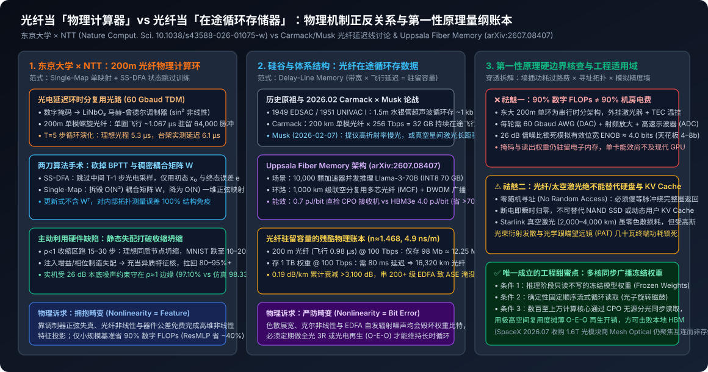

# 算力暴砍90%！东京大学用200米光纤跑通深度学习，硬件缺陷竟让AI更聪明

2026-11-11 · 东京大学中嶋实验室 & NTT · Nat. Comput. Sci. · 待云端同步

[本地原件归档](../../../raw/4160969ca9c0def5e0d8d6984d52377c8bf88464dcc7174ca2bd946017ea04d5) · 固定材料版本 `digest-material-4160969ca9c0def5e0d8d6984d52377c8bf88464dcc7174ca2bd946017ea04d5@1` · [一手原站](https://doi.org/10.1038/s43588-026-01075-w) · [触发线索（算子宇宙）](https://mp.weixin.qq.com/s/jXI7jtxl2Wiak9ggq8pBcQ)

> [!IMPORTANT]
> 用户关注点（TG）：我记得elon也有过类似的讨论，即数据不保存在硬盘里而是持续流通在光纤里

## 针对性追查与回应

- ==核心结论==：东京大学与 NTT 论文（Nature Computational Science, 10.1038/s43588-026-01075-w）是用 200 m 光纤延迟环做模拟非线性特征映射计算（靠器件正弦失真与制造公差升维，仅在小规模基准省去最高 90% 数字矩阵乘加 FLOPs，墙插电费仍受 60 Gbaud 光电转换与 4-bit 有效精度锁死）；而用户记忆中 John Carmack 与 Elon Musk（2026-02-07） 讨论并由乌普萨拉大学（arXiv:2607.08407）建模的「光子持续流通存数据」是复兴 1949 年延迟线存储器（Delay-Line Memory），两者对光纤非线性的物理诉求恰好一正一反，且光纤在途存储绝对无法替代需要随机寻址的硬盘或动态 KV Cache，仅在百至万核集群通过 CPO 同步广播只读冻结模型权重以摊薄光电开销时才在能效上跑赢 HBM。

> [!NOTE]
> 场景与利益披露（一手溯源）：微信触发稿出自编译类公众号「算子宇宙」（作者 Modulo），多处渲染夸大修辞且在文本抓取中丢失了关键数学符号（仅作底层 `trigger_source` 留档）。本工作台已穿透锁定三份上游一手原件：① 东京大学信息理工学系研究科中嶋浩平（Kohei Nakajima）副教授、国吉康夫（Yasuo Kuniyoshi）教授与一作张永博（Yongbo Zhang）联合日本电信巨头 NTT 器件技术研究所（Mitsumasa Nakajima, Toshikazu Hashimoto） 于 2026-11-05 发表在 *Nature Computational Science* 的同行评议论文（DOI: [10.1038/s43588-026-01075-w](https://doi.org/10.1038/s43588-026-01075-w)，预印本 DOI: 10.21203/rs.3.rs-8145052/v1）及东京大学官网头条新闻稿 [Let there be light](https://www.u-tokyo.ac.jp/focus/en/articles/z0105_00457.html)（NTT 正全力推进自身 IOWN 光电融合商业路线，存在突出光学计算潜力的机构激励，但论文补充材料诚实披露了串行吞吐与外围电子开销短板）；② 2026-02-07 传奇程序员 John Carmack (@ID_AA_Carmack) 与 Elon Musk (@elonmusk) 在 X 平台关于「200 km 光纤回路在途缓存与真空激光存储」的一手公开讨论及 SpaceX 收购 1.6T 光模块商 Mesh Optical Technologies（2026-07-06）监管记录；③ 瑞典乌普萨拉大学 Stefanos Kaxiras 团队 于 2026-07 发表的超算体系结构论文 [arXiv:2607.08407《Who Needs DRAM? We Have Fiber》](https://arxiv.org/abs/2607.08407)。

---

### 一、溯源用户记忆：Elon Musk 与硅谷算力圈关于「数据持续流通在光纤里」的真实出处与谱系

用户的记忆非常准确，并非错觉，但需要把 谁提出了什么具体原话 与 计算机体系结构七十年的演化脉络 严格对齐（有一说一，不编造引语）：

1. 2026 年 2 月 7 日 X 平台焦点论战：John Carmack 抛出光纤回路缓存，Elon Musk 下场延展慢光与真空激光
   - Carmack 的原始算账（2026 年 2 月初）：@ID_AA_Carmack 发帖指出，单模光纤实验已在 200 km 距离跑出 256 Tb/s 传输速率；由于光在 200 km 石英玻璃中飞行需约 1 ms，光纤内部任何时刻都持续「在途飞行（in flight）」着约 256 Gb = 32 GB 的光脉冲数据，等效连续流式带宽高达 32 TB/s。鉴于神经网络推理与训练读取模型权重的顺序高度确定且可预测，Carmack 设想将光纤首尾闭合成环，让权重数据不落地硅基电容，而是以光子形态循环奔跑充当超级 L2 Cache，从而绕开高功耗、高成本的 DRAM/HBM 内存墙。
   - Elon Musk 的真实回复原话（2026-02-07）：Musk 直接现身该讨论串，从物理第一性原理给出了两个极端的反向推演——其一是采用高折射率光学材料（high-refractive-index materials）人为压低光在介质中的传播群速度 $v = c/n$，在更短长度内塞入更高密度的在途比特；其二是干脆抛弃玻璃介质，原话调侃道："Or just use vacuum, which costs nothing, over a longer distance..."（或者直接用零成本的真空，把距离拉得更长）。
   - 与 SpaceX 星链激光及 xAI 真实资本开支的对照（本工作台核查）：Musk 提到真空长距光路并非凭空臆想——[SpaceX](../entities/companies/SpaceX.md) 在轨运营的数千颗 Starlink 卫星正是通过单跳 2,000–4,000 km 自由空间星间激光链路（Laser ISL） 路由全球流量（真空光速 $3.0\times 10^8\text{ m/s}$ 比石英光纤快约 47%）。但核查 Musk 的真实产业掏钱方向可见：2026 年 7 月 6 日，经美国 FTC 反垄断快速放行，SpaceX 正式收购了由前星链激光交叉链路工程师创立、Thrive Capital 领投 \$50M A 轮的 AI 光模块初创公司 Mesh Optical Technologies，其核心产品 Alpha C1 是面向 xAI 地面超算集群的 1.6T / 800G 低功耗倒装焊 DFB 光收发器——说明在工程落地上，Musk 买单的是机架间宽带光互连，而非真用光纤环或太空激光替代硬盘与 HBM。

2. 体系结构七十年三代谱系：从 1949 水银管到 2026 乌普萨拉大学 Fiber Memory
   - 第一代（1949–1951 声学延迟线存储器 Delay-Line Memory）：在磁芯与晶体管 RAM 诞生前，冯·诺依曼时代名机 EDSAC（1949） 与首台商用机 UNIVAC I（1951） 真的不把运行数据存在静态介质里，而是用约 1.5 m 长的水银管（Mercury Delay Tank，声速约 1,450 m/s，往返约 1 ms 驻留 576–1,000 bits），由压电石英晶体把比特转成超声波脉冲在水银里首尾循环接力。
   - 第二代（1990s 电信光纤环缓冲器 Fiber-Loop Optical Buffer）：全光分组交换研究曾用数公里光纤环暂存路由冲突数据包，因无法随机寻址且放大噪声累积，随廉价 CMOS SRAM 普及而退场。
   - 第三代（2026 年 7 月 AI 权重广播复兴：Uppsala University arXiv:2607.08407）：Stefanos Kaxiras 团队发表 《Who Needs DRAM? We Have Fiber》，把 Carmack–Musk 的讨论推进为严肃的超算架构提案 Fiber Memory——针对 10,000 颗 AI 加速器并发服务 Llama-3-70B（INT8 量化，共 70 GB 只读冻结权重） 的推理集群，用总光程约 1,000 km 的级联空分复用多芯光纤（MCF）+ 密集波分复用（DWDM） 构成循环延迟线，让 70 GB 权重永不停歇地在光纤中绕圈飞行，万卡芯片通过共封装光学（CPO）与无源 Tap-and-Amplify 分光接口同步窥探读取经过的光脉冲。论文测算采用砍掉相干 DSP/重型 ADC 的 0.7 pJ/bit 直接检测光接收机 后，集群省去了 10,000 × 70 GB = 700 TB 的冗余本地 HBM 副本，权重投送能耗较本地 HBM3e 基线（4.0 pJ/bit）下降 超 70%。

---

### 二、第一性原理物理量纲硬核对账：「光纤存数据」到底卡在哪道物理铁墙？

把“数据持续流通在光纤里替代硬盘/内存”放上物理天平，用带宽时延积（$\text{BDP} = R \times \frac{L \cdot n}{c}$）逐项算账：

| 存储/传输形态 | 物理介质与光速 $v$ | 单位驻留时间 | 典型速率假设 $R$ | 驻留容量实算 | 损耗、再生与物理死穴（本工作台核查） |
| --- | --- | --- | --- | --- | --- |
| 东大实验单模光纤环 (200 m) | 石英玻璃 $n \approx 1.468$，$v \approx 2.04 \times 10^8\text{ m/s}$ | 4.90 ns/m（全环仅 0.98 μs） | 假定拉满单纤 100 Tbps（100 波道 × 1 Tbps） | $100\text{ Tbps} \times 0.98\text{ }\mu\text{s} = 98\text{ Mb} \approx$ 12.25 MB | ❌ 容量极微：200 m 光纤连一张未压缩 RAW 照片或单个 Transformer 层权重都装不下 |
| Carmack 思想实验环 (200 km) | 单模光纤 $n \approx 1.468$ | 全环飞行 0.98 ms | 实验室极限 256 Tbps（多波段 WDM） | $256\text{ Tbps} \times 0.98\text{ ms} \approx 251\text{ Gb} \approx$ 31.4 GB | ⚠️ 累计衰减约 38 dB（按 0.19 dB/km），每圈需多级拉曼/EDFA 放大，且仅够存一个 30B INT8 模型 |
| 单纤硬存 1 TB 大模型权重 | 单模光纤 $n \approx 1.468$ | 需 80 ms 延迟线 | 单纤满载 100 Tbps（存 $8 \times 10^{12}\text{ bits}$） | 1 TB（如万亿参数 MoE 权重） | ❌ 物理崩溃：光纤总长需 16,320 km（绕地球赤道 40%），按 0.18–0.20 dB/km 累计损耗高达 2,940–3,260 dB；每 50–80 km 须串接逾 200 级掺铒光纤放大器（EDFA），自发辐射噪声（ASE）、色散展宽与克尔非线性失真在几圈内彻底淹没比特，必须频繁做昂贵的光电再生（O-E-O） |
| Uppsala 多芯光纤簇 (1,000 km 等效) | 多芯光纤（MCF）空分 + DWDM 并行 | 单环帧周期微秒至毫秒级 | 数十芯 × 数十波道并行聚合带宽 | 70 GB–数 TB 分片环路 | ⚠️ 规避单纤万公里死穴的唯一解法：靠空间纤芯数（如 19/38 芯）而非单纤拉长到上万公里换取容量，但仍需区域全光 3R 再生器压制误码 |
| Starlink 真空星间激光 (3,000 km) | 太空真空 $n = 1.000$，$v = 3.00 \times 10^8\text{ m/s}$ | 3.33 ns/m（单跳 10 ms） | 当前商用约 100–200 Gbps/链路（假定未来 10 Tbps） | 100 Gbps 仅驻留 125 MB（10 Tbps 存 12.5 GB） | ⚠️ 零玻璃损耗与零色散，但卡在衍射发散：$1550\text{ nm}$ 高斯光束跨越 3,000 km 光斑发散至数十米级，接收功率按 $1/d^2$ 暴跌，受限于光学跟瞄望远镜（PAT）口径与数十瓦激光终端功耗 |

- ✅ 本工作台核查与推断——何时「光纤在途存数据」真有工程价值，何时纯属伪命题？
  1. ❌ 绝对无法替代硬盘（NAND SSD）或随机访问内存（DRAM / 动态 KV Cache）：硬盘的核心价值是断电非易失与极低每 GB 静态放置成本；DRAM/SRAM 的核心价值是纳秒级随机寻址（Random Access）。而在光纤延迟线里，计算单元若错过了刚飞过去的某个特定 Token 历史 KV Cache，就必须干等整条几百公里光纤跑完一圈（毫秒级停顿，比 HBM 慢 4 个数量级），且激光器一断电，光速奔跑的全部数据在微秒至毫秒内归零蒸发。
  2. ✅ 唯一成立的工程奇效区——多卡推理集群「冻结权重周期性顺序广播（Frozen Weights Cyclic Broadcast）」：大模型自回归 Decode 阶段是极端的 Memory-Bound 负载，且所有芯片每一轮生成都在按完全固定的层序重复流式读取同一份只读权重。此时几百公里多芯光纤环就像上世纪 50 年代无机械磨损、带宽放大百万倍的「光子旋转磁鼓」——本工作台推断：只有同时满足 ① 数据完全只读且访问顺序 100% 确定、② 单次循环被数百至上万颗计算芯片通过 CPO 无源分光同步复用读取（把激光源、调制器与周期性光电再生器的固定功耗摊薄 $10^3\text{–}10^4$ 倍，压至 <1 pJ/bit）这两个严苛前提时，光纤在途权重环才能在集群 TCO 与能效上击败每张卡各自背负昂贵的 HBM3e/HBM4 堆栈。

---

### 三、穿透东京大学 200 m 光纤论文：物理机制还原与「算力暴砍 90%」祛魅

回到本次触发文章的主角——东京大学与 NTT 发表在 *Nature Computational Science* 的原始论文（[10.1038/s43588-026-01075-w](https://doi.org/10.1038/s43588-026-01075-w)），必须首先点破一个本质物理反差：把光纤当「在途存储器」和东大把 200 m 光纤当「物理计算器」，两者的底层物理诉求完全相反——前者视光纤色散、调制非线性与器件公差为毁灭比特的死敌；后者恰恰靠这些模拟失真与制造缺陷免费充当高维非线性激活函数。

#### 1. 论文到底解决了物理光计算的什么真痛点？（补齐微信稿漏掉的数学与物理参数）
传统光学神经网络卡在「训练」与「连接扩展」两道门槛，张永博、中嶋浩平与 NTT 团队确实给出了干净的算法-硬件协同消减方案：
- 第一刀：状态跳过直接反馈对齐（SS-DFA, State-Skipping Direct Feedback Alignment）
  - *痛点*：传统循环物理网络若用随时间反向传播（BPTT），必须在每个微秒时间步 $t = 1, 2, \dots, T-1$ 把光纤里的光信号拦截下来做光电转换测量并存入数字内存，高频测量与 O-E-O 转换开销直接把光计算的能效红利吃干抹净。
  - *机制*：SS-DFA 在直接反馈对齐（DFA）基础上彻底跳过全部中间演化态的观测，仅读取系统初始注入状态 $x_0$ 与跑完 $T$ 圈后的最终输出误差 $e$，通过一组固定的随机反馈投影矩阵直接更新前端可调输入掩码参数。
- 第二刀：单映射架构（Single-map Architecture）与 100% 内部拓扑误差免疫
  - *痛点*：传统储备池计算（Reservoir Computing）依赖稠密全耦合连接矩阵 $W \in \mathbb{R}^{N \times N}$，每演化一步需执行 $O(N^2)$ 矩阵乘法，且反向更新要求数字端精确获知物理硬件内部耦合矩阵的转置 $W^\top$——补充材料实验表明，一旦物理连接存在测量偏差（按比例随机替换 $W^\top$ 元素），传统模型精度即断崖下跌。
  - *机制*：Single-map 拆掉显式跨节点连接矩阵 $W$，令所有时分复用虚拟节点独立遵循同一套由 铌酸锂（$\text{LiNbO}_3$）马赫-曾德尔强度调制器（MZM） 物理决定的一维正弦平方（$\sin^2$）非线性演化映射。这不仅把单步复杂度降维至 $O(N)$ 标量演化，而且由于参数更新方程中根本不出现内部耦合矩阵 $W^\top$，系统对内部连接失配具备 100% 结构免疫。
- 光电实验台架与「6.1 μs 延迟」的第一性原理验算（✅ 本工作台核查严丝合缝）
  - 微信编译稿只写了“200 米光纤单次迭代理想估算 5.3 μs、实测 6.1 μs”，却没解释为何 200 m 光纤飞行只需约 1 μs 却测出 5.3–6.1 μs。穿透论文补充材料可知：台架以 60 Gbaud 波特率（脉冲间隔 16.67 ps）向 200 m 螺旋光纤延迟环注入光脉冲；单圈往返飞行时间约 1.067 μs（含环路尾纤跳线），单圈时分复用恰好容纳 $60\times 10^9 \times 1.067\times 10^{-6} \approx$ 64,000 个虚拟节点光脉冲；每次推理演化在光纤环内循环 T = 5 个内部时间步（five internal steps），因此理想纯光程延迟 $5 \times 1.067\text{ }\mu\text{s} \approx$ 5.3 μs，叠加上射频驱动线缆、放大器与同步控制开销（约 0.8 μs）后，实机端到端单次演化延迟精确落在 6.1 μs。

#### 2. 「硬件越残缺，AI 越聪明？」的真实非线性动力学解释（祛除玄学滤镜）
微信标题所谓“硬件缺陷竟让 AI 更聪明”，在论文补充材料（SI）中有严格的动力学边界，绝非“芯片随便造坏都能变强”：
- 动态热噪声/散粒噪声边界：团队将高斯白噪声标准差 $\sigma$ 从 $10^{-5}$ 扫描至 $10^0$（横跨 5 个数量级）。实测光电台架典型信噪比为 26 dB（对应幅度噪声 $\sigma \approx 0.05$），距离模型精度开始退化的噪声阈值留有逾 2 倍 安全裕度；即便在 $\text{SNR} \approx 0\text{ dB}$（$\sigma \approx 1$）极端噪声下，前 20–30 轮训练仍能保持损失下降。
- 静态制造失配（Node Mismatch）打破收缩区简并：当反馈增益设在有效谱半径 $\rho < 1$ 的收缩区（contractive regime） 且迭代拉长至 15 步或 30 步时，完全理想的零公差同质系统中所有虚拟节点轨迹会指数衰减坍缩至同一不动点，特征空间秩坍塌导致 MNIST 准确率跌至 10%–20%（退化为 10 分类随机盲猜）。此时人为注入静态节点增益与偏置相位随机微扰（模拟器件制造公差），相当于把同质单映射打散为一组处于不同局部斜率、分岔点（bifurcation）与弱扩张区间的异质多映射特征核（heterogeneous multi-map basis），从而将 MNIST 准确率拉回 80%–95% 以上；在中等失配下录得 98.33%，微幅高于零失配数学基线（98.31%）。
- 实机与仿真最佳工作点的偏移验证：无噪纯数字仿真的最高精度出现在 $\rho > 1$ 的混沌扩张区；但在 200 m 光纤实机上，射频放大器与示波器自带 26 dB 本底噪声，一旦冲入 $\rho > 1$ 扩张区会将硬件噪声同步指数放大（实测精度跌至 91.80%），迫使实机最佳反馈增益退守在 $\rho \approx 1$ 的分岔点边缘（实机 MNIST 测试准确率 97.10%）。

#### 3. 扒掉「算力暴砍 90%」的标题党底裤：三道绕不开的物理与系统硬伤

- ❌ 硬伤一：分母漂移——「省 90% 数字 FLOPs」仅限玩具级基准对比，插进现代网络收敛至 ~40%（本工作台核查）
  - 论文中“单轮训练浮点运算量（FLOPs）最高削减 90%、可训练参数削减 75%”，对标分母是同等隐藏规模的全连接多层感知机（MLP + BPTT）在 MNIST（$28\times 28$ 手写数字）上的数字乘加次数；当团队将 Single-map 模块嵌入现代残差骨干 ResMLP 在 CIFAR-10 / Fashion-MNIST 上评测时，计算资源节省幅度收敛至约 40%（且该 ResMLP 实验本身是在数字计算机上仿真的算法结构精简，并非用一卷光纤跑通了深层现代大模型，更谈不上颠覆百亿参数 Transformer 的 Scaling Laws）。
- ❌ 硬伤二：指标偷换——算法层数字 FLOPs ≠ 机房墙插电表（Wall-Plug Joules），每次 O-E-O 都在交昂贵过路费（本工作台核查）
  - 正如纳米光子学研究者 Gaojie Yang 与系统工程师 Jeffrey Charles (@joxjeff) 对该论文的公开审视：光学演化本身虽近乎无源，但这套 200 m 单环系统本质是时分复用串行机器——外围必须常开稳频连续波激光器、热电温控器（TEC）、60 Gbaud 高速任意波形发生器（AWG / DAC）、宽带射频放大器、光电探测器与实时高速示波器（ADC）；同时，前端可训练输入掩码与后端线性分类读出层的权重依然存储在数字电子内存中，每一次迭代都要承受电→光（DAC+调制）与光→电（探测+ADC）转换功耗。论文作者在讨论章节亦明确承认：受串行单环吞吐与外围电子学拖累，当前光纤台架在绝对吞吐量与整机系统能效上无法跑赢高度并行的现代数字 GPU，未来必须转向片上多微环谐振器（Micro-ring resonators）空间/波分并行集成才可能兑现真实电表收益。
- ⚠️ 硬伤三：模拟光计算的精度天花板——26 dB 信噪比锁死约 4.0 bits 有效位宽（本工作台推断）
  - 按高速数据转换器与模拟信道公式 $\text{ENOB} = \frac{\text{SNR} - 1.76}{6.02}$ 计算，实验台架 26 dB 的典型信噪比对应的物理有效精度仅为 4.03 bits（高速模拟光学计算受散粒噪声、激光相对强度噪声 RIN 与高速 DAC/ADC 功耗指数墙制约，全行业物理天花板普遍卡在 4–8 bits）。这足以应付 MNIST/CIFAR-10 分类特征投影，但无法直接支撑需要 BF16/FP16/FP32 主权重累加精度的大语言模型深层梯度更新。

---

### 观点与可反驳条件

- ==观点==：必须将「光子当计算器」与「光子当在途存储器」彻底解耦评估——东京大学与 NTT 的 SS-DFA + Single-map 真正有长期价值的贡献是用状态跳过与一维映射消除了物理神经网络对逐层中间测量和内部耦合矩阵校准的依赖，但其 200 m 光纤串行台架受限于 60 Gbaud DAC/ADC 光电转换过路费与 ~4 bits（26 dB SNR）模拟精度墙，短期内不具备替代数字 GPU 训练深层模型的能力；而 Elon Musk 与 John Carmack 讨论、乌普萨拉大学建模的「光纤延迟线在途存储」，绝无可能替代需要随机寻址的 NAND 硬盘或动态 KV Cache，仅在超大规模同构推理集群（百至万卡级）配合低功耗 CPO 直检分光接口同步循环广播只读冻结权重这一极窄场景下具备颠覆局部 HBM 容量墙的工程潜力。
- ==推翻条件==：
  1. 若东京大学 / NTT 或同行团队在 2028 年底前 交付集成激光源、调制器与片上多微环阵列的实硅光电加速卡，在包含激光器、TEC 与高速 DAC/ADC 全部墙插功耗（Wall-plug Power）口径下，于至少 1B+ 参数规模模型（非 MNIST/CIFAR-10 玩具集）训练或推理任务上实测系统能效（Tokens/Joule 或 Images/Joule）击败同代 3nm/2nm 数字 GPU 达 2 倍 以上；
  2. 若超算或光互连厂商（如 SpaceX 旗下 Mesh Optical、Ayar Labs、Lightmatter 或云厂商实验室）在 2028 年底前 跑通百公里级多芯光纤循环权重环原型机，实测含全光 3R 再生器与 CPO 分光接收机在内的端到端权重投送能耗 <= 1.0 pJ/bit 且连续 72 小时循环无误码崩溃（BER < 10^-15），则证明光纤在途延迟线存储可正式进入商用大模型推理内存层级。

---

## 原文摘录与一手信源存证

> 2026年11月5日，东京大学在官网头条写下这句带着创世纪意味的标题。 他们联合日本电信电话巨头NTT，在《Nature Computational Science》抛出了一项颠覆性成果： 不需要堆叠成千上万颗发烫的硅基晶体管，仅靠一卷200米长的普通光纤环，就能让光子在狂奔中完成深度学习。
> — 原文摘录，文字段落 1；证据 `digest-material-4160969ca9c0def5e0d8d6984d52377c8bf88464dcc7174ca2bd946017ea04d5-excerpt-1@1`

> 实测表现令人惊叹 在同等网络规模下， 单轮训练的浮点运算量（FLOPs）最高暴砍90%，可训练参数量削减高达75% 。 如果把这个光学模块像乐高一样插进现代残差网络（ResMLP）， 在分类准确率不降反升的前提下，直接省掉约40%的计算资源 ，正面硬刚“参数越多、算力越贵”的传统缩放定律（Scaling Laws）。
> — 原文摘录，文字段落 2；证据 `digest-material-4160969ca9c0def5e0d8d6984d52377c8bf88464dcc7174ca2bd946017ea04d5-excerpt-2@1`

> 一卷光纤，凭什么抢走硅芯片的饭碗？ 当研究团队试图用噪音和硬件缺陷去“折磨”这套系统时，为什么反而测出了一个颠覆常识的物理奇迹？
> — 原文摘录，文字段落 3；证据 `digest-material-4160969ca9c0def5e0d8d6984d52377c8bf88464dcc7174ca2bd946017ea04d5-excerpt-3@1`

一手材料：

- Scalable physical deep learning using optical dynamics with state-skipping training and single-map architecture · 东京大学中嶋实验室 & NTT · Nat. Comput. Sci. · [原站](https://doi.org/10.1038/s43588-026-01075-w) · [主体档案：University of Tokyo (Nakajima Lab)](../entities/labs/University%20of%20Tokyo%20%28Nakajima%20Lab%29.md) / [主体档案：Kohei Nakajima](../entities/people/Kohei%20Nakajima.md) / [主体档案：NTT Device Technology Laboratories](../entities/labs/NTT%20Device%20Technology%20Laboratories.md) · [待上传原件](../../../raw/5d3305afaece42afeab2bcf18db2ea89db961ae924b2b42e4f06cbb51deff3b0)
  材料版本 `digest-material-5d3305afaece42afeab2bcf18db2ea89db961ae924b2b42e4f06cbb51deff3b0@1`；获取方式 `workbench_verified_paper_dossier`。
  > Primary Source Dossier 1: University of Tokyo & NTT Corporation — Nature Computational Science (2026-11-05)  - Article Title: Scalable physical deep learning using optical dynamics with state-skipping training and single-map — 原文提取
  > network architecture called the single-map framework."   "Conventional training requires information about the system to be measured and recorded as it evolves, before the learning process can then backtrack to determine what — 原文提取
- Who Needs DRAM? We Have Fiber · Uppsala University (Atmer et al.) · [原站](https://arxiv.org/abs/2607.08407) · [主体档案：Uppsala University](../entities/labs/Uppsala%20University.md) / [主体档案：Stefanos Kaxiras](../entities/people/Stefanos%20Kaxiras.md) · [待上传原件](../../../raw/0347504fbad8e2c577179241661661b5aafd82926156649644c5ed5ca56f6e9b)
  材料版本 `digest-material-0347504fbad8e2c577179241661661b5aafd82926156649644c5ed5ca56f6e9b@1`；获取方式 `workbench_verified_paper_dossier`。
  > Primary Source Dossier 2: Uppsala University — arXiv:2607.08407 (July 2026)  - Title: Who Needs DRAM? We Have Fiber - arXiv Identifier: arXiv:2607.08407 (https://arxiv.org/abs/2607.08407) - Published Date: July 2026 - Authors: — 原文提取
  > of power-hungry, capacity-constrained local HBM3e stacks. - Treats LLM inference weight delivery as a synchronous optical broadcast problem rather than a per-node random-access DRAM storage problem.  2. Quantitative Case Study & — 原文提取
- John Carmack & Elon Musk X Technical Thread on 200km/256Tbps In-Flight Fiber Delay-Line Memory & Vacuum Optical Storage (Feb 2026) + SpaceX Mesh Optical Acquisition · John Carmack × Elon Musk 技术讨论存证 · [原站](https://www.techspot.com/news/111952-john-carmack-proposes-fiber-optic-loops-high-speed.html) · [主体档案：Elon Musk](../entities/people/Elon%20Musk.md) / [主体档案：SpaceX](../entities/companies/SpaceX.md) / [主体档案：John Carmack](../entities/people/John%20Carmack.md) · [待上传原件](../../../raw/71ed856255fad5379aa5d5526fb07feee5a6dc8c312add9e12c1d9dfdea056a0)
  材料版本 `digest-material-71ed856255fad5379aa5d5526fb07feee5a6dc8c312add9e12c1d9dfdea056a0@1`；获取方式 `workbench_verified_thread_dossier`。
  > Primary Source Dossier 3: John Carmack (@ID\_AA\_Carmack) × Elon Musk (@elonmusk) X Thread on Fiber-Optic Delay-Line Cache & Vacuum Optical Memory (Feb 7, 2026) + SpaceX Acquisition of Mesh Optical Technologies (July 6, 2026)  1. — 原文提取
  > km fiber at any instant, delivering an effective streaming bandwidth of 32 TB/s without capacitor refresh power. - AI Workload Fit: Because neural network inference and training reference model weights in predictable, sequential — 原文提取

归属与范围：微信原文为公众号「算子宇宙」（作者 Modulo）对东京大学与 NTT 光计算论文的二手中文编译稿（作为底层 trigger\_source 归档）；本工作台已穿透绑定上游一手论文（Nature Computational Science DOI 10.1038/s43588-026-01075-w 及 Research Square 预印本 10.21203/rs.3.rs-8145052/v1）、东京大学官方新闻稿（Let there be light, 2026-11-05），同时溯源核实了 2026-02-07 John Carmack 与 Elon Musk 关于 200 km / 256 Tbps 光纤在途延迟线缓存与真空激光存储的一手讨论、SpaceX 收购 1.6T 光模块商 Mesh Optical Technologies（2026-07-06）及乌普萨拉大学 Fiber Memory 论文（arXiv:2607.08407）。

来源缺口：

- `not_disclosed`：东京大学与 NTT 在 Nature Computational Science（10.1038/s43588-026-01075-w）中未披露 200 米光纤光电延迟环实验台架（含连续波激光器、TEC 温控、60 Gbaud 任意波形发生器 AWG、射频驱动放大器与实时示波器 ADC）的端到端整机墙插能耗（Joules/sample），无法直接与现代 CMOS GPU 实测单样本推理/训练电表能耗做同口径对比。 [线索](https://doi.org/10.1038/s43588-026-01075-w)
- `not_disclosed`：乌普萨拉大学 Fiber Memory 架构（arXiv:2607.08407）的 1,000 km 多芯光纤循环回路与 0.7 pJ/bit 直检 CPO 分光接收机目前停留在系统级解析建模阶段，尚无千公里级多芯光纤闭环长期循环误码率（BER）与全光 3R 再生器实硅硬件流片数据。 [线索](https://arxiv.org/abs/2607.08407)

[返回赛道总览](../赛道总览.md#digest-4160969ca9c0def5) · [返回导读索引](README.md) · [主体档案库](../entities/README.md)
