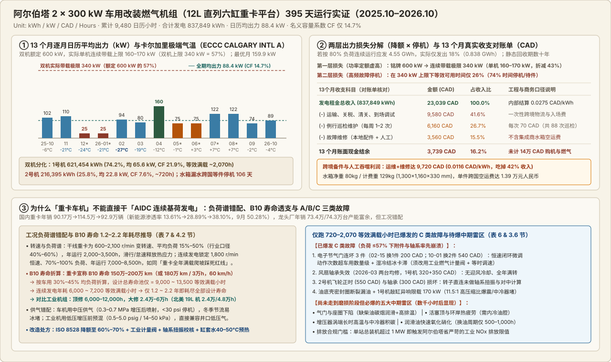

# 车机在北美高寒地区的应用实证:两台 300 kW 十二升直列六缸燃气发电机组在阿尔伯塔运行一年的观测

2026-11-06 · 加村Energy这些事 · 有来源缺口

[本地原件归档](../../../raw/a86b6bab14f4bbf73fbee7fb37360e1c04be4d36b646f7c20db0eea9e88152f1) · 固定材料版本 `digest-material-a86b6bab14f4bbf73fbee7fb37360e1c04be4d36b646f7c20db0eea9e88152f1@1` · [一手原站](https://mp.weixin.qq.com/s/drxVn2gpDEk-IdYfvNUmiQ)

> [!IMPORTANT]
> 用户关注点（TG）：这个数据很全啊，基本用原文就行了，然后找一下这个作者的其他信源，他有没有个人网站or其他账户

## 针对性追查与回应

- ==核心结论==：两台国产 12 L 直列六缸重卡天然气平台改装发电机组（铭牌 2 × 300 kW = 600 kW，设备合同总价约 14 万 CAD）在加拿大阿尔伯塔省连续观测 395 天（9,480 h）后，累计发电仅 837,849 kWh，全场名义容量系数 14.7%（1号机 21.9% / 65.6 kW，2号机 7.6% / 22.8 kW；12–1月低谷仅 25.0 kW / 4.2%）。出力折损由两层叠加造成：单机连续带载极限锁死在 160–170 kW（铭牌 57%），且在此上限下仍有 74% 时间处于故障停机或跨国待件（2号机水箱漏水空运备件耗时 106 天）。由于车用变转速低负荷谱与发电 1,800 r/min 恒速重载严重错配，重卡发动机设计寿命池仅 9,000–13,500 等效满负荷小时，连续发电 1.2–2.2 年 即耗尽寿命；13 个月例行巡检（6,160 CAD）与维修（3,560 CAD）吞噬租金收入（23,039 CAD）的 42%，扣减首次入场物流调试（9,580 CAD）后仅结余 3,739 CAD。未经主机厂按 ISO 8528 重新定额与高寒耐久强化的现成车机不宜直接用于数据中心或数字矿场连续基荷。
- 作者身份、场景与利益标注及全网其他信源盘点（✅ 本工作台核查）：
  1. 作者与机构真实身份（✅ 已核验并录入信源库）：公众号 加村Energy这些事 作者 Tony老师傅 本名 Tony Hwong（Tony Huang），现任聚焦北美的能源项目开发与工程咨询机构 WNT Energy Inc.（总部位于加拿大温哥华 Vancouver, BC）首席技术官（Chief Technology Officer, CTO），公开联系邮箱 tonyhwong@wntenergy.ca（项目商务邮箱 Amy@wntenergy.ca），具备热能工程与能源项目金融背景，长期深耕加拿大阿尔伯塔省（Alberta）与美国德州（Texas）天然气发电、混合微网及 AI 数据中心（AIDC）表后/离网（Behind-the-Fence / BTM）电力方案。场景与利益标注：本文系作者受同行委托亲自参与阿省现场运行满一年的第一手操盘复盘，电量对齐电度表、收支对齐对账单、气温对齐 ECCC CALGARY INTL A，未拆检故障均显式分层为工程推断；作者作为本地能源工程咨询方，立场明确区分“反对现成车机直接跑基荷”与“支持联合国内主机厂开发合规发电专用变型”。
  2. 已确认的个人/机构网站与研究门户矩阵（共 3 个独立站点入口 + 5 个实时数据看板，均已写入 `registry.sqlite3` 信源通道）：
     - 双语独立研究文库（Research Catalog，最核心文字信源）：[https://research.wntenergy.ca](https://research.wntenergy.ca) —— 作者维护的中英双语深度报告与技术笔记总目录（静态 Web 目录架构，未暴露 RSS feed，已按 `web_search_only` 站点通道接入），系统收录其关于北美 AIDC 表后供电、燃气轮机与往复式内燃机选型、气源采购与环保认证的系列原稿；
     - WNT Energy 官方网站与五大实时监测看板：[https://wntenergy.ca](https://wntenergy.ca) —— 公开提供 5 个非商业高频筛查工具：① Alberta Energy Dashboard（实时追踪阿省 AESO 池电价、供需平衡、AECO 天然气价与 AUC/AEPA 项目审批）、② Texas Energy Dashboard（ERCOT 电价负荷、Waha/Henry Hub 气价与 TCEQ 环评）、③ North America Datacenter Dashboard（北美 AIDC 与 BTM 容量追踪）、④ North America Power Plants（北美在运/规划电厂数据库）、⑤ GT Radar（燃气轮机产能与排期监测雷达）；
     - 2026 加拿大能源与算力项目库子站：[https://investment2026.wntenergy.ca](https://investment2026.wntenergy.ca) —— 汇总 *Canada Investment Summit 2026* 能源项目库与阿尔伯塔 AIDC 项目简报。
  3. 作者在 research.wntenergy.ca 与《加村Energy这些事》的代表性历史研究清单：
     - 一线电站运行实证姊妹篇：[《理想和现实的偏差：阿尔伯塔一座小型内燃机电厂运行全回顾》（2026-11-09，阿省 5×1.475MW 二手工业内燃机 1,038 天全账本，本库已归档）](理想和现实的偏差：阿尔伯塔一座小型内燃机电厂运行全回顾.md)；
     - 北美 AIDC 表后供电与电网政策：[《Anthropic 为什么要亲自下场买发电机？》（2026-11-10，拆解 Anthropic \$3.4B 接盘 OnePWR 1.7GW 卡特彼勒槽位，本库已归档）](Anthropic%20%E4%B8%BA%E4%BB%80%E4%B9%88%E8%A6%81%E4%BA%B2%E8%87%AA%E4%B8%8B%E5%9C%BA%E4%B9%B0%E5%8F%91%E7%94%B5%E6%9C%BA%EF%BC%9F.md)、《同样是北美 BTM 数据中心，为什么加拿大走联合循环，美国德州走单循环？》、《阿省电网为何对 Data Center 大开绿灯而对矿场关门？—— AESO 接入政策全解析》、*Alberta Data Centre Levy Mechanism Details*、*Off grid Alberta Data Center*、《德州矿场内燃机供电合规路径解析（增强版）》；
     - 燃机/内燃机行情、白皮书与出海认证：《阿尔伯塔省天然气寻源与采购白皮书（2026）》（编号 WNT-WP-GAS-2026-01）、《2026 年 9F 燃机市场价格行情》、《中型新一代往复式内燃机或燃气轮机》、《美国 AIDC 适用的大功率燃气发电机组 EPA 认证现状》、*On-site Certification Path for Chinese Power Generation Units in Canada*、《跨境引进二手燃气轮机机会与风险》、《一个攻城狮眼中的 GEV 季报》、《60Hz 的战争：全球燃机交付与订单格局》、《Bernstein〈Powering AI...〉中文整理、全文译文与分析》。
  4. 其他国内外社交与内容平台逐一核查结果（严守证据边界，不臆造）：
     - 中文平台：微信公众号 加村Energy这些事 为唯一确认的主力中文首发号；东方财富财富号、搜狐、网易、新浪财经及原创力文档（book118.com，存有其白皮书 PDF）可见单篇转载或文档镜像；知乎、雪球、小红书、B站、微博、知识星球 均未检索到作者实名或同名独立认证账号；
     - 海外社交与代码平台：wntenergy.ca 全站未绑定 X (Twitter)、LinkedIn、Substack、Medium、YouTube 官方账号，公开检索亦无对应个人主页；GitHub 同名账号 github.com/tonyjhuang（软件开发者，reddit-to-gmap 作者）与 Global Energy Monitor（gem.wiki）记载的澳洲褐煤气化项目同名人物经核查均属无关重名，已严格剔除。

---

## 原文全量实证记录（1–6 章正文与表 1–表 11 完整保留）

> 按用户「基本用原文就行了」指示，以下完整保留《车机在北美高寒地区的应用实证:两台 300 kW 十二升直列六缸燃气发电机组在阿尔伯塔运行一年的观测》全部章节正文与表 1 至表 11 原始数据，仅将微信纯文本换行还原为标准 Markdown 表格，并在关键数据表后以独立引用块附注工作台核查。

### 1 缘起：什么是车机，为什么会吸引投资人

#### 1.1 车机的定义

本文所说的“车机”，指以重型卡车上的内燃机为原型改装的发电机组。这类发动机原以柴油为燃料，近年来中国市场出现了大量以天然气为燃料的版本；主流为直列六缸、排量 12~15 L，也有更高的如重康 19LK19 方案。改装为发电用途后的功率集中在 200~400 kW。

#### 1.2 为什么它进入了投资人的选择范围

重卡发动机在国内产量与保有量极大，供应链成熟，单机成本远低于工业燃气发电机组。“兆瓦成本一百万出头”的数字，对于第一次在北美、特别是阿尔伯塔做连续发电业务的投资人很有吸引力。

#### 1.3 本报告的来历与范围

笔者受同行朋友委托，参与了两台 12 L 直列六缸燃气发电机组在阿尔伯塔的现场运行。机组于 2025 年 10 月投入运行，至今已满一年。本文以这一年的实际运行为样本，尽量做到客观、完整，供投资人作选择参考。

但是请注意如下事实，可以做理性的技术层面讨论，但不争论：

- 样本有限：2 台机组、单一机型、单一场址、一个相对温和的冬季。结论是对“车机用于连续发电”这条路线的实证参照，而不是统计结论。
- 数据口径：电量来自电度表读数，故障与费用来自对账单，调试过程来自沟通记录。现场没有运行小时计、燃气耗量和机组参数记录，所有出力均为日历口径。
- 表述原则：报告不点名集成商、发动机厂和现场人员；对未拆检确认的故障原因，一律标注为“推断”。

---

### 2 整体表现：一年的发电与收支

#### 2.1 机组配置

表 1 机组主要配置（品牌已匿名）

| 项目 | 参数 |
| :--- | :--- |
| 数量与型式 | 2 台，拖车式静音集装箱（美规拖车钩） |
| 发动机 | 国产重卡直列六缸 12 L 天然气发动机（车用平台） |
| 发电机 | 国产品牌无刷同步发电机，UL/CSA 认证 |
| 额定 | 300 kW / 400 V / 60 Hz / 1,800 r/min，功率因数 0.8 |
| 冷却与冬季配置 | 立式散热器（集成商配套）；油水加热、柜内空间加热器 |
| 供气要求 | 调压阀前 0.3~0.7 MPa；CH₄ ≥ 80%；H₂S ≤ 20 ppm |
| 适用环境（技术协议） | −30 ~ 40 °C；海拔 ≤ 1,000 m；额定条件 100 kPa、25 °C |
| 现场 | 海拔约 1,000 m（阿省典型海拔） |

#### 2.2 总体指标

表 2 全期总体指标

| 指标 | 1 号机 | 2 号机 | 合计 |
| :--- | :---: | :---: | :---: |
| 累计发电量 | 621,454 kWh | 216,395 kWh | 837,849 kWh |
| 占比 | 74.2% | 25.8% | 100% |
| 日历平均出力（395 天，9,480 h） | 65.6 kW | 22.8 kW | 88.4 kW |
| 容量系数（对额定 300 kW） | 21.9% | 7.6% | 14.7% |
| 等效满负荷小时（累计） | 约 2,070 h | 约 720 h | — |

读数起点为 2025 年 10 月 1 日，终点为 2026 年 10 月 31 日，共 395 天。两台机组从未出现过接近满负荷的持续运行：最好的月份（2026 年 4 月）合计日历平均出力 160 kW，为装机的 26.7%。

#### 2.3 逐月发电量

表 3 逐月发电量与卡尔加里月均 / 极端最低气温

| 月份 | 天数 | 1 号 kWh | 2 号 kWh | 合计 kWh | 平均 kW | 气温均值 / 极低 °C |
| :--- | :---: | :---: | :---: | :---: | :---: | :---: |
| 2025-10 | 30 | 49,439 | 24,064 | 73,503 | 102.1 | 6.8 / −6.0 |
| 2025-11 | 30 | 69,150 | 10,090 | 79,240 | 110.1 | 0.0 / −20.7 |
| 2025-12 * | 31 | 16,859 | 1,724 | 18,583 | 25.0 | −7.0 / −23.8 |
| 2026-01 * | 31 | 16,859 | 1,724 | 18,583 | 25.0 | −2.8 / −21.4 |
| 2026-02 | 28 | 36,449 | 26,504 | 62,953 | 93.7 | −3.7 / −26.8 |
| 2026-03 | 31 | 35,785 | 23,818 | 59,603 | 80.1 | −1.0 / −18.9 |
| 2026-04 | 30 | 89,066 | 26,069 | 115,135 | 159.9 | 2.9 / −11.7 |
| 2026-05 * | 31 | 47,041 | 8,864 | 55,905 | 75.1 | 12.6 / −0.5 |
| 2026-06 * | 30 | 45,523 | 8,579 | 54,102 | 75.1 | 13.7 / 3.4 |
| 2026-07 * | 31 | 91,057 | 0 *(并入9月)* | 91,057 | 122.4 | 19.8 / 6.8 |
| 2026-08 * | 30 | 88,119 | 0 *(并入9月)* | 88,119 | 122.4 | 17.3 / 6.7 |
| 2026-09 | 31 | 28,981 | 25,825 | 54,806 | 73.7 | 11.9 / −2.0 |
| 2026-10 | 31 | 7,126 | 59,134 | 66,260 | 89.1 | 5.8 / −4.4 |
| 合计 | 395 | 621,454 | 216,395 | 837,849 | 88.4 | — |

*\* 现场电表为不定期抄表：12–1 月、5–6 月、7–8 月为合并读数，表中按天数均分到月，属估算；10 月起算窗口为 30 天。2 号机 8 月末读数缺失，7–9 月电量按原报表口径全部计入 9 月，7–8 月记 0（原报表同此口径）。气温来自 ECCC CALGARY INTL A，个别月份有缺测日。*

> 本工作台复核（✅ 量纲勾稽一致 / ⚠️ 合并抄表口径提示）：13 个月分项求和 1号机 = 621,454 kWh、2号机 = 216,395 kWh、总计 = 837,849 kWh，除以 395 天 × 24 h = 9,480 h 得日历平均出力 88.38 kW（88.4 kW），再除以双机铭牌 600 kW 得全场容量系数 14.73%（14.7%），全部与表 2、表 3 严密吻合；需注意 2026-07 与 2026-08 的平均功率 122.4 kW 仅反映了 1 号机出力，2 号机同期电量积攒在 9 月读数（25,825 kWh）中。

#### 2.4 冬季表现

出力最低的时期是 2025 年 12 月至 2026 年 1 月，两台合计日历平均仅 25 kW（容量系数 4.2%），恰为一年中最冷的阶段。但需客观看待：

- 本冬偏温和：观测期最低气温 −26.8 °C（2026-02-19），没有出现 −30 °C 以下；1 月均温比 1991–2020 年常年（−7.6 °C）偏暖约 5 °C。机组技术协议的低温运行下限正是 −30 °C。正常或偏冷年份的风险高于本次所见。
- 低温不是唯一原因：2 月是观测期最冷的月份，出力反而恢复到 94 kW。12–1 月的低出力，2 号机因等待备件从国内发货而停摆是确定因素；1 号机仅发出约 23 kW，对应的具体故障没有记录。
- 与低温在时间上吻合的事件：2 号机水箱漏水发生在入冬首次强降温期（11 月极端最低 −20.7 °C）；1 号机节气门更换发生在 2 月寒潮期间。因果关系尚未拆检确认。

#### 2.5 收支

表 4 13 个月收支（与对账单余额核对一致）

| 项目 | 金额 CAD | 占收入 | 说明 |
| :--- | :---: | :---: | :--- |
| 发电租金收入 | 23,039 | 100% | 约 0.0275 加元/kWh（内部结算安排，非市场电价） |
| 运输、关税、清关、到场、调试 | 9,580 | 41.6% | 一次性 |
| 例行巡检维护 | 6,160 | 26.7% | 每次 70 加元，每周 1–2 次 |
| 故障维修（配件 + 人工） | 3,560 | 15.5% | 不含集成商承担的备件空运费 |
| 13 个月结余 | 3,739 | 16.2% | 未计设备购置成本、折旧与燃气 |

运维与维修的现金支出合计 9,720 加元，约 0.0116 加元/kWh，相当于收入单价的 42%。设备合同价约 14 万加元（按约 5.2 元/加元粗算），13 个月结余 3,739 加元，按本案结算口径静态回收期以数十年计；由于租金单价是本案的内部安排，这一数字只说明本案，不代表其他商业模式。若 2 台机组能在 80% 负荷下连续运行，同一时期可发约 4.55 GWh，实际发出其中的 18%。

> 本工作台测算（❌ 资本回收证伪）：23,039 - 9,580 - 6,160 - 3,560 = 3,739 CAD 对账精确闭合；即便次年起不再发生 9,580 CAD 一次性入场费，仅靠维持现有发电水平下的年化运行净现金流（约 12,300 CAD/年），回收 140,000 CAD 设备本金仍需 11.4 年，远超该车机在连续发电工况下 1.2–2.2 年 的物理寿命上限。

---

### 3 损失归因：三类原因

#### 3.1 先看损失的两层结构

由于缺少运行小时计，无法把损失精确拆分为停机和降负荷。但是首先需要明确的是，本机连续带载功率极限为 160-170 kW，为设计值的一半略高。

以每台约 170 kW 作为带载能力（2 号机假定同级），则全厂能力上限约 340 kW，实际平均 88.4 kW，等效可用时间约 26%，若以出厂标称额定功率 600 kW 计算，等效可用时间为 14.7%。

这一分解的含义：即使机组全年不停，也只能发出额定的 57%；而实际上它们有大约四分之三的时间处于停机或故障状态。两层损失的原因各不相同，下面按三类原因逐一说明。

#### 3.2 三类原因总览

表 5 三类原因对应的主要事件

| 事件 / 现象 | 主因 | 放大因素 | 状态 |
| :--- | :--- | :--- | :--- |
| 进气压力与气源不匹配，压力低于约 30 psi 即停机 | A 设计与配套 | — | 未见书面结论 |
| 2 号机水箱漏水，停机待件 | A 散热系统配套（原因未拆检） | B 备件空运、清关 | 已更换 |
| 启动敲击缸体异响（疑增压器漏气 / 中冷器堵塞） | C 发动机 | — | 未拆检 |
| 1 号机节气门更换；另 2 个节气门更换 | C 发动机 | — | 已更换 |
| 风扇轴承失效（两台均在 3 月修复） | C 随机附件 | — | 已修复 |
| 油底壳密封圈断裂漏油 | C 发动机 | B 待国内备件 | 未见闭环 |
| 1 号机仅约 170 kW；5–6 月“维修、功率小” | C 发动机（待查） | — | 未闭环 |
| 2 号机飞轮及正时故障；飞轮轴承更换 | C 发动机 | — | 已更换 |

#### 3.3 A 类：设计与当地情况不匹配

- 进气压力：机组按中压供气配置，调试时压力低于约 30 psi 即停机，现场气源约 30~40 psi。这主要是签约前厂家与现场气源条件沟通不充分所致，可通过前期书面确认避免。集成商表示其常规产品为低压进气。
- 散热水箱：现场人员调试时即反映水箱偏小，集成商答复按环境与工况设计、理论够用；2 号机水箱在投运 6 周后漏水。是水箱本身的制造与耐久问题、热冲击还是低温所致，没有拆检结论，不作推断。
- 条款表述：合同正文的环境温度写作“0-30℃ ～ 40℃”，技术协议为“−30℃ ～ 40℃”，两处表述不一致；低温条款应在签约前核对。

#### 3.4 B 类：备件与供应链（简述）

2 号机水箱的处理过程是这一类问题的典型：2025-11-15 漏水停机；到国内采购备件发出到现场，从漏水到恢复共 106 天。

- 物流成本与周期：一个水箱预估 80 kg，实际计费 129 kg（含包装，约 1,300×1,160×330 mm），空运费约 1.39 万元人民币，已是优惠后价格。
- 易损件备存：合同随机备品“满足一年正常运行”，包括火花塞、空滤、机滤等，但水箱、节气门、轴承、飞轮类部件不在其中；这类件在本案中恰是故障主体。
- 本地人工成本：现场负责人的看法是，加拿大配件和人工都贵，频繁故障意味着项目收益大部分流向本地维修。
- 量级估算：以 2 号机自身 2–4 月的发电速度（约 857 kWh/天）为基线，12–1 月 62 天少发约 50 MWh，约占全期发电量的 6%。这一基线本身偏低，估算偏保守。

#### 3.5 C 类：发动机本体及随机附件（重点）

C 类是车机自身的问题，也是与前两类最大的区别：A、B 类可以通过更好的沟通和备件策略缓解，C 类的根源是车用设计与连续发电工况不匹配。下表按记录列出现象与可能机理。机理均为工程推断，现场没有对应的拆检报告，证据等级一栏已标注。

表 6 C 类事件与可能机理

| 部位 / 现象 | 现场记录 | 可能机理（推断） | 证据等级 |
| :--- | :--- | :--- | :--- |
| 电子节气门（3 件，两次事件） | 2026-02-15 更换 1 件（200 加元）；2026-10-01 更换 2 件（540 加元） | 车用节气门服务驾驶员瞬态需求，开度变化慢、总动作次数有限；发电为恒速闭环调节，节气门全年持续微调，累计动作次数高出数量级；寒冷季节进气湿冷空气可导致结冰、卡滞 | 事件已确认；机理推断 |
| 风扇轴承 | 2026-03-18~20，1 号机，配件 320 + 安装 350 加元；3-25 两台均可工作 | 车用风扇随车速调节、离合器常脱开，实际运转时间短；固定式连续运行风扇全年满转；低温下润滑脂流动性差 | 事件已确认；机理推断（是否发动机配套存疑） |
| 飞轮及正时（2 号机）；飞轮轴承 | 2026-08-01 更换（550 加元）；2026-10-01 更换轴承（300 加元） | 车用飞轮匹配离合器与变速箱，轴系扭振在车辆传动链上验证；发电机转子直连飞轮后轴系质量与刚度完全不同，未做扭振计算和对中校核时，会加速轴承与正时机构损坏 | 事件已确认；机理推断，需拆检 |
| 油底壳密封圈断裂漏油 | 2026-03-25，需国内备件 | 固定式连续运行的热循环、振动与低温使橡胶件老化；车用油底壳为浅冲压结构、密封面刚度有限 | 事件已确认；机理推断 |
| 启动敲缸异响；1 号机约 170 kW | 2025-09 调试期异响，因异响未敢运行；2026-03 会议集成商初步怀疑增压器漏气或中冷器堵塞 | 进气量不足导致燃烧不良，或爆震（见下文气质）；增压器、中冷器是否损坏未拆检 | 未拆检，根因未定 |

一个值得注意的事实：上述故障发生时，机组的运行负荷不超过额定的约 57%，累计运行强度也只有 720~2,070 等效满负荷小时。也就是说，即使降额运行，车用平台的附件、传动连接和密封部位也未能支撑连续发电工况。这里需要避免的误读是：这些故障多集中在附件，并不说明发动机主体没有问题，因为主运动件尚没有走到磨损阶段。

气质是一个附加风险。车用发动机按稳定的管道或 LNG 气质标定，本项目所用车机为 11.5 的高压缩比。若现场气甲烷值偏低，恒速满负荷下易爆震，需要降额或退点火角，进而造成排温升高。

#### 3.6 尚未暴露的风险

以下部位在本案中尚没有故障记录，但在车机改发电的连续重载工况下是典型的中期失效点，应作为投资人的风险预期：

- 气门与气门座圈：天然气燃烧缺少柴油碳烟的润滑，且车用天然气机排温较高；连续高负荷下气门座圈磨损下陷通常在数千小时后显现。
- 活塞、缸套与活塞环：恒速高负荷下热负荷持续，没有车辆滑行时的降温窗口；爆震会损伤活塞顶与环岸。
- 增压器与中冷器：涡端温度与转速长期处于高位；积碳与冷凝水影响中冷效率。
- 润滑油：车用换油周期以公里计（国六天然气重卡常见 3 万~6 万公里，折合约 500~1,000 h，且平均负荷低）；连续高负荷下氧化与硝化加快，需按小时和油液分析缩短周期。
- 排放后处理：若总装机超过 1 MW，需满足更为苛刻的阿省本地 NOx 排放要求。

---

### 4 为什么车机不宜直接用于连续重载发电

#### 4.1 负荷谱：从变工况到连续恒载

根据运营经验，干线重卡发动机大部分时间处于额定功率 15%~50% 的负荷，达到 50%~80% 的情况很少；部分公开行业资料给出的长途干线平均负荷率为 40%~60%。无论取哪种口径，车机都是“短时高负荷、长时低负荷、频繁变速变载”的设计，额定功率只在爬坡、超车时短暂使用。

数字矿场和数据中心则要求恒转速（本案 1,800 r/min）、70%~100% 负荷、全年 8,000 小时以上不间断运行，相当于让卡车一直满载爬坡，不换挡也不松油门，即“一直踩在红线区”。

*注：原文配图中车用负荷分布为依据经验区间绘制的示意，非实测负荷谱。*

表 7 车用与连续发电工况对比

| 对比项 | 车用工况 | 连续发电工况 |
| :--- | :--- | :--- |
| 转速 | 600~2,100 r/min 全域变化 | 恒定 1,800 r/min |
| 平均负荷 | 15%~60%（经验）；40%~60%（部分行业口径） | 70%~100%，恒定 |
| 年运行小时 | 约 2,000~3,500 h | 7,000~8,500 h |
| 热应力 | 滑行、怠速使温度周期性下降 | 几乎无释放窗口，持续热负荷 |
| 冷却 | 迎风冷却，散热量随车速变化 | 无迎风，风扇全年满转承担散热 |
| 燃料 | 稳定的 LNG/CNG 气质 | 管网气或井口 / 伴生气，气质可能波动 |
| 起停与环境 | 每天起停，处于车辆热包络内 | 长期连续，露天集装箱，冬季 −30 °C 以下 |
| 维护体系 | 全国服务网络，按公里保养 | 北美本地缺乏车机配件与服务 |

#### 4.2 寿命消耗

国内主流重卡发动机公开宣称的 B10 寿命约 150 万~200 万公里，有厂家将其表述为“180 万公里 / 3 万小时”，隐含平均车速约 60 km/h。这 3 万小时 是在车用平均负荷下取得的。按 30%~45% 的平均负荷折算，设计寿命总量约 9,000~13,500 等效满负荷小时。

连续发电每年消耗 6,000~7,200 等效满负荷小时，约 1.2~2.2 年 即耗尽车机的设计寿命总量；工业燃气发电机组的顶修间隔通常在 6,000~12,000 运行小时，大修间隔在 2.4 万~6 万小时 以上（参照本地资料库中某国产 16 缸机组 6,000 h 顶修、某北美品牌 19 L 机组 2.4 万 / 4.8 万 h 大修的维保计划）。磨损与负荷并非线性关系，高负荷下热负荷驱动的失效增长更快，按线性折算的结果偏乐观。

#### 4.3 现场故障与工况错配的对应

第 3.5 节列出的 C 类事件与工况差异一一对应：节气门对应“恒速闭环调节的累计动作次数”，风扇轴承对应“风扇全年满转”，飞轮与正时对应“发电机直连后的轴系扭振”，密封件对应“热循环与振动”，出力受限与异响对应“恒速满负荷下的进气与爆震余量”。这些都是车用设计时没有被要求、也没有被验证的条件。

---

### 5 改进方向：连续重载与高寒适应

以下为把车用平台转化为发电专用变型时需要处理的主要事项。这些是方向性建议，参数为设计起点，需主机厂按具体机型核算和验证，尚未经本项目现场验证。

#### 5.1 连续重载的强化

表 8 连续重载强化事项

| 系统 | 改进方向 | 针对的问题 |
| :--- | :--- | :--- |
| 功率定额 | 按 ISO 8528 重新定额（COP/PRP），连续功率建议不超过车用峰值功率的 60%~70%，由耐久试验确定；给出海拔、温度降额曲线 | 带不满负荷、寿命消耗 |
| 缸盖与配气 | 气门与座圈改用耐高温材料并加硬化处理，增加气门旋转机构；强化缸盖冷却 | 气门座圈下陷（待显现） |
| 活塞与燃烧 | 活塞内冷油腔与耐高温环组；适当降低压缩比或增加爆震余量；分缸爆震与排温监测，按甲烷值自适应点火 | 爆震、热负荷 |
| 增压与进气 | 按恒速工况重新匹配增压器；中冷器防积垢；以工业级燃气计量阀取代车用电子节气门，配等时调速 | 出力受限、节气门磨损 |
| 润滑 | 加深油底壳或增加副油箱，外置机油冷却器，低灰分燃气机油，按运行小时与油液分析换油 | 机油氧化硝化、密封泄漏 |
| 冷却系统 | 按 40~45 °C 环境与满负荷散热量设计工业散热器；缸套水与中冷水分路；工业级电动或液力风扇与轴承 | 水箱、风扇轴承 |
| 轴系 | 标准飞轮壳与飞轮，弹性联轴器；完成发动机-发电机轴系扭振与对中计算 | 飞轮、正时、轴承 |
| 密封件 | 油封与垫片改用耐热耐低温材料 | 油底壳漏油 |
| 监测与维护 | 小时计、燃气耗量、各缸排温、远程监控；以运行小时为基准的保养计划 | 无法区分停机与降负荷 |

#### 5.2 高寒（阿尔伯塔）适应

表 9 高寒适应措施

| 措施 | 要点（参考量级，需热平衡核算） | 针对的问题 |
| :--- | :--- | :--- |
| 缸套水预热 | 强制循环式缸套水加热器，待机保持缸套水约 40~50 °C，实现无冲击带载起步（量级 6~9 kW） | 冷启动、热冲击、水箱漏水 |
| 机油预热 | 油底壳加热垫或循环油加热，待机保持油温约 25~35 °C | 冷启动磨损、润滑不良 |
| 保温舱体与风门 | 保温隔热舱体；进排风口设电动保温百叶，停机即关，运行时按舱温调节 | 舱内低温、水箱冻结风险 |
| 燃气与进气防冻 | 燃气预热（可利用缸套水余热），防止调压器节流结冰；节气门或燃气阀加热；进气防湿防冰 | 节气门卡滞、燃气调压器冰堵 |
| 曲轴箱通风 | 通风管路电伴热，防冷凝水结冰冰堵 | 曲轴箱压力异常、油封泄漏 |
| 防冻液与电瓶 | 乙二醇浓度按 −40 °C 校核；电瓶加热或保温，增大冷启动容量 | 冷启动失败 |
| 运行规程 | 热备用优先于冷启动；分段升载；停机后保温不排水；寒潮前后专项巡检 | 冷启动与寒潮故障 |
| 本地化备件 | 在北美本地常备水箱、节气门、轴承、密封件、点火件；指定本地服务商 | 停机时间长 |

#### 5.3 供气方式：低压还是中压

本案机组按中压供气配置（调压阀前 0.3~0.7 MPa），车用天然气发动机多采用这种做法：燃气在增压器、中冷器之后喷入，进气管内为空气，安全性较好、动态响应快。工业燃气机组则多用低压供气，燃气在增压器前与空气预混，所需压力很低（参考本地资料库：某北美品牌 12 缸机组 0.5~5.0 psig，某欧洲品牌 16 缸机组 14~25 kPa，某国产 16 缸机组入口最高 50 kPa）。

表 10 两种供气方式比较

| 比较项 | 低压供气（增压器前混合） | 中压供气（增压后喷射 / 混合） |
| :--- | :--- | :--- |
| 气源压力 | 2~50 kPa，管网低压分支、井口低压气可直接使用 | 0.3~0.7 MPa，低压气源需增设压缩机 |
| 系统复杂度 | 无压缩机，系统简单 | 压缩机增加投资、自耗电与故障点 |
| 动态响应 | 混合气路径长，加载响应较慢 | 响应快，利于孤网负荷突变 |
| 安全性 | 增压器与中冷器内为可燃混合气，需防回火 | 进气管内为空气，较安全 |
| 寒冷地区 | 压降小，调压器冰堵风险低 | 节流降温明显，冬季须燃气预热 |

建议：稳态连续负荷优先低压预混、稀燃路线；有稳定中压气源且负荷阶跃大时，中压喷射更有优势。无论哪种，都应在签约前书面确认进气压力范围并与现场气源比对。把车机改为低压供气并非换一个混合器，还涉及增压器匹配和点火、空燃比重新标定，属于发电专用变型开发的一部分。

---

### 6 产能机会与投资建议

#### 6.1 中国重卡电动化与车机产能

中国重卡市场正在快速电动化。新能源重卡终端渗透率从 2024 年的约 13.6% 升至 2025 年全年 28.9%，2025 年 12 月单月首次超过 50%；2026 年 1–9 月累计 38.1%，9 月单月 50.3%。天然气重卡 2024–2025 年维持在约 18 万~20 万辆，2026 年前三季度同比下降约 12%。

表 11 中国重卡市场与发动机产销关键数据

| 指标 | 2024 | 2025 | 2026（1–9 月） | 核验状态 |
| :--- | :---: | :---: | :---: | :--- |
| 重卡销量（中汽协，批发含出口） | 90.17 万辆 | 114.5 万辆 | 92.9 万辆 | 双源一致 |
| 新能源重卡（国内终端） | 8.2 万辆 | 23.11 万辆 | 22.64 万辆 | 双源一致，已抽查 |
| 新能源终端渗透率 | 13.61% | 28.89%（12 月 53.89%） | 38.10%（9 月 50.28%） | 已抽查 |
| 天然气重卡（国内终端） | 17.82 万辆 | 19.87 万辆 | 约 12.78 万辆 | 2026 数据单源，未确认 |
| 龙头发动机企业年销量（年报） | 73.4 万台 | 74.3 万台 | — | 双源一致（全系列） |

> 本工作台核查（✅ 匿名机型与行业数据核验）：对照潍柴动力（000338.SZ / 2338.HK）2024 及 2025 年度报告，其全系列发动机年销量精确为 73.4 万台（2024）与 74.3 万台（2025），结合表 1 直列六缸 12 L、11.5:1 压缩比及 0.3~0.7 MPa 中压喷射特征，本工作台推断 本案改装车机底层发动机平台对应潍柴 WP12NG / WP13NG 车用天然气机系列（文中另提的 重康 19LK19 则对应重庆康明斯 19 升 K19 平台）。

重卡发动机产能是按历史高点（2020 年重卡销量约 160 万辆）配置的，而柴油与天然气重卡的国内需求正被电动化挤压，11~15 L 直列六缸发动机的产能富余是趋势（公开渠道未找到官方产能利用率数据）。这为“车机转向分布式发电”提供了产能、成本与供应链基础。

#### 6.2 机会在哪里，怎么做

北美（特别是阿尔伯塔）、中亚、中东等地天然气价格低廉，200~400 kW 这个小功率段适合油田伴生气、井口、矿场、边远微网等分布式场景。中国车机平台可以在这里发挥作用，前提是充分改进、适应本地环境，而不是一味低价竞争。本案说明，仅靠低价改装进入这一市场，设备本身的价格优势会被停机、维修、跨境备件与本地人工吃掉。

- 由主机厂主导：由发动机主机厂开发按发电工况定额的发电专用变型，完成连续运行耐久与高寒验证，并对发电用途承担质保。
- 适应北美条件：低压或经验证的供气方案、高寒包、CSA/ULC 与排放合规、北美标准的控制与并机接口。
- 服务前置：本地备件库、本地服务商、远程监控，把关键件的修复时间控制在天，而不是月。
- 商务模式绑定可用率：采用租赁或按电量结算时，可用率直接决定收入，厂家与投资人的利益才能一致。

#### 6.3 对投资人的建议

1. 不建议把未经重新设计的车机直接用于数字矿场、数据中心等连续重载场景。本案在温和冬季、低累计负荷下已出现 14.7% 的容量系数和多次部件级故障。
2. 如因成本或交期必须短期使用，应将其视为短寿命、可消耗设备：运行负荷不超过额定约 50%~60%（本案 1 号机实际只能带到约 57%）；至少按 1.5 倍配置冗余；现场常备水箱、节气门、风扇轴承、飞轮轴承、正时件、密封圈与火花塞；按 1.5~2 年回收投资测算，不要套用工业机组的长寿命假设。
3. 采购评估清单：主机厂出具的 ISO 8528 连续功率（COP/PRP）定额；发电工况下累计 8,000 小时以上的现场运行证据；顶修与大修间隔（以运行小时计）；整机（而非单个部件）的 CSA 认证；海拔与低温降额曲线；供气压力要求与现场气源是否匹配；发动机厂是否对发电用途提供质保；北美本地备件与服务响应时间；合同环境条款表述一致。
4. 数据先行：新项目强制安装运行小时计与远程监控，记录燃气耗量、负荷、排温、水温与每次停机原因，以便把损失拆成停机与降负荷两部分。
5. 看好平台，不看好现成车机：中国重卡电动化释放的 12~20 L 发动机产能确有合作空间，较合适的模式是与主机厂共同开发、联合验证发电专用变型，再进入北美分布式发电市场。

可能改变上述结论的条件：主机厂推出按发电工况定额、具备 2 万小时 以上同类工况运行数据的专用变型；或项目负荷本身是间歇、调峰性质（年运行数百至一两千小时），与车用负荷谱接近。

---

### 观点与可反驳条件

- ==观点==：中国重卡电动化挤出的 12~15 L 天然气发动机产能虽具备极低采购单价优势，但未经重新定额与部件强化的现成车用发动机无法匹配北美高寒算力/矿场 1,800 r/min 恒速连续基荷工况，初期低设备成本会被超过 40% 的功率降额、高频附件轴系故障及百日级跨境备件停机抵消；可行商业路径只能是将其作为降额冗余的 1.5–2 年 短期消耗品，或由发动机主机厂主导完成 ISO 8528 连续功率定额、工业级燃气阀与低压预混改型、气门旋转硬化、轴系扭振校核及北美本地备件前置。
- ==推翻条件==：
  1. ① 现成车机高可用率实证：若有独立电度表与维修对账单证实，未经主机厂发电专用改型的现成国产 12–15 L 重卡改装燃气机组在北美高寒地区连续运行满 8,000 日历小时以上，能达成对铭牌功率的容量系数 CF >= 70% 且累计满载运行突破 15,000 小时 无主运动件或轴系大修，则“现成车机不宜用于连续重载发电”的判断将被推翻；
  2. ② 本地备件仓扭转全周期财务回收：若集成商在北美建立现货备件库后，能在维持采购单价约 \$200 USD/kW 的同时将单次故障修复时间 MTTR 压至 48 小时 以内、度电运维维修现金支出压至 \$0.005 USD/kWh 以下，并在 1.5 年 物理寿命内收回全部设备与入场成本，则低价车机短期消耗品模式的经济性边界需上修；
  3. ③ 主机厂推出经 2 万小时验证的发电专用变型机：若国内重卡发动机主机厂正式发布符合 ISO 8528 COP 定额、整机通过加拿大 CSA/ULC 认证且具备 20,000 小时 以上高寒连续重载实测记录的专用发电变型机，则车机平台切入北美分布式基荷电源的技术障碍即告解除。

---

## 原文摘录与一手信源存证

> 本文所说的 “ 车机 ” ，指以重型卡车上的内燃机为原型改装的发电机组。这类发动机原以柴油为燃料，近年来中国市场出现了大量以天然气为燃料的版本；主流为直列六缸、排量 12~15 L ，也有更高的如重康 19LK19 方案。改装为发电用途后的功率集中在 200~400 kW 。
> — 原文摘录，文字段落 1；证据 `digest-material-a86b6bab14f4bbf73fbee7fb37360e1c04be4d36b646f7c20db0eea9e88152f1-excerpt-1@1`

> 重卡发动机在国内产量与保有量极大，供应链成熟，单机成本远低于工业燃气发电机组。 “ 兆瓦成本一百万出头 ” 的数字，对于第一次在北美、特别是阿尔伯塔做连续发电业务的投资人很有吸引力。
> — 原文摘录，文字段落 2；证据 `digest-material-a86b6bab14f4bbf73fbee7fb37360e1c04be4d36b646f7c20db0eea9e88152f1-excerpt-2@1`

> 笔者受同行朋友委托，参与了两台 12 L 直列六缸燃气发电机组在阿尔伯塔的现场运行。机组于 2025 年 10 月投入运行，至今已满一年。本文以这一年的实际运行为样本，尽量做到客观、完整，供投资人作选择参考。
> — 原文摘录，文字段落 3；证据 `digest-material-a86b6bab14f4bbf73fbee7fb37360e1c04be4d36b646f7c20db0eea9e88152f1-excerpt-3@1`

归属与范围：按用户指示完整保留《车机在北美高寒地区的应用实证:两台 300 kW 十二升直列六缸燃气发电机组在阿尔伯塔运行一年的观测》第 1–6 章原文正文与表 1–表 11 全部实证数据，并深度检索确认作者 Tony老师傅（Tony Hwong / Tony Huang，加拿大温哥华 WNT Energy Inc. 首席技术官 CTO，邮箱 tonyhwong@wntenergy.ca）的独立研究站 https://research.wntenergy.ca 、公司官网与五大电力看板 https://wntenergy.ca 及项目库 https://investment2026.wntenergy.ca ，同步录入 registry.sqlite3 与信源库。

来源缺口：

- `not_disclosed`：原报告出于商业免责未公开国内改装集成商、发动机厂及现场业主实名；现场未装独立运行小时计与燃气流量计，出力均为电度表日历口径（12–1 月、5–6 月、7–8 月为合并读数按天数均分，2 号机 7–9 月电量计入 9 月）；水箱漏水与 C 类发动机及附件故障尚未经吊缸拆检最终确认。

[返回赛道总览](../赛道总览.md#digest-a86b6bab14f4bbf7) · [返回导读索引](README.md) · [主体档案库](../entities/README.md)
