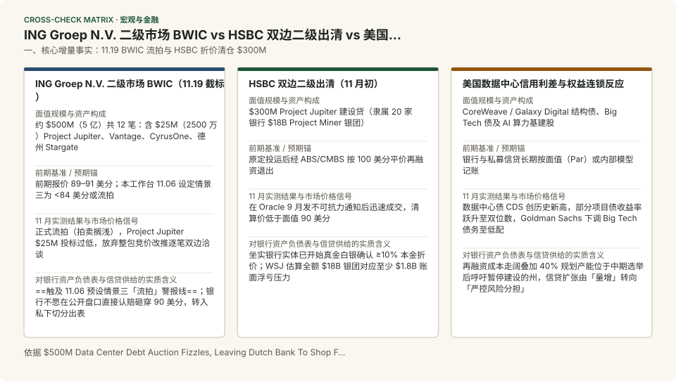

# \$500M Data Center Debt Auction Fizzles, Leaving Dutch Bank To Shop For Buyers

2026-11-23 · Bisnow (Matt Wasielewski) · 转引 Bloomberg (2026-11-20) · 有来源缺口

[本地原件归档](../../../raw/575847fa45a7d97ae70b9f276716df88d074a8d8df3dd40bc04ea567fbd6cbc7) · 固定材料版本 `digest-material-575847fa45a7d97ae70b9f276716df88d074a8d8df3dd40bc04ea567fbd6cbc7@1` · [一手原站](https://www.bisnow.com/news/national/data-center/-500m-data-center-debt-auction-fizzles-leaving-dutch-bank-to-shop-for-buyers)

## 深度拆解与复核

- 口径与利益：本稿穿透核查 Bisnow 记者 Matt Wasielewski 于 2026-11-23 发表的一手跟进报道《$500M Data Center Debt Auction Fizzles, Leaving Dutch Bank To Shop For Buyers》及其关联系列报道（Dan Rabb 与 Jon Banister 采写），上游核心交易动向转引自 Bloomberg 2026-11-20 报道（受 403 付费墙拦截，匿名交易知情人士未具名；ING 向 Bisnow 拒绝置评）。本次入库直接兑现本工作台 2026-11-06 在 [《软银燃气轮机订单正在违约 & 11.19需要重点关注荷兰银行ING出售的数据中心债的价格》](../../分布式计算/blogs/%E8%BD%AF%E9%93%B6%E7%87%83%E6%B0%94%E8%BD%AE%E6%9C%BA%E8%AE%A2%E5%8D%95%E6%AD%A3%E5%9C%A8%E8%BF%9D%E7%BA%A6%20%26%2011.19%E9%9C%80%E8%A6%81%E9%87%8D%E7%82%B9%E5%85%B3%E6%B3%A8%E8%8D%B7%E5%85%B0%E9%93%B6%E8%A1%8CING%E5%87%BA%E5%94%AE%E7%9A%84%E6%95%B0%E6%8D%AE%E4%B8%AD%E5%BF%83%E5%80%BA%E7%9A%84%E4%BB%B7%E6%A0%BC.md) 中设定的 11 月 19 日 BWIC 观测节点，检验「重定价压力是否由借户迁移扩散至银行损失及信贷供给」。

### 一、核心增量事实：11.19 BWIC 流拍与 HSBC 折价清仓 \$300M

1. ING 5 亿（\$500M）BWIC 流拍并转入逐笔双边洽谈：荷兰银行 [ING Groep N.V.](../../分布式计算/entities/funds/ING%20Groep%20N.V..md)（全球超 200 笔数据中心融资的头部牵头行）原计划通过罕见的纯数据中心贷款 BWIC（Bids Wanted In Competition，约 12 笔贷款、总面值 \$500M / 5 亿美元、单笔起投门槛 \$10M）一揽子出表。Bloomberg 2026-11-20 报道证实该拍卖已搁浅——整体需求冷淡，且针对新墨西哥州 Project Jupiter（与 [OpenAI](../../AI%E4%BA%A7%E4%B8%9A%E4%B8%8E%E5%95%86%E4%B8%9A/entities/companies/OpenAI.md) 及 [Oracle](../../分布式计算/entities/companies/Oracle.md) 挂钩）2500 万美元（\$25M）切片的投标报价过低；同时因底层项目融资结构复杂、部分买方需更长尽调时间，ING 已放弃整体 BWIC，转向逐笔私下双边洽谈（individual deals），并在评估现有报价是否可接受。除 Project Jupiter 外，该 12 笔组合亦涵盖 Vantage、CyrusOne 开发的园区以及 2025 年 1 月白宫发布的德州 Stargate 项目相关债权。
2. 银团底账与 HSBC 低于 90 美分清仓：Bisnow 系列报道补全了 Project Jupiter 的完整资本栈——该 1,400 英亩、远期最高 2.4–2.45 GW 园区由 [Blue Owl Capital](../../分布式计算/entities/funds/Blue%20Owl%20Capital.md) 旗下 Stack Infrastructure 开发，Blue Owl 投入 \$3B（30 亿美元）股权并向 20 家银行组成的大银团融得 \$18B（180 亿美元）建设期贷款（去年曾以代号 Project Miner 向贷款方推介）。2026 年 9 月 Oracle 因园区电力许可与燃气管道受阻发出不可抗力（Force Majeure）通知（若项目晚于 2028 年投运，协议条款允许 Oracle 最多顺延 3 年全额租金支付）后，参贷行 HSBC 随即在 11 月初以低于面值 90 美分（less than 90 cents on the dollar）的价格出清了 \$300M Project Jupiter 建设贷。

| 观察主体与交易工具 | 面值规模与资产构成 | 前期基准 / 预期锚 | 11 月实测结果与市场价格信号 | 对银行资产负债表与信贷供给的实质含义 |
| :--- | :--- | :--- | :--- | :--- |
| ING Groep N.V. 二级市场 BWIC（11.19 截标） | 约 \$500M（5 亿）共 12 笔：含 \$25M（2500 万）Project Jupiter、Vantage、CyrusOne、德州 Stargate | 前期报价 89–91 美分；本工作台 11.06 设定情景三为 <84 美分或流拍 | 正式流拍（拍卖搁浅），Project Jupiter \$25M 投标过低，放弃整包竞价改推逐笔双边洽谈 | ==触及 11.06 预设情景三「流拍」警报线==；银行不愿在公开盘口直接认赔砸穿 90 美分，转入私下切分出表 |
| HSBC 双边二级出清（11 月初） | \$300M Project Jupiter 建设贷（隶属 20 家银行 \$18B Project Miner 银团） | 原定投运后经 ABS/CMBS 按 100 美分平价再融资退出 | 在 Oracle 9 月发不可抗力通知后迅速成交，清算价低于面值 90 美分 | 坐实银行实体已开始真金白银确认 ≥10% 本金折价；WSJ 估算全额 \$18B 银团对应至少 \$1.8B 账面浮亏压力 |
| 美国数据中心信用利差与权益连锁反应 | CoreWeave / Galaxy Digital 结构债、Big Tech 债及 AI 算力基建股 | 银行与私募信贷长期按面值（Par）或内部模型记账 | 数据中心债 CDS 创历史新高，部分项目债收益率跃升至双位数，Goldman Sachs 下调 Big Tech 债务至低配 | 再融资成本走阔叠加 40% 规划产能位于中期选举后呼吁暂停建设的州，信贷扩张由「量增」转向「严控风险分担」 |

### 二、增量风险催化核查与估值传染机制

- ✅ 本工作台核查（11 月中旬政治、产业与信用三重共振）：相比 11 月初单纯的天然气管道延误，Bisnow 连续报道揭示 11 月中下旬出现了三项加速银行抛售的新变量——第一，美国中期选举后民主党赢下德州（TX）、佐治亚州（GA）和宾夕法尼亚州（PA）州长并控制国会两院，研究机构 Cleanview 测算约 40% 美国规划数据中心容量位于新任州长呼吁暂停建设的州；第二，Nvidia CEO 黄仁勋（Jensen Huang）11 月初遭免职风波后于周一（11-23）复职带动股价当日回升超 30%（但较一个月前仍跌 20%），Mag 7 指数周一早盘涨 8% 但近 30 日仍跌超 4%，Nasdaq 100 此前单日下挫 6.4%（2020 年以来最大单日跌幅）；第三，Anthropic 上周以超 \$2T 估值完成 IPO 后首周即跌超 15%，叠加大厂放缓开发承诺使多家数据中心与电力公司推迟 IPO，且知名空头 Michael Burry 在 Substack 点名预警 Oracle 云收入预测与数据中心减记风险。
- ⚠️ 本工作台推断（为什么流拍≠买方撤离，但比成交更致命）：表面上看 ING 流拍意味着资产未能立刻交割，实际上对全市场盯市传染（Mark-to-Market Contagion）的杀伤力分为两层。一方面，HSBC 在私下以 <90 美分清仓 \$300M 已证明一级参贷行正在承受实质损失退出（不再是口头讨论）；另一方面，ING 选择撤回公开 BWIC 而不愿按低价强行成交，直接暴露了商业银行在「确认真实清算价」与「避免公开成交价跌破 85 美分触发 \$18B 银团及全行业千亿级在建贷款被迫按市价减记（MTM）」之间的两难。同时必须区分：Bisnow 主稿把 ING 流拍与 HSBC \$300M 出清并列，但 ING 其余 11 笔（Vantage、CyrusOne 等）究竟因尽调周期长还是同样遭遇大幅贴水仍属未披露状态，不能直接将 Project Jupiter 的 <90 美分外推为全行业通用折价。

### 观点与可反驳条件

- ==观点==：ING \$500M BWIC 流拍与 HSBC 低于 90 美分清仓 \$300M Project Jupiter 贷款，标志着 AI 数据中心信贷风险已从「借户租约延期博弈」正式越界至「一级银团真金白银折价止损与供给收缩」；商业银行正通过化整为零的双边出清逃避公开价格发现带来的跨行盯市减记连锁反应。
- ==推翻条件==：
  1. 若截至 2027-01-31，ING 在双边洽谈中披露 \$500M 组合的大部分非 Project Jupiter 贷款（Vantage、CyrusOne 等）以 95 美分以上价格顺利出清，且 Project Jupiter 按新墨西哥州天然气管道 2027 年 2 月投运节点推进、未触发进一步银团折价抛售，则「个别项目延期风险已全面扩散为数据中心银团信贷系统性惜贷」的判断将被削弱或部分推翻。
  2. 若 2027 年 Q1–Q2 美国大型商业银行（含 ING、HSBC 及美资银团牵头行）季报显示数据中心与 TMT 项目融资不良率、信贷拨备及新批建设期贷款（Construction Loan）投放额未出现同比收缩，且 Project Jupiter 后续顺利完成 ABS/CMBS 100 美分平价再融资退出，则「重定价已实质冲击银行资本损耗与信贷供给」的传导判断将被证伪。

---

## 原文摘录与一手信源存证

> \$500M Data Center Debt Auction Fizzles, Leaving Dutch Bank To Shop For
> — 原文摘录，文字段落 1；证据 `digest-material-575847fa45a7d97ae70b9f276716df88d074a8d8df3dd40bc04ea567fbd6cbc7-excerpt-1@1`

> open\_question 中 2026-11-19 ING 5 亿美元数据中心贷款 BWIC 进展：据彭博及 Bisnow 报道，ING 打包出售约 12 笔数据中心贷款（含与 OpenAI/Oracle 新墨西哥州 Project Jupiter 挂钩的 2500 万美元债权及 Vantage、CyrusOne 相关敞口）因出价过低且买家需求冷淡而流拍，ING 已放弃整体 BWIC 并转向逐笔双边洽谈；另证实 HSBC 于 11 月初以低于面值 90
> — 原文摘录，文字段落 2；证据 `digest-material-575847fa45a7d97ae70b9f276716df88d074a8d8df3dd40bc04ea567fbd6cbc7-excerpt-2@1`

> 相关敞口）因出价过低且买家需求冷淡而流拍，ING 已放弃整体 BWIC 并转向逐笔双边洽谈；另证实 HSBC 于 11 月初以低于面值 90 美分的价格出清了 3 亿美元 Project Jupi…  【分诊与中枢定位】 【宏观与金融】Bisnow：涉及 OpenAI, Oracle；含指标 \$500M, 5 亿, 2500
> — 原文摘录，文字段落 3；证据 `digest-material-575847fa45a7d97ae70b9f276716df88d074a8d8df3dd40bc04ea567fbd6cbc7-excerpt-3@1`

一手材料：

- \$500M Data Center Debt Auction Fizzles, Leaving Dutch Bank To Shop For Buyers · Bisnow (Matt Wasielewski) · [原站](https://www.bisnow.com/news/national/data-center/-500m-data-center-debt-auction-fizzles-leaving-dutch-bank-to-shop-for-buyers) · [主体档案：Bisnow](../entities/labs/Bisnow.md) / [主体档案：ING Groep N.V.](../entities/funds/ING%20Groep%20N.V..md) / [主体档案：HSBC](../entities/companies/HSBC.md) · [本地原件](../../../raw/a9ef37800a4ff5697d1eccc2086a0de7c98cc992dc3e49c4a5362564361cd3a5)
  材料版本 `digest-material-a9ef37800a4ff5697d1eccc2086a0de7c98cc992dc3e49c4a5362564361cd3a5@1`；获取方式 `http_full_text`。
  > An auction for \$500M worth of data center debt stumbled out of the gate, and the lender is now at the door of buyers looking to make a deal. — 原文提取
  > Lackluster demand for the \$500M worth of debt, including some backing high-profile data center projects in the U.S., led Dutch bank ING to abandon a so-called bids-wanted-in-competition process and turn to closing individual deals to clear the debt, Bloomberg reported Friday. — 原文提取
- HSBC Sells \$300M Of Data Center Debt Tied To Stargate Project At Big Discount · Bisnow (Dan Rabb) · [原站](https://www.bisnow.com/news/national/data-center-capital-markets/hsbc-sells-300m-of-data-center-debt-at-steep-discount) · [主体档案库](../entities/README.md) · [本地原件](../../../raw/783286f6e83130c1724bfeaefc11d8f15aef5badafe089a45342166702c494b9)
  材料版本 `digest-material-783286f6e83130c1724bfeaefc11d8f15aef5badafe089a45342166702c494b9@1`；获取方式 `http_full_text`。
  > Financial giant HSBC has sold \$300M in data center construction debt at less than 90 cents on the dollar, the latest sign of lender wariness of the growing risks facing large-scale data center development. — 原文提取
  > The debt is part of an \$18B financing package assembled by 20 banks for Project Jupiter, a massive data center development in Doña Ana County, New Mexico, Bloomberg reports . — 原文提取
- Oracle Project Delays Raise Concerns On Debt-Heavy AI Data Center Deals · Bisnow (Jon Banister) · [原站](https://www.bisnow.com/news/national/data-center-capital-markets/oracle-delays-raise-concerns-on-debt-heavy-ai-data-center-deals) · [主体档案库](../entities/README.md) · [本地原件](../../../raw/3ef6b251a78644911383f907bdb5f7e4ebf514145542ff5aca76557ee49cb611)
  材料版本 `digest-material-3ef6b251a78644911383f907bdb5f7e4ebf514145542ff5aca76557ee49cb611@1`；获取方式 `http_full_text`。
  > Billions of dollars of debt are tied to artificial intelligence data center campuses that are becoming increasingly unpopular, and delays on one of those projects are sending shockwaves through the market. — 原文提取
  > Oracle sent a notice to development partner Stack Infrastructure — owned by asset management giant Blue Owl Capital — seeking to delay full rent payments on the 1,400-acre Project Jupiter in New Mexico due to setbacks in moving the project forward, Bloomberg first reported Thursday . — 原文提取

归属与范围：已穿透 Bisnow 2026-11-23 原站全文及同系列 3 篇一手跟进报道（HSBC \$300M 折价出售、ING \$500M 中选后抛售、Oracle 不可抗力与 Project Jupiter 融资结构），完成与本库 2026-11-06《软银燃气轮机订单正在违约 & 11.19 需要重点关注荷兰银行 ING 出售的数据中心债的价格》的节点衔接：11 月 19 日截标的 ING \$500M（约 12 笔、单笔起投 \$10M、含 OpenAI/Oracle 新墨西哥州 Project Jupiter \$25M 切片及 Vantage/CyrusOne/德州 Stargate 敞口）BWIC 拍卖因出价过低且买家需求冷淡而流拍，ING 已放弃整体 BWIC 竞价并转向逐笔双边洽谈（individual deals）；同时证实 Project Jupiter 总融资为 Blue Owl \$3B 股权 + 20 家银行 \$18B 银团建设贷（代号 Project Miner），Oracle 9 月发出可顺延全额租金最多 3 年的不可抗力通知后，HSBC 于 11 月初以低于面值 90 美分率先出清 \$300M 贷款份额。上游 Bloomberg 原文返回 HTTP 403 付费墙与双边洽谈单笔报价明细保留为 unavailable / not\_disclosed 缺口。

来源缺口：

- `unavailable`：上游首发媒体 Bloomberg 2026-11-20 原文（https://www.bloomberg.com/news/articles/2026-11-20/ing-s-500-million-data-center-loan-auction-stalls-on-low-bids）返回 HTTP 403 付费墙拦截，本轮全部拍卖流拍与匿名市场消息经 Bisnow 2026-11-23 及同系列报道交叉采信。 [线索](https://www.bloomberg.com/news/articles/2026-11-20/ing-s-500-million-data-center-loan-auction-stalls-on-low-bids)
- `not_disclosed`：ING 放弃整体 BWIC 转向逐笔双边洽谈（individual deals）后各笔贷款的意向买价、12 笔贷款中剩余 11 笔（Vantage、CyrusOne 及德州 Stargate）的逐笔本金拆分、HSBC 出清 \$300M Project Jupiter 贷款的精确成交美分（仅披露低于 90 美分）及接盘买家身份均未公开；ING 对 Bisnow 拒绝置评。 [线索](https://www.bisnow.com/news/national/data-center/-500m-data-center-debt-auction-fizzles-leaving-dutch-bank-to-shop-for-buyers)

[返回赛道总览](../赛道总览.md#digest-575847fa45a7d97a) · [返回导读索引](README.md) · [主体档案库](../entities/README.md)
