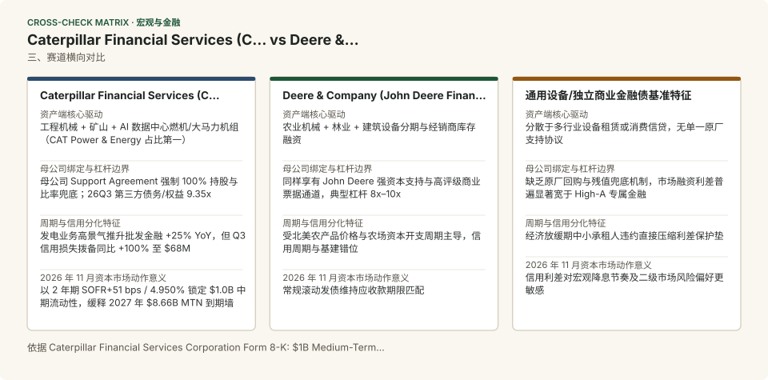

# Caterpillar Financial Services Corporation Form 8-K: \$1B Medium-Term Notes Series L Issuance

2026-11-13 · Caterpillar Financial Services Corp. · SEC Form 8-K / 424B3 / 10-Q · 有来源缺口

[本地原件归档](../../../raw/68325e7ac170e30d4fab4e874251314c060bc6a4f1b585e862eeec2e1808efd3) · 固定材料版本 `digest-material-68325e7ac170e30d4fab4e874251314c060bc6a4f1b585e862eeec2e1808efd3@1` · [一手原站](https://www.sec.gov/Archives/edgar/data/764764/000110465926126947/tm2629723d1_8k.htm)

## 深度拆解与复核

- 口径与利益：本文底层事实取自 Caterpillar Financial Services Corporation（简称 CFSC，CIK 0000764764，Caterpillar Inc. 全资专属金融子公司）向 SEC 提交的 [Form 8-K（2026-11-13）](https://www.sec.gov/Archives/edgar/data/764764/000110465926126947/tm2629723d1_8k.htm)、[Pricing Supplement No. 8（Floating Rate）](https://www.sec.gov/Archives/edgar/data/764764/000110465926124603/tm2629320d1_424b3.htm)、[Pricing Supplement No. 9（4.950% Fixed Rate）](https://www.sec.gov/Archives/edgar/data/764764/000110465926124605/tm2629320d2_424b3.htm) 及 [CFSC Q3 2026 Form 10-Q（2026-11-04）](https://www.sec.gov/Archives/edgar/data/764764/000076476426000030/cfsc-20260930.htm)，并与母公司 Caterpillar Inc.（NYSE: CAT, CIK 0000018230）Q3 2026 10-Q 交叉对照。Form 8-K 与 424B3 属于法定证券发行备案文件，由 Sidley Austin LLP 出具 Exhibit 5.1 法律意见并受证券反欺诈条款约束；但主承销商（BofA Securities、Citigroup Global Markets、MUFG Securities Americas）与发行人天然强调 High-A/Mid-A 信用资质与流动性充裕度，对具体募资用途拆分及行业坏账结构保持程序性留白。
- ==核心结论==：Caterpillar Financial Services Corporation 于 2026-11-09 定价、2026-11-13 交割的 Series L 中期票据（Medium-Term Notes）共募资 $1.0B（10 亿美元，净募资 $998.374M），由 $400M（4 亿美元）2 年期 Compounded Daily SOFR + 51.0 bps 浮息票据与 $600M（6 亿美元）2 年期 4.950% 固息票据构成。对照 CFSC Q3 2026 10-Q，本次发债本质上是为母公司 $78.0B 在手订单与批发库存融资扩张（批发贷款余额年内暴增 +76.9% 至 $2,673M）锁定 2 年期中端负债并接续未来 12 个月到期的 $12,999M 短债墙；==定价端仅 51 bps 的浮息利差证明投资级信用市场对 CAT 产业背书高度买账，但 CFSC 单季信用损失拨备同比翻倍至 $68M（9M +68.3% 至 $138M）暴露出传统基建/工程代理商资产端信用周期正在同步走弱==。

### 一、业务切口与核心机制

#### 1. Series L 双券种发行架构与承销条款拆解
本次发行依托 CFSC 于 2026-03-27 生效的 Form S-3（Registration No. 333-294677）与 2023-03-29 信托契约（受托人 U.S. Bank Trust National Association），于 2026-11-09 同步定价并在 T+3（2026-11-13）完成交割。两只票据均设定为 2 年期（2028-11-13 到期）、高级无担保债务，由 BofA Securities（23.34%）、Citigroup Global Markets（23.34%，兼任交割代理）与 MUFG Securities Americas（23.33%）联合牵头账簿管理，另有 17 家联席承销商分销剩余 29.99% 份额。

| 发行条款维度 | Series L 浮动利率票据（Pricing Supp. No. 8） | Series L 固定利率票据（Pricing Supp. No. 9） | 合并/结构特征说明 |
| :--- | :--- | :--- | :--- |
| 发行规模（本金） | $400,000,000（4 亿美元） | $600,000,000（6 亿美元） | 合计 $1,000,000,000（$1.0B），浮息占比 40%、固息占比 60% |
| CUSIP 与 SEC 备案 | 14913V2H0（Rule 424B3 No. 8） | 14913V2G2（Rule 424B3 No. 9） | 同日 Form 8-K（tm2629723d1_8k.htm）归档 Exhibit 5.1 |
| 定价日 / 交割日 / 到期日 | 2026-11-09 / 2026-11-13 / 2028-11-13 | 2026-11-09 / 2026-11-13 / 2028-11-13 | 2 年整期限，采用 T+3 初始交割（二级市场按 Rule 15c6-1 为 T+1） |
| 发行价 / 承销费 / 净募资 | 100.000% / 0.150% / $399,400,000 | 99.979% / 0.150% / $598,974,000 | 合计净募资 $998,374,000；承销费共 $1.500M，固息折价 $126k |
| 利率基准与到期收益率 | Compounded Daily SOFR + 51.0 bps（0.510%）；下限 0.000% | 票息 4.950%；到期收益率 YTM 4.961% | 浮息首期利率于 2027-02-11 确定；固息较 2 年期美债隐含利差紧凑 |
| 付息频率与计息惯例 | 季度付息（2/5/8/11 月 13 日，2027-02-13 起）；Actual/360 | 半年付息（5/11 月 13 日，2027-05-13 起）；30/360 | 浮息采用 2 个美债工作日观察期前移（Observation Shift） |
| 提前赎回条款 | 不可提前赎回（Redemption Date: N/A） | 任意时点整笔或部分 Make-Whole 赎回（Treasury + 10.0 bps 或 100% 取高） | 固息内嵌极紧 T+10 bps 补偿性赎回保护 |

#### 2. 专属金融子公司（Captive Finance）的资金传导链条
CFSC 并非独立放贷银行，而是 Caterpillar 工业制造体系的资产负债表延伸工具：母公司签订支持协议（Support Agreement），承诺维持 100% 持股并在特定财务比率跌破门槛时注资兜底，同时双方共享 $11.50B 全球银团循环授信（其中 $8.63B 分配予 CFSC，2026 年 8 月刚续期至 2027–2031 年）。CFSC 依靠母公司信用背书（Fitch/Moody's High-A、S&P Mid-A）在公开市场低成本发行中期票据（MTN，占总借款 80.3%）与商业票据（CP），转而为终端客户提供零售分期贷款/融资租赁、收购母公司应收账款，以及向全球 CAT 代理商提供库存批发周转信贷（Wholesale Loans）。

### 二、核心数据核查、口径纠偏与合规/工程边界

#### 1. CFSC Q3 2026 法定报表与母公司产业周期交叉核查

| 资产负债与损益指标（百万美元） | 2026-09-30 / 2026Q3 | 2025-12-31 / 2025Q3 | 变动幅度 | 本工作台核查与交叉含义 |
| :--- | :--- | :--- | :--- | :--- |
| 净融资应收款（Finance Receivables, net） | $35,971M | $32,815M | +9.6% YTD | 总应收 $36,303M 减拨备 $332M；由母公司采购应收款 +25.9% 与批发贷 +76.9% 拉动 |
| 其中：Caterpillar 采购应收款 | $6,924M | $5,500M | +25.9% YTD | 反映 CAT 终端出货加速，母公司将机械及发电设备账期转由 CFSC 买断持有 |
| 其中：代理商批发贷款（Wholesale Loans） | $2,673M | $1,511M | +76.9% YTD | 代理商备货与成套周期拉长推高渠道杠杆；Q3 批发金融收入同比增 +25.0% 至 $230M |
| 第三方金融债务合计（ST+CLTD+LTD） | $34,551M | $32,617M | +5.9% YTD | 短期借款 $4,855M + 一年内到期长债 $8,144M + 长期债务 $21,552M；含母公司拆借总借款 $36,077M |
| 股东权益与债务权益比（Debt/Equity） | 权益 $3,694M（9.35x） | 权益 $3,227M（10.11x） | 杠杆微降 | 扣减 $662M 现金后净杠杆 9.17x；因 9M 留存收益增厚 $434M 使账面倍数略降 |
| Q3 合并营收 / 利息支出 | $1,021M / $397M | $926M / $358M | +10.3% / +10.9% | 9M 营收 $2,959M（+10.2%），利息成本随总债务攀升同步上行 |
| Q3 信用损失拨备（Provision for Credit Losses） | $68M | $34M | +100.0% YoY | 9M 拨备达 $138M（同比 +68.3%），坏账准备金率由 YE25 的 0.86% 升至 0.91% |
| Q3 归母净利润 | $145M | $134M | +8.2% YoY | 9M 净利润 $434M（+8.2%），拨备翻倍明显压低了营收增长向利润的传导弹性 |

- ✅ 本工作台核查（发行定价与净募资算术闭环）：核对两份 [424B3 定价补充文件](https://www.sec.gov/Archives/edgar/data/764764/000110465926124603/tm2629320d1_424b3.htm) 与 [Pricing Supplement No. 9](https://www.sec.gov/Archives/edgar/data/764764/000110465926124605/tm2629320d2_424b3.htm)，浮息 $400M × 99.850% = $399.400M，固息 $600M × 99.829% = $598.974M，总净募资 $998.374M 与承销费 0.150%（$1.500M）加折价 $0.126M 精确闭合；其中 4.950% 固息券 YTM 为 4.961%，在 2 年期浮息利差仅为 SOFR + 51.0 bps 的背景下，反映市场给予 CAT 高等级工业金融极低信用风险溢价。
- ⚠️ 本工作台核查（短债到期墙与 AI 电力繁荣下的信用背离）：[CFSC Q3 2026 Form 10-Q](https://www.sec.gov/Archives/edgar/data/764764/000076476426000030/cfsc-20260930.htm) 披露，截至 2026-09-30 未来 12 个月内到期债务高达 $12,999M（短期借款 $4,855M + 一年内到期长债 $8,144M，占第三方总债务 37.6%），且 2026Q4 剩余及 2027 年分别有 $1,378M 和 $8,664M 中期票据到期（9M 2026 已滚动发行 $10.02B MTN 兑付 $7.12B）。尽管母公司 26Q3 Power & Energy 部门营收 $8.784B（OPM 24.4%）、Power Generation 同比暴增 +30% 至 $3.421B 且在手订单飙至 $78.0B，但 CFSC 资产端一方面出现代理商批发贷款激增 +76.9% 至 $2,673M 的垫资膨胀，另一方面单季信用损失拨备却从 $34M 翻倍至 $68M。
- 本工作台推断：Parent 层面的 AI 数据中心燃机/内燃机槽位（如 Anthropic 接盘 OnePWR 1.7 GW）多为大厂现金或强信用主体直付，并未直接恶化坏账；CFSC 拨备翻倍更可能源自高利率环境下北美中小施工承包商、矿山零售分期客户及代理商库存周期的早期违约抬头，因此本次发行 2 年期 Series L 票据并非单纯扩张性加杠杆，而是将商业票据短端敞口（Q3 末已从 YE25 的 $5,408M 压降至 $4,717M）向 2028 年错峰展期，以 4.96% 固定成本对冲未来两年资本市场信用利差走阔风险。
- 合规与结构边界：两只票据未向欧盟及英国零售投资者提供 PRIIPs KID 文件（仅限机构/合格买方）；同时 Form 8-K 与 424B3 均未披露本次 $998.374M 募资在偿还到期商业票据与承接新发设备融资之间的具体分配比例，亦未披露 CFSC 是否配套利率互换（Interest Rate Swaps）将 4.950% 固息转换回浮息以匹配资产端重定价久期。

### 三、赛道横向对比

| 对比维度 | Caterpillar Financial Services (CFSC) | Deere & Company (John Deere Financial) | 通用设备/独立商业金融债基准特征 |
| :--- | :--- | :--- | :--- |
| 资产端核心驱动 | 工程机械 + 矿山 + AI 数据中心燃机/大马力机组（CAT Power & Energy 占比第一） | 农业机械 + 林业 + 建筑设备分期与经销商库存融资 | 分散于多行业设备租赁或消费信贷，无单一原厂支持协议 |
| 母公司绑定与杠杆边界 | 母公司 Support Agreement 强制 100% 持股与比率兜底；26Q3 第三方债务/权益 9.35x | 同样享有 John Deere 强资本支持与高评级商业票据通道，典型杠杆 8x–10x | 缺乏原厂回购与残值兜底机制，市场融资利差普遍显著宽于 High-A 专属金融 |
| 周期与信用分化特征 | 发电业务高景气推升批发金融 +25% YoY，但 Q3 信用损失拨备同比 +100% 至 $68M | 受北美农产品价格与农场资本开支周期主导，信用周期与基建错位 | 经济放缓期中小承租人违约直接压缩利差保护垫 |
| 2026 年 11 月资本市场动作意义 | 以 2 年期 SOFR+51 bps / 4.950% 锁定 $1.0B 中期流动性，缓释 2027 年 $8.66B MTN 到期墙 | 常规滚动发债维持应收款期限匹配 | 信用利差对宏观降息节奏及二级市场风险偏好更敏感 |

### 观点与可反驳条件

- ==观点==：CFSC 本次 $1.0B 2 年期 Series L 票据（SOFR + 51.0 bps 浮息与 4.950% 固息）验证了 Caterpillar Inc. 的工业高景气仍能为其金融子公司换取极窄的 High-A 级债务定价权，但 Q3 2026 财报显示的“批发贷款余额 +76.9% YTD”与“信用损失拨备 +100% YoY（$68M）”同步出现，说明在 AI 电力设备繁荣之外，传统基建与经销商零售信贷正在积聚资产质量压力，本次发债实为防御性久期展期而非纯粹景气扩表。
- ==推翻条件==：
  1. ① 信用拨备见顶回落条件：若 CFSC 在 2026Q4 至 2027Q2 连续两个季度将信用损失拨备压回单季 <=$40M（即恢复至 2025 年同期均值附近）且年末不良率（Past-due >30 days）未见上行，同时批发贷款继续保持 >=20% 同比增速，则“传统工程零售信用恶化拖累专属金融盈利弹性”的警示将被证伪。
  2. ② 利差重定价恶化条件：若后续 CFSC 于 2027 年为对冲 $8.66B 到期 MTN 而新发的 2–3 年期美元债券，其浮息利差显著走阔至 >=SOFR + 85 bps（较本次 +51 bps 扩张逾 34 bps）或遭遇评级机构展望下调，则“CAT $78B 在手订单可长期压低金融端融资溢价”的判断将被修正。

---

## 原文摘录与一手信源存证

> 【信源巡检核心摘要】 Caterpillar Financial Services Corporation 提交 Form 8-K 非经常性融资公告，披露于 2026-11-13 发行 Series L 中期票据共 10 亿美元（2026-11-09 定价），包括 4 亿美元 2028 年到期浮动利率票据与 6 亿美元 2028 年到期 4.950% 固定利率票据。
> — 原文摘录，文字段落 1；证据 `digest-material-68325e7ac170e30d4fab4e874251314c060bc6a4f1b585e862eeec2e1808efd3-excerpt-1@1`

一手材料：

- Caterpillar Financial Services Corporation Form 8-K & Series L Pricing Supplements No. 8 & 9 (\$1.0B Notes due 2028) · Caterpillar Inc. · [原站](https://www.sec.gov/Archives/edgar/data/764764/000110465926126947/tm2629723d1_8k.htm) · [主体档案：Caterpillar](../entities/companies/Caterpillar.md) · [本地原件](../../../raw/35d94ce7bcea2db34168e10343f60e6431763a2fcc5f8bc34eac3914b1f47d22)
  材料版本 `digest-material-35d94ce7bcea2db34168e10343f60e6431763a2fcc5f8bc34eac3914b1f47d22@1`；获取方式 `sec_edgar_primary_compilation`。
  > === FORM 8-K (2026-11-13, CIK 0000764764) === false 0000764764 0000764764 2026-11-13 2026-11-13 iso4217:USD xbrli:shares iso4217:USD xbrli:shares UNITED STATES SECURITIES AND EXCHANGE COMMISSION WASHINGTON, D.C. — 原文提取
  > === PRICING SUPPLEMENT NO. 8 (FLOATING RATE DUE 2028, \$400M, SOFR + 51 BPS) === 424B3 1 tm2629320d1\_424b3.htm 424B3 Filed Pursuant to Rule 424(b)(3) Registration No. 333-294677 PRICING SUPPLEMENT NO. — 原文提取
- Caterpillar Financial Services Corporation Form 10-Q for Q3 2026 (Period Ended Sept 30, 2026) · Caterpillar Inc. · [原站](https://www.sec.gov/Archives/edgar/data/764764/000076476426000030/cfsc-20260930.htm) · [主体档案：Caterpillar](../entities/companies/Caterpillar.md) · [本地原件](../../../raw/cc511af9d266d0c3294f6f68d850e88b6b04fe7b0b3d6ffb6a3139b0f60299ff)
  材料版本 `digest-material-cc511af9d266d0c3294f6f68d850e88b6b04fe7b0b3d6ffb6a3139b0f60299ff@1`；获取方式 `sec_edgar_primary_compilation`。
  > --- Consolidated Statements of Profit --- not applicable. 2 PART I. FINANCIAL INFORMATION ITEM 1. — 原文提取
  > --- Consolidated Statements of Financial Position --- 21 \$ 465 \$ 679 See Notes to Consolidated Financial Statements (Unaudited). — 原文提取

归属与范围：完成 Caterpillar Financial Services Corporation Series L \$1.0B 中期票据 Form 8-K、Pricing Supplements No. 8/9（Rule 424B3）及 Q3 2026 Form 10-Q 取证并与母公司 Caterpillar Inc. 26Q3 10-Q 交叉核查；核实 2 年期浮息（SOFR+51.0bps）与固息（4.950% 票息 / 4.961% YTM）定价及 \$998.374M 净募资，识别出在母公司 Power Generation +30% YoY 与 CFSC 批发贷款 +76.9% YTD 扩张背后，CFSC Q3 信用损失拨备同比翻倍至 \$68M 的信用分化信号。

来源缺口：

- `not_disclosed`：Form 8-K 及 Pricing Supplements No. 8/9 未披露本次 Series L 票据 \$998.374M 净募资在偿还商业票据（Q3 末 \$4,717M）与新增零售/批发设备融资贷款之间的精确分配比例，亦未披露一二级认购机构分配名单及是否配套利率互换（IRS）对冲操作。 [线索](https://www.sec.gov/Archives/edgar/data/764764/000110465926126947/tm2629723d1_8k.htm)

[返回赛道总览](../赛道总览.md#digest-68325e7ac170e30d) · [返回导读索引](README.md) · [主体档案库](../entities/README.md)
