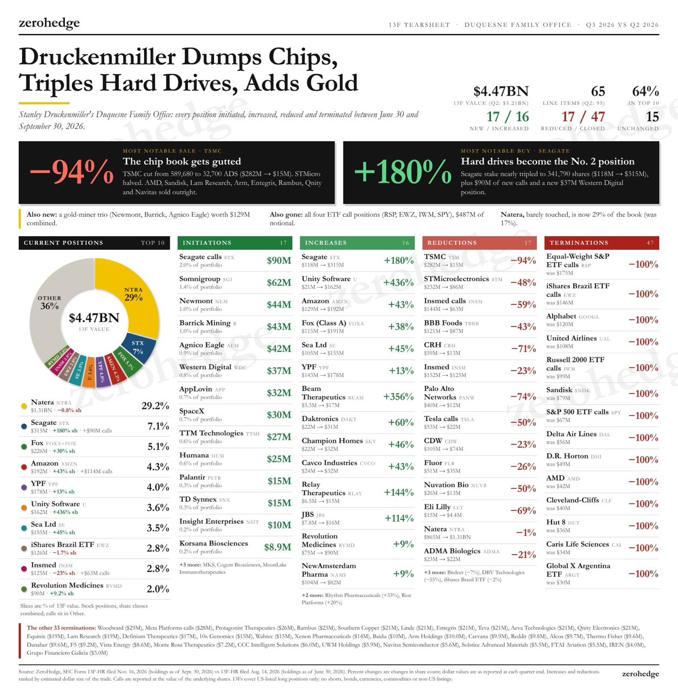

# Druckenmiller Dumps Chips, Triples Hard Drives, Adds Gold (Duquesne Q3 2026 13F & Hyperliquid 复核)

2026-11-16 · Duquesne Family Office · SEC Form 13 · 有来源缺口

[本地原件归档](../../../raw/05a528b2d27ba1110ebfbac926782813c0063af5a1e0a3d32ee606cef29410cd) · 固定材料版本 `digest-material-05a528b2d27ba1110ebfbac926782813c0063af5a1e0a3d32ee606cef29410cd@1` · [一手原站](https://www.sec.gov/edgar/browse/?CIK=0001536411) · [触发线索（ZeroHedge）](https://www.zerohedge.com/markets/druckenmiller-dumps-chips-triples-hard-drives-adds-gold)

> [!IMPORTANT]
> 用户关注点（TG）：review一下，最近druckenmiller好像还投了Hyperliquid

## 针对性追查与回应

本复核以 [SEC EDGAR CIK 0001536411](https://www.sec.gov/edgar/browse/?CIK=0001536411) 于 2026-11-16 披露的 Duquesne Family Office LLC 2026Q3（截至 2026-09-30）与 2026-08-14 披露的 2026Q2（截至 2026-06-30）Form 13F-HR 为法定基准（仅覆盖美股多头正股与看涨期权名义值），结合 [Hyperliquid](https://hyperliquid.xyz/)、[Trade[XYZ]](https://trade.xyz/)、[Intercontinental Exchange (ICE)](https://www.ice.com/) 及 [@standuquesne](https://x.com/standuquesne) 一手公告，直接核查 ZeroHedge 图表漏列的 Hyperliquid 投资线及四项统计口径偏差。讲者立场与利益相关方背景：ZeroHedge 作为二级市场资讯媒体（归为 trigger_source），标题与制图倾向强化“清仓芯片”戏剧冲突并省略 Unchanged 持仓；Stanley Druckenmiller 旗下 Duquesne 既是 PURR 2,941,500 股持有方也是 Trade[XYZ] 私募股东，其 2026-10-29 在 @standuquesne 对 Trade[XYZ] 产品价值的背书存在直接持仓利益相关。

### Hyperliquid 两条投资线核查：公开金库股 PURR 被遗漏，私募基建 Trade[XYZ] 属 Q4 发生

✅ 本工作台核查（一级证据一：NASDAQ: PURR 持仓连续两季在列但被 ZeroHedge 图表隐没）：Hyperliquid Strategies Inc.（NASDAQ: PURR）由 Nasdaq 上市生科公司 Sonnet BioTherapeutics 于 2025 年 12 月与 Atlas Merchant Capital 及 Paradigm 发起的 SPV Rorschach I LLC 完成 \$888M 业务合并组建，前 Barclays CEO Bob Diamond 任董事长、David Schamis 任 CEO，定位为专职累积与质押 HYPE 代币的数字资产金库公司，截至 2026-09-30 账面已扩表至 3,850 万枚 HYPE（年中为 2,930 万枚）且维持零负债与股份回购。对照 SEC 13F-HR 原件，Duquesne 于 Q2 2026 建仓 PURR 共 2,941,500 股（当时市值 \$23.15M，占 Q2 组合 0.44%），Q3 股数 100% 保持 2,941,500 股未动，随股价上涨单季持仓市值跃升 +55.9% 至 \$36.092M（占 Q3 13F 总值 \$4.47B 的 0.81%）。该头寸体量已高于 ZeroHedge 专栏高调点名的 AppLovin（APP \$32M / 0.7%）、SpaceX（SPCX \$30.5M / 0.7%）、TTM Technologies（TTMI \$27M / 0.6%）、Humana（HUM \$25M / 0.6%）及 Palantir（PLTR \$15M / 0.3%）；==PURR 在整张图表中消失纯粹源于制图剪裁——Top 10 柱状图止步于 \$90M（Revolution Medicines / RVMD），下方四栏又只列举 Initiations 17 只、Increases 16 只、Reductions 17 只与 Terminations 47 只，将全部 15 只 Unchanged 持仓（17 + 16 + 17 + 15 = 65 只在持仓位）统一塞进灰色 OTHER 36%==。

✅ 本工作台核查（一级证据二：2026-10-29 Trade[XYZ] × ICE 私募战略入股）：在 Q3 13F 截止日一个月后，纽约证券交易所母公司 ICE 于 2026-10-29 与 Hyperliquid HIP-3 生态头部 RWA 永续合约构建方 Trade[XYZ] 签署最终协议：ICE 对 Trade[XYZ] 进行战略少数股权投资并出任其美国受监管市场的独家运营商，计划在获得 CFTC 批准后上线独立清算、KYC 与 AML 合规框架（市场简称 ICE[XYZ]），拟经由合规 FCM 及 ICE 与 OKX 合资经纪通道向美国零售与机构提供覆盖加密资产、美股、指数、大宗与外汇的 24/7 永续期货。同日 Stanley Druckenmiller 开通个人 X 账号 @standuquesne 发布首条帖文，公开确认投资 Trade[XYZ] 并准备将相关交易产品融入投研流程。需辨明技术与财务口径：美国在岸合规市场将运行在 ICE 专设受监管清算设施上而非无许可离岸 L1 直结，且 ICE 声明该少数股权对 2026 年调整后财务业绩无重大影响；消息仍推动 HYPE 原生代币上涨约 15% 至 20% 至 \$91–\$94 区间。==因该笔投资属私募股权且发生于 Q4（2026-10-29），自然不会出现在截至 2026-09-30 的 Q3 13F 报表中==。

### ZeroHedge 13F 图表四项法证纠偏与交叉互证

⚠️ 本工作台核查（期权名义市值错觉 vs 实际净多头压缩）：SEC Form 13F 强制按看涨期权对应的底层正股名义市值入账，而非期权权利金成本。Q3 期间 Duquesne 一口气清仓 4 只宽基及区域 ETF Calls——Equal-Weight S&P ETF（RSP \$175M）、iShares Brazil ETF（EWZ \$146M）、Russell 2000 ETF（IWM \$99M）及 S&P 500 ETF（SPY \$67M），仅指数期权名义值即减少 \$487M；叠加密集清仓 Meta Platforms calls（\$28M）、大幅削减 Insmed calls（INSM \$144M 降至 \$63M，-59% 即 -\$81M）与 Tesla calls（TSLA \$53M 降至 \$22M，-50% 即 -\$31M），==期权名义市值压缩合计约 \$627M，占 13F 账面总市值从 Q2 的 \$5.21B 滑落至 \$4.47B（-\$740M）的约 85%==。与此同时，ZeroHedge Top 10 柱状图刻意把在持的 Amazon（AMZN 正股 \$192M / +43% sh / 4.3% 另有 \$114M calls）、Seagate（STX 另有 98,000 股 calls 对应 \$90.39M / 2.0%）及 Insmed（INSM 正股 \$125M / -23% sh / 2.8% 另有 \$63M calls）的期权腿剔除并打包进 OTHER 36%，低估了单一标的的真实期权杠杆。

✅ 本工作台核查（AI 供应链精确换仓：撤离晶圆代工/设备/NAND/矿企 → 重仓双寡头 HAMR 近线硬盘、AI 服务器 PCB 与黄金对冲）：对照 [SemiAnalysis 加速器模型下修导读](../../%E5%88%86%E5%B8%83%E5%BC%8F%E8%AE%A1%E7%AE%97/blogs/Revising%20Down%20Accelerator%20Demand%20and%20Shipment%20Outlook%3B%20Nvidia%20Bears%20the%20Brunt%20%28SemiAnalysis%20Accelerator%20Model%20.md) 与 [Google AI 基础设施访谈导读](../../%E5%88%86%E5%B8%83%E5%BC%8F%E8%AE%A1%E7%AE%97/blogs/Google%20AI%20%E5%9F%BA%E7%A1%80%E8%AE%BE%E6%96%BD%E8%B4%9F%E8%B4%A3%E6%B7%B1%E5%BA%A6%E8%AE%BF%E8%B0%88%EF%BC%9A10%20%E4%B8%87%E5%8D%A1%E9%9B%86%E7%BE%A4%E6%95%85%E9%9A%9C%E4%B8%8D%E6%96%AD%EF%BC%8CAgent%E6%8E%A8%E9%AB%98%20CPU%E3%80%81%E5%AD%98%E5%82%A8%E5%92%8C%E7%BD%91%E7%BB%9C%E9%9C%80%E6%B1%82%EF%BC%8C2036%E5%B9%B4%E6%9C%BA%E6%9E%B6%EF%BC%8CTPU%208i_8t%EF%BC%8C%E8%BD%A8%E9%81%93%E6%95%B0%E6%8D%AE%E4%B8%AD%E5%BF%83.md)，Duquesne 并非一刀切看空算力，而是剥离对单一代工/设备与高波矿企的暴露，将筹码集中至 Agent 存储温冷层必需的 HAMR 机械硬盘双寡头、板级互联、刚 IPO 的太空算力龙头以及宏观贵金属对冲（联动 [Barclays AI CDS 导读](2008%E5%86%8D%E7%8E%B0%EF%BC%81%E4%B8%80%E6%96%87%E8%AF%BB%E6%87%82%E5%8D%8E%E5%B0%94%E8%A1%97%E6%9C%80%E7%83%AD%E9%97%A8%E4%BA%A4%E6%98%93%EF%BC%9AAI%20CDS.md) 揭示的 AI 信贷分层）：

| 板块与换仓方向 | 核心标的与代码 | SEC 13F-HR 法证变动明细 | 权重与组合意义 |
| :--- | :--- | :--- | :--- |
| 算力代工与芯片设备减清 | TSMC (TSM)、STMicroelectronics (STM)、Sandisk (SNDK)、AMD、Lam Research、Arm Holdings、Entegris、Rambus、Qnity Electronics、Navitas Semiconductor | TSM 由 589,680 份 ADS 砍至 32,700 份（\$282M 降至 \$14.9M，-94%）；STM 由 \$144M 砍至 \$63M（-48%）；SNDK \$79M、AMD \$42M、Rambus \$23M、Entegris \$21M、Qnity \$21M、Lam Research \$19M、Arm \$10.0M、Navitas \$5.6M 全部清仓 | 规避晶圆代工、NAND 及模拟芯片资本开支波动 |
| 算力云/矿企与网安撤出 | Alphabet (GOOGL)、Hut 8 (HUT)、Equinix (EQIX)、IREN、Bitdeer、Riot Platforms、Palo Alto Networks (PANW) | GOOGL \$120M、HUT \$36M、EQIX \$19M、IREN \$4.0M 悉数清仓，Bitdeer 减持 -7%，PANW 由 \$40M 减持 -74% 至 \$12M；仅 Riot Platforms 小幅增持 +20% | 退出高电耗矿企 REITs 与高估值网安软件 |
| HAMR 近线硬盘双寡头与 PCB 分销 | Seagate (STX)、Western Digital (WDC)、TTM Technologies (TTMI)、TD Synnex (SNX)、Insight Enterprises (NSIT)、CDW | STX 正股暴增 +180% 至 341,790 股（9 月 30 日收盘 \$922.34 对应 \$315.25M / 7.1%），叠加 98,000 股 calls（\$90.39M / 2.0%）及剥离 Sandisk 后的纯 HDD 标的 WDC 新建仓 \$37M（0.8%）；新建仓 TTMI \$27M（0.6%）、SNX \$15M（0.3%）、NSIT \$10M（0.2%），同时减持 CDW -23%（\$105M 降至 \$74M） | ==HDD 赛道总敞口达 \$442.64M（占 13F 9.9%）==，押注近线存储供给紧约束 |
| 太空算力、软件与应用重估 | SpaceX (SPCX)、Unity Software (U)、Fox (FOXA+FOX)、Sea Ltd (SE)、YPF、AppLovin (APP)、Palantir (PLTR)、MKS | SpaceX 于 2026-06-12 以 \$135 IPO 后建仓 202,125 Class A 股约 \$30.5M（0.7%）；Unity 暴增 +436%（\$21M 至 \$162M / 3.6%）；FOXA+FOX 增持 +30% 至 \$226M（5.1%，其中 FOXA +38% 至 \$191M）；SE 增持 +45%（\$105M 至 \$155M / 3.5%）；YPF 增持 +13%（\$143M 至 \$178M / 4.0%） | Top 10 集中度达 64%，新兴媒体与拉美能源提供非算力贝塔 |
| 货币贬值对冲与周期换档 | Newmont (NEM)、Barrick Mining (B)、Agnico Eagle (AEM)、Somnigroup (SGI)、Champion Homes (SKY)、Cavco Industries (CVCO)、Daktronics (DAKT)、JBS、BBB Foods (TBBB)、CRH、Fluor (FLR)、EWZ | 金矿三杰新建仓 \$129M（NEM \$44M / 1.0%、B \$43M / 1.0%、AEM \$42M / 0.9%）；清仓 UAL \$108M、DAL \$56M、DHI \$49M、CLF \$40M、ARGT \$30M、Woodward \$29M、Southern Copper \$21M、Linde \$21M、Aeva \$21M、Alcoa \$9.7M、Vista Energy \$8.6M 等旧周期，减持 TBBB -43%（\$121M 至 \$87M）、CRH -71%（\$59M 至 \$13M）、FLR -26%（\$51M 至 \$35M）、EWZ 正股 -1.7%（-2%）至 \$126M（2.8%）；加仓 SKY +46%（\$32M）、CVCO +43%（\$32M）、DAKT +60%（\$31M）、JBS +114%（\$16M）及 SGI \$62M（1.4%） | 以 2.9% 金矿组合对冲财政赤字与 AI 信贷利差分化 |

✅ 本工作台核查（Natera 跃居 29.2% 的被动涨幅归因 + 医药组合股数与市值背离）：Top 1 重仓 Natera (NTRA) 在 Q3 实际小幅减仓 -0.8% 股数（ZeroHedge 减持栏四舍五入标为 -1%），其仓位权重仍从 Q2 的 17%（\$865M）跃升至 29.2%（\$1.31B），主因正股单季大涨叠加 13F 总规模分母缩水 14.2%，并获本库 [Natera Q3 2026 Form 10-Q 导读](../../AI%E5%8C%BB%E8%8D%AF/blogs/Natera%20Q3%202026%20Financial%20Results%20%26%20Form%2010-Q_%20Revenue%20%24794.0M%20%28%2B34.1%25%20YoY%29%2C%20Signatera%20Clinical%20MRD%20Volume%20%2B56%25.md)（单季营收 \$794.0M / +34.1% YoY、Signatera 临床 MRD 检测量 316,000 例 / +56% YoY）基本面支撑。同样体现股数与金额背离的是 NewAmsterdam Pharma (NAMS)：股数实际增持 +9%，但因股价回调导致持仓市值从 \$104M 降至 \$82M。其余生科仓位呈现向高弹性临床标的集中：加仓 Beam Therapeutics (BEAM +356% 至 \$17M)、Relay Therapeutics (RLAY +144% 至 \$15M)、Rhythm Pharmaceuticals (+33%) 与 Revolution Medicines (RVMD +9.2% 至 \$90M / 2.0%)，新建仓 Humana (HUM \$25M / 0.6%)、Korsana Biosciences (\$8.9M / 0.2%)、Cogent Biosciences 与 MoonLake Immunotherapeutics；同期削减 Eli Lilly (LLY -69% 至 \$4.4M)、DBV Technologies (DBV -55%)、Nuvation Bio (NUVB -50% 至 \$13M)、ADMA Biologics (-21% 至 \$22M)，并清仓 Caris Life Sciences (CAI \$34M)、Protagonist Therapeutics (\$26M)、Teva (\$21M)、Definium Therapeutics (\$17M)、10x Genomics (\$15M)、Xenon Pharmaceuticals (\$14M)、Thermo Fisher (\$9.6M) 及 Monte Rosa Therapeutics (\$7.2M)（其他清仓尚包括 Baidu \$10M、Carvana \$9.9M、Reddit \$9.8M、Wabtec \$15M、F5 \$9.2M、CCC Intelligent Solutions \$6.0M、UWM Holdings \$5.9M、Solstice Advanced Materials \$5.5M、FTAI Aviation \$5.5M 与 Grupo Financiero Galicia \$3.0M）。

⚠️ 本工作台推断（13F 47 天滞后与宏观全盘不可见边界）：由于 Form 13F-HR 在季度结束后 47 天（2026-09-30 截点至 2026-11-16 提交）才完成披露，且法定豁免美债利率空头、主权曲线交易、外汇（日元/欧元）、现货与期货黄金、个股做空以及亚洲/欧洲本土交易所直持股票，==将 \$4.47B 13F 多头清单视作 Duquesne 全盘风险预算会把“削减 TSMC ADS 与美股指数 Calls”误读为单边看空 AI 资本开支==。

### 观点与可反驳条件

- ==观点==：Duquesne Family Office 2026Q3 的实质策略是“美股期权名义杠杆去化（-\$627M）+ AI 算力仓位从代工/设备/NAND 向 HAMR 近线硬盘双寡头（\$442.64M）与黄金矿商（\$129M）转移 + 借公开金库股 PURR（\$36.092M）与 Q4 私募 Trade[XYZ] × ICE 双轨布局 Hyperliquid 生态”。
- ==推翻条件==：① 2026Q4 SEC Form 13F-HR 披露 Duquesne 将 Seagate (STX) 与 Western Digital (WDC) 合计股数减持超过 50%，或彻底清仓其 2,941,500 股 PURR。
- ==推翻条件==：② CFTC 正式驳回或无限期搁置 ICE 与 Trade[XYZ] 的美国受监管 24/7 永续期货清算运营申请，且双方解除独家运营协议。
- ==推翻条件==：③ Hyperliquid Strategies (PURR) 在后续 Form 10-Q 中停止增持并净减持其 3,850 万枚 HYPE 金库储备。

---

## 原文摘录与一手信源存证

> Druckenmiller Dumps Chips, Triples Hard Drives, Adds Gold (ZeroHedge 13F Tearsheet: Duquesne Family Office Q3 2026 vs Q2 2026) Published: 2026-11-16 | Source: ZeroHedge (based on SEC Form 13F-HR filed Nov.
> — 原文摘录，文字段落 1；证据 `digest-material-05a528b2d27ba1110ebfbac926782813c0063af5a1e0a3d32ee606cef29410cd-excerpt-1@1`

> Key Highlights: - Most Notable Sale (TSMC -94%): The chip book gets gutted. TSMC cut from 589,680 to 32,700 ADS (\$282M -\> \$15M). STMicro halved (\$144M -\> \$63M, -48%).
> — 原文摘录，文字段落 2；证据 `digest-material-05a528b2d27ba1110ebfbac926782813c0063af5a1e0a3d32ee606cef29410cd-excerpt-2@1`

> Top 10 Stock Positions (\$4.47BN 13F Value; OTHER 36% includes remaining stocks and calls): 1. Natera (NTRA): \$1.31BN (-0.8% sh), 29.2% 2. Seagate (STX): \$315M (+180% sh · +\$90M calls), 7.1% 3.
> — 原文摘录，文字段落 3；证据 `digest-material-05a528b2d27ba1110ebfbac926782813c0063af5a1e0a3d32ee606cef29410cd-excerpt-3@1`

一手材料：

- Duquesne Family Office LLC — SEC Form 13F-HR (Q3 2026 Ended Sept. 30, 2026 & Q2 2026 Comparison) · Duquesne Family Office · SEC Form 13F-HR · [原站](https://www.sec.gov/edgar/browse/?CIK=0001536411) · [主体档案：Duquesne Family Office](../entities/funds/Duquesne%20Family%20Office.md) · [本地原件](../../../raw/28e1e9bc5198eed08abbee0c6c71b1fa72f61a0388a25cadb7b2fc6a2d544de1)
  材料版本 `digest-material-28e1e9bc5198eed08abbee0c6c71b1fa72f61a0388a25cadb7b2fc6a2d544de1@1`；获取方式 `web_search_verified_primary`。
  > SEC Form 13F-HR Forensic Snapshot: Duquesne Family Office LLC (CIK 0001536411) Filing Comparison: Q3 2026 (Period Ended Sept. 30, 2026; Filed Nov. 16, 2026) vs Q2 2026 (Period Ended June 30, 2026; Filed Aug. — 原文提取
  > 1. Portfolio Headline Metrics & Structural Decomposition - Total 13F Long Equity + Option Notional Value: \$4.47B (Q3 2026) vs \$5.21B (Q2 2026), net decline of -\$740M (-14.2%). — 原文提取
- Stanley Druckenmiller (@standuquesne) & ICE Strategic Investment in Trade\[XYZ\] on Hyperliquid + Hyperliquid Strategies (NASDAQ: PURR) Filings · Stanley Druckenmiller (@standuquesne) · ICE & Trade\[XYZ\] · [原站](https://hyperliquid.xyz/) · [主体档案：Hyperliquid](../entities/companies/Hyperliquid.md) / [主体档案：Trade\[XYZ\]](../entities/companies/Trade%5BXYZ%5D.md) / [主体档案：Intercontinental Exchange (ICE)](../entities/companies/Intercontinental%20Exchange%20%28ICE%29.md) · [本地原件](../../../raw/7f518cdd28402f35a43ec057546e8f2639f077035edb2b4005e713fd2f74b292)
  材料版本 `digest-material-7f518cdd28402f35a43ec057546e8f2639f077035edb2b4005e713fd2f74b292@1`；获取方式 `web_search_verified_primary`。
  > Hyperliquid Ecosystem Investment Verification: Duquesne Family Office / Stanley Druckenmiller Tracks Covered:   (A) Public Equity DAT Exposure: Hyperliquid Strategies Inc. — 原文提取
  > TRACK A: PUBLIC EQUITY TREASURY PROXY — HYPERLIQUID STRATEGIES INC. (NASDAQ: PURR)  1. — 原文提取

归属与范围：已穿透 SEC EDGAR CIK 0001536411（2026-11-16 13F-HR）及 @standuquesne / ICE × Trade\[XYZ\] 一手披露，ZeroHedge 退居 trigger\_source。

来源缺口：

- `not_disclosed`：SEC Form 13F-HR 法定豁免不披露空头仓位、美债及主权利率衍生品、外汇头寸、大宗商品现货与期货、非美交易所直持股票，亦不披露期权具体行权价、到期日与权利金成本 [线索](https://www.sec.gov/edgar/browse/?CIK=0001536411)
- `not_disclosed`：2026-10-29 ICE 与 Stanley Druckenmiller（@standuquesne）对 Trade\[XYZ\] 私募股权投资的具体出资金额及持股比例未公开披露，且 2026-09-30 之后 Q4 二级市场调仓须待下期 13F 披露 [线索](https://www.ice.com/)

[返回赛道总览](../赛道总览.md#digest-05a528b2d27ba111) · [返回导读索引](README.md) · [主体档案库](../entities/README.md)
