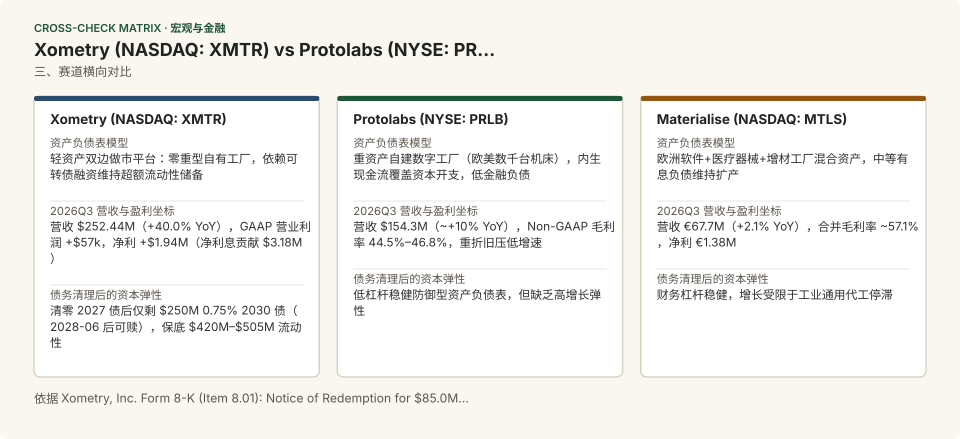

# Xometry, Inc. Form 8-K (Item 8.01): Notice of Redemption for \$85.0M 1.00% Convertible Senior Notes due 2027

2026-11-05 · Xometry, Inc. · SEC Form 8-K / Form 10-Q · 有来源缺口

[本地原件归档](../../../raw/8bb2857fee775aeb3545ec26ffa2a78beac49a5335feb7e85ba0d8a6824b0bf6) · 固定材料版本 `digest-material-8bb2857fee775aeb3545ec26ffa2a78beac49a5335feb7e85ba0d8a6824b0bf6@1` · [一手原站](https://www.sec.gov/Archives/edgar/data/1657573/000119312526445554/xmtr-20260930.htm) · [触发线索（Xometry, Inc. Investor Relations / SEC EDGAR (CIK 0001657573) / Siemens AG Official Releases）](https://www.sec.gov/Archives/edgar/data/1657573/000119312526449980/xmtr-20261105.htm)

## 深度拆解与复核

- 口径与利益：本文底层事实直接取自 Xometry, Inc.（NASDAQ: XMTR, CIK 0001657573）向 SEC 提交的 [2026-11-05 Form 8-K（Item 8.01，CFO James Miln 签署）](https://www.sec.gov/Archives/edgar/data/1657573/000119312526449980/xmtr-20261105.htm) 及 [Q3 2026 Form 10-Q（2026-11-03 披露，Note 10 可转债附注与资产负债表）](https://www.sec.gov/Archives/edgar/data/1657573/000119312526445554/xmtr-20260930.htm)，并与库内已入库的 Xometry 26Q3 盈利导读（digest-2b6d801e23b6b1a7）交叉对账。SEC 8-K/10-Q 为法定证券申报文件（注：8-K 末段前瞻陈述模板误植“Form 6-K”笔误字样，不影响条款法律效力），管理层选择在首次实现 GAAP 季度盈利（26Q3 归母净利 +$1.94M）后两日发出赎回通知，客观服务于提前清零 2027 年流动负债、向西门子等战略伙伴与机构投资者展示无近期偿债压力的资产负债表形象。
- ==核心结论==：Xometry 于 2026-11-05 发出赎回通知（Notice of Redemption），定于 2026-11-20 按 100% 本金加应计利息赎回全部未转股的约 $85.0M 2027 年 2 月到期 1.00% 可转换优先票据（1.00% Convertible Senior Notes due 2027）。结合 Q3 2026 10-Q 披露“Q3 已触发 2027 Sale Price Trigger（即股价连续满足 >=130% 转股价 $72.94 门槛）”，且本次 8-K 对 11 月 19 日前转股明确指定实物交割（Physical Settlement），==本次赎回兼具“若股价高于 $56.11 则倒逼持有人转股（省下 $85M 现金且不新增稀释 EPS，因 1.528M 股已计入 Q3 60.46M 稀释股本分母）”与“若全部现金兑付则仅消耗 $504.98M 流动性的 16.9%、将总有息债务一次性压降 25.8% 并清零一年内到期负债”的双重结构意义==；但若走现金赎回路径，用 ~3.5% 收益率的理财证券偿付 1.00% 低息债务将产生约 $0.5M–$0.6M/季度的净利息负利差，对微薄的 GAAP 营业利润（26Q3 仅 +$57k）形成短期净利拖拽。

### 一、业务切口与核心机制

#### 1. 2027 年可转债存续演变与 11 月 5 日赎回条款全解
Xometry 原于 2022-02-04 私募发行 $287.5M 2027 年 2 月 1 日到期 1.00% 可转债（净募资 $278.2M，受托人 U.S. Bank Trust Company, National Association）。2025 年 6 月，公司通过新发 $250.0M 2030 年到期 0.75% 可转债（净募资 $241.4M）筹资，以 $216.7M 现金（含 $14.3M 溢价及 $0.7M 利息）提前回购 $201.7M 本金的 2027 票据（确认 $16.4M 债务清偿损失），残余约 $85.8M（截至 2026-11-05 为约 $85.0M）转入今年 11 月赎回清单。

| 核心赎回与转股条款 | 2026-11-05 Form 8-K 与 2022-02-04 契约规定 | 量化拆解与机制含义 |
| :--- | :--- | :--- |
| 赎回标的与未偿本金 | 1.00% Convertible Senior Notes due 2027，约 $85.0M 本金 | Q3 2026 资产负债表账面流动负债 $84,816k（含 $184k 未摊销发行费用） |
| 赎回通知日 / 转股截止 / 赎回日 | 2026-11-05 / 2026-11-19 17:00 NYC / 2026-11-20 | 较原定 2027-02-01 到期日提前约 73 天结束利息计提 |
| 现金赎回价格 | 100% 本金 + 2026-08-01 至 2026-11-20 前一日应计未付利息 | 本工作台测算：111 天（或 30/360 109 天）应计利息约 $257k–$262k，全现金总支出约 $85.26M |
| 基础转股率与 Make-Whole 加成 | 原 17.8213 股/$1,000 本金 + 额外 0.0018 股 = 17.8231 股/$1,000 | 对应初始转股价 $56.1126，赎回窗口有效转股价微降至 $56.1069（加成仅 +0.01%） |
| 交割方式选择 | Physical Settlement（全额股票实物交割） | 若持有人在 11-19 前转股，公司交付 ~1,514,963 股 Class A 普通股、零现金本金流出 |
| 赎回触发合法性依据 | Q3 2026 满足连续 30 个交易日中 >=20 日股价 >=130% 转股价 | 130% × $56.11 = $72.94/股；Q3 10-Q 明确披露 2027 Sale Price Trigger 已在 Q3 触发 |

### 二、核心数据核查、口径纠偏与合规/工程边界

#### 1. 结合 Q3 2026 10-Q 的两套结算情景与杠杆/现金成本测算

| 财务与资本结构指标 | 2026-09-30 Q3 10-Q 实绩 | 情景 A：100% 强制转股（Physical Settlement） | 情景 B：100% 现金赎回（Cash Redemption） |
| :--- | :--- | :--- | :--- |
| 现金、等价物与有价证券合计 | $504,982k（$505.0M：现金 $18.13M + 证券 $486.85M） | $504.98M（零本金支出；若仅付/免除应计息则现金不动） | ~$419.72M（扣除 $85.0M 本金及 ~$260k 利息，消耗 16.9% 流动性） |
| 流动负债：2027 可转债账面值 | $84,816k（本金 ~$85.0M） | $0（一年内到期金融债务清零） | $0（一年内到期金融债务清零） |
| 非流动负债：2030 可转债（0.75%） | $243,607k（本金 $250.0M，转股价 $47.06） | $243.61M（唯一存续可转债） | $243.61M（唯一存续可转债） |
| 有息债务总额（账面）/ 总债务降幅 | $328,423k（$328.4M） | $243,607k（总债务降幅 -25.8%） | $243,607k（总债务降幅 -25.8%） |
| 净现金（总流动性 - 账面总债务） | +$176,559k（+$176.6M） | +$261.38M（净现金激增 +$84.8M） | ~$176.11M（净现金基本持平，资产负债表缩表） |
| 流通股本与稀释股本影响 | 基本 55.91M（加权 57.33M）/ 稀释 60.46M | 基本股本增 ~1.515M（+2.7%）；稀释股本零新增（Q3 已计入 1.528M 股） | 流通股数不变；Q4 起稀释股本可剔除 ~1.53M 股（-2.5%） |
| 季度净利息收入变动测算 | 利息收入 $4,440k - 利息支出 $1,258k = +$3,182k | 季度现金利息支出节省 ~$212.5k（含摊销省 ~$270k–$300k），净利增厚 | 丧失 ~$750k–$850k 理财收益 vs 仅省 $212.5k 现金利息，产生 ~$500k–$640k/季负利差 |

- ✅ 本工作台核查（Q3 2026 盈利含金量与负利差风险）：对照 [Q3 2026 Form 10-Q 损益表](https://www.sec.gov/Archives/edgar/data/1657573/000119312526445554/xmtr-20260930.htm)，Xometry 26Q3 GAAP 营业利润仅 +$57k（营业利润率 +0.02%），归母净利润 +$1,935k 几乎全数仰赖 +$3,182k 的净利息收益（利息及股息收入 $4,440k 减利息支出 $1,258k）。若按季度年化估算，其账面 $505.0M 现金及有价证券对应年化收益率约 3.5%–4.0%（其中 26Q1 含西门子 $50M 战略入股增资）；在情景 B（全现金赎回）下，用 3.5%+ 收益资产赎回 1.00% 低息债虽消除 $85.0M 债务，却会令单季税前净利息减少约 $500k–$640k（外加 Q4 加速核销约 $184k 残余发行成本），直接压缩当前微弱的 GAAP 净利缓冲垫。
- ✅ 本工作台核查（2030 可转债与 Capped Call 安全垫完整验证）：核对 [Q3 2026 Form 10-Q](https://www.sec.gov/Archives/edgar/data/1657573/000119312526445554/xmtr-20260930.htm) Note 10，2027 票据清理后公司唯一剩余债务为 2030-06-15 到期的 $250.0M 0.75% 可转债，距首次可赎回窗口（2028-06-20）仍有 19 个月以上且配套 $17.5M Capped Call 期权将稀释上限锁定在 $63.35/股（对比初始转股价 $47.06/股，提供 +34.6% 稀释防护缓冲）。另需注意 Q3 期末现金及等价物仅 $18.13M，若发生大额现金赎回，公司须变现 $67M–$85M 短期有价证券（Marketable Securities $486.85M）完成兑付。
- ⚠️ 本工作台核查（主信源标识纠偏与未披露缺口）：库内此前自动抓取记录将本篇 Form 8-K 归因混入了 Siemens AG，经核对原文签署页，本公告为 Xometry, Inc. 独立提交的债务赎回法定文件（Siemens AG 仅在 2026Q1 完成 $50M 股权投资，未参与本次票据赎回）；此外 2026-11-05 Form 8-K 仅宣告赎回安排，11-19 转股截止及 11-20 交割后的最终“转股 vs 现金兑付”精确比例尚未在已抓取 SEC 文件中披露。
- 本工作台推断：结合 Q3 10-Q 已触发 130% 股价条件（>$72.94）以及公司刻意选择 Physical Settlement（只交股票不付现金）来看，CFO James Miln 发出本次赎回通知的核心意图大概率是借强制转股（Forced Conversion）在不额外稀释 Q3 既定 60.46M 稀释分母的前提下，把 $85.0M 债务转为永久股东权益并把净现金推高至 ~$261M，为 2027Q1 西门子 Designcenter 原生报价嵌入上线预留充沛扩张弹药。

### 三、赛道横向对比

| 对比维度 | Xometry (NASDAQ: XMTR) | Protolabs (NYSE: PRLB) | Materialise (NASDAQ: MTLS) |
| :--- | :--- | :--- | :--- |
| 资产负债表模型 | 轻资产双边做市平台：零重型自有工厂，依赖可转债融资维持超额流动性储备 | 重资产自建数字工厂（欧美数千台机床），内生现金流覆盖资本开支，低金融负债 | 欧洲软件+医疗器械+增材工厂混合资产，中等有息负债维持扩产 |
| 2026Q3 营收与盈利坐标 | 营收 $252.44M（+40.0% YoY），GAAP 营业利润 +$57k，净利 +$1.94M（净利息贡献 $3.18M） | 营收 $154.3M（~+10% YoY），Non-GAAP 毛利率 44.5%–46.8%，重折旧压低增速 | 营收 €67.7M（+2.1% YoY），合并毛利率 ~57.1%，净利 €1.38M |
| 债务清理后的资本弹性 | 清零 2027 债后仅剩 $250M 0.75% 2030 债（2028-06 后可赎），保底 $420M–$505M 流动性 | 低杠杆稳健防御型资产负债表，但缺乏高增长弹性 | 财务杠杆稳健，增长受限于工业通用代工停滞 |

### 观点与可反驳条件

- ==观点==：Xometry 在首次实现 GAAP 季度盈利（26Q3 +$1.94M）后立即赎回全部 $85.0M 2027 年 1.00% 可转债并锁定 Physical Settlement，是一次以较低财务摩擦出清 2027 年再融资尾端风险的资产负债表优化操作——若实现强迫转股，公司将零现金损耗把净现金推升至 $261M 以上；即便全额现金兑付，剩余 $420M 流动性与 2030 年 0.75% 低息单一债务（配 $63.35 Capped Call）也足以支撑 2027 年西门子 Designcenter 生态扩张，只是短期现金利息负利差意味着 26Q4 起 GAAP 季度持续盈利将更严峻地依赖主业营业利润（而非利息收入）撑场。
- ==推翻条件==：
  1. ① 负利差触发 GAAP 再度转亏条件：若 2026-11-20 实际结算为高比例现金兑付（现金流出 >=$60M），且 2026Q4 至 2027Q1 因 Marketplace 毛利率受关税或履约补贴影响回落至 <=34.5%、无法弥补每季 ~$0.5M 净利息减少，导致公司 GAAP 净利润再次连续两季转负，则“清偿 2027 债后公司盈利结构已稳步进入自维持通道”的判断将被证伪。
  2. ② 流动性过度收缩或再融资条件：若赎回消耗现金叠加 2027 年营运资金占用扩大（26Q3 应收账款已升至 $152.15M，较 YE25 的 $97.37M 增 +56.3%），迫使 Xometry 在 2027 年底前新增高息循环信贷或高于 3.0% 票息的新债，则“剩余 $420M–$505M 现金足以覆盖至 2030 年全部增长开支”的假设将被推翻。

---

## 原文摘录与一手信源存证

> 【信源巡检核心摘要】 Xometry向SEC提交非经常性Form 8-K（Item 8.01）公告，于2026年11月5日发出赎回通知，计划在2026年11月20日赎回全部未转股的约8,500万美元2027年到期1.00%可转换优先票据（按100%本金加应计未付利息现金兑付）。
> — 原文摘录，文字段落 1；证据 `digest-material-8bb2857fee775aeb3545ec26ffa2a78beac49a5335feb7e85ba0d8a6824b0bf6-excerpt-1@1`

一手材料：

- Xometry, Inc. Form 10-Q for Q3 2026 (Period Ended Sept 30, 2026) — Debt & Balance Sheet · Xometry, Inc. · [原站](https://www.sec.gov/Archives/edgar/data/1657573/000119312526445554/xmtr-20260930.htm) · [主体档案：Xometry](../entities/companies/Xometry.md) · [本地原件](../../../raw/6ad6dc971b30674fec419fbf92ccc94817544722eb2dbc0575d44299c87c2155)
  材料版本 `digest-material-6ad6dc971b30674fec419fbf92ccc94817544722eb2dbc0575d44299c87c2155@2`；获取方式 `sec_edgar_primary_compilation`。
  > === XOMETRY, INC. FORM 8-K (NOVEMBER 5, 2026, CIK 0001657573) === 8-K false 0001657573 0001657573 2026-11-05 2026-11-05 UNITED STATES SECURITIES AND EXCHANGE COMMISSION WASHINGTON, D.C. — 原文提取
  > ) \$ ( 1.05 ) Net income (loss) per share, diluted \$ 0.03 \$ ( 0.23 ) \$ ( 0.16 ) \$ ( 1.05 ) For the three months ended September 30, 2026, diluted net income per share includes the dilutive effect of stock options, RSUs, PRSUs and shares reserved for charitable contribution, determined using the treasury stock method. — 原文提取

归属与范围：完成 Xometry 2026-11-05 Form 8-K（xmtr-20261105.htm）与 Q3 2026 Form 10-Q（xmtr-20260930.htm）原文穿透取证并与库内 26Q3 深度研究交叉核算：确认 2027 Notes 在 Q3 触发 130% 股价条件（\$72.94+）后公司同步宣布全额赎回并选择 Physical Settlement（转换率上调 0.0018 股至 17.8231 股/\$1,000，对应 \$56.1069/股），系统拆解强迫转股 vs 现金赎回两套情景对 \$504.98M 流动性、总杠杆（-\$84.8M 降幅 25.8%）及 Q4 起净利息收入负利差的影响。

来源缺口：

- `not_disclosed`：2026-11-05 Form 8-K 仅宣布赎回通知与 Physical Settlement 方式，2026-11-19 转股截止及 2026-11-20 交割完成后的最终实际转股本金额、发行股份数与现金兑付净额尚未在已归档 SEC 8-K/10-Q 中披露。 [线索](https://www.sec.gov/Archives/edgar/data/1657573/000119312526449980/xmtr-20261105.htm)

[返回赛道总览](../赛道总览.md#digest-8bb2857fee775aeb) · [返回导读索引](README.md) · [主体档案库](../entities/README.md)
