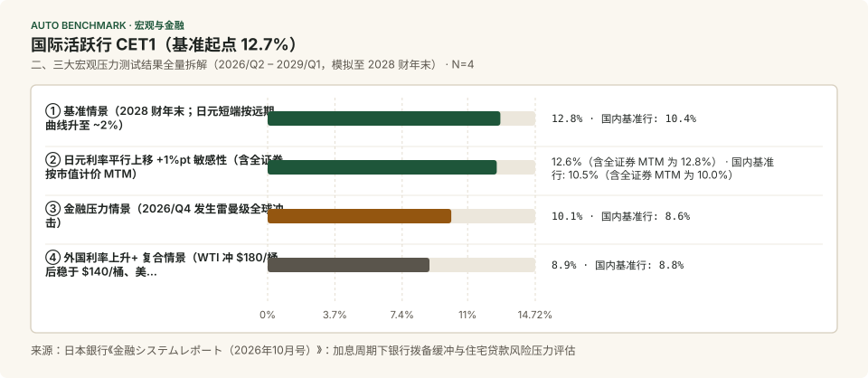

# 日本銀行《金融システムレポート（2026年10月号）》：加息周期下银行拨备缓冲与住宅贷款风险压力评估

2026-10-23 · 日本銀行 (Bank of Japan) · 有来源缺口

[本地原件归档](../../../raw/ec053043956b36fb75b9e3ee2fbb9fcaface9713650c5875fe2c4242b16d08be) · 固定材料版本 `digest-material-ec053043956b36fb75b9e3ee2fbb9fcaface9713650c5875fe2c4242b16d08be@1` · [一手原站](https://www.boj.or.jp/en/research/brp/fsr/data/fsr261023a.pdf) · [触发线索（日本銀行 (Bank of Japan)）](https://vertexaisearch.cloud.google.com/grounding-api-redirect/AUZIYQFfpT2wUBveLJ42cVZIbPR9H1xEgXFyjGahDTTkCoteZFL1BClXU1A_wdXWGoHaup7mZksUzW3Cag5CWjkTJQ-bPBBokH0nioI1c-yvvXRfF4Y9WUHQk1XtXE9HKyIMkA7ircKrzlSlMEzQzYV9mBOG)

## 深度拆解与复核

> 口径与利益披露（信源归属）：本拆解直接依据日本中央银行（Bank of Japan，金融机构局）于 2026-10-23 15:00 JST 公布的 96 页全本 [Financial System Report (October 2026) PDF](https://www.boj.or.jp/en/research/brp/fsr/data/fsr261023a.pdf) 及其 [日文官方发布页](https://www.boj.or.jp/research/brp/fsr/fsr261023.htm)、[英文官方发布页](https://www.boj.or.jp/en/research/brp/fsr/fsr261023.htm)。作为日本宏观审慎监管当局，BOJ 报告原则上截至 2026 年 9 月末汇总数据（涵盖 10 家大型行、61 家第一地方行 + 34 家第二地方行共计 95 家地方行，以及 247 家在 BOJ 开立往来账户的信用金库），兼具政策沟通与压舱稳定市场预期的央行立场——文中宏观测压情景为假设性韧性检验（不构成 BOJ 对未来利率路径或资产价格的官方预测），且不涉及个体商业银行或支付机构 10 月末单季实际拨备数字。

### 一、宏观核心判断与三大风险传导链（热力图、海外 NBFI 与日元债）

1. 金融周期整体无重大失衡，仅股票指标亮「红」：14 项金融活动指标（FAIXs）中 11 项维持「绿灯」，金融缺口（Financial Gap）小幅走阔主要由价格因子拉动。东京核心三区二手公寓涨势趋缓，但商业地产写字楼投资回报率利差（Yield Gap）因房价与利率双升持续收窄；截至 2026 年 3 月末，银行业涉房贷款合计占总贷款比重仍高——住房贷款占 24.0%、房地产交易与租赁业占 9.9%、家庭租房经营贷款占 4.7%、房地产投资基金占 4.1%（地方行向房地产基金放款存在明显跨县投向东京及高风险夹层贷敞口）。
2. 跨境风险新枢纽——海外非银金融机构（NBFI）与 AI 算力融资（2026 年 6 月末实数）：日本本土 NBFI 资产占比较低，但跨境双向通道已大幅扩张——==海外投资基金流向日本市场的规模自 2008 年 3 月的 111 万亿日元升至 2026 年 6 月的 408 万亿日元（3.68 倍）；日本银行业对海外 NBFI 的贷款与投资自 8 万亿日元跃升至 126 万亿日元（15.75 倍）==。截至 2026 年 3 月末，日本三大行的海外贷款中 NBFI 占比已达 30.2%（电力能源 17.1%、制造业 13.5%、建筑地产 12.4%、信息通信 6.5%），其中海外基金总体占海外贷款 9%（PE 占 3%、私募信贷 PC 占 2%、地产基金 1%、对冲基金 0.2%），项目融资占 12%，数据中心占 1%。BOJ 明确点出美国 Hyperscaler 正突破内部现金流极限转向发债与长期租约融资，私人信贷与私募基金正承接大量 AI 数据中心资金缺口，一旦 AI 资本开支回报不及预期，海外 NBFI 降杠杆减仓将触发双向跨境溢出。
3. 加息周期下银行盈利与证券估值损分化：伴随日本短端与长端利率上行，全类型银行核心盈利（PPNR）持续改善，三大行贷款利差扩张尤为明显；但持有较高比例日元债券的信用金库与部分地方行账面估值浮亏扩大（高存贷比机构被迫上调定期存款利率揽储，但高息揽入存款对利率变动敏感、粘性偏低，同时活期存款转账周转率较 2012 年基数升至 ~160+）。
4. 前沿 AI 与网络安全（Box 2）：多因素认证压降了网银非法转账损失金额，但海外漏洞扫描等可疑访问激增，BOJ 就 Frontier AI 放大攻击速度向机构提出 9 项短期治理要求。

### 二、三大宏观压力测试结果全量拆解（2026/Q2 – 2029/Q1，模拟至 2028 财年末）

BOJ 基于金融宏观计量模型（FMM）对 105 家银行（10 家大型行 + 95 家地方行）与 247 家信用金库执行三套情景测试（监管红线：国际活跃行 CET1 最低 4.5% + 2.5% 留存缓冲 + G-SIB 1.0%–1.5% / D-SIB 0.5%；国内基准行核心资本比率最低 4.0%，且 2024 年 3 月末起逐步落实 Basel III 资本底限）：

| 情景与关键冲击假设 | 国际活跃行 CET1（基准起点 12.7%） | 国内基准行（不含信金，起点 10.7%） | 国内信用金库（起点 13.2%） | 核心损益驱动与脆弱点 |
| :--- | :--- | :--- | :--- | :--- |
| ① 基准情景（2028 财年末；日元短端按远期曲线升至 ~2%） | 12.8% | 10.4% | 14.0% | 利差走阔推升 PPNR 覆盖信用成本；Basel III 底限拉升 RWA 小幅压低国内行比率 |
| ② 日元利率平行上移 +1%pt 敏感性（含全证券按市值计价 MTM） | 12.6%（含全证券 MTM 为 12.8%） | 10.5%（含全证券 MTM 为 10.0%） | 13.8%（含全证券 MTM 跌至 9.7%） | 信用金库因日元债久期较长，计入未实现估值损后核心资本骤降 4.1%pts，但仍远高于 4.0% 红线 |
| ③ 金融压力情景（2026/Q4 发生雷曼级全球冲击） | 10.1% | 8.6% | 12.6% | 降息压缩国际活跃行海外利差 + 风险资产下跌，但全类别仍维持监管达标 |
| ④ 外国利率上升+ 复合情景（WTI 冲 \$180/桶后稳于 \$140/桶、美/日长端 +1.5%pts、美股 -50% / 日股 -40%、基金 -35%、美 BBB 利差 +1,100 bps） | 8.9% | 8.8% | 13.2% | 新增海外 NBFI 抛售额外放大 BBB 利差 +600 bps、亚洲 GDP 峰值跌 -7%、外币 PC 基金与数据中心贷款计提 -10%pts 至 -15% 违约损失 |

### 三、Box 1 住宅贷款传导与原位物理/金融口径复核（本工作台核查与推断）

- ✅ Box 1 房贷利率传导与「5年/125% 规则」时间滞后核查（本工作台核查）：第一地方行共同数据平台显示，继 2024 年 7 月、2025 年 1 月、2025 年 12 月三次加息后，多数浮动房贷利率分别调升 +0.15%pts、+0.25%pts、+0.25%pts（累计 +0.65%pts，多数已突破 1%，2026 年 6 月与 9 月加息还将继续传导）。但由于日本浮动房贷普遍附带「5 年规则」（5 年内维持月供总额不变、内部先缩减本金偿还比例）与「125% 规则」（重定价后月供涨幅封顶 25%），每年实际触发月供上调的贷款仅约 20%；2026 财年调整的存量贷款月供增幅众数仅约 5,000 日元，突破 125% 上限的贷款占比仅 0.7%。==这一机制与库内 [全国保証（7164）2027年3月期 Q2 中期财报](%E5%85%A8%E5%9B%BD%E4%BF%9D%E8%A8%BC%EF%BC%887164%EF%BC%892027%E5%B9%B43%E6%9C%88%E6%9C%9F%20Q2%20%E4%B8%AD%E6%9C%9F%E8%B4%A2%E6%8A%A5%EF%BC%9A%E6%96%B0%E5%A2%9E%E6%8B%85%E4%BF%9D%E9%A2%9D%E5%A2%9E%2017.2%25%EF%BC%8C%E4%BB%A3%E4%BD%8D%E6%B8%85%E5%81%BF%E7%8E%87%E7%A8%B3%E5%AE%9A%E4%BA%8E%200.09%25.md) 披露的 0.09% 极低代位清偿率高度互证——短期内违约尚未兑现并非风险消失，而是「5 年规则」将现金流压力推迟至第 6 年以后并转化成未偿本金滞留==。
- ⚠️ 超长期房贷（>35 年）结构风险与审贷缓冲核查（本工作台核查）：为对冲房价上涨对月供的挤压，第一地方行新发放浮动房贷中「期限超过 35 年」的超长期品种占比已过半（>50%），地方行与信用金库全口径存量余额占比也已突破 10%。由于本金摊还极慢，同等 +1%pt 加息下 >40 年期房贷的月供跳升幅度远高于 <=35 年期。当前维持韧性的核心防火墙在于银行审贷时设置的「审查利率缓冲（实际利率与压力测试利率之差）」普遍达 2–3%pts，但该缓冲仅覆盖首贷当期收入能力，无法锁定 35–50 年长周期内的就业与房产折价风险。
- ⚠️ 中小企业（SMEs）成本分化与未决问题口径边界（本工作台推断）：BOJ 测算原油翻倍（+100%）仅推高少数高能耗 SME 违约率，且受益于实质无借金企业增多与新冠固定利率贷款集中于 2030–2031 年到期，国内企业部门利息覆盖倍数（ICR）整体尚稳；但 SME 营业利润率呈明显 K 型分化（尾部 10%–20% 持续处于亏损区间）。本工作台推断：对于待核查的 10 月 30 日个别银行及商户支付机构季报实际拨备与回收率，BOJ 全行业框架只能说明「系统级不良拨备尚远低于核心 PPNR」，无法替代对单家消费信贷/商户收单机构坏账核销率与逾期回收率的逐行审计。

### 观点与可反驳条件

- ==观点==：日本银行 2026 年 10 月报告证实日本银行体系在基准加息（短端 ~2%）下具备充裕损失吸收能力，真正的系统性风险不在国内传统借贷违约，而在两大结构性错配：对内是信用金库日元债久期浮亏（+1%pt 利率平移致全证券 MTM 资本比率骤降 4.1%pts）与房贷「5 年规则」+ >35 年超长期贷款累积的延迟还款悬崖；对外是日资银行向海外 NBFI 投融资十年间扩至 126 万亿日元后，成为全球 AI 资本开支与美国私募信贷（PC）违约回流冲击的新传导管道。
- ==推翻条件==：
  1. 若 2027 财年末（2028 年 3 月）前日本三大行及主要地方行在海外私募信贷（PC）基金与数据中心敞口（现合计占三大行海外贷款约 3%–12%）上的年度不良信用成本合计升破海外贷款余额的 1.5%，且同期海外投资基金净撤出日本股市与债市规模连续两个季度超过 20 万亿日元，则证明「海外 NBFI 渠道冲击可控且不损伤本邦金融中介」的压测乐观假设被推翻。
  2. 若 2027–2028 年首批集中跨过「5 年规则」重定价周期的日本浮动房贷（含 >35 年超长期新贷）出现月供集中跳升，带动全国保証（7164）代位清偿率从当前 0.09% 翻倍突破 0.25% 以上且地方行住房贷款不良率显著上行，则「工资涨幅与 2–3%pts 审查利差缓冲可平滑消化房贷加息冲击」的判断将被证伪。

---

## 原文摘录与一手信源存证

> 【信源巡检核心摘要】 日本银行（BOJ）于 2026-10-23 在官网（boj.or.jp）发布《金融系统报告（2026年10月号）》。报告维持日本金融体系整体稳健的基准判断，但针对追加加息周期下的利率上行传导开展重点压力检视，专题分析借款利率上升对企业部门、背负住房贷款的家计部门以及金融机构损失吸收能力（含拨备缓冲与自有资本耐性）的影响。
> — 原文摘录，文字段落 1；证据 `digest-material-ec053043956b36fb75b9e3ee2fbb9fcaface9713650c5875fe2c4242b16d08be-excerpt-1@1`

一手材料：

- Financial System Report (October 2026) — Full Text · 日本銀行 (Bank of Japan) · [原站](https://www.boj.or.jp/en/research/brp/fsr/data/fsr261023a.pdf) · [主体档案：日本銀行 (Bank of Japan)](../entities/companies/%E6%97%A5%E6%9C%AC%E9%8A%80%E8%A1%8C%20%28Bank%20of%20Japan%29.md) · [本地原件](../../../raw/e0054c8c79dc0aef488edb21c07dded5db6e47178ea8d3bafbac82c29e472b7a)
  材料版本 `digest-material-e0054c8c79dc0aef488edb21c07dded5db6e47178ea8d3bafbac82c29e472b7a@1`；获取方式 `http_pdf`。
  > Not to be released until 3:00 p.m. Japan Standard Time on Friday, October 23, 2026. — PDF p.1
  > The total of major banks, regional banks, and shinkin banks covered in this Report is as follows (as of end-September 2026). — PDF p.2
- 金融システムレポート（2026年10月号）公表ページ · 日本銀行 (Bank of Japan) · [原站](https://www.boj.or.jp/research/brp/fsr/fsr261023.htm) · [主体档案库](../entities/README.md) · [本地原件](../../../raw/c1e78fb65dc6fcb2cb747e79f63e0af84265973a838129596f38ce6d3e1279db)
  材料版本 `digest-material-c1e78fb65dc6fcb2cb747e79f63e0af84265973a838129596f38ce6d3e1279db@1`；获取方式 `http_full_text`。
  > 内外の金融市場では、中東情勢を巡る不確実性は引き続き高いものの、グローバルなAI関連需要の拡大が、市場センチメントを改善させる方向に作用し、株価が上昇したほか、社債スプレッドも引き続き低水準で推移した。ただし、今後の中東情勢、AI関連投資の収益性と資金調達、海外ノンバンク部門の動向等を巡る不確実性は引き続き高い。今回のレポートでは、こうした外部環境を踏まえ、わが国金融システムの安定性について点検する。 — 原文提取
  > 海外ノンバンク部門については、グローバルにAI関連投資が大幅に増加するもとで、プライベートファンドなどが資金の出し手として存在感を増している。こうした最近の動向を整理するとともに、マクロ・ストレステストでは、AI関連投資の収益性に関する将来期待の縮小の影響について精緻化を行ったうえで、海外ノンバンク部門のポートフォリオ調整などによってショックが増幅される状況も想定し、金融機関の資本の十分性を検証する。 — 原文提取
- Financial System Report (October 2026) — Official Release Page · 日本銀行 (Bank of Japan) · [原站](https://www.boj.or.jp/en/research/brp/fsr/fsr261023.htm) · [主体档案库](../entities/README.md) · [本地原件](../../../raw/1d314cc821f4c1ef05646496b0e82ce9b4cebd98527342a9572706ba57470fc4)
  材料版本 `digest-material-1d314cc821f4c1ef05646496b0e82ce9b4cebd98527342a9572706ba57470fc4@1`；获取方式 `http_full_text`。
  > In global and domestic financial markets, the expansion in global AI-related demand had the effect of improving market sentiment, although uncertainties remained high over the situation in the Middle East. — 原文提取
  > With regard to the foreign NBFI sector, private funds and other entities have been playing an increasingly prominent role as providers of financing amid the substantial increase in global AI-related investment. — 原文提取

归属与范围：穿透替换原 vertexaisearch 重定向，直接从日本银行官网（boj.or.jp）抓回并归档 96 页《Financial System Report (October 2026)》官方完整 PDF（fsr261023a.pdf）及日/英文发布页正文。完整拆解 10 家大型行、95 家地方行与 247 家信用金库宏观压力测试全参数（基准情景 vs 金融压力情景 vs 外国利率上升+情景：WTI \\\$180/桶峰值、美日长端 +1.5%pts、AI 盈利重估与海外 NBFI 减仓将美 BBB 信用利差额外推宽 600 bps 至 +1,100 bps）、日资银行向海外 NBFI 投融资自 8 万亿升至 126 万亿日元的跨境通道、Box 1 浮动房贷累计加息 0.65%pts 下 5 年/125% 规则的还款递延与 \>35 年超长期房贷占比过半的结构隐患，并与库内全国保証（7164）2027 年 3 月期 Q2 财报交叉互证；10 月 30 日个股银行与支付机构实际拨备回收明细保留来源缺口。

来源缺口：

- `not_disclosed`：日本银行《金融系统报告（2026年10月号）》统计截止至 2026 年 9 月末且采用全行业汇总口径（10 家大型行、95 家地方行、247 家信用金库），未披露单个商业银行、地方银行或商户支付机构于 2026 年 10 月 30 日季报中录得的实际信用成本、不良拨备计提与回收明细；住房贷款风险与信用成本实证仅可与已入库全国保証（7164）中期财报交叉比对，单行拨备仍待追查各行季报。
- `unavailable`：报告英文发布页附带的宏观测压情景经济变量表（Scenario Tables XLSX）及日文版全文 PDF（7,918KB）未单独作为独立原件下载，本次仅完整归档 96 页英文官方全本 PDF（fsr261023a.pdf）及日/英文官网发布页全文。 [线索](https://www.boj.or.jp/en/research/brp/fsr/fsr261023.htm)

[返回赛道总览](../赛道总览.md#digest-ec053043956b36fb) · [返回导读索引](README.md) · [主体档案库](../entities/README.md)
