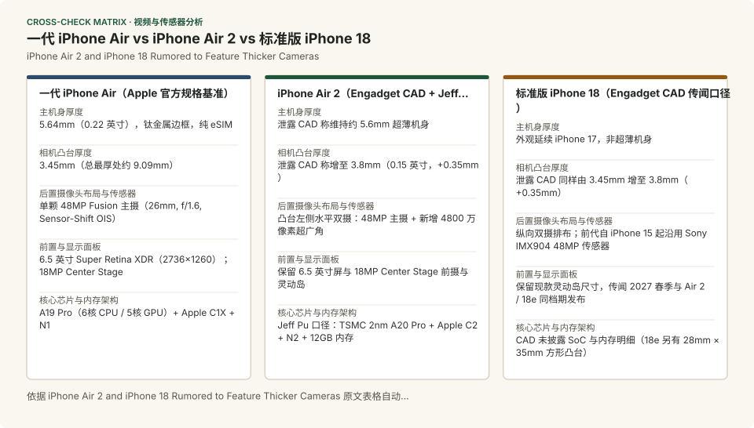

# iPhone Air 2 and iPhone 18 Rumored to Feature Thicker Cameras

2026-11-24 · Engadget (Filipe Espósito CAD 原始披露) · Apple iPhone Air 官方规格基准 (附 Jeff Pu 口径) · 有来源缺口

[本地原件归档](../../../raw/5c67aafbdacf304c570efcd3865d3dacb2c387e5e27fe7e66873d7641eda10fa) · 固定材料版本 `digest-material-5c67aafbdacf304c570efcd3865d3dacb2c387e5e27fe7e66873d7641eda10fa@1` · [一手原站](https://www.engadget.com/2325828/new-leaks-reveal-the-iphone-18e-will-have-a-redesigned-camera-plateau/) · [触发线索（MacRumors (传闻汇总 · 触发线索)）](https://www.macrumors.com/2026/11/24/iphone-air-2-and-iphone-18-thicker-cameras/)

## 深度拆解与复核

- ==核心结论==：直接穿透至本次传闻链条的上游原始披露 [Engadget 2026-11-23 供应链 CAD 独家报道](https://www.engadget.com/2325828/new-leaks-reveal-the-iphone-18e-will-have-a-redesigned-camera-plateau/) 并对照 [Apple 官方一代 iPhone Air 技术规格](https://www.apple.com/iphone-air/specs/)（Model A3260）可知，触发线索 [MacRumors 2026-11-24 报道](https://www.macrumors.com/2026/11/24/iphone-air-2-and-iphone-18-thicker-cameras/) 本身并非一手起源，而是将 Engadget 披露的 CAD 厚度变化（iPhone Air 2 与标准版 iPhone 18 相机凸台由 3.45mm 增至 3.8mm、增幅 10.1%；Air 2 主机身维持约 5.6mm）、Sonny Dickson 展示的水平双摄物理机模，与广发证券（GF Securities）分析师 Jeff Pu 蒲得宇关于 4800 万像素（48MP）超广角、台积电 2nm A20 Pro 芯片、Apple C2 基带、N2 无线芯片、12GB（12 GB）内存及 18MP Center Stage 前摄的预测拼合而成。值得注意的是，Engadget 原文点明标准版 iPhone 自 iPhone 15 起连续沿用 Sony IMX904 48MP 主摄传感器，本次标准版 iPhone 18 同样把凸台从 3.45mm 拉升至 3.8mm，指向 2027 春季模组级升级信号；但全部 2027 机型规格均属未获 Apple 官方证实的供应链传闻。
- 本工作台交叉档案：[主体档案：Jeff Pu 蒲得宇 (@sssjeffpu)](../entities/people/Jeff%20Pu%20%E8%92%B2%E5%BE%97%E5%AE%87%20%28%40sssjeffpu%29.md)

#### 1. 口径与利益披露及传闻/官宣边界

- 信息来源链路与激励标注：本次巡检由 MacRumors（2026-11-24）文章触发，已向上游穿透核验两条独立原始依据与一条官方物理基准——（1）机械 CAD 原始披露方：[Engadget（Filipe Espósito，2026-11-23）](https://www.engadget.com/2325828/new-leaks-reveal-the-iphone-18e-will-have-a-redesigned-camera-plateau/) 首次公布源自配件/供应链渠道的 CAD 尺寸，显示 iPhone Air 2 与标准版 iPhone 18 凸台均由 3.45mm（0.14 英寸）增至 3.8mm（0.15 英寸），且同期披露 iPhone 18e 改用约 28mm × 35mm 方形相机凸台；（2）官方硬件基准：[Apple 一代 iPhone Air 技术规格页](https://www.apple.com/iphone-air/specs/)（Model A3260）确认量产机身厚度 5.64mm、165g、6.5 英寸 2736×1260 OLED、A19 Pro、48MP Fusion（26mm f/1.6 传感器位移防抖）、18MP Center Stage 前摄与 C1X/N1 芯片；（3）卖方研报与机模线索：广发证券分析师 Jeff Pu 蒲得宇面向二级市场发布的供应链配置预期，以及 Sonny Dickson 展示的水平双摄物理机模。
- 本工作台核查（严格区分官方量产基准与未证实传闻）：✅ 一代 iPhone Air 的 5.64mm 钛金属机身、单颗 48MP Fusion 主摄、A19 Pro、C1X 与 N1 属 Apple 官网可核验量产参数；⚠️ 而 iPhone Air 2 与 iPhone 18 的 3.8mm 凸台、48MP 超广角、Sony IMX904 换代、A20 Pro、C2、N2、12GB 内存与 2027 春季发布窗口均为未经 Apple 官方证实的供应链传闻，早期配件厂 CAD 公差亦可能存在量产前修订。

#### 2. 一代量产基准 vs 2027 春季传闻参数对照表

| 对比维度 | 一代 iPhone Air（Apple 官方规格基准） | iPhone Air 2（Engadget CAD + Jeff Pu 口径） | 标准版 iPhone 18（Engadget CAD 传闻口径） |
| --- | --- | --- | --- |
| 主机身厚度 | 5.64mm（0.22 英寸），钛金属边框，纯 eSIM | 泄露 CAD 称维持约 5.6mm 超薄机身 | 外观延续 iPhone 17，非超薄机身 |
| 相机凸台厚度 | 3.45mm（总最厚处约 9.09mm） | 泄露 CAD 称增至 3.8mm（0.15 英寸，+0.35mm） | 泄露 CAD 同样由 3.45mm 增至 3.8mm（+0.35mm） |
| 后置摄像头布局与传感器 | 单颗 48MP Fusion 主摄（26mm, f/1.6, Sensor-Shift OIS） | 凸台左侧水平双摄：48MP 主摄 + 新增 4800 万像素超广角 | 纵向双摄排布；前代自 iPhone 15 起沿用 Sony IMX904 48MP 传感器 |
| 前置与显示面板 | 6.5 英寸 Super Retina XDR（2736×1260）；18MP Center Stage | 保留 6.5 英寸屏与 18MP Center Stage 前摄与灵动岛 | 保留现款灵动岛尺寸，传闻 2027 春季与 Air 2 / 18e 同档期发布 |
| 核心芯片与内存架构 | A19 Pro（6核 CPU / 5核 GPU）+ Apple C1X + N1 | Jeff Pu 口径：TSMC 2nm A20 Pro + Apple C2 + N2 + 12GB 内存 | CAD 未披露 SoC 与内存明细（18e 另有 28mm × 35mm 方形凸台） |

#### 3. 传感器/CIS 叠层封装、48MP 超广角光学厚度与 A20 Pro/C2/N2 物理可行性核查

| 工程约束维度 | 物理瓶颈与供应链真实约束 | 本工作台可行性测算与核查结论 |
| --- | --- | --- |
| CIS 叠层封装 vs 光学总长（TTL） | 行业主流 48MP 超广角常采用 1/2.55–1/2.6 英寸级堆栈式 CMOS（像素尺寸约 0.7–0.8 um），搭配 6P/7P 镜片与微距对焦马达。即便采用 Sony 晶圆级混合键合（Cu-Cu Hybrid Bonding）CIS 把逻辑层移至像素层下方，缩小的是芯片平面面积而非大幅削减光学焦距。 | ✅ 本工作台测算：48MP 超广角光学总长（镜头顶点至感光面）叠加 IR 滤光片、传感器封装基座、背板屏蔽与盖板玻璃，典型 Z 向需求仍在 6.8–7.8mm 量级；对比一代凸台处总厚 9.09mm（5.64mm + 3.45mm）扣除约 1.2mm OLED 总成与壳体公差，仅余约 7.2mm 净空。因此新增 48MP 超广角伴随凸台加厚 0.35mm 至 3.8mm 具备硬物理合理性。 |
| 凸台主板堆叠冲突与电磁/热耦合 | 一代 iPhone Air 把主板与射频器件集中布置在上部相机凸台，以把下部空间让渡给电池（官方视频续航 27 小时）。若在同宽度凸台内由单摄改为水平双摄，第二颗 VCM 与 OIS 磁石还会产生磁干扰与热量集中。 | ⚠️ 本工作台推断：右侧仍保留闪光灯与麦克风时，左侧水平双摄将挤压原属于单摄时代的主板横向宽度；0.35mm 增厚不只是给超广角镜头让位，也服务于多摄电磁屏蔽间隙与 18MP 前摄堆叠错位。 |
| 标准版 iPhone 18 打破 IMX904 沿用信号 | Engadget 指出标准版 iPhone 自 iPhone 15 起连续使用 48MP Sony IMX904 传感器；而 iPhone 18 CAD 在维持纵向双摄外形的前提下同样把凸台从 3.45mm 增至 3.8mm。 | ⚠️ 本工作台核查：若 CAD 尺寸属实，说明 3.8mm 并非 Air 2 双摄排版独有约束，标准版 18 极可能借 0.35mm 模组余量替换沿用三代的 IMX904 主摄或升级超广角光学模组；但也存在第三方模具 CAD 对同期机型采用同一包络公差的风险。 |
| A20 Pro（2nm）+ C2 + N2 功耗热预算耦合 | 双 48MP ISP 并行读取、12GB 内存与超薄机身电池体积上限之间存在直接功耗张力。 | ✅ 本工作台核查：若如 Jeff Pu 口径将 SoC 推进至 2nm A20 Pro 并由一代 C1X/N1 升级至 C2 基带与 N2 无线芯片，可在同成像吞吐下压低动态功耗与散热负担，是 5.6mm 机身承载双 48MP 影像管线与 12GB 内存的必要硅片底座。 |

### 观点与可反驳条件

- ==观点==：对视频与传感器产业链而言，iPhone Air 2 与 iPhone 18 传闻的核心观察点不是“Air 2 多了一颗 4800 万像素超广角”，而是 5.6mm 超薄机身下的 Z 向光学物理边界与标准版 Sony IMX904 换代信号——即便结合堆栈式 CIS 与低功耗 2nm SoC 传闻，广角光学总长仍倒逼凸台由 3.45mm 上探至 3.8mm；同时必须区分 Apple 官方已量产参数与供应链未定型传闻，避免把早期 CAD 当作 2027 量产终稿。
- ==推翻条件==：
  1. ① 光学与封装路线证伪条件：若 Apple 最终发布的 iPhone Air 2 在保持约 5.6mm 机身与双 48MP 后摄前提下，通过超薄玻塑混合镜组或定焦超广角方案将凸台厚度维持在 <= 3.45mm，或因结构与热预算约束维持单摄形态，则“双 48MP 必致凸台增厚至 3.8mm”的物理妥协推论将被推翻。
  2. ② 供应链换代与 CAD 实证证伪条件：若 2027 年一季度前上游模组厂财报或独立拆机信源证实标准版 iPhone 18 仍继续沿用 Sony IMX904 且实机凸台未增加至 3.8mm，则 Engadget 所引供应链 CAD 中的 3.8mm 共振数据将被证伪为配件厂早期试模公差误差。

---

## 原文摘录与一手信源存证

> 【信源巡检核心摘要】 MacRumors 援引广发证券（GF Securities）分析师 Jeff Pu（蒲得宇）供应链研究报告称，iPhone Air 2 预计增配 4800 万像素超广角后置镜头，并搭载 A20 Pro 芯片、C2 基带与 N2 无线芯片（6.5 英寸屏、12GB 内存）。
> — 原文摘录，文字段落 1；证据 `digest-material-5c67aafbdacf304c570efcd3865d3dacb2c387e5e27fe7e66873d7641eda10fa-excerpt-1@1`

一手材料：

- New leaks reveal the iPhone 18e will have a redesigned camera plateau (iPhone Air 2 & iPhone 18 CAD 原始披露) · Engadget (Filipe Espósito) · [原站](https://www.engadget.com/2325828/new-leaks-reveal-the-iphone-18e-will-have-a-redesigned-camera-plateau/) · [主体档案：Engadget](../entities/labs/Engadget.md) · [本地原件](../../../raw/dd34aaa0e41a8d012912e5f867856fbb28075f5a1df0fdd85fb401da82391d36)
  材料版本 `digest-material-dd34aaa0e41a8d012912e5f867856fbb28075f5a1df0fdd85fb401da82391d36@1`；获取方式 `http_full_text`。
  > We've also got further confirmation the iPhone Air 2 will have a second camera. — 原文提取
  > — and it looks like they'll look a lot more like the more expensive iPhones. CAD images of the new iPhone 18e seen by Engadget show a redesigned camera bump on the back of the phone, similar to the one on the Pro models. — 原文提取
- iPhone Air - Technical Specifications (Apple Official Production Baseline, Model A3260) · Apple · [原站](https://www.apple.com/iphone-air/specs/) · [主体档案：Apple](../entities/companies/Apple.md) · [本地原件](../../../raw/d7badacdd7a388cefe67634aecad980bbf691acacd271696185715b470952cd1)
  材料版本 `digest-material-d7badacdd7a388cefe67634aecad980bbf691acacd271696185715b470952cd1@1`；获取方式 `http_full_text`。
  > The iPhone Air display has rounded corners that follow a beautiful curved design, and these corners are within a standard rectangle. — 原文提取
  > The next generation of Apple Intelligence is centered around you, integrated into your apps, and built with privacy. — 原文提取
- iPhone Air 2 and iPhone 18 Rumored to Feature Thicker Cameras · MacRumors · 综合 Jeff Pu (广发证券) / Sonny Dickson 口径 · [原站](https://www.macrumors.com/2026/11/24/iphone-air-2-and-iphone-18-thicker-cameras/) · [主体档案：Jeff Pu 蒲得宇 (@sssjeffpu)](../entities/people/Jeff%20Pu%20%E8%92%B2%E5%BE%97%E5%AE%87%20%28%40sssjeffpu%29.md) / [主体档案：MacRumors](../entities/labs/MacRumors.md) · [本地原件](../../../raw/24c4737957c7b4e0183b48b67d7b7fe7f3f7212a76726f0f2b7656aa26b3fe46)
  材料版本 `digest-material-24c4737957c7b4e0183b48b67d7b7fe7f3f7212a76726f0f2b7656aa26b3fe46@1`；获取方式 `http_full_text`。
  > says it has seen computer-aided design (CAD) files showing the ‌iPhone Air‌ 2 with two rear cameras positioned side-by-side. — 原文提取
  > shared by Sonny Dickson last week. Those mockups position both cameras horizontally toward the left of the plateau, with the flash and microphone continuing to be placed on the right. — 原文提取

归属与范围：已穿透 MacRumors 触发线索至上游原始披露 Engadget（2026-11-23 CAD 爆料与 Sony IMX904 沿用背景）并抓取归档 Apple 一代 iPhone Air 官方技术规格页（2025-09-19 Model A3260，5.64mm 机身 / 48MP Fusion f/1.6 / A19 Pro / C1X / N1）与 MacRumors 完整原文；严格区隔已量产官方基准与未经 Apple 官方证实的 2027 春季 CAD / Sonny Dickson / Jeff Pu 供应链传闻。

来源缺口：

- `not_disclosed`：iPhone Air 2 与 iPhone 18 全部 2027 春季参数均属未经 Apple 官方证实的外部供应链传闻及第三方 CAD 测绘；广发证券（GF Securities）机构研报 PDF 未公开托管于公开网页，且具体 CMOS 靶面尺寸、像素间距（um）、镜头片数及 Sony vs Samsung 供应商份额尚未披露。 [线索](https://www.engadget.com/2325828/new-leaks-reveal-the-iphone-18e-will-have-a-redesigned-camera-plateau/)

[返回赛道总览](../赛道总览.md#digest-5c67aafbdacf304c) · [返回导读索引](README.md) · [主体档案库](../entities/README.md)
